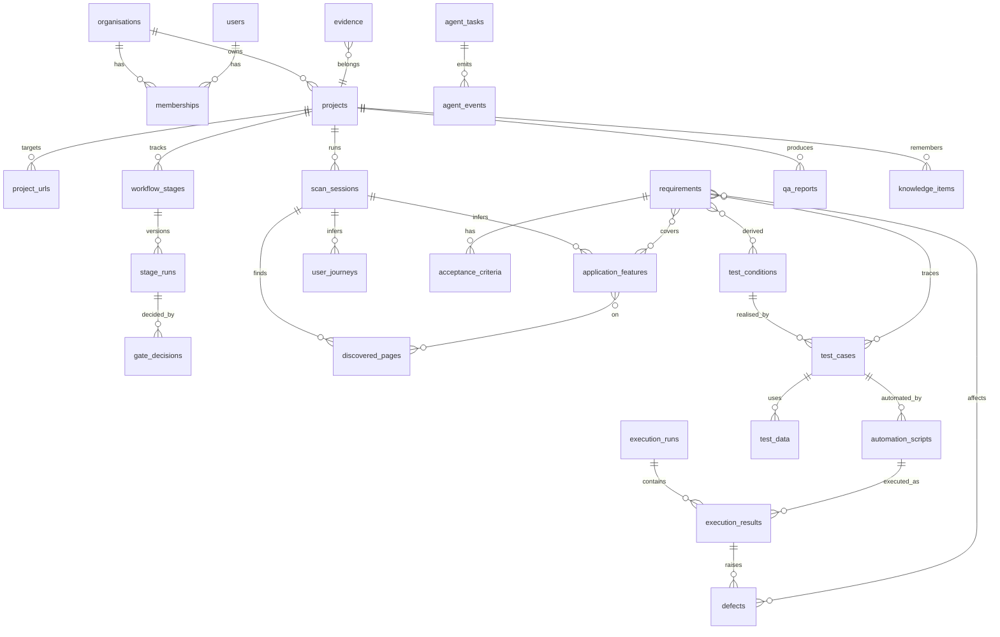

# Database schema

SQLAlchemy 2.x (async) models, Alembic migrations. Runs on SQLite (aiosqlite, WAL, `busy_timeout=5000`, `foreign_keys=ON`) and PostgreSQL (asyncpg) with **no code change**: only `DATABASE_URL` differs.

## Conventions

| Concern | Decision |
|---|---|
| Primary keys | `id UUID` (SQLAlchemy `Uuid`: native on PG, CHAR(32) on SQLite), generated in Python (uuid4). |
| Human keys | Per-project readable keys (`REQ-0001`, `TC-0001`, `DEF-0001`, `SCAN-0001`) from `project_counters` (row-locked increment; on SQLite inside the write transaction). Unique `(project_id, key)`. |
| Timestamps | `created_at`, `updated_at` as `UTCDateTime` TypeDecorator (aware UTC in Python, ISO text on SQLite, `timestamptz` on PG). |
| Enums | `String(32)` + CHECK constraint (`native_enum=False`), Python `StrEnum`. |
| JSON | `JSON().with_variant(JSONB, "postgresql")`. Used for nested, read-mostly structures (forms, element lists, evidence refs). Anything that is filtered, joined or traced is a column/table. |
| Tenancy | Every tenant-owned row has `organisation_id NOT NULL` (denormalised even when reachable through `project_id`) and, where applicable, `project_id`. Composite indexes lead with `organisation_id`. |
| Deletes | Projects: soft archive (`archived_at`). Evidence, stage runs, reports, audit logs: never deleted by workflow code. FKs use `ON DELETE RESTRICT` except pure children of a session (`CASCADE`). Hard purge = admin job (Phase 5), audited. |
| Optimistic concurrency | Editable entities have `version INT` (SQLAlchemy `version_id_col`); PATCH requires the current version, else 409. |

### Versioning

Two mechanisms:

1. **Generation versioning (stage level)**: each stage execution is a `stage_runs` row (`version` 1..n). Artefacts produced by an agent carry `stage_run_id`. Regenerating creates new artefact rows under the new stage run; the project "current" view = artefacts of `workflow_stages.current_stage_run_id`. Old versions remain queryable and diffable (needed for change impact, Phase 6).
2. **Edit versioning (entity level)**: user edits to requirements, acceptance criteria, test cases, scripts, strategies and plans bump `version` and write the previous state to `entity_revisions(entity_type, entity_id, version, snapshot JSON, changed_by, change_reason)`. Locked/human-edited items are carried forward on regeneration (matched by `lineage_id`) instead of overwritten.

`lineage_id` (UUID) on regenerable artefacts links "the same thing" across stage-run versions (e.g. REQ-0004 v1 and v2), so keys stay stable and traceability survives regeneration.

### Tenant isolation enforcement

- `TenantScope(org_id, user_id, role)` is resolved from the session in `api/deps.py` and passed to every repository.
- `TenantRepository[Model]` base: every `select` adds `Model.organisation_id == scope.org_id`; inserts set it; updates/deletes filter by it. Cross-tenant access returns **404** (not 403) to avoid existence leaks.
- Safety net: a SQLAlchemy `do_orm_execute` listener raises `TenantScopeMissing` if a query touches a tenant model without a scope option (system jobs use an explicit `SystemScope(org_id)` taken from the job row).
- Worker jobs carry `organisation_id`; the worker rebuilds the scope from the job, never from payload content.
- Tests: a parametrised integration test calls every endpoint with a second organisation's token and asserts 404.
- PostgreSQL production (Phase 5): Row-Level Security policies on `organisation_id` using `SET LOCAL app.org_id`, as defence in depth.
- Permissions: org roles `owner > admin > member > viewer`. Viewers read only; members run workflows and edit artefacts; admins approve locked gates (G7, G8, G9 need `member` with `can_approve`, configurable) and manage members. Project-level membership (`project_members`) arrives in Phase 3 if needed; until then org role applies to all projects.

## Entity overview

## Tables

`P1` = created by Phase 1 migrations. Columns listed are key ones; all tenant tables also have `id`, `organisation_id`, `created_at`, `updated_at` unless noted.

### Identity and tenancy

| Table | Phase | Key columns | Indexes / constraints |
|---|---|---|---|
| `organisations` | P1 | `name`, `slug`, `plan`, `limits JSON` (max_projects, max_concurrent_scans, max_pages_cap, perf ceilings) | unique `slug` |
| `users` (no org id) | P1 | `email` (lower-cased), `full_name`, `password_hash` (argon2id), `is_active`, `last_login_at` | unique `email` |
| `memberships` | P1 | `user_id → users`, `organisation_id`, `role` (owner/admin/member/viewer), `can_approve bool` | unique `(organisation_id, user_id)` |
| `sessions` (no org id) | P1 | `user_id`, `token_hash` (sha256 of opaque token), `organisation_id` (active org), `expires_at`, `revoked_at`, `ip`, `user_agent` | unique `token_hash`; `(user_id)` |
| `password_reset_tokens` (no org id) | P1 | `user_id`, `token_hash`, `expires_at`, `used_at` | unique `token_hash` |
| `audit_logs` | P1 | `actor_type` (user/agent/system), `actor_user_id?`, `action` (dotted, e.g. `project.created`, `gate.approved`), `target_type`, `target_id`, `project_id?`, `ip?`, `request_id`, `metadata JSON` (redacted) — no `updated_at` | `(organisation_id, created_at desc)`, `(organisation_id, target_type, target_id)`. Append-only: repository exposes insert/list only; on PG `REVOKE UPDATE, DELETE` from the app role. |

### Projects and workflow

| Table | Phase | Key columns | Indexes / constraints |
|---|---|---|---|
| `projects` | P1 | `name`, `description`, `status` (active/paused/archived), `approval_policy JSON`, `settings JSON` (scan defaults, respect_robots), `created_by`, `archived_at` | `(organisation_id, archived_at, updated_at desc)` |
| `project_urls` | P1 | `project_id`, `url` (normalised), `role` (primary/additional/api), `allowed_hosts JSON`, `environment_label`, `authorisation_status` (pending/attested/revoked), `authorised_by`, `authorised_at`, `authorisation_statement`, `last_check JSON` (status, final_url, redirect chain, tls, resolved_ips, checked_at), `credentials_secret_id?` (P2) | unique `(project_id, url)` |
| `project_counters` | P1 | `project_id`, `kind`, `next_value` | PK `(project_id, kind)` |
| `workflow_stages` | P1 | `project_id`, `stage_key`, `status` (see state machine), `current_stage_run_id?`, `gate_key?`, `gate_status` (none/pending/approved/rejected/recommended), `stale_reason?`, `updated_by` | unique `(project_id, stage_key)` |
| `stage_runs` | P1 | `workflow_stage_id`, `project_id`, `stage_key`, `version`, `status`, `agent_task_id`, `input_hash`, `upstream_versions JSON`, `output JSON` (summary + ids of produced artefacts), `validation_issues JSON`, `generated_by` (ai/rules/mixed), `partial bool`, `started_at`, `finished_at`, `triggered_by` | unique `(workflow_stage_id, version)` |
| `gate_decisions` | P1 | `project_id`, `gate_key`, `stage_run_id`, `decision` (approve/reject/request_changes), `comment`, `decided_by`, `agent_recommendation JSON` | `(project_id, gate_key, created_at)` |
| `approvals` | P4 | `project_id`, `kind` (destructive/external_transaction/load_test/security_test/real_user_data), `scope JSON`, `requested_by`, `decided_by`, `status`, `expires_at` | `(project_id, kind, status)` |
| `entity_revisions` | P2 | `entity_type`, `entity_id`, `version`, `snapshot JSON`, `changed_by`, `change_reason` | unique `(entity_type, entity_id, version)` |

### Discovery

| Table | Phase | Key columns | Indexes / constraints |
|---|---|---|---|
| `scan_sessions` | P1 | `project_id`, `stage_run_id`, `key` (SCAN-0001), `start_url`, `status` (queued/running/paused/completed/partial/failed/cancelled), `limits JSON`, `frontier JSON` (resume queue + seen set), `stats JSON` (pages, forms, errors, blocked), `completeness JSON` (score, rating, reasons), `limitations JSON`, `blocked_requests JSON`, `robots JSON`, `started_at`, `finished_at`, `error?` | `(project_id, created_at desc)`; unique `(project_id, key)` |
| `discovered_pages` | P1 | `scan_session_id`, `project_id`, `url`, `url_hash`, `canonical_url`, `title`, `http_status`, `depth`, `parent_page_id?`, `page_type` (landing/listing/detail/form/auth/search/error/other), `requires_auth bool`, `headings JSON`, `nav_links JSON`, `links JSON` (same-site), `forms JSON` (fields with type/label/required/constraints, submit label, method), `components JSON` (buttons, dropdowns, search, filters, tables, modals, tabs, each with role, accessible name, locator candidates, `fingerprint`), `responsive JSON` (per viewport: nav collapsed, overflow), `console_issues JSON`, `network_issues JSON`, `load_ms`, `structure_hash` | unique `(scan_session_id, url_hash)`; `(project_id, url_hash)` for cross-scan diff |
| `application_features` | P1 | `scan_session_id`, `stage_run_id`, `lineage_id`, `project_id`, `key` (FEAT-0001), `name`, `description`, `category` (navigation/auth/search/form/content/commerce/account/other), `provenance`, `confidence`, `evidence_refs JSON`, `generated_by` | `(project_id, stage_run_id)` |
| `feature_pages` | P1 | `feature_id`, `page_id` | PK both |
| `user_journeys` | P1 | `scan_session_id`, `stage_run_id`, `lineage_id`, `project_id`, `key` (JRN-0001), `name`, `steps JSON` ([{page_id, action, element_ref?}]), `provenance`, `confidence`, `evidence_refs JSON`, `generated_by` | `(project_id, stage_run_id)` |

### Requirements and strategy (Phase 2)

| Table | Key columns | Indexes |
|---|---|---|
| `requirements` | `project_id`, `stage_run_id`, `lineage_id`, `key` (REQ-0001), `title`, `description`, `type` (functional/non_functional), `category`, `classification` (observed/inferred/assumed/unverified), `source` (discovery/document/user), `evidence_refs JSON`, `confidence`, `assumptions JSON`, `status` (draft/approved/rejected/needs_info), `locked bool`, `version`, `risk_likelihood?`, `risk_impact?` | unique `(project_id, key, stage_run_id)`; `(project_id, status)` |
| `requirement_features` | `requirement_id`, `feature_id` | PK both |
| `acceptance_criteria` | `requirement_id`, `project_id`, `key` (AC-0001), `given`, `when`, `then`, `status`, `version` | `(requirement_id)` |
| `test_strategies` | `project_id`, `stage_run_id`, `version`, `status`, `content JSON` (scope, levels, types, techniques, entry/exit, DoR, DoD, environments, data approach), `risk_register JSON` | `(project_id, status)` |
| `test_plans` | `project_id`, `strategy_id`, `stage_run_id`, `version`, `status`, `content JSON` | `(project_id)` |

### Test design (Phase 3)

| Table | Key columns | Indexes |
|---|---|---|
| `test_conditions` | `project_id`, `stage_run_id`, `lineage_id`, `key` (TCOND-0001), `description`, `technique`, `priority` | `(project_id)` |
| `condition_requirements` | `test_condition_id`, `requirement_id`, `acceptance_criterion_id?` | PK pair |
| `test_cases` | `project_id`, `stage_run_id`, `lineage_id`, `test_condition_id?`, `key` (TC-0001), `title`, `objective`, `preconditions JSON`, `steps JSON` ([{action, data, expected}]), `expected_result`, `test_type`, `test_level`, `technique`, `priority`, `risk_score`, `automation_suitability` (suitable/partial/manual_only + reason), `execution_status` (not_run/passed/failed/blocked/error — denormalised latest), `status` (draft/approved/rejected/deprecated), `evidence_refs JSON`, `locked`, `version` | unique `(project_id, key)` per lineage; `(project_id, status)`, `(project_id, execution_status)` |
| `test_case_requirements` | `test_case_id`, `requirement_id` | PK pair; index `requirement_id` (reverse traceability) |
| `test_data` | `project_id`, `test_case_id?`, `key`, `name`, `kind` (valid/invalid/boundary/synthetic), `values JSON` (no real PII; secrets by reference), `generator` | `(project_id)` |

### Automation, execution, defects (Phase 4)

| Table | Key columns | Indexes |
|---|---|---|
| `automation_scripts` | `project_id`, `test_case_id`, `test_case_version`, `stage_run_id`, `path`, `language` ('typescript'), `code` (or `storage_key` if large), `version`, `validation JSON` (tsc/eslint/guard results), `status` (draft/valid/invalid/approved/outdated), `generated_by` | `(test_case_id, version)` unique; `(project_id, status)` |
| `automation_assets` | `project_id`, `kind` (page_object/fixture/factory/config/ci), `path`, `code`, `version` | unique `(project_id, path, version)` |
| `execution_runs` | `project_id`, `key` (RUN-0001), `approval_gate_decision_id`, `environment_url_id`, `config JSON` (browsers, viewports, workers, retries), `status`, `totals JSON` (computed), `started_at`, `finished_at`, `triggered_by` | `(project_id, created_at desc)` |
| `execution_results` | `execution_run_id`, `project_id`, `test_case_id`, `automation_script_id`, `script_version`, `browser`, `viewport`, `status` (passed/failed/error/skipped/flaky), `attempt`, `duration_ms`, `error JSON`, `failed_step`, `analysis JSON` (FailureAnalysis), `classification` | `(execution_run_id)`, `(test_case_id, created_at desc)` |
| `defects` | `project_id`, `key` (DEF-0001), `summary`, `description`, `environment`, `preconditions`, `steps JSON`, `expected`, `actual`, `severity`, `priority`, `reproducibility`, `root_cause_hypothesis`, `status` (draft/confirmed/rejected/fixed/verified/closed), `confirmed_by?`, `execution_result_id?`, `evidence_refs JSON`, `version` | `(project_id, status)` |
| `defect_links` | `defect_id`, `requirement_id?`, `test_case_id?` | index each FK |

### Performance and reports

| Table | Phase | Key columns | Indexes |
|---|---|---|---|
| `performance_runs` | P5 | `project_id`, `approval_id`, `profile JSON` (type, vus, ramp, duration, thresholds, max_rps, target), `script_storage_key`, `status`, `metrics JSON` (p50/p90/p95/p99, rps, error_rate), `threshold_results JSON`, `aborted_reason?` | `(project_id, created_at desc)` |
| `qa_reports` | P1 | `project_id`, `report_type` (discovery, requirements_spec, test_strategy, test_plan, test_case_spec, rtm, execution, defect, performance, completion, release_readiness), `version`, `stage_run_id?`, `source_versions JSON`, `content JSON` (structured, source of truth), `files JSON` ([{format, storage_key, size, sha256}]), `ai_sections JSON` (labelled), `generated_by`, `created_by` | `(project_id, report_type, version desc)` |

### Evidence, AI and infrastructure

| Table | Phase | Key columns | Indexes |
|---|---|---|---|
| `evidence` | P1 | `project_id`, `kind`, `storage_key`, `mime`, `size`, `sha256`, `source_url?`, `viewport?`, `scan_session_id?`, `page_id?`, `execution_result_id?` (P4), `performance_run_id?` (P5), `captured_at`, `metadata JSON`, no `updated_at` (immutable) | `(project_id, kind)`, `(scan_session_id)`, `(page_id)` |
| `knowledge_items` | P1 | `project_id`, `kind`, `title`, `content`, `provenance`, `evidence_refs JSON`, `source`, `status`, `version`, `superseded_by?` | `(project_id, kind, status)` |
| `agent_tasks` | P1 | `project_id`, `stage_run_id?`, `agent_key`, `status` (queued/running/succeeded/failed/cancelled/paused), `input JSON` (ids + parameters, no secrets), `output_ref JSON`, `error JSON`, `attempt`, `llm JSON` (provider, model, tokens_in/out, repairs, fallback_used), `started_at`, `finished_at`, `heartbeat_at` | `(project_id, created_at desc)`; partial unique on `(project_id, agent_key, stage_run_id)` where status in (queued, running) — emulated by service check + unique `dedupe_key` |
| `agent_events` | P1 | `id BIGINT autoincrement` (monotonic cursor; not UUID), `organisation_id`, `project_id`, `agent_task_id?`, `stage_key?`, `agent_key?`, `type`, `level` (info/warn/error), `message` (user-readable), `data JSON`, `created_at` | `(project_id, id)`, `(organisation_id, id)` |
| `jobs` | P1 | `kind`, `organisation_id`, `project_id?`, `payload JSON` (ids only), `status` (queued/running/succeeded/failed/cancelled), `dedupe_key?`, `attempts`, `max_attempts`, `run_after`, `locked_by`, `locked_at`, `heartbeat_at`, `last_error` | `(status, run_after)`; unique `dedupe_key` (nullable) |
| `secrets` | **P1** (moved from P2) | `project_id`, `name`, `ciphertext` (AES-256-GCM, key id prefix), `created_by`, `rotated_at` | unique `(project_id, name)` |
| `worker_heartbeats` | P1 (added) | `worker_id` PK, `mode` (inline/separate), `heartbeat_at` — not tenant data; feeds `GET /health` | – |

## Phase 1 migration set

`0001_identity` (organisations, users, memberships, sessions, password_reset_tokens, audit_logs) → `0002_projects_workflow` (projects, secrets, project_urls, project_counters, workflow_stages, stage_runs, gate_decisions) → `0003_discovery` (scan_sessions, discovered_pages, application_features, feature_pages, user_journeys, evidence, knowledge_items, qa_reports) → `0004_agents_jobs` (agent_tasks, agent_events, jobs, worker_heartbeats).

### Phase 1 implementation deviations

- `secrets` ships in Phase 1: the lead decided credentials are accepted and stored encrypted at project creation even though Phase 1 discovery is unauthenticated. `project_urls.credentials_secret_id` is therefore populated in P1.
- `audit_logs.project_id` has no foreign key (the audit table is created before `projects`, and audit rows must outlive projects). The `metadata` column is mapped as `meta` in the ORM.
- `stage_runs` adds `parameters JSON` (the run's ScanSettings / reason) and `error`; `agent_task_id` has no FK (tasks are created after the run).
- `scan_sessions` adds `sequence` (n of SCAN-000n), `auth_boundaries`, `access_gaps`, `external_links`, `skipped_links`, `injection_flags`, `current` (live page), `control` (pause/cancel flags), `summary`, `summary_generated_by`.
- `discovered_pages` adds `final_url`, `status` (visited/failed/blocked), `failure_reason`, `sequence`, `found_via` (start/link/sitemap/search), `redirected_from`, `counts JSON`, `screenshot_evidence_id`.
- `application_features` / `user_journeys` add `page_ids JSON` (denormalised for reads) and `reason` (why inferred/unverified). `evidence` adds `key` (EV-0001). `knowledge_items` adds `scan_session_id`.
- `qa_reports` adds `status` (rendering/ready/failed), `scan_session_id`, `error`; rendered files live in `evidence` rows of kind `report_render`.
- `agent_tasks` adds `dedupe_key` (unique, cleared on finish) instead of the partial unique index. `jobs` adds `concurrency_group` (`scan` enforces the per-organisation limit inside the claim `UPDATE`), `cancel_requested`, `finished_at`.

Migrations are generated with Alembic autogenerate, reviewed by hand, use `render_as_batch=True` (SQLite ALTER support), and are tested by running `upgrade head` + `downgrade base` on a fresh SQLite DB in CI. A Postgres run of the same migrations is added once a Postgres instance is available (Docker).
