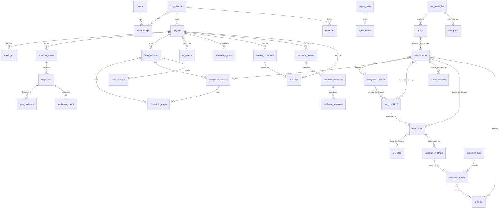

# Database schema

SQLAlchemy 2.x (async) models, Alembic migrations. Runs on SQLite (aiosqlite, WAL, `busy_timeout=5000`, `foreign_keys=ON`) and PostgreSQL (asyncpg) with **no code change**: only `DATABASE_URL` differs.

## Conventions

| Concern | Decision |
|---|---|
| Primary keys | `id UUID` (SQLAlchemy `Uuid`: native on PG, CHAR(32) on SQLite), generated in Python (uuid4). |
| Human keys | Per-project readable keys (`REQ-0001`, `TC-0001`, `DEF-0001`, `SCAN-0001`) from `project_counters` (row-locked increment; on SQLite inside the write transaction). Unique `(project_id, key)`. |
| Timestamps | `created_at`, `updated_at` as `UTCDateTime` TypeDecorator (aware UTC in Python, ISO text on SQLite, `timestamptz` on PG). |
| Enums | `String(32)` + CHECK constraint (`native_enum=False`), Python `StrEnum`. |
| JSON | `JSON().with_variant(JSONB, "postgresql")`. Used for nested, read-mostly structures (forms, element lists, evidence refs). Anything that is filtered, joined or traced is a column/table. |
| Tenancy | Every tenant-owned row has `organisation_id NOT NULL` (denormalised even when reachable through `project_id`) and, where applicable, `project_id`. Composite indexes lead with `organisation_id`. |
| Deletes | Projects: soft archive (`archived_at`). Evidence, stage runs, reports, audit logs: never deleted by workflow code. FKs use `ON DELETE RESTRICT` except pure children of a session (`CASCADE`). Hard purge = admin job (Phase 5), audited. |
| Optimistic concurrency | Editable entities have `version INT` (SQLAlchemy `version_id_col`); PATCH requires the current version, else 409. |

### Versioning

Two mechanisms:

1. **Generation versioning (stage level)**: each stage execution is a `stage_runs` row (`version` 1..n). Artefacts produced by an agent carry `stage_run_id`. Regenerating creates new artefact rows under the new stage run; the project "current" view = artefacts of `workflow_stages.current_stage_run_id`. Old versions remain queryable and diffable (needed for change impact, Phase 6).
2. **Edit versioning (entity level)**: user edits to requirements, acceptance criteria, test cases, scripts, strategies and plans bump `version` and write the previous state to `entity_revisions(entity_type, entity_id, lineage_id, version, snapshot JSON, changes, source, changed_by, change_reason)`, read by `lineage_id` so history survives regeneration. Locked/human-edited items are carried forward on regeneration (matched by `lineage_id`) instead of overwritten.

`lineage_id` (UUID) on regenerable artefacts links "the same thing" across stage-run versions (e.g. REQ-0004 v1 and v2), so keys stay stable and traceability survives regeneration.

### Tenant isolation enforcement

- `TenantScope(org_id, user_id, role)` is resolved from the session in `api/deps.py` and passed to every repository.
- `TenantRepository[Model]` base: every `select` adds `Model.organisation_id == scope.org_id`; inserts set it; updates/deletes filter by it. Cross-tenant access returns **404** (not 403) to avoid existence leaks.
- Safety net: a SQLAlchemy `do_orm_execute` listener raises `TenantScopeMissing` if a query touches a tenant model without a scope option (system jobs use an explicit `SystemScope(org_id)` taken from the job row).
- Worker jobs carry `organisation_id`; the worker rebuilds the scope from the job, never from payload content.
- Tests: a parametrised integration test calls every endpoint with a second organisation's token and asserts 404.
- PostgreSQL production (Phase 5): Row-Level Security policies on `organisation_id` using `SET LOCAL app.org_id`, as defence in depth.
- Permissions: org roles `owner > admin > member > viewer`. Viewers read only; members run workflows and edit artefacts; admins approve locked gates (G7, G8, G9 need `member` with `can_approve`, configurable) and manage members. Phase 3 (P3-07) adds member management and invitations at organisation level. Project-level membership (`project_members`) is a deliberate Phase 3 non-goal, so the org role applies to all projects.

## Entity overview

## Tables

`P1` = created by Phase 1 migrations. Columns listed are key ones; all tenant tables also have `id`, `organisation_id`, `created_at`, `updated_at` unless noted.

### Identity and tenancy

| Table | Phase | Key columns | Indexes / constraints |
|---|---|---|---|
| `organisations` | P1 | `name`, `slug`, `plan`, `limits JSON` (max_projects, max_concurrent_scans, max_pages_cap, perf ceilings) | unique `slug` |
| `users` (no org id) | P1 | `email` (lower-cased), `full_name`, `password_hash` (argon2id), `is_active`, `last_login_at` | unique `email` |
| `memberships` | P1 | `user_id → users`, `organisation_id`, `role` (owner/admin/member/viewer), `can_approve bool` | unique `(organisation_id, user_id)` |
| `invitations` | P3 | See "Workspace members (Phase 3)" | unique `token_hash` |
| `sessions` (no org id) | P1 | `user_id`, `token_hash` (sha256 of opaque token), `organisation_id` (active org), `expires_at`, `revoked_at`, `ip`, `user_agent` | unique `token_hash`; `(user_id)` |
| `password_reset_tokens` (no org id) | P1 | `user_id`, `token_hash`, `expires_at`, `used_at` | unique `token_hash` |
| `audit_logs` | P1 | `actor_type` (user/agent/system), `actor_user_id?`, `action` (dotted, e.g. `project.created`, `gate.approved`), `target_type`, `target_id`, `project_id?`, `ip?`, `request_id`, `metadata JSON` (redacted) — no `updated_at` | `(organisation_id, created_at desc)`, `(organisation_id, target_type, target_id)`. Append-only: repository exposes insert/list only; on PG `REVOKE UPDATE, DELETE` from the app role. |

### Projects and workflow

| Table | Phase | Key columns | Indexes / constraints |
|---|---|---|---|
| `projects` | P1 | `name`, `description`, `status` (active/paused/archived), `approval_policy JSON`, `settings JSON` (scan defaults, respect_robots), `created_by`, `archived_at` | `(organisation_id, archived_at, updated_at desc)` |
| `project_urls` | P1 | `project_id`, `url` (normalised), `role` (primary/additional/api), `allowed_hosts JSON`, `environment_label`, `authorisation_status` (pending/attested/revoked), `authorised_by`, `authorised_at`, `authorisation_statement`, `last_check JSON` (status, final_url, redirect chain, tls, resolved_ips, checked_at), `credentials_secret_id?` (P2) | unique `(project_id, url)` |
| `project_counters` | P1 | `project_id`, `kind`, `next_value` | PK `(project_id, kind)` |
| `workflow_stages` | P1 | `project_id`, `stage_key`, `status` (see state machine), `current_stage_run_id?`, `gate_key?`, `gate_status` (none/pending/approved/rejected/recommended), `stale_reason?`, `updated_by` | unique `(project_id, stage_key)` |
| `stage_runs` | P1 | `workflow_stage_id`, `project_id`, `stage_key`, `version`, `status`, `agent_task_id`, `input_hash`, `upstream_versions JSON`, `output JSON` (summary + ids of produced artefacts), `validation_issues JSON`, `generated_by` (ai/rules/mixed), `partial bool`, `started_at`, `finished_at`, `triggered_by` | unique `(workflow_stage_id, version)` |
| `gate_decisions` | P1 | `project_id`, `gate_key`, `stage_run_id`, `decision` (approve/reject/request_changes), `comment`, `decided_by`, `agent_recommendation JSON` | `(project_id, gate_key, created_at)` |
| `approvals` | P4 | `project_id`, `kind` (destructive/external_transaction/load_test/security_test/real_user_data), `scope JSON`, `requested_by`, `decided_by`, `status`, `expires_at` | `(project_id, kind, status)` |
| `entity_revisions` | P2 | See "Phase 2 changes to existing tables": keyed by `lineage_id`, with `changes`, `source`, `proposal_id` | unique `(entity_type, lineage_id, version)` |

### Discovery

| Table | Phase | Key columns | Indexes / constraints |
|---|---|---|---|
| `scan_sessions` | P1 | `project_id`, `stage_run_id`, `key` (SCAN-0001), `start_url`, `status` (queued/running/paused/completed/partial/failed/cancelled), `limits JSON`, `frontier JSON` (resume queue + seen set), `stats JSON` (pages, forms, errors, blocked), `completeness JSON` (score, rating, reasons), `limitations JSON`, `blocked_requests JSON`, `robots JSON`, `started_at`, `finished_at`, `error?` | `(project_id, created_at desc)`; unique `(project_id, key)` |
| `discovered_pages` | P1 | `scan_session_id`, `project_id`, `url`, `url_hash`, `canonical_url`, `title`, `http_status`, `depth`, `parent_page_id?`, `page_type` (landing/listing/detail/form/auth/search/error/other), `requires_auth bool`, `headings JSON`, `nav_links JSON`, `links JSON` (same-site), `forms JSON` (fields with type/label/required/constraints, submit label, method), `components JSON` (buttons, dropdowns, search, filters, tables, modals, tabs, each with role, accessible name, locator candidates, `fingerprint`), `responsive JSON` (per viewport: nav collapsed, overflow), `console_issues JSON`, `network_issues JSON`, `load_ms`, `structure_hash` | unique `(scan_session_id, url_hash)`; `(project_id, url_hash)` for cross-scan diff |
| `application_features` | P1 | `scan_session_id`, `stage_run_id`, `lineage_id`, `project_id`, `key` (FEAT-0001), `name`, `description`, `category` (navigation/auth/search/form/content/commerce/account/other), `provenance`, `confidence`, `evidence_refs JSON`, `generated_by` | `(project_id, stage_run_id)` |
| `feature_pages` | P1 | `feature_id`, `page_id` | PK both |
| `user_journeys` | P1 | `scan_session_id`, `stage_run_id`, `lineage_id`, `project_id`, `key` (JRN-0001), `name`, `steps JSON` ([{page_id, action, element_ref?}]), `provenance`, `confidence`, `evidence_refs JSON`, `generated_by` | `(project_id, stage_run_id)` |

### Requirements, readiness, strategy, plan, documents and assistant (Phase 2)

All tables below are tenant tables (`id`, `organisation_id`, `created_at`, `updated_at`; composite indexes lead with `organisation_id`), accessed only through `TenantRepository`. **Regenerable artefacts** share one column set, written once as a mixin (`RegenerableMixin`):

| Column | Purpose |
|---|---|
| `project_id`, `stage_run_id` | Owning project and the stage-run version that produced or carried the row. The current view is the rows of `workflow_stages.current_stage_run_id`. |
| `lineage_id` | Same logical item across versions (keys stay stable, history by lineage). |
| `key` | Human key (`REQ-0001` …), unique per `(project_id, stage_run_id, key)`; reused across versions of one lineage. |
| `match_key` | Deterministic matcher for carry-forward: source anchor (feature/form/field/journey/document anchor) + `rule_id` or normalised title. Index `(project_id, match_key)`. |
| `carried_from_id` | Previous-version row this row was carried from (nullable). |
| `provenance`, `confidence`, `evidence_refs JSON`, `generated_by` (ai/rules/human), `rule_id?` | Provenance model (architecture §5). Requirements and ACs expose `provenance` as `classification`. |
| `locked bool`, `human_edited bool`, `version INT` (optimistic, `version_id_col`), `updated_by?` | Edit control. `version` continues across carried rows of a lineage. |
| `suggested_change JSON?` | Only on rows of a **candidate** (pending review) run: for protected items, the generator's proposed content shown in the change review. Cleared when the review is applied or discarded. |

| Table | Key columns (beyond the mixin) | Indexes / constraints |
|---|---|---|
| `requirements` | `title`, `description`, `type` (functional/non_functional), `category`, `behaviour_scope` (ui/backend/mixed), `source` (discovery/document/user/assistant), `source_refs JSON` (journey/page/document ids), `assumptions JSON`, `status` (draft/approved/rejected/needs_info), `status_comment?`, `status_changed_by?`, `status_changed_at?`, `risk_level?` (denormalised max of linked risks, written by P2-06), `validation_issues JSON` | unique `(project_id, stage_run_id, key)`; unique `(stage_run_id, lineage_id)`; `(organisation_id, project_id, stage_run_id, status)`; CHECK `NOT (provenance = 'observed' AND behaviour_scope <> 'ui')` (DB backstop for the code rule) |
| `requirement_features` | `requirement_id → requirements CASCADE`, `feature_id → application_features` | PK both; index `feature_id` |
| `acceptance_criteria` | mixin + `requirement_id → requirements CASCADE`, `kind` (positive/negative/boundary), `given_text`, `when_text`, `then_text` (`WHEN`/`THEN` are SQL keywords; the API exposes `given`/`when`/`then`), `status` (draft/approved/rejected), `test_values JSON?`, `sort_order` | unique `(project_id, stage_run_id, key)`; `(requirement_id, sort_order)` |
| `readiness_criteria` (**new**) | mixin + `kind` (dor/dod), `scope` (requirement/project), `text`, `status` (active/removed), `check_rule_id?`, `evaluable_from_phase?`, `evaluation JSON?` (project-level result; per-requirement results are computed on read, not stored) | unique `(project_id, stage_run_id, key)`; `(project_id, stage_run_id, kind)` |
| `test_strategies` | `project_id`, `stage_run_id`, `key` (TS-001), `version`, `status` (draft/awaiting_approval/approved/stale), `generated_by`, `content JSON` (sections, see api-contracts `TestStrategy.sections`; DoR/DoD and the risk register are **no longer** in here), `approved_input JSON` (requirements snapshot hash + version used), `human_edited_sections JSON`, `locked_sections JSON`, `suggested_changes JSON` (candidate runs only), `validation_issues JSON`, `updated_by?` | unique `(project_id, stage_run_id)`; `(organisation_id, project_id, status)` |
| `risks` (**new**; replaces `test_strategies.risk_register JSON`) | mixin + `strategy_id → test_strategies`, `title`, `description`, `category` (product/project), `likelihood` 1–5, `impact` 1–5, `score` (L×I, written only by the domain service), `level` (low 1–4 / medium 5–9 / high 10–16 / very_high 20–25), `factors JSON`, `likelihood_rationale`, `impact_rationale`, `mitigation JSON` (test_types, techniques, notes), `requires_approval bool`, `status` (open/mitigated/accepted), `status_comment?` (required for accepted) | unique `(project_id, stage_run_id, key)`; `(project_id, stage_run_id, level)`; CHECK `likelihood BETWEEN 1 AND 5 AND impact BETWEEN 1 AND 5 AND score = likelihood * impact` |
| `risk_requirements` (**new**) | `risk_id → risks CASCADE`, `requirement_lineage_id` (lineage, not row id: requirement edits and regeneration don't break the link; resolved to the current row on read) | PK both; index `requirement_lineage_id` |
| `risk_features` (**new**) | `risk_id → risks CASCADE`, `feature_id → application_features` | PK both |
| `test_plans` | One row **per plan version** (each save is a new version, design P2 §9): `project_id`, `strategy_id → test_strategies`, `stage_run_id`, `key` (TP-001), `version`, `strategy_version` (approved strategy version it derives from), `source` (derived/edited/regenerated), `review_status` (not_required/pending_review/applied/discarded, for regenerated candidates), `is_current bool`, `generated_by`, `content JSON` (sections), `human_edited_sections JSON`, `rules_template_sections JSON`, `suggested_changes JSON` (candidates only), `note?`, `created_by?` | unique `(project_id, version)`; `(organisation_id, project_id, is_current)` |
| `source_documents` (**new**) | `project_id`, `key` (DOC-001), `title`, `filename`, `mime`, `size`, `sha256`, `status` (extracting/ready/failed/withdrawn), `pages?`, `chars?`, `outline JSON` (anchor, heading, page, char offsets), `statements JSON` (rule-extracted requirement-like statements with anchors), `injection_flags JSON`, `file_evidence_id → evidence`, `text_evidence_id? → evidence`, `error?`, `uploaded_by`, `withdrawn_at?`, `withdrawn_by?` | unique `(project_id, key)`; `(organisation_id, project_id, status)`; unique `(project_id, sha256)` where not withdrawn (re-upload of the same file → 409; enforced in the service on SQLite) |
| `assistant_threads` (**new**) | `project_id`, `user_id → users` (owner; threads are private), `title`, `archived_at?`, `last_message_at` | `(organisation_id, project_id, user_id, last_message_at desc)` |
| `assistant_messages` (**new**; append-only, no `updated_at`) | `thread_id → assistant_threads CASCADE`, `project_id`, `role` (user/assistant), `content` (redacted before storage), `intent?`, `params JSON`, `context_ref JSON?`, `answered_by?` (intent/ai), `generated_by?`, `citations JSON` (ArtefactRef list), `notices JSON`, `llm JSON?` (model, tokens, tool calls; no prompt text) | `(thread_id, created_at)` |
| `assistant_proposals` (**new**) | `project_id`, `thread_id`, `message_id → assistant_messages`, `key` (PROP-0001), `kind`, `target_type?`, `target_id?`, `target_lineage_id?`, `summary`, `payload JSON` (validated per kind), `preview JSON`, `base_versions JSON`, `status` (pending/accepted/rejected/stale/failed), `generated_by`, `created_by`, `decided_by?`, `decided_at?`, `decision_comment?`, `result JSON?` | unique `(project_id, key)`; `(organisation_id, project_id, status)`; `(target_type, target_id)` |

**Removed from the earlier Phase 2 sketch:** `requirements.risk_likelihood` / `risk_impact` (risk lives in `risks`; requirements carry only the derived `risk_level`), `test_strategies.risk_register JSON` and the DoR/DoD inside `test_strategies.content` (now `risks` and `readiness_criteria`, because both are edited, versioned, linked and gate-checked per item).

### Phase 2 changes to existing tables

| Table | Change | Story |
|---|---|---|
| `entity_revisions` | Created in Phase 2 (`0005`). Columns: `project_id`, `entity_type` (requirement/acceptance_criterion/readiness_criterion/test_strategy/risk/test_plan), `entity_id` (row), `lineage_id`, `version`, `snapshot JSON`, `changes JSON` (field diff), `source` (user/assistant_proposal/regeneration_review/system), `proposal_id?`, `changed_by?`, `change_reason?`; no `updated_at` (append-only). Unique `(entity_type, lineage_id, version)`; index `(organisation_id, project_id, entity_type, lineage_id)`. History is read by **lineage**, so it survives regeneration. | P2-00 |
| `gate_decisions` | + `artefact_snapshot JSON` (`[{type, id, version}]` approved), `snapshot_hash` (sha256 of the sorted snapshot, for "is this exactly what was approved"), `stage_run_versions JSON` (G3 covers `requirements` + `readiness_criteria`). | P2-00 |
| `workflow_stages` | No schema change. `stale_reason` is now also set when a re-approved gate changes a downstream stage's input. | P2-00 |
| `stage_runs` | + `review_status` (not_required/pending_review/applied/discarded, default not_required), `review_decisions JSON?`, `applied_by?`, `applied_at?`, `guidance?` (user text for the AI path), `approved_input JSON?` (upstream gate snapshot hash + version used). `current_stage_run_id` moves only on apply (or immediately for a first run). | P2-00 |
| `secrets` | + `kind` (login_credentials), `metadata JSON` (non-secret: `login_url`, masked `username_hint`), `version INT`, `last_used_at?`, `last_result?` (succeeded/failed/not_attempted), `last_reason_code?`, `last_result_at?`. Ciphertext stays AES-256-GCM `<key_id>:…`, holding the JSON `{username, password}`. Existing Phase 1 `scan_credentials` rows are backfilled: `kind='login_credentials'`, metadata from the decrypted login URL and username hint (done in a **data migration step run by the app**, not in Alembic, because Alembic has no encryption key; it runs once at startup and is idempotent). | P2-01 |
| Secrets usage | No new table. Every decrypt writes `audit_logs` `secret.used` with `{secret_id, task_id, purpose: "discovery_signin"|"signin_test"}` (append-only, never values). `secrets.last_used_at` is the convenience copy. | P2-01 |
| `scan_sessions` | + `auth JSON` (`attempted`, `result`, `reason_code`, `login_url`, `authenticated_pages`, `started_at`, `finished_at`). | P2-01 |
| `discovered_pages` | + `auth_context` (anonymous/authenticated, default anonymous). Index `(scan_session_id, auth_context)`. | P2-01 |
| `evidence` | `kind` CHECK widened with `document_file`, `document_text`; + `source_document_id?`. | P2-08 |
| `knowledge_items` | No schema change. Rejections (requirements, ACs, risks) write `kind='decision'` with `metadata.lineage_id` so carry-forward suppresses them. | P2-02 |
| `qa_reports` | No schema change. `report_type` already allows `requirements_spec`, `test_strategy`, `test_plan`; `source_versions` holds stage-run versions + `snapshot_hash`. | P2-09 |
| `project_counters` | New `kind`s: `REQ`, `AC`, `DOR`, `DOD`, `TS`, `RISK`, `TP`, `DOC`, `PROP`. Keys reused per lineage; a counter is consumed only for new lineages. | P2-00+ |
| `organisations.limits` | + `assistant_ai_turns_per_day` (default 200), `max_documents_per_project` (default 10), `max_document_mb` (default 20). | P2-08, P2-10 |

### Test design and traceability (Phase 3)

Migration `0013_test_design` (P3-01a; also holds the columns first written by P3-02, P3-03 and P3-05). These are tenant tables, accessed only through `TenantRepository`.

`test_conditions`, `test_cases` and `test_data` use the Phase 2 `RegenerableMixin`:
- `project_id`, `stage_run_id`, `lineage_id`, `key`, `match_key`, `carried_from_id`
- `provenance`, `confidence`, `evidence_refs`, `generated_by`, `rule_id`
- `locked`, `human_edited`, `version`, `updated_by`
- `suggested_change`

Their current view is the rows of `workflow_stages(test_design).current_stage_run_id`. Links to Phase 2 artefacts use **lineage ids**, as `risk_requirements` does, so editing or regenerating requirements never breaks traceability. Links resolve to the current row on read.

| Table | Key columns (beyond the mixin) | Indexes / constraints |
|---|---|---|
| `test_conditions` | `title`, `description`, `technique` (equivalence_partitioning/boundary_value_analysis/decision_table/state_transition/use_case/error_guessing), `test_type`, `feature_lineage_id?`, `design_basis JSON` (technique-specific: EP `{field, classes:[{id, kind: valid\|invalid, description}]}`; BVA `{field, constraint, boundary, values:[{id, length\|value, side: on\|below\|above}], mode: 2_value\|3_value}`; decision table `{conditions, actions, rules}`; state transition `{states, transitions, coverage}`; use case `{journey_lineage_id?, flow}`; error guessing `{catalogue_id}`), `notes JSON` (e.g. "No maximum length was discovered…"), `status` (draft/approved/rejected), `status_comment?` | unique `(project_id, stage_run_id, key)`; unique `(stage_run_id, lineage_id)`; `(organisation_id, project_id, stage_run_id, technique)` |
| `condition_requirements` | `test_condition_id → test_conditions CASCADE`, `requirement_lineage_id`, `acceptance_criterion_lineage_id?` | PK `(test_condition_id, requirement_lineage_id, acceptance_criterion_lineage_id)` (AC part stored as the zero UUID when absent); index `requirement_lineage_id` |
| `test_cases` | `test_condition_id? → test_conditions` (same stage run; null for manual cases), `title`, `objective`, `preconditions JSON` (list[str]), `steps JSON` (`[{n, action, data_refs: [TD lineage ids], expected}]`), `expected_result`, `expected_result_status` (defined/open_question), `open_question_ref JSON?` (`{requirement_lineage_id, key}`), `test_type`, `test_level`, `technique`, `suites JSON` (`["smoke","regression"]`), `side_effects JSON` (submits_form/signs_in/creates_data/external_transaction), `design_basis_ref JSON` (coverage item id within the condition), `automation_suitability` (suitable/partial/manual_only), `automation_reason`, `automation_assessed` (`preliminary` in Phase 3; P4-02 writes `assessed`), `execution_status` (not_run/passed/failed/blocked/error; always `not_run` in Phase 3, written only by Phase 4), `status` (draft/approved/rejected/deprecated), `status_comment?`, `status_changed_by?`, `status_changed_at?`, `source` (design/user/assistant), **P3-05:** `risk_level?`, `risk_score?`, `derived_priority` (critical/high/medium/low), `priority_override?`, `priority_override_reason?` (effective priority = override or derived; computed in the serializer), `lint JSON` (`[{code, severity, message, path}]`), `lint_rules_version` | unique `(project_id, stage_run_id, key)`; unique `(stage_run_id, lineage_id)`; `(organisation_id, project_id, stage_run_id, status)`; `(project_id, stage_run_id, derived_priority)`; CHECK `execution_status = 'not_run'` is **not** added (Phase 4 writes it); CHECK `priority_override IS NULL OR priority_override_reason IS NOT NULL` |
| `test_case_requirements` | `test_case_id → test_cases CASCADE`, `requirement_lineage_id`, `acceptance_criterion_lineage_id?` | PK as `condition_requirements`; index `requirement_lineage_id` (reverse traceability) |
| `test_data` | `name`, `feature_lineage_id?`, `form_ref JSON` (page id, form index, selector), `field_label`, `field_selector`, `kind` (valid/invalid/boundary/secret_ref), `value_type` (text/email/number/empty/whitespace/secret_ref), `value?` (never a secret; ≤ 5000 chars), `secret_ref?` (secret **name** only), `length?`, `boundary_ref JSON?` (condition lineage + coverage item it tests; locks the length), `generator` (factory rule id + seed), `synthetic bool` (true for generated; guard-checked for human values), `status` (active/retired) | unique `(project_id, stage_run_id, key)`; unique `(stage_run_id, lineage_id)`; `(organisation_id, project_id, stage_run_id, field_label)`; CHECK `(kind = 'secret_ref') = (secret_ref IS NOT NULL AND value IS NULL)` |
| `test_case_data` | `test_case_id → test_cases CASCADE`, `test_data_lineage_id` | PK both; index `test_data_lineage_id` ("used by" lookups) |

The `traceability` stage stores nothing. The matrix, coverage and gap lists are computed on read by `TraceabilityService`, from the current rows or from the last G5 `artefact_snapshot`. Only reports freeze a copy, in `qa_reports.content`.

**As built (P3 backend) — differences from the table above:**
- `test_cases.condition_lineage_id?` (plain UUID, no FK) replaces `test_condition_id → test_conditions`: a case points at its condition's **lineage**, like every other Phase 3 link, so carrying cases into a regenerated run never needs a remap. Resolved to the condition row of the same stage run on read.
- `test_conditions.technique` also takes `checklist` (non-functional cases); `test_conditions` adds `coverage_items JSON` (`[{id, label}]`, the items the condition's cases realise) and `requirement_lineage_ids JSON` / `ac_lineage_ids JSON` (denormalised copies of `condition_requirements`, which stays the indexed link table).
- `test_cases` adds `requirement_lineage_ids JSON`, `ac_lineage_ids JSON`, `data_lineage_ids JSON` (denormalised copies of `test_case_requirements` / `test_case_data`, kept in step by the service), `risk_lineage_id?` (the risk the derived priority comes from), `priority_overridden_by? → users` and `priority_overridden_at?` (migration 0015). `open_question_ref` is `{requirement_lineage_id, key, message, field}`. `design_basis_ref` is `{coverage_item, explanation, positive}`.
- `test_conditions.feature_lineage_id` / `test_data.feature_lineage_id` hold the `application_features.id` (features are not regenerable, so the id is stable).
- `test_data.form_ref` is `{form_anchor, path, page_id, form_index, field_key, field_type}` (generated items; human items keep the subset they send).
- Entity revisions of `test_data` store the credentials reference under `account_ref` (the revision redactor masks keys containing "secret"); the value is the secret's **name**, never its content.

**Removed from the earlier sketch:**
- `test_cases.risk_score` as a free column; it is now derived together with `risk_level`/`derived_priority`.
- The `test_data.kind = synthetic` value; every generated item is synthetic, so this is now a boolean.
- The cross-run `test_cases (project_id, key)` uniqueness; keys are now unique per stage run and reused per lineage, as in Phase 2.

### Workspace members (Phase 3, P3-07)

Migration `0014_invitations`.

| Table | Key columns | Indexes / constraints |
|---|---|---|
| `invitations` (tenant table) | `email` (lower-cased), `role` (admin/member/viewer; never owner), `can_approve bool`, `token_hash` (SHA-256 of a 32-byte token; the raw token is returned once and never stored), `invited_by → users`, `expires_at` (7 days), `accepted_at?`, `accepted_user_id? → users`, `revoked_at?`, `revoked_by?` | unique `token_hash`; `(organisation_id, email)`; `(organisation_id, expires_at)` |
| `memberships` | + `invited_by?`, `joined_at?` (nullable; Phase 1/2 rows keep null). Removal **deletes** the membership row (the audit log keeps `member.removed`); the user row and authored artefacts remain. | unchanged |

### Phase 3 changes to existing tables

| Table | Change | Story |
|---|---|---|
| `workflow_stages` / `stage_runs` | No schema change. `test_design` uses `review_status`, `approved_input` (`{requirements_snapshot_hash, strategy_snapshot_hash, versions}`) and `guidance`. `traceability` rows have status only (derived, never a run). | P3-00 |
| `projects` | No schema change. **Data step (P3-00, decision D1):** `approval_policy.G5` changes from `recommended` to `required` for existing projects, unless their audit log shows G5 was set explicitly. It runs in app code at startup and is idempotent. New projects get `required` from `DEFAULT_APPROVAL_POLICY`. | P3-00 |
| `gate_decisions` | No schema change. G5 `artefact_snapshot` = approved test cases + their conditions + the test data items they use (`[{type, id, version}]`). | P3-00, P3-02 |
| `entity_revisions` | No schema change (`entity_type` is a plain string). New values `test_condition`, `test_case`, `test_data`. | P3-00 |
| `assistant_proposals` | No schema change (`kind` is a plain string). New kinds `add_test_cases`, `update_test_case`, `set_suite`; `regenerate_stage` accepts `test_design`. | P3-06 |
| `knowledge_items` | No schema change. Rejected cases, conditions and data write `kind='decision'` with `metadata.lineage_id`. | P3-01b, P3-02 |
| `qa_reports` | No schema change. `report_type` already allows `test_case_spec`, `rtm`; `files` gains `format='csv'`; `source_versions` holds G3/G4/G5 snapshot hashes. | P3-08 |
| `project_counters` | New `kind`s `TCOND`, `TC`, `TD`. A counter is consumed only for new lineages. | P3-00 |
| `requirements` | No schema change. `linked_test_cases` is computed on read from `test_case_requirements`. | P3-01a |
| `organisations.limits` | + `max_test_cases_per_run` (default 300), `max_test_data_per_run` (400), `invitations_per_hour` (20). | P3-01a, P3-07 |

### Automation, execution, defects (Phase 4)

| Table | Key columns | Indexes |
|---|---|---|
| `automation_scripts` | `project_id`, `test_case_id`, `test_case_version`, `stage_run_id`, `path`, `language` ('typescript'), `code` (or `storage_key` if large), `version`, `validation JSON` (tsc/eslint/guard results), `status` (draft/valid/invalid/approved/outdated), `generated_by` | `(test_case_id, version)` unique; `(project_id, status)` |
| `automation_assets` | `project_id`, `kind` (page_object/fixture/factory/config/ci), `path`, `code`, `version` | unique `(project_id, path, version)` |
| `execution_runs` | `project_id`, `key` (RUN-0001), `approval_gate_decision_id`, `environment_url_id`, `config JSON` (browsers, viewports, workers, retries), `status`, `totals JSON` (computed), `started_at`, `finished_at`, `triggered_by` | `(project_id, created_at desc)` |
| `execution_results` | `execution_run_id`, `project_id`, `test_case_id`, `automation_script_id`, `script_version`, `browser`, `viewport`, `status` (passed/failed/error/skipped/flaky), `attempt`, `duration_ms`, `error JSON`, `failed_step`, `analysis JSON` (FailureAnalysis), `classification` | `(execution_run_id)`, `(test_case_id, created_at desc)` |
| `defects` | `project_id`, `key` (DEF-0001), `summary`, `description`, `environment`, `preconditions`, `steps JSON`, `expected`, `actual`, `severity`, `priority`, `reproducibility`, `root_cause_hypothesis`, `status` (draft/confirmed/rejected/fixed/verified/closed), `confirmed_by?`, `execution_result_id?`, `evidence_refs JSON`, `version` | `(project_id, status)` |
| `defect_links` | `defect_id`, `requirement_id?`, `test_case_id?` | index each FK |

### Performance and reports

| Table | Phase | Key columns | Indexes |
|---|---|---|---|
| `performance_runs` | P5 | `project_id`, `approval_id`, `profile JSON` (type, vus, ramp, duration, thresholds, max_rps, target), `script_storage_key`, `status`, `metrics JSON` (p50/p90/p95/p99, rps, error_rate), `threshold_results JSON`, `aborted_reason?` | `(project_id, created_at desc)` |
| `qa_reports` | P1 | `project_id`, `report_type` (discovery, requirements_spec, test_strategy, test_plan, test_case_spec, rtm, execution, defect, performance, completion, release_readiness), `version`, `stage_run_id?`, `source_versions JSON`, `content JSON` (structured, source of truth), `files JSON` ([{format, storage_key, size, sha256}]), `ai_sections JSON` (labelled), `generated_by`, `created_by` | `(project_id, report_type, version desc)` |

### Evidence, AI and infrastructure

| Table | Phase | Key columns | Indexes |
|---|---|---|---|
| `evidence` | P1 | `project_id`, `kind`, `storage_key`, `mime`, `size`, `sha256`, `source_url?`, `viewport?`, `scan_session_id?`, `page_id?`, `execution_result_id?` (P4), `performance_run_id?` (P5), `captured_at`, `metadata JSON`, no `updated_at` (immutable) | `(project_id, kind)`, `(scan_session_id)`, `(page_id)` |
| `knowledge_items` | P1 | `project_id`, `kind`, `title`, `content`, `provenance`, `evidence_refs JSON`, `source`, `status`, `version`, `superseded_by?` | `(project_id, kind, status)` |
| `agent_tasks` | P1 | `project_id`, `stage_run_id?`, `agent_key`, `status` (queued/running/succeeded/failed/cancelled/paused), `input JSON` (ids + parameters, no secrets), `output_ref JSON`, `error JSON`, `attempt`, `llm JSON` (provider, model, tokens_in/out, repairs, fallback_used), `started_at`, `finished_at`, `heartbeat_at` | `(project_id, created_at desc)`; partial unique on `(project_id, agent_key, stage_run_id)` where status in (queued, running) — emulated by service check + unique `dedupe_key` |
| `agent_events` | P1 | `id BIGINT autoincrement` (monotonic cursor; not UUID), `organisation_id`, `project_id`, `agent_task_id?`, `stage_key?`, `agent_key?`, `type`, `level` (info/warn/error), `message` (user-readable), `data JSON`, `created_at` | `(project_id, id)`, `(organisation_id, id)` |
| `jobs` | P1 | `kind`, `organisation_id`, `project_id?`, `payload JSON` (ids only), `status` (queued/running/succeeded/failed/cancelled), `dedupe_key?`, `attempts`, `max_attempts`, `run_after`, `locked_by`, `locked_at`, `heartbeat_at`, `last_error` | `(status, run_after)`; unique `dedupe_key` (nullable) |
| `secrets` | **P1** (moved from P2); columns added in P2-01 | `project_id`, `name`, `ciphertext` (AES-256-GCM, key id prefix), `created_by`, `rotated_at`; P2: `kind`, `metadata`, `version`, `last_used_*`, `last_result*` | unique `(project_id, name)` |
| `worker_heartbeats` | P1 (added) | `worker_id` PK, `mode` (inline/separate), `heartbeat_at` — not tenant data; feeds `GET /health` | – |

## Phase 1 migration set

`0001_identity` (organisations, users, memberships, sessions, password_reset_tokens, audit_logs) → `0002_projects_workflow` (projects, secrets, project_urls, project_counters, workflow_stages, stage_runs, gate_decisions) → `0003_discovery` (scan_sessions, discovered_pages, application_features, feature_pages, user_journeys, evidence, knowledge_items, qa_reports) → `0004_agents_jobs` (agent_tasks, agent_events, jobs, worker_heartbeats).

### Phase 1 implementation deviations

- `secrets` ships in Phase 1: the lead decided credentials are accepted and stored encrypted at project creation even though Phase 1 discovery is unauthenticated. `project_urls.credentials_secret_id` is therefore populated in P1.
- `audit_logs.project_id` has no foreign key (the audit table is created before `projects`, and audit rows must outlive projects). The `metadata` column is mapped as `meta` in the ORM.
- `stage_runs` adds `parameters JSON` (the run's ScanSettings / reason) and `error`; `agent_task_id` has no FK (tasks are created after the run).
- `scan_sessions` adds `sequence` (n of SCAN-000n), `auth_boundaries`, `access_gaps`, `external_links`, `skipped_links`, `injection_flags`, `current` (live page), `control` (pause/cancel flags), `summary`, `summary_generated_by`.
- `discovered_pages` adds `final_url`, `status` (visited/failed/blocked), `failure_reason`, `sequence`, `found_via` (start/link/sitemap/search), `redirected_from`, `counts JSON`, `screenshot_evidence_id`.
- `application_features` / `user_journeys` add `page_ids JSON` (denormalised for reads) and `reason` (why inferred/unverified). `evidence` adds `key` (EV-0001). `knowledge_items` adds `scan_session_id`.
- `qa_reports` adds `status` (rendering/ready/failed), `scan_session_id`, `error`; rendered files live in `evidence` rows of kind `report_render`.
- `agent_tasks` adds `dedupe_key` (unique, cleared on finish) instead of the partial unique index. `jobs` adds `concurrency_group` (`scan` enforces the per-organisation limit inside the claim `UPDATE`), `cancel_requested`, `finished_at`.

Migrations are generated with Alembic autogenerate, reviewed by hand, use `render_as_batch=True` (SQLite ALTER support), and are tested by running `upgrade head` + `downgrade base` on a fresh SQLite DB in CI. A Postgres run of the same migrations is added once a Postgres instance is available (Docker).

## Phase 2 migration set

Each story ships its own migration (numbers follow the roadmap build order; renumber at merge if stories move, never edit a merged migration):

`0005_revisions_gates` (entity_revisions; gate_decisions and stage_runs review columns) → `0006_requirements` (requirements, requirement_features, acceptance_criteria) → `0007_readiness_criteria` → `0008_strategy_risks` (test_strategies, risks, risk_requirements, risk_features) → `0009_test_plans` → `0010_assistant` (assistant_threads, assistant_messages, assistant_proposals) → `0011_secrets_auth_scan` (secrets columns, scan_sessions.auth, discovered_pages.auth_context) → `0012_source_documents` (source_documents, evidence kind + column).

Rules: all `render_as_batch=True` (SQLite ALTERs; CHECK changes on `evidence.kind` and `secrets` go through batch table recreation); every migration has a working `downgrade`; CI runs `upgrade head → downgrade base → upgrade head` on a fresh SQLite DB and on a copy of a **Phase 1 database with data** (fixture DB from the P1 e2e run) to prove that existing projects, scans and secrets survive. New columns on existing tables are nullable or have server defaults so no Phase 1 row needs rewriting. The secrets backfill is the only data change and runs in app code (see above).

## Phase 3 migration set

`0013_test_design` (test_conditions, condition_requirements, test_cases, test_case_requirements, test_data, test_case_data; written by P3-01a, with the columns P3-02, P3-03 and P3-05 use created up front) → `0014_invitations` (invitations; memberships `invited_by`, `joined_at`).

Rules as in Phase 2:
- Use `render_as_batch=True`, and give every migration a working `downgrade`.
- CI runs `upgrade head → downgrade base → upgrade head` on a fresh SQLite DB, and on a copy of a **Phase 2 database with data** (the fixture DB from the P2-11 e2e run). This proves that requirements, strategies, risks, assistant threads and secrets survive.
- New columns on `memberships` are nullable, so no existing row needs them filled.
- The only data change is the G5 policy switch on existing projects. It runs in app code (P3-00), not in Alembic, and is tested on the Phase 2 fixture DB.
- If P3-07 merges before P3-01a, the numbers swap at merge time. Never edit a merged migration.
