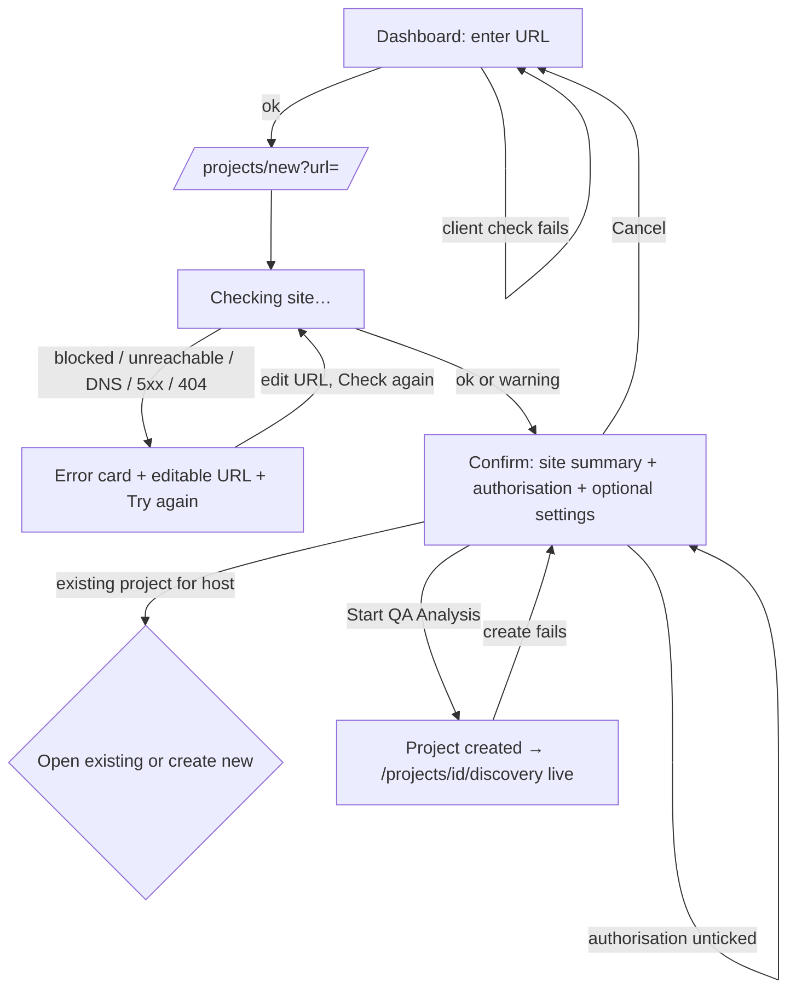

# P1 — Autonomous AI QA Analyst Platform: Phase 1 UX

## 1. Goal and user
Source: `docs/spec/qa-analyst-platform.md` §1, §2, §5 (steps 1–8), §15, §18 (Gates 1–2), §19, §20 Phase 1.

The user is a QA lead, test analyst or product owner. They sign up, enter one website URL, confirm they are authorised to test it, and watch an AI agent explore the site. They end with an evidence-backed **Application Discovery Report** that they can review, approve (Gate 2) and download as a PDF. Every claim in it is labelled **Observed** or **Inferred** and links to evidence. The 11 project sections that are not built yet are shown honestly as "Coming in Phase N", with no placeholder data.

Phase 1 is the first impression of a "Senior QA Test Analyst on demand". The UI should feel calm and exact, and earn trust through evidence rather than volume.

---

## 2. Design tokens (light theme)

**Migration rule:** keep the existing token *names* from `web/src/app/globals.css` (`canvas`, `surface`, `elevated`, `overlay`, `line`, `line-strong`, `fg-strong`, `fg`, `fg-muted`, `fg-subtle`, `accent`, `accent-hover`, `accent-soft`, `on-accent`) and change their *values*. Every component in `web/src/components/ui` then re-skins with no class changes. Add the new tokens below. Hard-coded dark-theme classes must be replaced; the list is in §10.

Phase 1 is light only (`color-scheme: light`). Dark mode is out of scope. Because everything goes through tokens, a later `[data-theme=dark]` override block is cheap.

### 2.1 Colour
Paste into `globals.css` (Tailwind v4 `@theme`):

```css
@theme {
  /* Navy primary scale */
  --color-navy-50:  #EEF2F8;
  --color-navy-100: #DCE3EF;
  --color-navy-200: #B9C6DD;
  --color-navy-300: #8EA1C3;
  --color-navy-400: #6079A3;
  --color-navy-500: #415A86;
  --color-navy-600: #2F466F;
  --color-navy-700: #243659;   /* hover on primary, link text */
  --color-navy-800: #1A2847;   /* PRIMARY */
  --color-navy-900: #121C35;   /* pressed */
  --color-navy-950: #0B1224;   /* modal scrim base */

  /* Surfaces (back to front) */
  --color-canvas:   #F6F7F9;   /* app background */
  --color-surface:  #FFFFFF;   /* cards, sidebar, top bar, inputs, modals */
  --color-elevated: #F9FAFB;   /* table headers, nested panels, code blocks */
  --color-overlay:  #EEF1F5;   /* chips, segmented track, row hover */

  /* Lines */
  --color-line:        #E3E7ED; /* card borders, dividers (decorative) */
  --color-line-strong: #CDD3DC; /* table/section dividers */
  --color-line-input:  #858FA1; /* form control borders: 3.3:1 on white (WCAG 1.4.11) */

  /* Text */
  --color-fg-strong: #0E1730;  /* headings, key figures      ~17:1 on white */
  --color-fg:        #2A3448;  /* body                       ~12.5:1 */
  --color-fg-muted:  #535D70;  /* secondary, labels          ~6.6:1 white, ~5.9:1 overlay */
  --color-fg-subtle: #667085;  /* placeholders, timestamps   ~5.0:1 white, 4.6:1 canvas */

  /* Primary (keeps the "accent" names so existing components re-skin) */
  --color-accent:       #1A2847; /* = navy-800; white text 14.6:1 */
  --color-accent-hover: #243659; /* = navy-700; white text 12:1  */
  --color-accent-soft:  #EEF2F8; /* = navy-50; active nav/tab bg  */
  --color-on-accent:    #FFFFFF;

  /* Semantic: fg is text/icon, bg is tint, line is 1px ring */
  --color-success-fg: #067647; --color-success-bg: #ECFDF3; --color-success-line: #ABEFC6; --color-success-solid: #079455;
  --color-warning-fg: #B54708; --color-warning-bg: #FFFAEB; --color-warning-line: #FEDF89; --color-warning-solid: #DC6803;
  --color-danger-fg:  #B42318; --color-danger-bg:  #FEF3F2; --color-danger-line:  #FECDCA; --color-danger-solid:  #D92D20;
  --color-info-fg:    #175CD3; --color-info-bg:    #EFF8FF; --color-info-line:    #B2DDFF; --color-info-solid:    #2E90FA;

  /* Evidence labels (not semantic status) */
  --color-observed-fg: #1A2847; --color-observed-bg: #EEF2F8;            /* navy, solid chip */
  --color-inferred-fg: #6B3FA0; --color-inferred-bg: #F6F2FC;            /* muted violet, dashed chip, 6.6:1 */

  /* Focus */
  --color-focus: #2F6FED;      /* 4.5:1 on white; used as 2px outline at 2px offset */

  /* Scrim */
  --color-scrim: rgb(11 18 36 / 0.45);
}
```

Usage rules:
- **Navy is for action and selection**: primary buttons, active nav, selected tabs, links, the "done" lifecycle connector. Status always uses the semantic tones. One primary button per view region.
- **Status mapping** (replaces `TONE_CLASSES` in `StatusPill.tsx`). Each tone is `bg-{t}-bg text-{t}-fg ring-{t}-line`.
  - green = success: done, approved, completed, observed OK
  - blue = info: running, queued, live
  - amber = warning: waiting for approval, paused, partial, access gap
  - red = danger: failed, blocked, error
  - grey = `bg-overlay text-fg-muted ring-line-strong`: not started, cancelled, coming later
  - violet = inferred only
  - Drop the `rose` tone.
- **Colour is never the only signal.** Every status carries an icon and a text label.
- `fg-subtle` is not used on `overlay` backgrounds for meaningful text.

### 2.2 Typography
- **UI font:** Inter (variable), already loaded in `web/src/app/layout.tsx` via `next/font/google`. Keep it. Enable `font-feature-settings: "cv11", "ss01"` (straight-sided 1 and open digits help with URLs and IDs). Use `tabular-nums` on every counter, timestamp and table number.
- **Mono:** JetBrains Mono via `next/font/google` (`variable: "--font-jetbrains"`, subsets latin, `display: swap`). Use it for URLs in technical contexts, DOM snippets, selectors and evidence IDs.

```css
@theme inline {
  --font-sans: var(--font-inter), ui-sans-serif, system-ui, sans-serif;
  --font-mono: var(--font-jetbrains), ui-monospace, SFMono-Regular, Menlo, monospace;
}
@theme {
  --text-display: 1.875rem; --text-display--line-height: 2.375rem; /* 30/38, 600, -0.02em: welcome + report title */
  --text-h1: 1.5rem;        --text-h1--line-height: 2rem;          /* 24/32, 600, -0.015em: page titles */
  --text-h2: 1.125rem;      --text-h2--line-height: 1.75rem;       /* 18/28, 600: section titles */
  --text-h3: 0.9375rem;     --text-h3--line-height: 1.375rem;      /* 15/22, 600: card titles */
  --text-body-lg: 1rem;     --text-body-lg--line-height: 1.625rem; /* 16/26: report reading text */
  --text-body: 0.875rem;    --text-body--line-height: 1.375rem;    /* 14/22: default UI */
  --text-small: 0.8125rem;  --text-small--line-height: 1.25rem;    /* 13/20: meta, table cells */
  --text-caption: 0.75rem;  --text-caption--line-height: 1rem;     /* 12/16, 500: badges, timestamps; minimum size */
}
```
- Section labels in the sidebar use 12px, 600 weight, uppercase, `tracking-[0.04em]`, `text-fg-muted`.
- Never go below 12px. All sizes are in `rem` so browser text scaling works. Layouts must survive 200% zoom and 400% reflow at 320 CSS px.

### 2.3 Spacing, layout, radii, shadows
- **Spacing:** Tailwind's 4px base.
  - Page padding: `px-4 sm:px-6 lg:px-8`, `py-6 lg:py-8`.
  - Card padding: `px-5 py-4` (dense) / `p-6` (feature cards).
  - Gap between cards: `gap-6`. Gap between page sections: `space-y-8`.
- **Widths:**
  - Content max: `max-w-[1280px]`.
  - Reading width (report, auth): `max-w-[760px]` / `max-w-[400px]`.
  - Sidebar: `w-64`.
- **Breakpoints:** Tailwind defaults. Persistent sidebar from `lg` (1024). Below that, a drawer.
- **Radii:**
  ```css
  --radius-sm: 6px;   /* badges, chips */
  --radius-md: 8px;   /* buttons, inputs */
  --radius-lg: 12px;  /* cards */
  --radius-xl: 16px;  /* hero card, modals, drawers */
  ```
  Pills stay `rounded-full`.
- **Shadows** (cool, low, navy-tinted). Cards use `border-line` + `shadow-xs`. Never stack heavy shadows on cards.
  ```css
  --shadow-xs: 0 1px 2px rgb(16 24 40 / 0.05);
  --shadow-sm: 0 1px 3px rgb(16 24 40 / 0.08), 0 1px 2px rgb(16 24 40 / 0.04);
  --shadow-md: 0 4px 8px -2px rgb(16 24 40 / 0.08), 0 2px 4px -2px rgb(16 24 40 / 0.04);  /* popovers */
  --shadow-lg: 0 12px 16px -4px rgb(16 24 40 / 0.08), 0 4px 6px -2px rgb(16 24 40 / 0.03); /* drawers, menus */
  --shadow-xl: 0 20px 24px -4px rgb(16 24 40 / 0.10), 0 8px 8px -4px rgb(16 24 40 / 0.04); /* modals */
  ```
- **Focus:** global `:focus-visible { outline: 2px solid var(--color-focus); outline-offset: 2px; }`. The ring sits on the page background, so it reaches ≥ 3:1 on all surfaces, including around navy buttons. Never `outline-none` without a replacement.
- **Control sizes** (update `Button.tsx` SIZES):
  - `sm`: h-8, text-small. Dense tables only, with ≥ 8px between targets so they pass WCAG 2.5.8.
  - `md`: h-10. Default.
  - `lg`: h-12, text-body-lg. The hero "Start QA Analysis" button.
  - Under `@media (pointer: coarse)`, `sm` and `md` become min-h-11 (44px).
- **Motion:** 150ms ease-out for hover and colour, 200ms for drawers.
  - Everything animated (spinner, live pulse, lifecycle "running" shimmer, new-event slide-in) has a `motion-reduce:` fallback. Spinners become a static icon. New events appear without a slide.

---

## 3. Information architecture and app shell

### 3.1 Routes (Phase 1)
| Route | Screen |
|---|---|
| `/login`, `/register` | Sign in, Sign up (`/forgot-password` and `/reset-password` are only restyled if the API supports them) |
| `/dashboard` | Primary dashboard |
| `/projects` | All projects (table) |
| `/projects/new?url=` | Start QA Analysis (Gate 1 + scan settings) |
| `/projects/[id]` | Overview |
| `/projects/[id]/discovery` | Application Discovery (`?view=live|summary|sitemap|functionality|journeys|responsive|gaps`, `&scan=<n>`) |
| `/projects/[id]/reports` | Reports list. Phase 1 holds the Discovery Report only |
| `/projects/[id]/reports/discovery?scan=<n>` | Application Discovery Report (in-app) |
| `/projects/[id]/{requirements,test-strategy,test-cases,automation,execution,performance,defects,traceability,assistant}` | "Coming in Phase N" pages |
| `/settings` | Profile and organisation (restyle only) |

Project sections are **nested routes**, not `?tab=`, so every section can be linked, has its own `<title>` and can manage focus. This replaces the `TABS` array in `web/src/app/(app)/projects/[id]/page.tsx`.

**Global nav in Phase 1:** Dashboard, Projects, Settings, Help. The legacy items (Test Runs, Bugs, Reports, Integrations) leave the nav; see Open question 1. The floating `AssistantPanel` is not mounted in Phase 1. "AI QA Analyst" is a project section (Coming later).

### 3.2 App shell (rework `web/src/components/layout/AppShell.tsx` + `Topbar.tsx`)

The sidebar changes with context. Outside a project it shows global nav only. Inside `/projects/[id]/*` it adds a **Project** group with the 12 sections.

```
+------------------+-------------------------------------------------------------+
| [■] QA Analyst   |  Projects / acme.com / Application Discovery   [?] [DE ▾]  |  <- Topbar 64px, white, border-b
|  Acme Ltd        +-------------------------------------------------------------+
|                  |                                                             |
|  ▣ Dashboard     |   PROJECT HEADER (see 3.3)                                  |
|  ▤ Projects      |                                                             |
|                  |   page content (max-w 1280, canvas bg)                      |
|  PROJECT         |                                                             |
|  acme.com     ⇅  |                                                             |
|  ○ Overview      |                                                             |
| ▌● App Discovery |  <- active: accent-soft bg, 3px navy bar, fg-strong         |
|  ○ Requirements P2                                                             |
|  ○ Test Strategy P2                                                            |
|  ○ Test Cases   P3                                                             |
|  ○ Automation   P4                                                             |
|  ○ Test Execution P4                                                           |
|  ○ Performance  P5                                                             |
|  ○ Defects      P4                                                             |
|  ○ Traceability P3                                                             |
|  ○ Reports         (live; holds the Discovery Report)                          |
|  ○ AI QA Analyst  Later                                                        |
|                  |                                                             |
|  ⚙ Settings      |                                                             |
|  ? Help          |                                                             |
+------------------+-------------------------------------------------------------+
```

- **Sidebar:** `bg-surface border-r border-line`. The brand mark is a navy square with a white icon. The org name sits under the wordmark in `text-small text-fg-muted`.
- **Project group:**
  - Header: the project name, plus a "Switch project" button (`ChevronsUpDown`) that opens a popover listing recent projects.
  - Each item: lucide icon + label.
  - Unbuilt sections are still links. They render `text-fg-muted` with a right-aligned `Badge tone="grey"`: "Phase 2" (visually "P2" below `xl` width).
  - The accessible name is the full text: "Requirements, coming in Phase 2".
- **Section → phase map** (single constant `PROJECT_SECTIONS` with `{slug, label, icon, phase}`):

  | Section | Phase |
  |---|---|
  | Overview, Application Discovery, Reports | 1 |
  | Requirements, Test Strategy | 2 |
  | Test Cases, Traceability | 3 |
  | Automation, Test Execution, Defects | 4 |
  | Performance | 5 |
  | AI QA Analyst | "a later phase" (Open question 2) |

- **Topbar:**
  - Breadcrumb `nav aria-label="Breadcrumb"`.
  - Help link.
  - User menu: name, email, org, Settings, **Sign out**.
  - Below `lg`: a hamburger (`aria-label="Open navigation"`, `aria-expanded`) opens the drawer. The existing focus/Escape handling in `AppShell` is kept, and focus must be trapped inside the drawer.
- The global search in the Topbar is hidden in Phase 1. It searches legacy entities.
- The "Recorded results first" sidebar footer note is replaced by a persistent, quiet footer line: "Only analyse sites you're authorised to test."

### 3.3 Project header (every project section)
```
acme.com                      [● Discovery running]          [Pause analysis] [⋯]
https://www.acme.com ↗  ·  Created 12 Nov 2026  ·  Scan 2 of 2
[✓ Discovery]─[○ Requirements]─[○ Strategy]─[○ Test design]─[○ Automation]─[○ Execution]─[○ Defects]─[○ Reporting]   <- LifecycleProgress compact
```
- **Title:** `text-h1`. The status pill shows the project's overall status.
- **Target URL:** an external link with `rel="noopener noreferrer"` and `target=_blank`, plus the visually hidden text "(opens in new tab)".
- **Actions** are context-dependent: Pause analysis / Resume analysis / Cancel analysis.
- **`⋯` menu:** Re-scan site, Edit scan settings (only when idle), Copy project link.
- The compact lifecycle bar appears on every section except Overview, where the full version is shown. Each segment links to its section.

### 3.4 "Coming in Phase N" page (`ComingInPhase`, new; wraps `EmptyState`)
```
+-- Card ---------------------------------------------------------+
|              (◌)                                                |
|        Requirements: coming in Phase 2                          |
|  The Requirements Engineering Agent will derive provisional     |
|  requirements from this project's discovery findings, each      |
|  labelled Observed, Inferred, Assumed or Unverified.            |
|                                                                 |
|  Your discovery results are saved and will be used then.        |
|  [Go to Application Discovery]                                  |
+-----------------------------------------------------------------+
```
No sample tables, charts or numbers. One sentence explains what the section will do, using the agent name from §4.

---

## 4. Auth screens (restyle `web/src/app/(auth)/*`)

**Layout:** keep the split layout from `(auth)/layout.tsx`, restyled.
- **Left panel** (`lg+` only): `bg-navy-800`, white text. It holds the wordmark, the headline "Your senior QA analyst, on demand." and three evidence points:
  - "Explores your site and maps every page, form and journey"
  - "Labels every finding Observed or Inferred, with evidence"
  - "You approve each quality gate before the next stage"
  - Footer: "Only analyse sites you're authorised to test."
- **Right panel:** `bg-canvas`. A centred `max-w-[400px]` white card (`rounded-xl shadow-sm p-8`).

```
   [■] QA Analyst
   Create your account
   Set up your organisation's QA workspace. You'll be its owner.

   Full name            [                         ]
   Work email           [                         ]
   Password             [                      👁 ]
                        At least 12 characters.
   Organisation name    [                         ]
                        Shown on your reports. You can change it later.

   [            Create account            ]   (primary, full width, h-10)
   By creating an account you agree to the Terms and Privacy Policy.
   Already have an account? Sign in
```

**Sign in:** "Sign in to QA Analyst". Email, Password (with show/hide toggle), "Forgot password?" link (if supported), [Sign in]. Footer: "New here? Create an account".

**Sign out:** user menu → "Sign out" signs out immediately (no confirmation), redirects to `/login` and shows the toast "You've signed out."

**Session expiry:** redirect to `/login?next=…&reason=expired` with the notice "Your session expired. Sign in again to continue." After sign-in, the user returns to `next`. Only same-origin paths are accepted.

**Behaviour:**
- Fields validate on blur and again on submit. On submit, focus moves to the first invalid field.
- The password toggle is a real button: `aria-label="Show password"` / `"Hide password"`, with `aria-pressed`.
- Sign-up creates the organisation; the user is its owner. After sign-up, go to `/dashboard` (first-run state).

| State | What the user sees | Copy |
|---|---|---|
| Submitting | Button spinner, fields read-only | "Creating account…" / "Signing in…" |
| Wrong credentials | InlineError above the button; password cleared and focused | "Email or password is incorrect." |
| Email taken | Field error on the email field | "An account with this email already exists. Sign in instead." (link) |
| Weak password | Field error | "Use at least 12 characters." |
| Rate limited | InlineError | "Too many attempts. Try again in {n} minutes." |
| Offline / server down | InlineError | "Can't reach QA Analyst. Check your connection and try again." |

---

## 5. Dashboard (`/dashboard`, rework `web/src/app/(app)/dashboard/page.tsx`)

Sections, in the order §15 gives them. No KPIs that Phase 1 can't back with real data: no pass rates, defects or coverage.

```
Good afternoon, Daniele                                           (text-display)
Acme Ltd · 3 projects                                             (text-fg-muted)

+-- Start a QA analysis (Card, rounded-xl, p-8, subtle navy-50 top border) -------+
| Enter a website and the AI QA Analyst explores it, maps its functionality and   |
| writes an Application Discovery Report you can review.                          |
|                                                                                  |
| Website URL                                                                      |
| [ https://                                       ] [ Start QA Analysis → ] (lg) |
| Public websites only. You'll confirm you're authorised to test it next.         |
+----------------------------------------------------------------------------------+

+-- Recent projects (2/3) ---------------------------+ +-- Testing activity (1/3) --+
| acme.com            [⚠ Waiting for approval]  2h  | | ● Discovery completed       |
| https://www.acme.com  ·  Discovery ▰▱▱▱▱▱▱▱       | |   acme.com · 2 h ago        |
|---------------------------------------------------| | ● Gate 2 awaiting approval  |
| shop.example.org    [● Discovery running]    now  | |   acme.com · 2 h ago        |
| https://shop.example.org · Visiting /cart          | | ● Discovery started         |
|---------------------------------------------------| |   shop.example.org · 5 min  |
|                               View all projects → | |            View all →       |
+---------------------------------------------------+ +-----------------------------+

+-- QA project health -------------------------------------------------------------+
| [ 3 Active projects ] [ 1 Analysis running ] [ 1 Awaiting your approval ] [ 7 Access gaps ] |
|                                                                                  |
| Project            Lifecycle          Pages found   Access gaps   Gate status   |
| acme.com           ▰▱▱▱▱▱▱▱ 1 of 8    42            5             Gate 2 waiting |
| shop.example.org   ▰▱▱▱▱▱▱▱ running   17 so far     —             —              |
+----------------------------------------------------------------------------------+
```

- **Start card:** `StartAnalysisForm` (new). It is a `form` with a `TextField` (`type="url"`, `inputMode="url"`, `autoComplete="url"`, `spellCheck=false`) and a primary `lg` Button. The pair stacks vertically below `sm`.
  - **Client-side validation** runs on submit (§6.1, rows C1–C5).
  - On success: `router.push('/projects/new?url=<normalised>')`.
  - **Normalisation:** trim. If there is no scheme, prefix `https://` and show "We'll analyse https://example.com" as the hint, not as an error.
- **Recent projects:** the last 5 projects by activity. Each row is one link to `/projects/[id]`. A row shows:
  - an initial-letter avatar. Never fetch the target site's favicon: it is untrusted content and would leak a request.
  - the project name and URL
  - the overall status pill
  - the current activity (running projects) or the stage name
  - a relative time (`time` element with the full date in `title`)
- **Testing activity:** the last 8 *milestone* events across projects (stage started/completed/failed, gate waiting/approved, scan cancelled). Not the raw page-visit stream.
- **QA project health:**
  - Four `StatTile`s (promote the `Kpi` from `dashboard/page.tsx` to `ui/StatTile.tsx`). Each tile is a link to a filtered `/projects` list.
  - Then a compact `Table` with one row per project.
  - The "Lifecycle" cell is `LifecycleProgress variant="mini"`: 8 segments, 4px high, plus a text label. The segments are `aria-hidden`; the text carries the meaning.

| State | What the user sees | Copy |
|---|---|---|
| First run (0 projects) | Welcome + Start card get more vertical space. Recent projects, Activity and Health are replaced by one quiet "What happens next" card with 3 numbered steps | Heading: "Welcome, {firstName}". Steps: "1. Enter your website URL." "2. Confirm you're authorised to test it." "3. Watch the AI explore it, then review the Application Discovery Report." |
| Loading | Skeletons for list rows and tiles. The Start card is interactive immediately | — |
| Projects error | `ErrorState` inside the Recent projects card only. Other cards still render | "Couldn't load your projects. Try again." |
| Activity empty (projects exist) | `EmptyState` small | "No activity yet." |
| Offline | Top banner (`Callout tone="warning"`). Start button still enabled; submitting shows the error | "You're offline. Changes and live updates resume when you reconnect." / submit: "You're offline. Connect to the internet to start an analysis." |

---

## 6. Start QA Analysis (`/projects/new?url=`) — Gate 1

A single page, not a modal: it holds credentials, must work on mobile, and must survive a refresh. Reading width `max-w-[760px]`.



```
Start QA analysis                                                   (text-h1)
Step 1 of the QA lifecycle: Application Discovery.

+-- Website ----------------------------------------------------------------+
| Website URL  [ https://acme.com                       ] [Check again]     |
|                                                                           |
| ✓ Reachable  ·  HTTP 200  ·  "Acme — Industrial Sensors"                  |
| ⓘ Redirects to https://www.acme.com. We'll analyse that address.          |
| Scope: pages on www.acme.com only. Links to other sites are listed, not   |
| visited.                                                                  |
+---------------------------------------------------------------------------+

+-- Gate 1 · Authorisation -------------------------------------------------+
| [ ] I am authorised to test this site.                                     |
|     I own www.acme.com or have the owner's permission to explore it with  |
|     automated tools. Your confirmation is recorded with your name and the |
|     time.                                                                 |
|                                                                           |
| What discovery does: opens pages, reads their structure and takes         |
| screenshots. It does not submit forms, make purchases, or create, change  |
| or delete data.                                                           |
+---------------------------------------------------------------------------+

+-- Scan settings (optional) ------------------------------- [Show ▾] -------+
| Project name     [ www.acme.com            ]                              |
| Maximum pages    [ 30 ]  (1–100)  Discovery stops after this many pages.  |
| Viewports        [x] Desktop (1440 × 900)  [x] Mobile (390 × 844)         |
|                  Both are needed for responsive observations.             |
|                                                                           |
| Credentials for signed-in areas (optional)                                |
| Without credentials, discovery covers public pages only and lists         |
| sign-in areas as access gaps.                                             |
| Sign-in page URL [ https://www.acme.com/login ]                           |
| Username or email[                             ]                          |
| Password         [                          👁 ]                          |
| ⚠ Use a dedicated test account, never a real customer's account.          |
|   Stored encrypted, used only by the discovery browser, never shown again.|
+---------------------------------------------------------------------------+

                                   [Cancel]  [ Start QA Analysis → ] (primary)
```

- **Site check:** runs on page load; "Check again" re-runs it.
  - While checking: the Website card shows `Spinner` "Checking https://acme.com…". The Gate 1 and settings cards render but the primary button stays enabled. Submitting while a check is pending waits for it.
- **Authorisation:** reuse `Checkbox` from `ui/Field.tsx`. The **primary button is never disabled**.
  - Submitting without the tick shows a field error and focuses the checkbox.
  - The checkbox label names the *final* host after redirects.
- **Scan settings:** a disclosure (`button aria-expanded aria-controls`), collapsed by default. It auto-expands if any field inside has an error.
  - Defaults: name = final host, 30 pages, both viewports.
  - The credential fields are all-or-none. If any one is filled, the others become required.
  - The sign-in URL must be on the scoped host.
- **Submit:** "Start QA Analysis" → "Starting…".
  - Creates the project, stores the Gate 1 record and queues discovery.
  - On success: `router.replace('/projects/{id}/discovery')` (the live view) with the toast "Project created. Discovery has started."
  - We land on Discovery rather than Overview because the live view is the most useful thing at this moment. Overview is one click away and the compact lifecycle bar is visible.

### 6.1 URL validation states (Gate 1)
C = client side (dashboard and this page). S = server site check. Blocking errors show on the URL field (`aria-invalid`, error text linked by `aria-describedby`) plus an error panel in the Website card. Warnings show as `Callout tone="warning"` and do not block.

| # | Condition | Blocks? | Copy |
|---|---|---|---|
| C1 | Empty | Yes | "Enter a website URL." |
| C2 | Not a URL | Yes | "Enter a valid URL, like https://example.com." |
| C3 | Scheme not http/https (ftp:, file:, javascript:, data:) | Yes | "Only http:// and https:// websites can be analysed." |
| C4 | Username/password in URL | Yes | "Remove the username and password from the URL. Add sign-in details under Scan settings instead." |
| C5 | `localhost`, `.local`, `.internal`, or a literal private/loopback IP | Yes | Same as S1 |
| S1 | Resolves to a private, loopback, link-local or reserved address | Yes | "{host} resolves to a private or internal address ({ip}). For safety, only public websites can be analysed." |
| S2 | Cloud metadata endpoint (e.g. 169.254.169.254) | Yes | "This is a cloud metadata address. It can't be analysed." |
| S3 | A redirect leads to a blocked address | Yes | "This site redirects to a private or internal address. For safety, it can't be analysed." |
| S4 | DNS failure | Yes | "We couldn't find {host}. Check the address for typos." |
| S5 | Timeout / connection refused | Yes | "We couldn't reach {url} (no response after {n} s). Check that the site is online and publicly reachable, then try again." |
| S6 | HTTP 5xx | Yes | "{host} responded with a server error (HTTP {code}). Try again later." |
| S7 | HTTP 404 at the URL | Yes | "This page doesn't exist (HTTP 404). Check the URL or use the site's home page." |
| S8 | HTTP 401/403 | No | "The page requires sign-in (HTTP {code}). Add credentials under Scan settings, or discovery will be limited to public pages." (auto-expands settings) |
| S9 | Redirect to another host | No (info) | "Redirects to {finalUrl}. We'll analyse that address." |
| S10 | Bot protection / CAPTCHA detected | No | "This site shows a bot-protection check. Discovery may be blocked on some pages." |
| S11 | Org already has a project for this host | No | "You already have a project for {host}." [Open project] [Create a new project] |
| S12 | Concurrent analysis limit reached | Yes (on submit) | "Your organisation already has {n} analyses running, the current limit. Pause or wait for one to finish." [View running analyses] |
| S13 | Rate limit | Yes (on submit) | "You've started {n} analyses in the last hour. You can start another at {time}." |
| S14 | Check service unavailable | Yes | "We couldn't check this site right now. Try again in a moment." |
| S15 | Gate 1 unticked | Yes | "Confirm you're authorised to test this site." |
| S16 | Credentials partial | Yes | "Enter a sign-in page URL, username and password, or leave all three empty." |
| S17 | Sign-in URL off-scope | Yes | "The sign-in page must be on {host}." |
| S18 | Create failed | — | InlineError: "We couldn't create the project. Nothing was started. Try again." |

---

## 7. Project Overview (`/projects/[id]`)

```
[Project header: title, status, actions — no compact lifecycle here]

+-- QA lifecycle -----------------------------------------------------------------+
|  ●━━━━━━━◆━━━━━━━○━━━━━━━○━━━━━━━○━━━━━━━○━━━━━━━○━━━━━━━○                       |
|  Discovery  Requirements Strategy  Test design Automation Execution Defects Reporting|
|  Running    Phase 2      Phase 2   Phase 3     Phase 4    Phase 4   Phase 4  Phase 5|
|  Step 4/8                                                                       |
|                                                       [Show all 21 steps ▾]    |
+---------------------------------------------------------------------------------+

+-- AI agent activity (2/3) ------------------ ● Live --+ +-- Needs your attention -+
| NOW  Application Discovery Agent                      | | (none) / Gate 2 card     |
|      Visiting /contact                                | +--------------------------+
|-------------------------------------------------------| +-- Discovery at a glance -+
| 14:02:31  Discovery Agent  Found form: Contact (3 fields) [Observed] [Evidence] | 18 pages · 6 forms      |
| 14:02:29  Discovery Agent  Visiting /contact          | | 3 access gaps            |
| 14:02:20  Discovery Agent  Skipped /logout — would end the session                |   Open Discovery →       |
| 14:02:12  Orchestrator     Started Application Discovery                          +--------------------------+
|                         [Show 3 new events]           | +-- Scope & authorisation -+
|                                   Load earlier events | | www.acme.com · 30 pages  |
+-------------------------------------------------------+ | Desktop + Mobile         |
                                                          | No credentials           |
                                                          | Authorised by D. Edema,  |
                                                          | 12 Nov 2026 14:01        |
                                                          +--------------------------+
```

### 7.1 Lifecycle progress (`LifecycleProgress`, new: `variant="full" | "compact" | "mini"`)
The 21 steps of §5 are grouped into 8 stages. Gates sit between stages, drawn as a diamond (◆) on the connector.

| Stage | Steps | Gate at end | Phase |
|---|---|---|---|
| Discovery | 1 Validate URL & check access (Gate 1) · 2 Create QA project · 3 Launch isolated browser · 4 Inspect application · 5 Build sitemap & functionality map · 6 Capture screenshots & DOM evidence · 7 Identify access gaps · 8 Generate Application Discovery Report | Gate 2 Discovery completeness | 1 |
| Requirements | 9 Derive provisional requirements · 10 Acceptance criteria · 11 Definition of Ready & Done | Gate 3 Requirements review | 2 |
| Strategy | 12 Risk-based Test Strategy & Test Plan | Gate 4 Test strategy approval | 2 |
| Test design | 13 Test conditions & test cases · 14 Traceability matrix | Gate 5 Test case quality | 3 |
| Automation | 15 Automation suitability · 16 Generate scripts · 17 Validate scripts | Gate 6 Script validation | 4 |
| Execution | (Gate 7 Execution authorisation before) 18 Execute approved tests | — | 4 |
| Defects | 19 Analyse results & investigate failures · 20 Defect reports & QA summary | Gate 8 Defect review | 4 |
| Reporting | 21 Release readiness assessment | Gate 9 Release readiness | 5–6 |

Status vocabulary for steps and stages. Icon, text and colour always appear together.

| Status | Icon (lucide) | Tone | Label |
|---|---|---|---|
| Done | `CircleCheck` | success | "Done" |
| Running | `Loader2` spinning; reduced motion: `CircleDot` | info | "Running" (stage adds "Step 4 of 8") |
| Waiting for approval | `UserRoundCheck` | warning | "Waiting for your approval" |
| Paused | `CirclePause` | warning | "Paused" |
| Failed | `CircleX` | danger | "Failed" |
| Cancelled | `CircleSlash` | grey | "Cancelled" |
| Not started | `Circle` | grey outline | "Not started" |
| Coming later | `CircleDashed` | grey, muted text | "Phase {n}" |

**Stage status roll-up** (first match wins): Failed → Waiting for approval → Paused → Running → Cancelled → Done (all steps done and the gate approved) → Not started / Coming later.

- **Full variant:**
  - Horizontal at `md+`, each stage a link to its section. Below `md` it becomes a vertical list (icon, name, status), with no horizontal scrolling.
  - Connectors are navy when the left stage is Done, and `line-strong` otherwise.
- **"Show all 21 steps"** is a disclosure listing steps grouped by stage. Each step row shows:
  - number, name, status, and duration or timestamp
  - the agent responsible
  - for failed steps: a one-line reason and a link to the failing event
  - stage actions on the stage heading row: **Re-run stage** (Done, Failed or Cancelled stages built in this phase; in Phase 1, Discovery only) and **Review gate** (when waiting).
- **Compact variant:** 8 equal segments, each with an icon, the name at `xl`, and a tooltip with the status. Accessible as an `ol`.
- **Mini variant:** 8 bars, `aria-hidden`, with a text label beside them.

### 7.2 Pause / resume / cancel / re-run
| Action | Where | Behaviour | Copy |
|---|---|---|---|
| Pause analysis | Header (when Running) | Finishes the current page, then pauses. The button shows "Pausing…" until confirmed by an event | Toast: "Analysis paused. Resume any time; nothing is lost." |
| Resume analysis | Header (when Paused) | Continues from the queue | Toast: "Analysis resumed." |
| Cancel analysis | `⋯` menu (Running/Paused) | `ConfirmDialog` (danger). Findings so far are kept as a partial scan | Title "Cancel discovery?" Body "Discovery stops after the current page. Findings and evidence collected so far are kept and marked as partial." [Keep running] [Cancel discovery] |
| Re-run stage / Re-scan site | Stage row; `⋯` menu; Gate 2 panel | Opens `ConfirmDialog` with the scan settings summary and an [Edit settings] link (to `/projects/new`-style settings in a modal). Creates Scan N+1; earlier scans, reports and evidence are kept (§13) | Title "Re-scan www.acme.com?" Body "This starts Scan {n+1} with the settings below. Scan {n} and its report stay available." [Cancel] [Start re-scan] |

All controls are real buttons with visible text. Nothing depends on hover or gestures.

### 7.3 AI agent activity feed (`AgentActivityFeed`, new) — SSE
**UI contract** (the developer confirms the endpoint): `GET /projects/{id}/events` streams `text/event-stream`. Reconnect sends `Last-Event-ID` for catch-up. Each event carries:
```
{ id, ts, agent: "orchestrator"|"discovery", stage, step,
  kind: "status"|"action"|"finding"|"skip"|"warning"|"error"|"gate",
  message, path?, findingId?, evidenceIds?, label?: "observed"|"inferred" }
```

- **"Now" row** (pinned at top): the agent name in `text-small font-semibold`, then the latest `action` message in `text-h3`. The running stage shows a live dot. When nothing is running: "No agent is working on this project right now."
- **Event list:**
  - Newest first, in an `ol`. Each row: `time` (tabular, 24h), agent chip (`Badge grey`), message, and optionally an `ObservationLabel` and an [Evidence] link that opens `EvidenceDrawer`.
  - Kinds:
    - `warning`: amber icon
    - `error`: red icon
    - `skip`: grey `CircleSlash` icon
    - `gate`: amber row background, with a [Review] button
- **Scroll behaviour:**
  - If the user has scrolled away from the top or has focus inside the list, new events don't shift content. A sticky "Show {n} new events" button appears instead.
  - The list holds the latest 200 events, with "Load earlier events" for more.
- **Agent names in Phase 1:** "Lead QA Orchestrator" and "Application Discovery Agent". Show the short form "Orchestrator" / "Discovery Agent" below `md`.
- **Example messages** (agents produce these; listed here as the tone reference):
  - "Started Application Discovery"
  - "Launched isolated Chromium browser (desktop 1440 × 900)"
  - "Visiting /contact"
  - "Found form: Contact (3 fields)"
  - "Found auth boundary: /account redirects to /login"
  - "Skipped /logout — would end the session"
  - "Skipped 'Delete account' button — destructive actions are never performed"
  - "Page limit reached: 30 of 30 visited, 14 more found but not visited"
  - "Couldn't load /careers — timed out after 30 s"
  - "Page text on /blog/ai contained instructions addressed to AI agents. Treated as page content and ignored."
  - "Generated Application Discovery Report (draft)"
  - "Gate 2: Discovery completeness is waiting for your approval"

**Connection indicator** (`LiveConnectionIndicator`, new; top-right of the card):

| State | Indicator | Copy |
|---|---|---|
| Connecting | grey dot | "Connecting…" |
| Live | green dot (pulses; static under reduced motion) | "Live" |
| Reconnecting | amber | "Reconnecting… Missed events will catch up." |
| Offline | amber `WifiOff` | "You're offline. The analysis keeps running on our servers." |
| Stopped (after 5 retries) | red + [Reconnect] | "Live updates stopped." |
| Nothing running | none | Feed shows history only |

---

## 8. Application Discovery workspace (`/projects/[id]/discovery`)

The page has a header row and then sub-views in a `Tabs` tablist (reuse `ui/Tabs.tsx`, which scrolls horizontally on narrow screens).

```
Application Discovery                          Scan [2 · 12 Nov 14:01 ▾]  [Open report]
[Gate 2 banner when waiting — §8.4]
Tabs:  Live | Summary | Sitemap | Functionality map | User journeys | Responsive | Access gaps (5)
```

- "Live" is shown only while a scan is queued, running or paused, and it is the default tab then. Afterwards the default is "Summary".
- The scan version selector (`SelectField`) lists all scans with their status. Older scans are read-only.

### 8.1 Live view (running)
```
+-- Card ----------------------------------------------------------------------------+
| ● Exploring www.acme.com                                    [● Live]  [Pause] [⋯]  |
|------------------------------------------------------------------------------------|
| +------------------------------------------+  Now visiting                         |
| |                                          |  Contact us                           |
| |   current page screenshot (16:10)        |  /contact                             |
| |                                          |  Desktop · captured 14:02:31          |
| +------------------------------------------+  [Desktop | Mobile]  (Segmented)      |
|                                                                                    |
| [ 18 / 30 Pages visited ] [ 14 Queued ] [ 6 Forms ] [ 142 Interactive elements ]   |
| [ 3 Access gaps ] [ 36 Screenshots ] [ 04:12 Elapsed ]                             |
| ▓▓▓▓▓▓▓▓▓▓▓▓░░░░░░░░  18 of up to 30 pages  (role=progressbar)                     |
+------------------------------------------------------------------------------------+
+-- AI agent activity (same AgentActivityFeed, filtered to this stage) ---------------+
```
- **Screenshot:** reuse `LiveFrame` from `web/src/components/run/LiveView.tsx`, generalised to take a frame source (`scanId`) instead of only `runId`.
  - It shows the latest captured screenshot, not video.
  - The `` alt is "Screenshot of {page title} ({path}), {viewport}".
  - Before the first frame: "Launching an isolated browser…".
- **Counters:** `StatTile size="sm"`, tabular numbers. They update from the event stream and are *not* inside a live region.
- **Progress bar:** uses the info tone, not navy, because progress is a status. `aria-valuenow`, `aria-valuemax`, and `aria-valuetext="18 of up to 30 pages"`.
- **Layout:** two columns from `lg` (`grid-cols-[1fr_280px]`). Below `lg` the panel stacks under the screenshot, and the counters become a 2-column grid.

### 8.2 Results views
Every finding (page, component, journey, observation, gap) shows:
1. An **ObservationLabel** (new):
   - **Observed** (eye icon, navy solid chip): seen directly in the browser.
   - **Inferred** (lightbulb icon, violet dashed chip): concluded from what was seen, not verified.
   - The chip has a `title` and a visually hidden definition. A "What do these labels mean?" popover sits in each view header.
2. **Evidence links:** [Screenshot] [DOM] (`Image`, `Code` icons). Each opens the `EvidenceDrawer`.
3. If inferred, a "Why inferred" line. For example: "The form was not submitted. Discovery is read-only."

**Summary**
- Gate 2 assessment card (§8.4) first.
- Then four `StatTile`s: Pages, Forms, User journeys, Access gaps.
- Then "Key observations": max 6 bullets, each with a label and evidence.
- Then "Scope & settings" and "Limitations of this scan". The limitations always include: "Discovery observes the user interface only. Backend behaviour, data handling and security have not been verified."

**Sitemap** (`SitemapTree`, new)
```
[Tree | List]  Filter: [All ▾]  Search pages [        ]
▾ /                     Home                       ✓ Visited   12 elements   [Observed]
  ▾ /products           Products                   ✓ Visited   2 filters, 1 table
      /products/sensor-x  Sensor X                 ✓ Visited
      /products/…        +9 more found             ○ Not visited — page limit
  ▸ /account            My account                 🔒 Needs credentials
    /contact            Contact us                 ✓ Visited   1 form
    /careers            Careers                    ⚠ Couldn't load (timeout)
  External links (4)    — listed, not visited
```
- **Tree mode:** ARIA `tree` / `treeitem` with `aria-expanded` and `aria-level`, roving tabindex. Keys:
  - Up/Down: move
  - Right/Left: expand/collapse
  - Home/End: first/last
  - Enter: open page detail
- **List mode:** `Table` with Path, Title, Status, Depth, Components and Found via. Use it as the screen-reader-friendly alternative and on mobile. On mobile it is the default and "Tree" is optional.
- **Page detail:** a `Drawer` on the right at `lg+` (`max-w-[560px]`), a full-screen sheet below that. It shows:
  - desktop and mobile screenshots
  - the components on the page (grouped by type, same rows as the Functionality map)
  - outgoing links
  - HTTP status and load time
  - evidence IDs

**Functionality map** (`FunctionalityMatrix`, new)
```
Filter: Type [All ▾]  Label [Observed + Inferred ▾]  Search [      ]
             Forms Inputs Buttons Links Dropdowns Search Filters Tables Modals Auth
/ Home         –     1      4      23      –        1      –       –      1     –
/products      –     2      3      18      1        1      2       1      –     –
/contact       1     3      1       9      –        –      –       –      –     –
/account       ·     ·      ·       ·      ·        ·      ·       ·      ·    🔒
```
- A native `<table>` with a sticky first column and header row. Each non-zero cell is a button: "3 inputs on /contact".
- Selecting a cell shows the **Findings list** below, filtered.
- `–` means none found (visually hidden text "none found"). `·` means not observed, because there was no access.
- Below `md`, the matrix becomes per-page cards with count chips, e.g. "Forms 1 · Inputs 3".
- **Findings list row:**
  - `Form · Contact` [Observed]
  - "3 fields: Name (text, required), Email (email, required), Message (textarea). Submit button 'Send'. Not submitted."
  - [Screenshot] [DOM] · /contact
- **Component types** come from §5: forms, inputs, buttons, links, dropdowns, search, filters, tables, modals, auth boundaries. Interactive components that don't fit go under "Other interactive".

**User journeys** (`JourneyCard`, new)
```
Contact the company                                             [Inferred]
Home → Contact us → Fill contact form → Send   (Send not performed: read-only)
Why inferred: steps 1–3 were navigated; submission was not performed.
Evidence: 3 screenshots                                         [View steps]
```
- Each step is labelled. Navigated steps are Observed. Steps that would submit or change data are always Inferred.
- Steps show as an ordered list. "View steps" expands per-step screenshots.

**Responsive** (`ResponsiveCompare`, new)
- Per page: desktop and mobile screenshots side by side (stacked below `md`), with an observation list.
  - Example: "Navigation collapses into a menu button" [Observed]
  - Example: "Content wider than the screen: horizontal scrolling at 390 px" [Observed]
- Toggle "Only pages with differences" (on by default).
- If only one viewport was scanned: `EmptyState` "Responsive observations need both viewports. This scan used Desktop only." [Re-scan with Mobile].

**Access gaps**
`Table`: Area · Reason · Evidence · Suggested next step. Reasons use a fixed vocabulary:

| Reason | Suggested next step |
|---|---|
| Needs credentials | Add credentials and re-scan |
| Couldn't observe: needs data (e.g. an empty cart) | Note for the requirements phase |
| Not performed: destructive or transactional action | Requires explicit approval in a later phase |
| Not visited: page limit | Re-scan with a higher limit |
| Outside scope (other domain) | — |
| Couldn't load (timeout / HTTP {code}) | Re-scan |
| Blocked by bot protection | Allowlist the scanner or provide a test environment |

Header action: [Add credentials and re-scan].

### 8.3 Evidence drawer (`EvidenceDrawer`, new on a new `ui/Drawer.tsx`)
```
Evidence EV-0042                                               [×]
Screenshot · /contact · Desktop 1440×900 · 12 Nov 2026 14:02:31
Captured by Application Discovery Agent · Scan 2
[ screenshot, element outlined in focus-blue 2px box ]     [Open full size]
DOM snippet                                                   [Copy]
┌───────────────────────────────────────────────┐
│ <form aria-label="Contact" …>                 │  (mono, escaped text)
└───────────────────────────────────────────────┘
Used by: Form · Contact; Journey · Contact the company
```
- **The DOM snippet is rendered as escaped text only, never as HTML.** Links in it are not clickable. Website content is untrusted (§19).
- **Drawer behaviour** (same contract as `Modal`):
  - Focus moves to the title. Focus is trapped while open.
  - Escape closes. Focus returns to the trigger.
  - Full screen below `md`.
- Missing evidence: "This evidence file is no longer available." The finding stays, with "Evidence missing" shown.

### 8.4 Gate 2: Discovery completeness (`GateReviewPanel`, new; reusable for Gates 3–9)
It appears in three places:
- as a banner at the top of Discovery and in "Needs your attention" on Overview, while waiting
- in full on the Summary tab
- in the report.

```
+-- Gate 2 · Discovery completeness ------------------- [⚠ Waiting for your approval] -+
| Agent assessment: Partially complete                                                 |
| Discovery covered the public site well. 3 signed-in areas couldn't be observed.      |
|                                                                                      |
| ✓ 30 of 44 pages found were visited (page limit 30)                                  |
| ✓ All visited pages captured on desktop and mobile                                   |
| ✓ 6 forms and 4 user journeys catalogued                                             |
| ⚠ 3 areas need credentials (/account, /orders, /settings)                           |
| ⚠ 14 pages not visited: page limit reached                                           |
| ✗ 1 page couldn't load (/careers, timeout)                                           |
|                                                                                      |
| Recommendation: Re-scan with credentials before deriving requirements.               |
| Approving now means requirements will cover the public site only.                    |
|                                                                                      |
| Comment (optional) [                                                     ]           |
| [Approve discovery]   [Re-scan…]                          View report →              |
+--------------------------------------------------------------------------------------+
```
- **Assessment values:** "Complete", "Partially complete", "Insufficient". The recommendation is advisory (§18). The user may approve regardless, and the UI never blocks that.
- **Approve** records the user, time and comment.
  - The panel becomes: "[✓ Approved] by Daniele Edema, 12 Nov 2026 15:10 · 'Public site only for now.'"
  - The stage becomes Done, and the report becomes "Approved".
  - Next-stage copy: "Discovery approved. Requirements analysis arrives in Phase 2; these findings are saved and will be used then."
- **Re-scan…** opens the re-scan dialog (§7.2), with settings editable and credentials highlighted when the gaps are credential-related.
- After approval, a re-scan creates a new scan, which needs its own Gate 2.

### 8.5 Discovery states
| State | What the user sees | Copy |
|---|---|---|
| Queued | Live tab: placeholder frame, `Spinner` | "Waiting for a browser worker… Position {n} in queue." |
| Starting | Placeholder frame | "Launching an isolated browser…" |
| Running | §8.1 | "Exploring {host}" |
| Pausing | Pause button shows spinner | "Pausing after the current page…" |
| Paused | Amber banner; frame frozen; [Resume] | "Discovery is paused. {n} pages visited so far." |
| Cancelled (partial) | Results tabs with a grey banner. Counts show "so far". Gate 2 available but the assessment is at most "Partially complete" | "Discovery was cancelled after {n} pages. Results below are partial." [Re-scan] |
| Timed out (max duration) | Same as cancelled, amber | "Discovery stopped at the {m}-minute limit after {n} pages. Results below are partial." |
| Failed, no results | `ErrorState`-style card with reason + [Re-scan] + [Edit settings] | "Discovery failed: {reason}. No pages were captured." Reasons: "The site stopped responding." / "The browser crashed." / "Sign-in failed with the credentials provided." |
| Failed with partial results | Danger banner + results | "Discovery stopped early: {reason}. Results from {n} pages are shown." |
| Sign-in failed (credentials) | Warning banner; public results continue | "Couldn't sign in with the credentials provided. Signed-in areas are listed as access gaps." [Update credentials and re-scan] |
| Completed, waiting for Gate 2 | Summary tab, Gate 2 banner | see §8.4 |
| Approved | Summary, green approved line | see §8.4 |
| Zero pages | Card | "No pages could be explored. The site may block automated browsers." [Re-scan] |
| Empty sub-view (e.g. no journeys) | `EmptyState` | "No user journeys were identified. Journeys need at least two linked pages with a clear goal." |
| No access gaps | `EmptyState` with success icon | "No access gaps. Every page found within the limit was observed." |
| Loading results | Skeleton rows/tiles | — |
| Load error | `ErrorState` in the tab panel | "Couldn't load discovery results. Try again." |
| Viewing an older scan | Info banner | "You're viewing Scan {n} from {date}. The latest is Scan {m}." [View latest] |

---

## 9. Application Discovery Report

### 9.1 In-app (`/projects/[id]/reports/discovery`)
`/projects/[id]/reports` lists one available report: the Application Discovery Report, with one row per scan. A note lists the other §17 reports grouped by phase, as text only and not as rows: "Requirements Specification, Test Strategy and Test Plan arrive in Phase 2…".

```
Reports / Application Discovery Report
+-- ToC (sticky, lg+) --+  +-- Document (max-w 760, white, p-10) ------------------------+
| 1 Summary             |  | Application Discovery Report                   (display)    |
| 2 Scope & approach    |  | www.acme.com · Scan 2 · 12 Nov 2026                         |
| 3 Sitemap             |  | [Draft — awaiting Gate 2]  or  [✓ Approved by … on …]       |
| 4 Functionality       |  |                                    [Download PDF]  [Print] |
| 5 User journeys       |  |---------------------------------------------------------------|
| 6 Responsive          |  | 1 Summary                                                   |
| 7 Access gaps &       |  | …                                                           |
|   limitations         |  |                                                             |
| 8 Completeness (G2)   |  |                                                             |
| A Evidence index      |  |                                                             |
| B Labels & glossary   |  |                                                             |
+-----------------------+  +-------------------------------------------------------------+
```
**Contents** (`ReportDocument`, new):
1. **Summary:** what was explored, headline counts, assessment, top 5 observations.
2. **Scope & approach:**
   - URL, final URL, scope host, max pages, viewports, credentials used (yes/no; values never shown), dates and duration, browser.
   - Gate 1 record: who, when, what was confirmed.
   - Approach: read-only exploration, no form submission.
3. **Sitemap:** an indented list with status.
4. **Functionality inventory:** a table per page.
5. **User journeys.**
6. **Responsive observations.**
7. **Access gaps & limitations.** It always includes the UI-only limitation sentence (§8.2). If any were ignored, it also includes the note: "Page content was treated as untrusted data; {n} pages contained text addressed to AI agents, which was ignored."
8. **Discovery completeness (Gate 2):** criteria, recommendation, decision.

Appendices:
- **A Evidence index:** ID, type, page, viewport, time.
- **B Labels & glossary:** Observed, Inferred, Access gap, Auth boundary, User journey, ISTQB references.

**Rules:**
- Every finding row carries a label and evidence IDs. In-app, these are links to the `EvidenceDrawer`.
- Headings are real `h2`/`h3`. The ToC is `nav aria-label="Report contents"` and highlights the current section with `aria-current="location"`.
- Below `lg`, the ToC becomes a "Contents" disclosure at the top.

### 9.2 Downloadable PDF (Phase 1)
- **Page setup:** A4 portrait, 20mm margins, Inter 10.5/15 body, JetBrains Mono 9pt for code, navy headings. White background, so it is print-safe.
- **Cover:**
  - title, site, scan number, date, org name, status (Draft / Approved by … on …)
  - the line "Confidential — prepared for {Org}"
  - the disclaimer: "Generated by an AI QA agent from browser observation. Findings are labelled Observed or Inferred; backend behaviour has not been verified."
- **Running header and footer:**
  - header: report title · site
  - footer: "Scan {n} · Generated {datetime} · Page x of y"
- **Screenshots:** thumbnails (max 60mm wide) beside their finding, captioned with the evidence ID. Full evidence stays in the app; the evidence index lists IDs and timestamps. No live links to the target site.
- **Accessibility:** a tagged PDF with real text, document language, title metadata, heading structure, alt text on screenshots (same as in-app) and table header rows. It must not be an image of the page.
- **File name:** `{host}-discovery-report-scan{n}-{yyyy-mm-dd}.pdf`.
- A Draft PDF carries a "DRAFT — awaiting Gate 2 approval" watermark band on every page header.

| State | What the user sees | Copy |
|---|---|---|
| Report not generated yet (discovery running) | `EmptyState` | "The report is generated when discovery finishes." [Watch discovery] |
| Generating PDF | Button `loading` | "Preparing PDF…" (status region announces "PDF ready" when done) |
| PDF ready | Browser download starts; toast | "Report downloaded." |
| PDF failed | Toast error + button returns | "Couldn't create the PDF. Try again." |
| Partial scan | Amber callout at the top of the document and the PDF cover | "Partial results: discovery was {cancelled / stopped} after {n} pages." |
| Load error | `ErrorState` | "Couldn't load the report. Try again." |

---

## 10. Component inventory

**Reuse (restyle through tokens):**
- `web/src/components/ui/Button.tsx`: Button, LinkButton. Update `VARIANTS` and `SIZES`:
  - danger/success use the semantic `*-solid` tokens.
  - add `lg`.
  - the focus ring uses `--color-focus`.
- `ui/Card.tsx`: Card, CardHeader (title → `text-h3`), CardBody, PageHeader (title → `text-h1`).
- `ui/Field.tsx`:
  - TextField, SelectField, Checkbox, TextArea.
  - Borders change to `border-line-input`. Error text uses `text-danger-fg`. The required `*` uses `text-danger-fg`.
- `ui/Tabs.tsx`: Tabs, TabPanel, Segmented (Desktop/Mobile toggles).
- `ui/Modal.tsx`: Modal, ConfirmDialog. The backdrop changes to `bg-scrim`, with no blur.
- `ui/Toast.tsx`: re-tone the icons to semantic tokens.
- `ui/Table.tsx`: header `bg-elevated`, row hover `bg-overlay`.
- `ui/States.tsx`: Spinner, LoadingBlock, Skeleton, EmptyState, ErrorState, InlineError, DataState. ErrorState and InlineError switch to danger tokens.
- `ui/StatusPill.tsx`: StatusPill, Badge. Replace `TONE_CLASSES` and `DOT` with semantic tokens and add the statuses from §7.1 to `TONES`.
- `components/run/LiveView.tsx`: `LiveFrame`. Generalise its source to a scan id.
- `components/layout/AppShell.tsx`, `Topbar.tsx`: rework per §3.2.
- `app/(auth)/layout.tsx`, `login`, `register`: restyle per §4.

**Hard-coded dark styles to remove:**
- `bg-white/5`, `text-*-300`, `bg-*-500/10`, `bg-black/70 backdrop-blur-sm`, `hover:bg-white/5`
- `color-scheme: dark` and the `select option` dark overrides in `globals.css`
- `text-emerald-400`, `text-red-400`, `text-sky-400` in `Toast` and `States`

`grep -rnE "white/|black/|-300|-400|/10" web/src` will find them.

**New (one line on why):**

| Component | Path (suggested) | Why nothing existing fits |
|---|---|---|
| StatTile | `ui/StatTile.tsx` | Promote `Kpi` from the dashboard so it can be reused |
| Callout | `ui/Callout.tsx` | Info/warning/success/danger banners. `InlineError` is danger-only |
| Disclosure | `ui/Disclosure.tsx` | Accessible show/hide (scan settings, 21 steps, ToC). Replaces ad-hoc `<details>` |
| Drawer | `ui/Drawer.tsx` | Side sheet with Modal's focus contract (evidence, page detail) |
| Tooltip | `ui/Tooltip.tsx` | Compact lifecycle labels. Shows on focus and hover, and is dismissible with Escape (WCAG 1.4.13) |
| StartAnalysisForm | `domain/StartAnalysisForm.tsx` | URL input + client validation, used on Dashboard and `/projects/new` |
| AuthorisationConfirm | `domain/AuthorisationConfirm.tsx` | Gate 1. `ConfirmPermission` is tied to legacy environments |
| ScanSettingsFields | `domain/ScanSettingsFields.tsx` | Shared by new project and the re-scan dialog |
| ComingInPhase | `domain/ComingInPhase.tsx` | Honest placeholder for 11 sections |
| LifecycleProgress (+StageStatusIcon) | `domain/LifecycleProgress.tsx` | 8 stages / 21 steps / gates, in 3 variants |
| AgentActivityFeed, LiveConnectionIndicator | `domain/AgentActivityFeed.tsx` | SSE feed with throttled announcements |
| ObservationLabel | `domain/ObservationLabel.tsx` | Observed/Inferred, a core principle (§2.6) |
| EvidenceDrawer, EvidenceLink | `domain/EvidenceDrawer.tsx` | Screenshot + escaped DOM. `EvidenceGallery` is built for test runs |
| SitemapTree | `discovery/SitemapTree.tsx` | ARIA tree + list mode |
| FunctionalityMatrix, FindingRow | `discovery/FunctionalityMatrix.tsx` | Pages × component types |
| JourneyCard | `discovery/JourneyCard.tsx` | Journey steps with per-step labels |
| ResponsiveCompare | `discovery/ResponsiveCompare.tsx` | Desktop vs mobile |
| GateReviewPanel | `domain/GateReviewPanel.tsx` | Gate 2 now, reused for Gates 3–9 |
| ReportDocument, ReportToc | `report/ReportDocument.tsx` | Reading layout shared with PDF content |

The legacy `components/project/*Tab.tsx` files are not reused for the new sections.

---

## 11. Accessibility (WCAG 2.2 AA)

- **Contrast:** the values in §2.1 meet these levels.
  - Body and muted text: ≥ 4.5:1.
  - Large text, icons and control borders (`line-input`): ≥ 3:1.
  - Focus ring: ≥ 3:1 against adjacent colours.
  - Semantic `*-fg` on `*-bg`: ≥ 5:1.
  - Gate checklist icons (✓ ⚠ ✗) always come with text.
- **Landmarks:**
  - Skip link "Skip to content" (keep it) → `main#main`.
  - `nav aria-label="Main"`, `nav aria-label="Project sections"`, `nav aria-label="Breadcrumb"`.
  - One `h1` per page.
- **Focus order:**
  - Shell: skip link → sidebar → topbar → main.
  - Project pages: header → lifecycle → content.
  - On route change, focus moves to the page `h1` (`tabIndex=-1`).
  - After "Start QA Analysis", focus goes to the Discovery `h1`.
  - On a failed submit, focus goes to the first invalid field.
  - After Approve, focus goes to the approved status line.
- **Live regions:**
  - The activity list itself is **not** live; it is too chatty.
  - One visually hidden `role="status"` region per project page announces:
    - the current activity, throttled to one announcement every 15 s
    - immediately: stage started/completed/failed, paused/resumed, a gate waiting, connection lost/restored.
  - A checkbox in the feed header, "Announce every event" (off by default), switches to announcing all events.
  - Toasts: errors `role="alert"`, others `role="status"` (as today).
  - Counters are not live; their totals are covered by the throttled summary.
- **Names and semantics:**
  - Lifecycle: an `ol aria-label="QA lifecycle"`. Each stage reads "Discovery: running, step 4 of 8", and the current stage has `aria-current="step"`. Gates read "Gate 2, Discovery completeness: waiting for your approval".
  - Matrix cells are buttons named "{count} {type} on {path}".
  - Evidence links read "Screenshot evidence for Contact form".
  - Icon-only buttons all have `aria-label`s: Close, Copy DOM snippet, Switch project, Show password.
  - The sitemap tree follows the APG tree pattern, with list mode as the alternative.
  - Status pills include their text. The colour dot is `aria-hidden`.
  - Screenshots have alt text (§8.1). Decorative avatars are `aria-hidden`.
- **No hover-only or gesture-only interaction.** Tooltips appear on focus too. The drawer and tree are fully keyboard-operable. There is no drag.
- **Targets:** ≥ 24×24 CSS px everywhere (2.5.8), 44px on coarse pointers. Spacing between table action links is ≥ 8px.
- **Forms:**
  - Visible labels, never placeholder-only.
  - `autoComplete` on auth fields and `autocomplete="off"` on the scan credential password.
  - Errors in text, linked by `aria-describedby`.
  - Don't block paste. 3.3.8 accessible authentication: allow password managers and paste.
- **Reduced motion:** see §2.3.
- **Zoom / reflow:**
  - At 320 px the matrix switches to cards and the lifecycle goes vertical.
  - Only data tables may scroll horizontally, inside a labelled, focusable scroll container (`tabIndex=0`, `aria-label`).
- **Focus not obscured (2.4.11):** the sticky topbar and "Show new events" button must not cover focused items. Use `scroll-padding-top: 80px` on `html`.

## 12. Responsive summary
| Width | Shell | Notable changes |
|---|---|---|
| ≥ 1280 | Sidebar + content max 1280 | Overview 2/3 + 1/3; report ToC visible |
| 1024–1279 | Sidebar | Compact lifecycle shows icons + names only at `xl`; phase badges short ("P2") |
| 768–1023 (tablet) | Drawer nav | Live view stacks; matrix scrolls with sticky first column; drawers 560px |
| < 768 (mobile) | Drawer nav | Lifecycle vertical; matrix → cards; sitemap list mode default; drawers full-screen; Start form stacks; header actions collapse into `⋯` except the primary one |

---

## 13. Copy (new strings)

**Product and shell**
- Wordmark placeholder: "QA Analyst"
- Footer: "Only analyse sites you're authorised to test."
- Section phase badge: "Phase {n}"; "Later"
- Skip link: "Skip to content"

**Coming-in-phase descriptions**
- Requirements (P2): "The Requirements Engineering Agent will derive provisional requirements from this project's discovery findings, each labelled Observed, Inferred, Assumed or Unverified."
- Test Strategy (P2): "The Test Strategy Agent will write a risk-based Test Strategy and Test Plan, with entry and exit criteria, for your approval."
- Test Cases (P3): "The Test Design Agent will write test conditions and test cases using techniques such as equivalence partitioning and boundary value analysis."
- Automation (P4): "The Test Automation Engineer Agent will generate and validate Playwright scripts linked to approved test cases."
- Test Execution (P4): "Approved tests will run here, with screenshots, traces and results as evidence."
- Performance (P5): "Load, stress, spike and endurance tests with k6, run only within limits you approve."
- Defects (P4): "Defect reports drafted from confirmed failures, separated from automation issues, for your review."
- Traceability (P3): "A requirements traceability matrix linking requirements, test cases, scripts, results and defects."
- AI QA Analyst (later): "Ask questions about this project's evidence: coverage, failures, risks. Answers use only recorded project data."
- Shared line: "Your discovery results are saved and will be used then."
- Shared button: "Go to Application Discovery"

**Statuses:** Done · Running · Waiting for your approval · Paused · Failed · Cancelled · Not started · Partial · Draft · Approved · Queued

**Buttons:** Start QA Analysis · Check again · Show scan settings / Hide scan settings · Pause analysis · Resume analysis · Cancel discovery · Keep running · Re-scan site · Start re-scan · Edit settings · Approve discovery · Re-scan… · Open report · Download PDF · Print · View all projects · Show {n} new events · Load earlier events · Reconnect · Show all 21 steps / Hide steps · Add credentials and re-scan · Open full size · Copy

**Labels:** Observed — "Seen directly in the browser." · Inferred — "Concluded from what was seen; not verified."

Everything else is inline in the sections above: §4 auth, §5 dashboard, §6.1 validation, §7 feed, §8.5 discovery states, §9 report.

---

## 14. Design acceptance criteria

**Theme and shell**
1. Given any Phase 1 page, when it renders, then the background is `#F6F7F9`, cards are white, and primary buttons are navy `#1A2847` with white text. No dark-theme surface or orange appears anywhere.
2. Given a keyboard user, when they Tab through any page, then every interactive element shows a 2px `#2F6FED` outline offset by 2px, and the first Tab stop is "Skip to content".
3. Given a user inside a project, when they view the sidebar, then all 12 sections are listed in the §15 order. The 9 unbuilt sections each show a phase badge, and their accessible name includes "coming in Phase {n}" (or "coming later").
4. Given the user opens an unbuilt section, then they see the "Coming in Phase N" card with no tables, charts, counts or sample data.
5. Given a viewport below 1024px, when the user activates "Open navigation", then a drawer opens with focus on its close button. Tab stays inside the drawer, and Escape closes it and returns focus to the hamburger.

**Auth**

6. Given a new user, when they submit name, email, a 12+ character password and an organisation name, then they land on `/dashboard` with "Welcome, {firstName}", and the org name is shown in the sidebar.
7. Given wrong credentials, when they sign in, then "Email or password is incorrect." appears, the password is cleared and focused, and the message doesn't say which field was wrong.
8. Given a signed-in user, when they choose Sign out, then they land on `/login` with "You've signed out.", and the browser Back button doesn't show app data.

**Dashboard and Gate 1**

9. Given 0 projects, then the dashboard shows the welcome, the Start card and the 3-step "What happens next" card, and shows no metric tiles.
10. Given the user enters `example.com`, then the hint "We'll analyse https://example.com" appears and submission proceeds to `/projects/new`.
11. Given each of rows C1–C5 and S1–S7, S12–S17 in §6.1, then the exact copy appears on or near the URL field, `aria-invalid="true"` is set, and no project is created.
12. Given `http://169.254.169.254/` or a host resolving to `10.x`, then the matching blocked message appears with no option to continue.
13. Given the authorisation box is unticked, when the user presses Start QA Analysis, then "Confirm you're authorised to test this site." appears and focus moves to the checkbox. The button was never disabled.
14. Given the user fills only the username under credentials, then S16 appears and the settings disclosure is expanded.
15. Given a valid submission, then the user lands on `/projects/{id}/discovery` with the Live tab selected and the toast "Project created. Discovery has started.", and Overview shows the Gate 1 record (user and time).

**Overview, lifecycle, feed**

16. Given discovery is running, then the lifecycle shows Discovery as Running with "Step {n} of 8", and stages 2–8 show "Phase {n}". Each status has an icon and text, not colour alone.
17. Given "Show all 21 steps" is activated, then 21 numbered steps appear grouped under the 8 stages, with Gates 1–9 shown in their positions.
18. Given the SSE stream emits "Found form: Contact (3 fields)", then a new row appears at the top of the feed with time, agent, message, an Observed label and an Evidence link. The screen-reader status region does not announce it unless "Announce every event" is on.
19. Given the stream disconnects, then the indicator shows "Reconnecting… Missed events will catch up." After it reconnects, missed events appear with no duplicates.
20. Given the user scrolled down in the feed, when new events arrive, then the content doesn't move and "Show {n} new events" appears.
21. Given the user presses Pause analysis, then the button reads "Pausing…" until paused. The status then shows Paused, Resume analysis is offered, and the status region announces "Discovery paused".
22. Given the OS has reduced motion on, then no spinner, pulse or slide animation plays. Static icons are shown instead.

**Discovery**

23. Given a completed scan, then every finding in Sitemap, Functionality map, User journeys, Responsive and Access gaps has an Observed or Inferred label, and at least one evidence link or the text "Evidence missing".
24. Given the user opens a DOM evidence item whose snippet contains `<script>` or `<a href>`, then it renders as literal text, and nothing in it is executable or clickable.
25. Given the sitemap in Tree mode, then arrow keys, Home/End and Enter work per the APG tree pattern, and List mode shows the same pages in a table.
26. Given a scan run with Desktop only, then the Responsive tab shows "Responsive observations need both viewports…" with a Re-scan option.
27. Given a cancelled scan, then results show the "cancelled after {n} pages" banner, the report and PDF are marked Partial, and the Gate 2 assessment is not "Complete".
28. Given Gate 2 is waiting, when the user approves with a comment, then the panel shows "Approved by {name}, {datetime}" plus the comment. Discovery shows Done, the report shows Approved, and focus moves to the approved line.
29. Given the user re-scans, then Scan {n+1} starts, and Scan {n} with its report stays selectable and read-only.

**Report**

30. Given a completed scan, then the report shows sections 1–8 and appendices A–B. "Access gaps & limitations" contains the sentence "Discovery observes the user interface only. Backend behaviour, data handling and security have not been verified."
31. Given the user presses Download PDF, then the button shows "Preparing PDF…" and a file named `{host}-discovery-report-scan{n}-{date}.pdf` downloads. Its text is selectable and it has a cover, page numbers, evidence IDs and (if not approved) the DRAFT band.

**Responsive and accessibility**

32. Given a 375px-wide viewport, then no page scrolls horizontally except labelled data tables. The lifecycle is vertical, and the Functionality map shows per-page cards.
33. Given 200% browser zoom at 1280px, then no text is clipped or overlapped.
34. Given an automated axe-core scan of each Phase 1 screen in each state listed, then there are zero serious or critical violations.

---

## 15. Open questions (only ones that change behaviour)

1. **Legacy features (Test Runs, Bugs, Integrations, old Reports, assistant panel).**
   - Option A: remove them from navigation in Phase 1.
   - Option B: keep them alongside the new product.
   - **Recommend A.** Hide them from the nav and leave the routes reachable until later phases replace them. Two models of "project" side by side would confuse users and contradict the honest Phase-N states.
2. **Which phase is the AI QA Analyst section?** The spec doesn't assign one.
   - **Recommend Phase 2.** Once requirements exist there is enough project data to answer from. Until then, label it "Coming later" rather than giving a number we may miss.
3. **May discovery use search and filter controls?** These are GET-style and non-destructive. Using them reveals more functionality (results pages, filter states).
   - **Recommend yes**, for search/filter only, with fixed harmless test input ("test"). Still never submit POST forms, sign-up, contact or checkout forms in Phase 1. The Gate 1 copy says "does not submit forms…", which would need adjusting to "does not submit forms that send, create, change or delete data".
4. **Duplicate projects for the same host.**
   - **Recommend:** warn (S11) and allow a second project. Re-scan inside the existing project is the main path.
5. **Limits.** Default/maximum pages (proposed 30 / 100), maximum scan duration (proposed 20 min) and concurrent analyses per organisation (proposed 2). The copy is parameterised, but the product manager should set the values.
