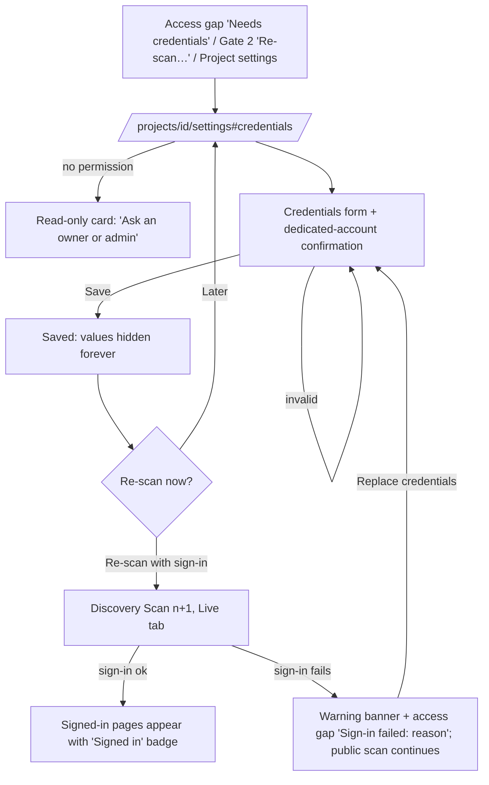

# P2 — AI QA Analyst Platform: Phase 2 UX (Requirements, Strategy, Plan, AI QA Analyst)

## 1. Goal and user
Source: `docs/spec/qa-analyst-platform.md` §2, §5 steps 9–12, §6, §7, §15–§17, §18 G3–G4; roadmap stories P2-01…P2-10; architecture agents B and C.

The user is the same QA lead, test analyst or product owner from Phase 1. Discovery is done. Phase 2 turns those findings, plus any requirement documents they upload, into **provisional requirements** they can trust. Each requirement is labelled Observed / Inferred / Assumed / Unverified, cites its evidence and has Given/When/Then acceptance criteria. The user reviews and approves the set (Gate 3) and gets a **risk-based Test Strategy** they approve (Gate 4). A **Test Plan** is then derived from the approved strategy, and all three are available as reports. An **AI QA Analyst** answers questions from project data with citations and proposes changes as diffs the user accepts. It never silently applies changes.

The design principle from Phase 1 still holds: earn trust with evidence and honest states, not volume. In Phase 2 that also means **nothing the AI produces replaces human work without a visible diff and a decision**.

This spec **extends** `docs/design/P1-qa-analyst-phase1.md`. Tokens, shell, focus, motion, gate and report patterns from that spec apply unless restated here. Section references like "P1 §8.4" point to it.

---

## 2. Token additions (`web/src/app/globals.css`)

```css
@theme {
  /* Provenance (P1 had observed + inferred; assumed + unverified now get distinct styling) */
  --color-observed-fg:   #1A2847; --color-observed-bg:   #EEF2F8; --color-observed-line:   #B9C6DD; /* solid ring   */
  --color-inferred-fg:   #6B3FA0; --color-inferred-bg:   #F6F2FC; --color-inferred-line:   #6B3FA0; /* dashed       */
  --color-assumed-fg:    #0B6670; --color-assumed-bg:    #ECF7F8; --color-assumed-line:    #0B6670; /* dotted, 6.1:1 */
  --color-unverified-fg: #535D70; --color-unverified-bg: #FFFFFF; --color-unverified-line: #858FA1; /* dashed, hollow */

  /* Diffs (reuse semantic tints; strike/underline carry meaning, not colour alone) */
  --color-diff-add-bg: #ECFDF3; --color-diff-add-fg: #067647;
  --color-diff-del-bg: #FEF3F2; --color-diff-del-fg: #B42318;
}
```

**Risk levels** reuse semantic tokens, and every cell also shows the level as text:

| Level | Scores | Style |
|---|---|---|
| Low | 1–4 | `success-bg` / `success-fg` |
| Medium | 5–9 | `warning-bg` / `warning-fg` |
| High | 10–16 | `danger-bg` / `danger-fg` |
| Very high | 20–25 | `danger-solid` / white, bold (4.6:1) |

**Status tones:** add the following to `TONES` in `ui/StatusPill.tsx`:
- `NEEDS_INFO`: amber
- `REJECTED`: grey (a decision, not a failure)
- `OUT_OF_DATE`: amber (the existing `STALE` key maps here too)
- `LOCKED`: grey
- `EXTRACTING`: blue
- `UPLOADING`: blue

---

## 3. Information architecture changes

### 3.1 New and changed routes
| Route | Screen |
|---|---|
| `/projects/[id]/requirements` | Requirements workspace. `?view=list|readiness|sources|review` plus filter params (§5.2). Default `list`. |
| `/projects/[id]/requirements/[key]` | Requirement detail (`REQ-0004`). `?v=<n>` shows an older revision read-only. |
| `/projects/[id]/requirements/changes?run=<n>` | Review regenerated requirements (diff). |
| `/projects/[id]/test-strategy` | Strategy workspace. `?view=strategy|risks|plan|review`. Default `strategy`. |
| `/projects/[id]/settings` | **Project settings** (new; not one of the 12 sidebar sections). Scan settings and **test credentials**. Reached from the header `⋯` menu ("Project settings"), the Overview "Scope & authorisation" card and every "Add credentials" action. |
| `/projects/[id]/reports/{requirements,test-strategy,test-plan}?version=<n>` | The three new reports. |
| `/projects/[id]/assistant` | AI QA Analyst workspace. `?thread=<id>`. |

### 3.2 Sidebar
- `PROJECT_SECTIONS` (`web/src/lib/sections.ts`): Requirements, Test Strategy and AI QA Analyst become `phase: 2`, and `isBuilt` becomes `phase <= CURRENT_PHASE` (2). They lose their phase badge.
- A built section can carry one **attention badge**, right-aligned. It is amber, uses `Badge`, and its accessible name is appended to the link.

  | Badge | When | Accessible name |
  |---|---|---|
  | "Review" | Its gate is waiting | "Requirements, Gate 3 waiting for your review" |
  | "Out of date" | The stage is stale | "Test Strategy, out of date" |
  | "{n}" | The assistant has pending proposals | "AI QA Analyst, 2 proposals to review" |

  - Only one badge is shown, in that priority order.

### 3.3 Header `⋯` menu (`workspace/ProjectHeader.tsx` `MoreMenu`)
Add the following items:
- "Project settings"
- "Re-scan site" (unchanged). When credentials are saved, the confirm dialog adds a "Sign in with the saved test account" checkbox, on by default.
- "Ask AI QA Analyst" (opens the side panel, §11.6). Below `md` this item is the only entry point to the panel, because the header button collapses into the menu.

---

## 4. Authenticated discovery (P2-01)

### 4.1 Flow

- Credentials can also be entered in the scan settings on `/projects/new`. Re-enable the P1 §6 credential block in `ScanSettingsFields`, replacing the Phase 1 sentence "Test-account credentials arrive in Phase 2."
- They can also be entered in the re-scan dialog.
- All three entry points use one shared `CredentialsFields` component.

### 4.2 Project settings: Test credentials card
```
Project settings                                                          (h1)
Tabs: Scan settings | Test credentials

+-- Test credentials -------------------------------------------------------------+
| Use a dedicated test account                                         (Callout   |
| • Create an account only for testing. Never use a real customer's or a          |
|   colleague's account.                                                 warning) |
| • Give it the least access needed. Avoid admin accounts unless you want admin   |
|   pages covered.                                                                |
| • Two-step verification and CAPTCHAs can't be completed by discovery.           |
| • Signed-in pages are screenshotted. Use an account that holds test data only.  |
|                                                                                 |
| Status:  ✓ Saved · added by Daniele Edema, 13 Nov 2026 10:02                    |
| Sign-in page   https://www.acme.com/login                                       |
| Username       Saved (hidden)                                                   |
| Password       Saved (hidden)                                                   |
| Last sign-in   ✓ Signed in during Scan 3 · 13 Nov 2026 10:05                    |
|                                                                                 |
| [Re-scan with sign-in]  [Replace credentials]  [Remove credentials]             |
+---------------------------------------------------------------------------------+
```
**Replace form (inline in the card):**
- Sign-in page URL: prefilled, because it is not secret.
- Username or email: empty.
- Password: empty, using `PasswordField` with the show/hide toggle, `autocomplete="off"`.
- Checkbox (required): "This is a dedicated test account, not a real person's account."
  - Your confirmation is recorded with your name and the time.
- Note: "Saved encrypted and used only by the discovery browser. You won't be able to see these values again; to change them, replace them."
- Buttons: [Cancel] [Save credentials].

**Rules:**
- **Write-only.** After saving, the username and password are never rendered. The API never returns them.
  - There is no "reveal" action.
  - Do not prefill the username on Replace.
- All three fields are required together (P1 S16, S17 copy reused). The checkbox is required.
- Pasting and password managers are allowed (WCAG 3.3.8).
- On save, the toast is "Test credentials saved. Re-scan to use them." The card shows [Re-scan with sign-in] as the primary action.
- **Remove:** `ConfirmDialog` (danger). Title "Remove test credentials?" Body "Future scans will cover public pages only. Earlier scans and their evidence are kept." [Cancel] [Remove credentials].
- **Permission:** owner and admin only (Open question 4). Members see the status rows and the note "Only owners and admins can change test credentials." There is no form.

### 4.3 Sign-in in the discovery UI
Additions to P1 §8:
- **Live view (P1 §8.1):** when credentials are used, a status chip appears beside the host: `KeyRound` "Signed in as test account". If sign-in fails, it becomes amber "Not signed in".
- **Activity feed:** the Discovery Agent emits these messages (tone reference):
  - "Signing in at /login with the saved test account"
  - "Signed in. Now exploring signed-in pages"
  - "Sign-in failed: the site reported an error after submitting the form"
  - "Signed out during the scan at /settings (session ended). Remaining signed-in pages are listed as access gaps"
  - "Skipped /logout — would end the session"
- **Sitemap / list / page detail:**
  - Pages visited with the session get a `Badge` "Signed in" with a `KeyRound` icon. The visually hidden text reads "visited while signed in".
  - A filter option "Signed-in pages" is added.
  - Page detail adds the row "Visited while signed in as the test account".
- **Summary:** adds `StatTile` "Signed-in pages {n}". The "Scope & settings" row reads "Credentials: test account, sign-in succeeded" or "…sign-in failed". Values are never shown.
- **Access gaps:** new reasons in the fixed vocabulary.

  | Reason | Suggested next step |
  |---|---|
  | Sign-in failed: the site rejected the username or password | Replace credentials and re-scan |
  | Sign-in failed: no sign-in form found at {path} | Check the sign-in page URL |
  | Sign-in failed: extra verification required (two-step code or CAPTCHA) | Use a test account without extra verification |
  | Sign-in failed: still on the sign-in page after submitting | Check the account works in a normal browser, then re-scan |
  | Signed out during scan | Re-scan; if it repeats, the site may end sessions quickly |

  - If the site showed a message, the row adds it as untrusted quoted text: "Site message: 'Invalid credentials'". It is escaped and truncated to 120 characters.
  - The row also always says: "We tried once, to avoid locking the account."
- **Gate 2 checklist:**
  - On success it adds "✓ Signed in with the test account: {n} signed-in pages visited".
  - On failure it adds "✗ Sign-in failed: {reason}". The recommendation then becomes "Replace the credentials and re-scan before deriving requirements."
- **Gate 1 / scan copy:** the "What discovery does" text becomes: "…It does not submit forms that send, create, change or delete data. With test credentials, it submits the sign-in form only."

### 4.4 States
| State | What the user sees | Copy |
|---|---|---|
| No credentials | Card with guidance + empty form | "No test credentials. Discovery covers public pages only." |
| Saving | Button loading, fields read-only | "Saving…" |
| Saved, never used | Status row | "Saved. Not used yet. Re-scan to sign in." |
| Last sign-in succeeded | Green row | "Signed in during Scan {n} · {datetime}" |
| Last sign-in failed | Amber row + [Replace credentials] primary | "Sign-in failed during Scan {n}: {reason}" |
| Save failed | InlineError | "Couldn't save the credentials. Nothing was changed. Try again." |
| Sign-in URL off-scope | Field error | P1 S17 |
| Confirmation unticked | Field error, focus to checkbox | "Confirm this is a dedicated test account." |
| No permission | Read-only card | "Only owners and admins can change test credentials." |

---

## 5. Requirements workspace (P2-02, P2-03, P2-04)

### 5.1 Layout
```
[Project header + compact lifecycle]
Requirements                                   Version [4 · 13 Nov 10:40 ▾]  [Regenerate…] [Open report]
[Out-of-date banner, when stale — §5.8]
[Gate 3 banner, when waiting — reuse GateBanner]
Tabs:  Requirements (42) | Ready & Done | Source documents (2) | Review · Gate 3
```
- Use `Tabs` from `ui/Tabs.tsx`. The selected tab is in `?view=`.
- The **version selector** lists requirement-set versions with their source ("Generated from Scan 3 + 2 documents", "Edited").
  - Older versions are read-only, with the P1 "viewing an older …" info banner.
- **[Regenerate…]** opens the dialog in §5.7.
- **[Open report]** goes to the Requirements Specification (§10).

### 5.2 Requirements tab: filter bar + table
```
Search [ REQ id, title or text   ]  Status [Any ▾] Label [Any ▾] Category [Any ▾] Source [Any ▾] [More filters ▾]
Active: [Status: Draft ×] [Label: Assumed ×]  Clear filters                        What do these labels mean? ⓘ
Showing 12 of 42                                                       Sort [ID ▾]

+---------------------------------------------------------------------------------------------------+
| [ ] | ID        | Requirement                            | Label        | Conf.     | Source   | AC | Status        |
|-----|-----------|----------------------------------------|--------------|-----------|----------|----|---------------|
| [ ] | REQ-0001  | Visitor can search products by keyword | ◉ Observed   | 92% High  | Scan 3   | 3  | ✓ Approved 🔒 |
|     |           | Functional · Search                    |              |           |          |    |               |
| [ ] | REQ-0007  | Contact form validates email format    | ◌ Inferred   | 68% Med.  | Scan 3   | 2  | ○ Draft  ✎    |
|     |           | Functional · Forms                     |              |           |          |    |               |
| [ ] | REQ-0019  | Pages meet WCAG 2.2 AA contrast        | ⋯ Assumed    | 40% Low   | User     | 1  | ? Needs info  |
|     |           | Non-functional · Accessibility         |              |           |          |    |               |
| [ ] | REQ-0023  | Order confirmation email is sent       | ◇ Unverified | 55% Med.  | Doc p.4  | 2  | ○ Draft  ⚠    |
|     |           | Functional · Checkout                  |              |           |          |    |               |
+---------------------------------------------------------------------------------------------------+
```
**Columns:**
- Checkbox.
- **ID:** mono. ID and title together form one link to the detail page.
- **Requirement:** the title, with `category · related feature` on a second line in `text-small text-fg-muted`.
- **Label:** `ProvenanceLabel` (§5.4).
- **Confidence:** `ConfidenceValue` (§5.4).
- **Source:** "Scan 3", "{doc name} p.4" (truncated with a tooltip) or "User".
- **AC:** acceptance-criteria count. 0 shows a warning icon and the text "None".
- **Status:** `StatusPill`, plus these icons, each with a tooltip and sr-only text:
  - 🔒 Locked
  - ✎ Edited by a person
  - ⚠ Conflict between document and application
  - ✦ Changed in latest generation

**Filters** are URL-synced, so the browser Back button and shared links work.

| Filter | Options |
|---|---|
| Status | Draft, Approved, Rejected, Needs info |
| Label | Observed, Inferred, Assumed, Unverified |
| Category | Functional; Non-functional: Usability, Accessibility, Performance, Security, Compatibility, Reliability |
| Source | Discovery, Document (each doc), User |
| More filters | Confidence (High ≥ 80%, Medium 50–79%, Low < 50%) · Feature · Locked · Edited by people · No acceptance criteria · Document conflicts · Changed in latest generation |

- Each active filter shows as a removable chip ("Remove filter Status: Draft").
- **Rejected requirements are hidden by default.** The status filter shows "Any (except Rejected)", and a quiet line under the table says "{n} rejected requirements hidden. Show them".
- **Sort options:** ID, Title, Confidence (low first), Status, Last changed.

**Bulk selection:**
- The header checkbox selects the visible page.
- When everything visible is selected, a line appears: "All {n} on this page are selected. Select all {m} matching requirements".
- A sticky **BulkActionBar** appears at the bottom of the viewport while anything is selected:
  ```
  12 selected   [Approve 12]  [Reject…]  [Mark as needs info]  [Lock]  [Unlock]   Clear selection
  ```
  - It is a `role="region"` with `aria-label="Bulk actions"`. Selection changes are announced through the page status region ("12 requirements selected").
- **Bulk approve guard:** if the selection includes Assumed or Unverified items, low-confidence items, or items with no acceptance criteria, show a `ConfirmDialog`:
  - Title: "Approve 12 requirements?"
  - Body: "3 are Assumed or Unverified and 1 has no acceptance criteria. Approving confirms them as requirements for testing; their labels stay as they are."
  - Actions: [Cancel] [Approve 8 only] [Approve all 12]. "Approve 8 only" skips the flagged items.
  - Without flags, approve runs immediately. The toast reads "12 requirements approved." with an [Undo] action, which reverts to the prior statuses within 10 s.
- **Bulk reject** opens the reject dialog (§5.3) once, and the reason applies to all.
- Locked items are still approvable. Edits to them are blocked (§5.3).

**Responsive:**
- Below `md` the table becomes stacked cards: ID + status, title, then label + confidence + source chips, and a checkbox at the top-left with a 44px target.
- Filters collapse into a [Filters ({n})] button that opens a full-screen sheet.
- The BulkActionBar shows the primary action plus a `⋯` menu.

### 5.3 Requirement detail (`/projects/[id]/requirements/REQ-0007`)
```
Requirements / REQ-0007                                        ‹ Previous   7 of 12 (filtered)   Next ›
REQ-0007 · Contact form validates email format                                      (h1)
[○ Draft] [◌ Inferred] Confidence 68% · Medium   [✎ Edited]                [Approve] [Reject…] [Edit] [⋯]
                                                                 ⋯ = Lock · Mark as needs info · Ask AI QA Analyst
                                                                     about this · Copy link
+-- main (2/3) ---------------------------------------------+ +-- side (1/3) ---------------------------+
| Description                                               | | Category   Functional · Forms           |
| The contact form rejects email addresses without "@" and  | | Source     Discovery · Scan 3           |
| shows an error next to the field.                         | |            Checkout spec.pdf p.4 §3.2   |
|                                                           | | Generated  AI · Requirements v4         |
| Why Inferred                                              | | Last change  D. Edema · 13 Nov 10:42    |
| The field has type="email" and is required. The form was  | |----------------------------------------|
| not submitted (discovery is read-only), so the error      | | Related features                        |
| message itself was not observed.                          | |  Form · Contact (/contact) →            |
|                                                           | |----------------------------------------|
| Evidence  [Screenshot EV-0042] [DOM EV-0043] [Doc p.4]    | | Linked test cases                       |
|                                                           | |  None yet. Test cases are written in    |
| Assumptions                                               | |  Phase 3, after the Test Strategy is    |
|  1. The validation runs in the browser before sending.    | |  approved.                              |
|                                                           | |----------------------------------------|
| Acceptance criteria (2)                    [Add criterion] | | Revision history (5)          View all |
| +-------------------------------------------------------+ | |  v5 Edited by D. Edema · 10:42          |
| | AC-0012                         [○ Draft] [Edit] [⋯]  | | |  v4 Regenerated (Requirements v4)       |
| | Given  I am on the Contact us page                    | | |  v3 Approved by A. Lee                  |
| | When   I enter "name.example.com" in Email and send   | | +----------------------------------------+
| | Then   the form is not sent                           | |
| | And    an error explains the email format is invalid  | |
| +-------------------------------------------------------+ |
+-----------------------------------------------------------+
```
**Header**
- Previous/Next walk the filtered set the user came from. The filters are passed as query params, so the set survives a refresh.
- Actions depend on status:
  - Draft / Needs info: [Approve] (primary), [Reject…], [Edit].
  - Approved: [Edit], [Reject…], plus [Move back to draft] in the `⋯` menu.
  - Rejected: [Restore to draft].

**Side panel** stacks under the main column below `lg`. Its rows are:
- Category.
- Source: one line per source, each a link.
  - Discovery → the Discovery Summary of that scan.
  - Document → opens the excerpt in the `EvidenceDrawer` (§7.3).
  - User → the person's name.
- Generated by: `GeneratedByLabel`, extended with `human` → "Written by a person".
- Last change.
- Related features: links to Discovery `?view=functionality` filtered to the feature.
- **Linked test cases:** an honest empty state. It shows no count and no sample data.
- Revision history: the latest 3, plus "View all".

**Acceptance criteria** (`AcceptanceCriteriaList`, new)
- Each criterion is a card. `Given` / `When` / `Then` keywords are bold and fixed-width aligned, and `And` lines are allowed.
- Each criterion has its own status: Draft, Approved or Rejected.
- **Edit form:**
  - Three `TextArea`s labelled Given, When and Then (2 rows each), plus [Add "And" line] under Then.
  - [Cancel] [Save criterion].
  - Validation: each field is required ("Describe the starting situation." / "Describe the action." / "Describe the expected result.").
- **[Add criterion]** opens the same form, empty. The new criterion's source is User.
- **Approving the requirement** also approves its Draft criteria. The confirm line in the toast reads "REQ-0007 and 2 acceptance criteria approved."
- A requirement with 0 criteria gets an amber Callout: "No acceptance criteria. Requirements need at least one before Gate 3 can pass its checks." [Add criterion]. This is advisory and does not block approval.

**Edit requirement** (in place; the main column turns into a form)
- Fields: Title (`TextField`, required, 120 characters), Description (`TextArea`, required), Category (`SelectField`), Related features (multi-select from discovered features), Assumptions (list editor: add, edit, remove, move up/down).
- "Reason for change" (optional, max 200 characters). It is stored in the revision.
- Buttons: [Cancel] [Save changes].
- **The label (provenance) and confidence are not editable** (Open question 3). The form shows them read-only, with the help text "Labels come from evidence. To confirm an Assumed or Unverified requirement, approve it; to correct it, edit the text or reject it."
- On save the item gains the **Edited** flag. Regeneration never overwrites it (§5.7). Toast: "REQ-0007 saved as version 6."
- **Locked:** the [Edit] button is replaced by [Unlock to edit]. Unlocking asks: "Unlock REQ-0007? Unlocked requirements can be edited. They stay protected from regeneration only if you edit them." [Cancel] [Unlock].
- **Conflict (optimistic locking, HTTP 409):** a danger Callout above the form: "Someone else changed REQ-0007 while you were editing (now version 6 by A. Lee)." [Compare with their version] [Discard my changes]. "Compare" opens the diff (§5.6) with *their* version on the left and *your unsaved text* on the right. The user then chooses [Keep theirs] or [Save mine as version 7]. Unsaved text is never lost silently.
- **Leaving with unsaved changes:** `ConfirmDialog` "Discard unsaved changes to REQ-0007?" [Keep editing] [Discard].

**Reject** (`RejectDialog`, new; also used for bulk reject)
- Reason (`SelectField`, required): Not a real feature · Duplicate of another requirement · Out of scope · Incorrect · Other.
- If the reason is Duplicate, a "Duplicate of" requirement picker is required.
- Comment: optional, but required for Other.
- Footer note: "The agent won't propose rejected requirements again. You can restore them later."
- Buttons: [Cancel] [Reject requirement].

**Revision history** (`RevisionHistory`, new; a `Drawer` from "View all")
- Ordered list, newest first. Each entry shows the version, change type (Generated, Regenerated, Edited, Approved, Rejected, Locked, Restored, Applied from AI QA Analyst proposal), who, when and the reason.
- Each entry has [Compare with previous], which opens the diff, and [Restore this version] (`ConfirmDialog`: "Restore version 3? This creates version 6 with the content of version 3. Nothing is deleted.").
- The `?v=<n>` view renders the detail page read-only with the banner "You're viewing version {n} of REQ-0007. The latest is version {m}." [View latest].

### 5.4 Provenance label, legend and confidence
**`ProvenanceLabel`** extends `domain/ObservationLabel.tsx`. Keep `ObservationLabel` as an alias and fix the duplicate grey styling of Assumed and Unverified. Four styles that differ by **icon, border style and fill**, not colour alone:

| Label | Icon (lucide) | Chip | Definition (tooltip + sr-only) |
|---|---|---|---|
| Observed | `Eye` | navy text on navy-50, solid ring | "Seen directly in the application, with evidence." |
| Inferred | `Lightbulb` | violet text on violet tint, dashed border | "Concluded from observed evidence; not verified by testing." |
| Assumed | `MessageCircleQuestion` | teal text on teal tint, dotted border | "Expected behaviour with no direct evidence. Confirm it with the product owner." |
| Unverified | `EyeOff` | grey text on white (hollow), dashed border | "Stated by a source such as a document, or its evidence couldn't be resolved. Not checked against the application." |

**`ProvenanceLegend`** replaces `LabelsHelp`.
- It is a `Disclosure`-based popover with the trigger "What do these labels mean?". It lists all four chips with their definitions, plus two rules:
  - "Backend behaviour (data saved, emails sent, payments processed) is never labelled Observed: discovery only sees the user interface."
  - "Approving a requirement doesn't change its label. An approved Assumed requirement is still an assumption, now accepted by your team."
- It appears in the Requirements tab header, on the detail page next to the label, in the regeneration review and as a report appendix.
- Discovery views keep showing only the two labels they use, with the same component.

**Why-label line:** every non-Observed requirement shows a "Why {label}" paragraph from the agent's `reason`.

**`ConfidenceValue`** (new, inline):
- Shows "68% · Medium" (tabular nums) with a tooltip: "The agent's confidence in this requirement, based on how much evidence supports it. It isn't a test result."
- Bands: High ≥ 80, Medium 50–79, Low < 50.
- Low adds a `fg-muted` `AlertCircle` icon.
- There is no colour bar.

### 5.5 Statuses and flags
| Status | Pill tone | Meaning |
|---|---|---|
| Draft | amber | Proposed, not reviewed |
| Approved | green | Accepted for testing |
| Needs info | amber, `CircleHelp` | Reviewer needs an answer before deciding (optional note shown) |
| Rejected | grey, `CircleSlash` | Not a requirement; reason shown |

| Flag | Icon | Meaning |
|---|---|---|
| Locked | `Lock` | Can't be edited or replaced by regeneration until unlocked |
| Edited | `PencilLine` | Changed by a person. Regeneration proposes changes instead of overwriting |
| Conflict | `TriangleAlert` | A document says one thing and the application shows another (§7.3) |
| Changed in latest generation | `Sparkle` | Added or changed by the last applied regeneration |

### 5.6 Diff presentation (`DiffView`, new; shared by revisions, regeneration, plan versions and assistant proposals)
- **Field-level:** only changed fields are shown, each under its field name. Unchanged fields are collapsed: "3 unchanged fields. Show".
- **Word-level text diff:**
  - Deletions: `<del>` with `diff-del` tints and a strike-through.
  - Insertions: `<ins>` with `diff-add` tints and an underline.
  - Visually hidden prefixes read "removed:" and "added:".
- **Layout:**
  - At `lg+` the user can toggle [Side by side | Inline] using `Segmented`. Inline is the default.
  - Below `lg`, inline only.
- **List fields** (assumptions, AC): items are marked `+ Added`, `− Removed` and `~ Changed`, each as text and an icon.

### 5.7 Regeneration (preserves locked and edited items)
**Dialog** ([Regenerate…]):
```
Regenerate requirements?
The Requirements Engineering Agent will derive requirements again from Scan 3 and 2 source documents.
• 9 locked or edited requirements are kept. Any changes the agent suggests for them are shown as proposals.
• 5 rejected requirements stay rejected and won't be proposed again.
• Nothing changes until you review and apply the results.
Guidance for the agent (optional) [ e.g. "Focus on checkout; ignore the blog."           ]
                                                       [Cancel]  [Regenerate]
```
- **While running:** the Requirements tab shows the P1 info Callout "Regenerating requirements… The current version stays in use until you apply changes." The activity feed shows the agent's events.
- **When done:** a toast and Callout "Regenerated requirements are ready to review." [Review changes].

**Review screen** (`/requirements/changes?run=5`, `ChangeReview`, new):
```
Review regenerated requirements                     Version 4 (current) → proposed version 5
Summary: 6 added · 4 changed · 2 no longer found · 3 proposals for protected items · 27 unchanged
Filter: [All changes ▾]                               [Accept all suggested]   [Apply 11 changes]

ADDED (6)
+ REQ-0043 Newsletter sign-up requires consent checkbox  [◉ Observed] 88%   (●) Accept  ( ) Skip
  Evidence EV-0310 · Scan 3 /newsletter                                        [View details]
CHANGED (4) — not protected
~ REQ-0007 Contact form validates email format                               (●) Accept  ( ) Keep current
  Description: The contact form rejects ~~addresses~~ ++email addresses without "@"++ …
PROPOSALS FOR PROTECTED ITEMS (3) — locked or edited by people
~ REQ-0001 🔒 Visitor can search products by keyword                         ( ) Accept  (●) Keep current
NO LONGER FOUND (2)
− REQ-0015 Careers page lists open roles   [Draft]                           (●) Mark rejected  ( ) Keep
− REQ-0009 Visitor can filter by price     [Approved]                        ( ) Mark rejected  (●) Keep
  Not found in Scan 3. /products filters were not visible. Evidence from Scan 2 is kept.
UNCHANGED (27) — collapsed
```
- Each row is a radio group (`fieldset` + `legend` = the requirement ID and title). "Accept all suggested" resets every row to its default.
- **Defaults:**
  - Added → Accept.
  - Changed (unprotected) → Accept.
  - Protected → Keep current.
  - No longer found: Draft → Mark rejected (reason "No longer found in Scan {n}"); Approved → Keep.
- **[Apply {n} changes]** creates the new version and returns to the list with the "Changed in latest generation" filter active. The toast reads "Version 5 applied: 11 changes."
- **[Discard regeneration]** is a secondary action in the page header. Confirm: "Discard these results? Version 4 stays current." Discarded runs stay in the version history, marked "Discarded".
- **Removed items are never deleted.** "Mark rejected" keeps the item and its evidence.
- **Gate effect:** if Gate 3 was approved, applying reopens it (§6.2) and the copy under the Apply button says so: "Gate 3 will need approval again."

### 5.8 Out of date (upstream changed)
- If a newer discovery scan was approved (or completed under a "recommended" G2), or a source document was added or removed after the current version was generated, show a warning Callout under the page title.
  - Title: "Requirements may be out of date"
  - Body: "They were generated from Scan 2. Scan 3 finished on 13 Nov. Regenerate to update them; locked and edited requirements are kept."
  - Actions: [Regenerate…] [What changed?]. "What changed?" opens a drawer listing new or removed pages and features between the scans, as available from the API.
- The lifecycle stage and sidebar show "Out of date". The workspace stays fully usable.

### 5.9 Requirements states
| State | What the user sees | Copy |
|---|---|---|
| Not started: discovery not finished | `EmptyState` | "Requirements are derived after discovery finishes." [Go to Application Discovery] |
| Not started: waiting for Gate 2 (policy required) | `EmptyState` + GateBanner for G2 | "Requirements start when Gate 2 (Discovery completeness) is approved." [Review Gate 2] |
| Queued / Running (first generation) | Card: spinner + step list (9 Derive requirements · 10 Acceptance criteria · 11 Ready & Done) with statuses, + activity feed filtered to the agent | "The Requirements Engineering Agent is deriving requirements from Scan {n}{ and {m} documents}." |
| Paused | Amber banner | "Requirements generation is paused." [Resume analysis] |
| Failed | ErrorState card with reason + [Try again] | "Requirements generation failed: {reason}. Discovery results are unaffected." |
| Generated by rules (AI off) | `GeneratedByLabel` in header + info Callout | "Generated by rules (AI not configured). Rules cover forms, navigation, search and sign-in. Non-functional requirements are limited; add them yourself or set up AI." |
| Partial (budget/time limit) | Amber Callout | "Requirements are partial: the agent stopped at the {limit}. {n} features weren't covered: {list}." [Regenerate…] |
| Loaded | Table | — |
| Filters match nothing | EmptyState in the table | "No requirements match these filters." [Clear filters] |
| All rejected / zero produced | EmptyState | "No requirements yet. Discovery found too little to derive them. Add one yourself or re-scan." [Add requirement] [Re-scan site] |
| Loading | Skeleton rows (8) | — |
| Load error | ErrorState in panel | "Couldn't load requirements. Try again." |
| Save error | InlineError above the form actions | "Couldn't save REQ-0007. Your changes are still here. Try again." |
| Edit conflict | §5.3 | — |
| No permission for an action | Button shown; on press InlineError | "You don't have permission to approve requirements. Ask an owner or admin." |
| Offline | P1 offline banner; save buttons stay enabled and fail with the error | "You're offline. Your changes are still here; save again when you reconnect." |
| Older version | Info banner, read-only | "You're viewing requirements version {n}. The latest is version {m}." [View latest] |
| Out of date | §5.8 | — |
| Regeneration ready | Callout | "Regenerated requirements are ready to review." [Review changes] |

**[Add requirement]** is a secondary button in the Requirements tab toolbar. It opens the edit form on a new detail page.
- Source: User.
- Label: Assumed. There is no evidence picker in Phase 2.
- Status: Draft.
- New key: next REQ id.

---

## 6. Definition of Ready / Done (P2-05) and Gate 3

### 6.1 Ready & Done tab
```
+-- Definition of Ready (9) ------------------ [Edit] -+ +-- Definition of Done (11) ------------------ [Edit] -+
| A requirement is ready for test design when:          | | Testing of a requirement is done when:               |
| 1. It has at least one approved acceptance criterion  | | 1. All its test cases have been executed             |
| 2. Its label is Observed or Inferred, or the product  | | 2. No open Critical or High defects remain           |
|    owner has approved it                              | | 3. Evidence is attached to every executed test       |
| …                                         Suggested   | | …                                       Added by you |
| Approved with Gate 3 · 13 Nov 2026                    | | Approved with Gate 3 · 13 Nov 2026                   |
+-------------------------------------------------------+ +------------------------------------------------------+
```
- Two cards, side by side at `lg+` and stacked below.
- Items are **numbered criteria, not tick boxes**. They define readiness; they aren't evaluated in Phase 2. Rendering checkboxes would imply a pass/fail state that doesn't exist yet.
- Each item has a quiet origin tag: "Suggested" (agent or rules) or "Added by you".
- **Edit mode** (`ChecklistEditor`, new):
  - Each row is a `TextField` with the label "Criterion {n}", plus [Move up] [Move down] [Remove], all icon buttons with `aria-label`s. There is no drag.
  - [Add criterion] adds an empty row and focuses it.
  - [Cancel] [Save]. Empty rows are dropped on save. A list of 0 items gets the error "Add at least one criterion."
  - Max 30 items, 300 characters each.
- Saving creates a revision (history via a "History" link, same `RevisionHistory` drawer).
- The checklists are versioned with the requirement set and are part of Gate 3. Editing them after G3 approval reopens G3 (§6.2).
- **States:**
  - Not generated: "Ready and Done criteria are generated with the requirements."
  - Load error: as §5.9.

### 6.2 Review · Gate 3 tab (`GateReviewPanel`, generalised)
```
+-- Gate 3 · Requirements review ------------------------------ [⚠ Waiting for your approval] -+
| Agent assessment: Ready with gaps                                                            |
| ✓ 42 requirements derived from Scan 3 and 2 documents                                        |
| ✓ 34 approved · 4 rejected                                                                   |
| ⚠ 4 still Draft: they won't be used by the Test Strategy Agent until approved                |
| ⚠ 2 requirements have no acceptance criteria (REQ-0019, REQ-0031)                            |
| ⚠ 6 approved requirements are Assumed or Unverified: confirm them with the product owner     |
| ⚠ 1 conflict between a document and the application (REQ-0023)                              |
| ✓ Definition of Ready (9) and Done (11) defined                                               |
|                                                                                              |
| Recommendation: Resolve the 2 requirements without acceptance criteria, then approve.        |
| The recommendation is advisory. You can approve regardless.          [AI-generated]          |
|                                                                                              |
| Comment [                                                              ]                     |
| [Approve requirements]  [Request changes]                       View Requirements Specification → |
+----------------------------------------------------------------------------------------------+
```
**Generalise `GateReviewPanel`.** Today it is coupled to the discovery scan (`ScanDetail`, the `completenessChecklist` copy and "Approve discovery"). The new props are:
- `assessment`
- `checks: {tone, text, href?}[]`. Each check that names items links to the filtered list.
- `recommendation`
- `approveLabel`
- `afterApproveCopy`
- `extraActions`
- `reportHref`

Gate 2 keeps its current behaviour through a `DiscoveryGateReview` wrapper.

Above the panel the tab shows four `StatTile`s: Requirements, Approved, Draft, Assumed or Unverified. Each links to the filtered list.

**Rules**
- **Every check number is computed by code** from the requirement set. The agent supplies only the assessment rating and recommendation text, labelled with `GeneratedByLabel`.
- **Approving with Drafts left:**
  - Drafts are excluded from the strategy input. The check line above says so.
  - On approve, a `ConfirmDialog` appears only if any drafts remain:
    - Title: "Approve with 4 drafts?"
    - Body: "Approved requirements go to the Test Strategy Agent. The 4 drafts are left out until you approve them."
    - Actions: [Review drafts] [Approve requirements].
- **Request changes:**
  - A comment is required (P1 behaviour).
  - The stage becomes "Changes requested". The panel then offers [Regenerate with this feedback], which opens §5.7 with the comment prefilled as guidance, and [Edit requirements].
- **After approval:** the approved line is shown (P1 pattern), followed by the next-stage copy "Requirements approved. The Test Strategy Agent is now writing the risk-based Test Strategy." with a [Go to Test Strategy] link.
- **Changes after approval** (edits, approvals, rejections, applied regeneration, DoR/DoD edits) **reopen Gate 3** for the new version (Open question 1):
  - The panel shows "Changes since approval: {n}" with a [Compare with approved version] diff link.
  - The Test Strategy keeps using the last approved version until Gate 3 is approved again. Re-approval marks the strategy "Out of date".
  - The first change after approval shows a one-time warning toast: "Requirements changed since Gate 3 approval. Approve again to pass the changes to the Test Strategy."
- **Policy `recommended`:** reuse the P1 "Ready for review" pill and copy.
- **No permission:** reuse the P1 `canApprove` Callout.

---

## 7. Source documents (P2-08)

### 7.1 Source documents tab
```
+-- Add requirement documents ---------------------------------------------------------------+
|  ┌ - - - - - - - - - - - - - - - - - - - - - - - - - - - - - - - - - - - - - - - - - - ┐   |
|  |  Drop PDF, Markdown or Word files here, or  [Choose files]                           |   |
|  |  PDF, MD, DOCX · up to 20 MB each · up to 10 documents per project                   |   |
|  └ - - - - - - - - - - - - - - - - - - - - - - - - - - - - - - - - - - - - - - - - - - ┘   |
|  ⓘ Documents are read as untrusted text. Instructions inside them are ignored. The agent   |
|    uses them as a source and cites the page or section. They don't replace evidence from   |
|    the application.                                                                         |
+--------------------------------------------------------------------------------------------+
+-- Documents (2) ----------------------------------------------------------------------------+
| Name                     Type  Size    Status                        Cited by     Added     |
| Checkout spec v2.pdf     PDF   1.2 MB  ✓ Ready · 14 pages            9 reqs       D. Edema  |
| Accessibility policy.md  MD    18 KB   ⚠ Partly read · see details   2 reqs       A. Lee    |
| Brand guide.docx         DOCX  4 MB    ◌ Extracting text… (pages 3/20)  —          now       |
| old-scan.pdf             PDF   9 MB    ✗ Couldn't read: password-protected  —      now  [Remove] |
+--------------------------------------------------------------------------------------------+
[Callout info, after any new Ready doc] 1 new document since requirements were generated. [Regenerate…]
```
- **The drop zone is never the only way to upload.** [Choose files] is a real button that opens the file input with `accept=".pdf,.md,.markdown,.docx"` and `multiple`. Dragging over the zone shows a 2px dashed `focus` border and the text "Drop to upload". Under reduced motion there is no animation.
- **Client checks** happen before upload, with errors listed per file in an InlineError list. Allowed files continue.
  - Unsupported type: "{name}: only PDF, Markdown and Word (.docx) files can be added."
  - Too large: "{name} is {size}. The limit is 20 MB."
  - Limit reached: "This project already has 10 documents. Remove one to add another."
- **Row actions** (`⋯`):
  - View extracted text. Opens a drawer showing escaped plain text, with page/section markers and the note "Showing the text we extracted. Formatting, images and tables may be missing."
  - Download original.
  - Remove from sources.
- **Remove:** `ConfirmDialog`. Title "Remove {name} from sources?" Body "It won't be used the next time requirements are generated. Requirements that cite it keep their citation, marked 'document removed'. The file is kept in the evidence store." [Cancel] [Remove].
- **Uploading before requirements exist is allowed.** The info line reads "This document will be used when requirements are generated."

### 7.2 Extraction states
| State | Status cell | Copy / detail |
|---|---|---|
| Uploading | `role=progressbar` per row, % | "Uploading… {p}%" + [Cancel upload] |
| Queued | blue pill | "Waiting to extract text" |
| Extracting | blue pill, spinner (static under reduced motion) | "Extracting text… (page {n} of {m})" |
| Ready | green | "Ready · {pages} pages · {words} words" |
| Partly read | amber + [Details] | "Pages {range} contain images only; their text couldn't be read. Scanned documents (OCR) aren't supported." |
| Contained instructions to AI | amber note, row still Ready | "This document contains text addressed to AI agents. It was treated as content and ignored." |
| Failed | red + [Remove] | "Couldn't read: {reason}". Reasons: "password-protected" · "the file is damaged" · "no text found" · "not a real {type} file" |
| Upload failed | red + [Try again] | "Upload failed. Check your connection and try again." |
| Removed | grey, shown under a "Removed (n)" disclosure | "Removed from sources by {name}, {date}" |
| Empty (no docs) | EmptyState under the drop zone | "No documents yet. Requirements come from discovery alone until you add one." |

### 7.3 How document-sourced requirements cite the document
- **Source line:** "Document · {name} · p. 4 · §3.2 Payment". The page appears for PDF; the heading path for MD and DOCX.
- **Evidence chip** `[Doc p.4]` opens the `EvidenceDrawer` in **document mode**:
  ```
  Evidence EV-0350 · Document excerpt
  Checkout spec v2.pdf · page 4 · §3.2 Payment · uploaded by D. Edema, 12 Nov
  "After payment succeeds, the customer receives an order confirmation email     (escaped
   within 5 minutes."                                                            quote, body-lg)
  [View in extracted text]  [Download original]
  Used by: REQ-0023
  ```
- **Label rules shown in the UI:**
  - Document only, not seen in the app → **Unverified**, with the why-line "Stated in Checkout spec v2.pdf. Not observable in the application during discovery."
  - Document and application agree → **Observed** or **Inferred** (per the app evidence), with both sources listed.
  - Document and application disagree → keep the app-based label and add the **Conflict** flag. The detail page shows a warning Callout:
    - Title: "The document and the application differ"
    - Body: "Document (p. 4): 'Password must be at least 12 characters.' Application (EV-0042): the field accepts 8 characters (minlength=8)."
    - Actions: [Keep application behaviour] [Keep document wording] [Mark as needs info]. Each action edits the requirement, with a revision note.
- A removed document's citation reads "Document removed from sources · {name} p. 4". The excerpt is still viewable.

---

## 8. Test Strategy workspace (P2-06) and Gate 4

### 8.1 Layout
```
Test Strategy                                Version [2 · 13 Nov 11:20 ▾]  [Regenerate…] [Open report]
[Out-of-date banner] [Gate 4 banner]
Tabs:  Strategy | Risk register (12) | Test Plan | Review · Gate 4
Based on Requirements version 5 (Gate 3 approved 13 Nov 10:55) · 34 approved requirements
```
The "Based on" line is always visible. It links to that requirement version.

### 8.2 Strategy tab
A document-style page at reading width `max-w-[960px]` with a sticky section nav at `xl` (reuse `ReportToc`). Each section is a `Card` with an [Edit] button (`EditableSection`, new). Editing one section never locks the others.

1. **Scope**: two lists, "In scope" and "Out of scope". Each item has a rationale and links ("Based on REQ-0001, RISK-003").
2. **Test levels**: a table with the columns Level · In scope · Rationale. Rows:
   - Component
   - Component integration
   - System
   - System integration
   - Acceptance

   "In scope" is shown as text ("In scope" / "Out of scope") with an icon. Out-of-scope rows explain why, e.g. "Component testing needs source-code access; this project tests the deployed site."
3. **Test types**: a table grouped under the headings Functional and Non-functional, with the columns Type · In scope · Rationale · Techniques · Needs separate approval.
   - Types are the §7 list (functional, regression, smoke, sanity, exploratory, usability, accessibility, compatibility, security, performance, load, stress, spike, endurance).
   - Performance, load, stress, spike, endurance and security rows that are in scope show an amber `Badge` with `ShieldAlert`: "Needs separate approval before running". Tooltip: "Planned only. These tests can't run until you approve their limits in a later phase."
4. **Techniques by feature**: a table with Feature · Techniques (chips: Equivalence partitioning, Boundary value analysis, Decision tables, State transition, Use case, Error guessing, Exploratory) · Why.
   - Below `md` it becomes a card per feature.
5. **Environments**: browsers, viewports and target URL(s), plus a "Not covered" list. Example: "Firefox and WebKit: planned for Phase 4 execution."
6. **Test data approach**: a text section, plus the fixed safety line "Tests use synthetic data only. No real customer data."
7. **Entry criteria** and **Exit criteria**: numbered lists using `ChecklistEditor`. Exit criteria may reference the risk levels and the Definition of Done.

**Edit section:**
- Lists use `ChecklistEditor`. Tables become row forms:
  - In-scope `Segmented` (In scope / Out of scope).
  - Rationale `TextArea`, required when the in-scope value changes: "Explain why you changed the scope."
  - Technique multi-select.
- [Cancel] [Save section]. Saving creates a strategy revision and marks the section **Edited** (protected on regeneration, same model as §5.7).
- Conflicts work as in §5.3.

**Regeneration** uses the same dialog-and-review pattern as §5.7. Edited sections and edited risks are protected, and their changes come as proposals.

### 8.3 Risk register tab
```
+-- Risk matrix (likelihood × impact) -----------------+  +-- Summary ------------------------+
|                 Impact →                              |  | 12 risks                           |
|            1 Negl. 2 Minor 3 Mod. 4 Major 5 Severe    |  | 2 Very high · 3 High · 5 Medium    |
| L 5 Almost   [ ]     [ ]     [1 H]   [ ]    [1 VH]    |  | 2 Low                              |
| i 4 Likely   [ ]     [ ]     [2 H]   [1 VH]  [ ]      |  | ⚠ 1 high risk has no test type    |
| k 3 Possible [ ]     [1 M]   [2 M]   [1 H]   [ ]      |  |   mapped (RISK-007)                |
| e 2 Unlikely [1 L]   [1 M]   [1 M]   [ ]     [ ]      |  | Scores are calculated by the       |
| 1 Rare       [1 L]   [ ]     [ ]     [ ]     [ ]      |  | system: likelihood × impact.       |
+-------------------------------------------------------+  +------------------------------------+
Filter: Level [Any ▾]  Feature [Any ▾]  Status [Open ▾]   [Clear matrix filter]       [Add risk]
| ID       | Risk                                   | L          | I          | Score       | Mitigation (test types)      | Status |
| RISK-001 | Checkout payment fails silently        | 4 Likely ▾ | 5 Severe ▾ | 20 Very high| Functional, Regression, E2E… | Open   |
|          | Features: Checkout · REQ-0023, REQ-0024 |            |            |             | + 2 notes                    |        |
```
- **Matrix** (`RiskMatrix`, new):
  - A real `<table>`: caption "Risk matrix: number of risks by likelihood and impact", row headers for likelihood, column headers for impact.
  - Each non-empty cell is a button showing the count and level abbreviation ("2 H"). Its accessible name is "2 risks, likelihood 4 Likely, impact 3 Moderate, score 12, High".
  - Activating a cell filters the list, and the filter chip "Matrix: L4 × I3" appears.
  - Empty cells are not focusable.
  - Cell colours follow the §2 risk levels, so the text carries the level.
  - Under 400px, cell labels shorten to the count only; the level stays in the accessible name and in the list.
- **List:** `Table`. Each row expands into a detail form (Disclosure row) with:
  - Description.
  - Related requirements and features (pickers).
  - Likelihood and Impact `SelectField`s, each with the 1–5 labels (Rare, Unlikely, Possible, Likely, Almost certain / Negligible, Minor, Moderate, Major, Severe).
  - Mitigations: test types (multi-select from in-scope types) plus free-text notes.
  - Status: Open, Mitigated or Accepted. Accepted needs a comment.
  - Provenance label and evidence links (risks cite requirements or evidence).
- **Scores are never computed in the browser.**
  - After a likelihood or impact change, the row saves immediately. The Score cell shows a spinner with the sr-only text "Recalculating score" until the API returns `score` and `level`. The matrix then updates.
  - If the save fails, the select reverts with an InlineError: "Couldn't update RISK-001. The previous rating is kept."
- **Checks** (computed by code) show in the Summary card and feed Gate 4:
  - "every High or Very high risk has at least one test type"
  - "{n} Accepted risks have no comment".
- **[Add risk]** opens the same form, empty. Source: User; label Assumed.
- **States:**
  - None: "No risks identified. Add one, or regenerate the strategy." [Add risk]
  - Loading: skeleton.
  - Error: ErrorState.
  - AI off: rule-based risks are labelled by `GeneratedByLabel`, with the Callout "Risks were generated by rules from the requirement categories. Review the likelihood and impact; rules use default ratings."

### 8.4 Review · Gate 4 tab
Same generalised `GateReviewPanel`. Code-computed checks:
- "✓ Based on Requirements version 5 (Gate 3 approved)". If Gate 3 is reopened: "⚠ Requirements changed after this strategy was written. Approving uses version 5."
- "✓ 6 test levels and 11 test types decided, each with a rationale" / "⚠ 2 decisions have no rationale".
- "✓ Every High and Very high risk is mapped to at least one test type" / "✗ RISK-007 (Very high) has no test type".
- "✓ Entry (5) and exit (7) criteria defined".
- "ⓘ 3 planned test types need separate approval before running: Performance, Load, Security". Info only, never a warning.

Approve label: "Approve test strategy". After approval: "Strategy approved. The Test Plan is being written from it." The panel then links to [Go to Test Plan].

The policy, request-changes, no-permission and reopen-after-change behaviour is the same as Gate 3 (§6.2).

### 8.5 Strategy states
| State | What the user sees | Copy |
|---|---|---|
| Not started: Gate 3 not approved | EmptyState + G3 banner | "The Test Strategy is written from approved requirements. Approve Gate 3 first." [Review Gate 3] |
| Running | Spinner card + feed (Test Strategy Agent) | "The Test Strategy Agent is writing a risk-based strategy from {n} approved requirements." |
| Failed | ErrorState + [Try again] | "Strategy generation failed: {reason}. Your requirements are unaffected." |
| Rules (AI off) | GeneratedByLabel + Callout | "Generated by rules (AI not configured). Scope and test types follow the requirement categories; rationales are brief. Review each section." |
| Partial | Amber Callout | "The strategy is partial: {sections} weren't generated before the {limit}." [Regenerate…] |
| Out of date | Warning Callout | "This strategy is based on Requirements version {n}. Version {m} was approved on {date}. Regenerate to update it; edited sections and risks are kept." [Regenerate…] |
| Section save error / conflict | as §5.9 / §5.3 | — |
| Loading / error | Skeleton / ErrorState | "Couldn't load the test strategy. Try again." |

---

## 9. Test Plan (P2-07)
The plan lives in the Test Strategy section, under its **Test Plan** tab. It is one document derived from the strategy.

```
Test Plan · Version 3                           [Version 3 · 13 Nov 11:40 ▾] [Compare versions] [Open report]
Derived from Test Strategy version 2 (Gate 4 approved 13 Nov 11:32)
+-- Contents (xl) -+ +-- Document (max-w 760) --------------------------------------------------------+
| 1 Introduction   | | 1 Introduction and objectives                                         [Edit]  |
| 2 Test items     | | …                                                                             |
| 3 Scope          | | 3 Scope                          From Test Strategy · Edit in Test Strategy → |
| 4 Approach       | | (read-only, rendered from the strategy)                                       |
| 5 Environments & | | 10 Schedule and milestones                                            [Edit]  |
|   test data      | | Not set. Add milestones if you need them in the plan.                         |
| 6 Entry & exit   | +-------------------------------------------------------------------------------+
| 7 Suspension &   |
|   resumption     |
| 8 Deliverables   |
| 9 Roles          |
| 10 Schedule      |
| 11 Risks         |
+------------------+
```
- **Sections:**

  | # | Section | Origin |
  |---|---|---|
  | 1 | Introduction & objectives | Plan |
  | 2 | Test items (features from requirements) | Plan |
  | 3 | Scope | Strategy, read-only |
  | 4 | Approach (levels, types, techniques) | Strategy, read-only summary |
  | 5 | Environments & test data | Strategy, read-only |
  | 6 | Entry & exit criteria | Strategy, read-only |
  | 7 | Suspension & resumption criteria | Plan |
  | 8 | Deliverables | Plan |
  | 9 | Roles & responsibilities | Plan |
  | 10 | Schedule & milestones | Plan |
  | 11 | Risks & contingencies | Links to the risk register, plus plan text |

  - **Editable sections are the plan-owned ones** (1, 2, 7, 8, 9, 10, 11). The strategy-derived ones show the tag "From Test Strategy" and a link to edit them there. This prevents the two documents disagreeing.
- **Schedule has no invented dates.** The agent never fills dates. Empty sections say "Not set."
- **Editing:** a `TextArea` for prose. Lists use `ChecklistEditor`, and roles use a two-column row editor (Role, Responsibility).
  - **Each save creates a new plan version.** An optional "Change note" is shown in the version list.
  - Toast: "Test Plan saved as version 4."
- **Versions:**
  - The selector lists every version with its author, time, note and source ("Derived from Strategy v2", "Edited", "Regenerated").
  - [Compare versions] opens `DiffView` with two version pickers.
  - Older versions are read-only, with the info banner pattern.
- **Out of date** (a newer strategy was approved):
  - Callout: "This plan was written from Strategy version 2. Version 3 was approved on {date}." [Update plan…]
  - Update uses the regeneration review (§5.7). Edited plan sections are protected and arrive as proposals.

| State | Copy |
|---|---|
| Not started: Gate 4 not approved | "The Test Plan is written from the approved Test Strategy. Approve Gate 4 first." [Review Gate 4] |
| Generating | "Writing the Test Plan from Strategy version {n}…" |
| Failed | "Couldn't write the Test Plan: {reason}." [Try again] |
| Rules (AI off) | "Generated from a template (AI not configured). Sections 1, 7, 8 and 9 contain standard wording. Edit them for this project." |
| Save error | "Couldn't save this section. Your text is still here. Try again." |

---

## 10. Reports (P2-09)

### 10.1 Reports list (`/projects/[id]/reports`)
Replace the Phase 1 "More reports arrive…" note for these three reports. The list becomes one row per report type, with the latest version:
```
Report                       Latest      Status                       Based on               Actions
Application Discovery Report Scan 3      ✓ Approved (Gate 2)          Scan 3                 [Open] [PDF ▾]
Requirements Specification   Version 2   ○ Draft · Gate 3 waiting     Requirements v5        [Open] [Download ▾]
Test Strategy                Version 1   ✓ Approved (Gate 4)          Strategy v2            [Open] [Download ▾]
Test Plan                    —           Not available yet            Needs Gate 4 approval  —
```
- [Download ▾] is a menu button with "PDF" and "HTML (single file)". Each option shows its loading state on the trigger ("Preparing PDF…").
- An "Older versions (n)" disclosure per row lists every frozen version with its status and date.
- The note keeps listing later reports by phase (Test Case Specification, Traceability Matrix in Phase 3, …).

### 10.2 Report versions
- **A frozen report version is created automatically when its gate is approved:**
  - Requirements Specification → Gate 3
  - Test Strategy → Gate 4
  - Test Plan → on each saved or derived plan version
- On the report page, **[Create draft from current]** snapshots the current working version at any time. The draft is marked "Draft" with the band "DRAFT — not yet approved at Gate {n}" (P1 §9.2 rules). The Test Plan has no gate, so its band reads "Version {n} · based on Strategy v{m}".
- If the source changed after the frozen version, the report page shows the info banner "This report reflects Requirements version 5. The current version is 6." [Create draft from current].

### 10.3 Report pages
These reuse `report/ReportDocument.tsx` + `ReportToc`. Generalise `ReportDocument` to take a `sections` definition instead of the fixed `REPORT_SECTIONS` / `DiscoveryReportContent`.
- **Header actions:** [Download PDF] [Download HTML] [Print].
- **Cover:** the Phase 1 rules, plus the version and "Based on …" line.
- **Disclaimer:** "Generated by an AI QA agent from browser observation{ and uploaded documents}. Requirements are labelled Observed, Inferred, Assumed or Unverified; backend behaviour has not been verified."

**Requirements Specification**
1. Introduction & scope
2. Sources: scans with dates, documents with names and upload dates, people
3. Labels & confidence: the `ProvenanceLegend` text and confidence bands
4. Summary: counts by status, label and category (code-computed table)
5. Functional requirements, grouped by feature. Each one shows:
   - ID, title, description
   - label, confidence, category, source, evidence IDs
   - why-label
   - assumptions
   - acceptance criteria (Given/When/Then)
   - related features
   - linked test cases: "None yet (test design is Phase 3)"
   - status
6. Non-functional requirements (same format)
7. Open items: Draft, Needs info, and Conflicts
8. Definition of Ready & Done
9. Gate 3 record

Appendices: A Rejected requirements with reasons · B Evidence & document index · C Revision summary · D Glossary (ISTQB terms).

**Test Strategy**
1. Summary
2. Scope
3. Test levels
4. Test types (approval-needed types flagged)
5. Techniques by feature
6. Risk register: the matrix table and the list
7. Environments & test data
8. Entry & exit criteria
9. Tests that need separate approval
10. Gate 4 record

Appendix: Glossary.

**Test Plan:** sections 1–11 as in §9, a version history table and the "Derived from Strategy v{n}" line.

**File names:** `{host}-requirements-spec-v{n}-{yyyy-mm-dd}.{pdf|html}`, `{host}-test-strategy-v{n}-…`, `{host}-test-plan-v{n}-…`.

**HTML download:**
- One self-contained file: inline CSS, no scripts, no external requests, images embedded.
- The same tagged headings and tables as the PDF, so it is readable by screen readers.

**States:** reuse P1 §9.2 ("Preparing PDF…", "Report downloaded.", "Couldn't create the PDF. Try again." and the HTML equivalents). Not-available reports show EmptyState: "The Test Plan report is available after Gate 4 is approved."

---

## 11. AI QA Analyst (P2-10)

### 11.1 Principles shown in the UI
1. **Structured first.** Suggested tasks are forms with parameters, not prompts to copy. Free text is one option among them.
2. **Cites everything.** Every factual sentence in an answer links to a project item or evidence.
3. **Proposes, never applies.** Changes appear as diffs. Nothing changes until the user accepts, and accepted changes go through the same API, revisions and permissions as manual edits.
4. **Honest scope.** It can't approve gates, run tests or invent results, and it says so plainly.
5. **Works without AI.** Deterministic tasks run with AI off. Free-form questions and AI proposals clearly need AI.

### 11.2 Layout (`/projects/[id]/assistant`)
```
AI QA Analyst                                                    [● AI on · Claude]  [History ▾] [New thread]
Answers use only this project's data: Scan 3, Requirements v5, Strategy v2, 2 documents. No test results exist yet.

+-- Tasks (1/3, lg+) -------------------------+ +-- Thread (2/3) --------------------------------------------+
| WORKS WITHOUT AI                            | |  You · 11:02                                               |
| ▸ Review coverage                           | |  Review coverage · Scope: All features                     |
|   Features without requirements, criteria   | |                                                            |
|   gaps, unmitigated risks                   | |  AI QA Analyst · 11:02          [Computed from project data]|
| ▸ What needs my attention?                  | |  Coverage review                                           |
| ▸ Summarise project status                  | |  • 3 discovered features have no requirement:              |
| ▸ Create a new test plan                    | |    [Form · Newsletter] [Filter · Price] [Search · Blog]    |
|   from the approved strategy                | |  • 2 requirements have no acceptance criteria:             |
| NEEDS AI                                    | |    [REQ-0019] [REQ-0031]                                   |
| ▸ Update requirements                       | |  • 1 Very high risk has no test type: [RISK-007]           |
| ▸ Suggest missing requirements              | |  Based on: Scan 3 · Requirements v5 · Strategy v2          |
| ▸ Reassess application risk                 | |  [Suggest requirements for these 3 features] (needs AI)    |
| ▸ Ask anything about this project           | |------------------------------------------------------------|
| LATER PHASES                                | |  Proposal · Update requirements             2 changes      |
| ○ Generate more negative test cases  Ph. 3  | |  (ProposalCard, §11.4)                                     |
| ○ Generate regression scenarios      Ph. 3  | |------------------------------------------------------------|
| ○ Explain a failed test              Ph. 4  | |  Ask about this project                                    |
| ○ Improve existing test scripts      Ph. 4  | |  [                                                       ] |
| ○ Analyse a defect                   Ph. 4  | |  Don't paste passwords or personal data.   [Stop] [Ask →]  |
+---------------------------------------------+ +------------------------------------------------------------+
```
- **Task list** (`AssistantTaskList`, new):
  - Grouped into "Works without AI", "Needs AI" and "Later phases". Each task is a button that expands an inline **task form**.
  - Later-phase tasks are plain list items, not disabled buttons. Each has the text "Available in Phase {n}: needs {test cases|test runs|defects}". This covers all nine §16 requests honestly.
  - Below `lg`, the task list becomes a "Tasks" disclosure above the thread, open when the thread is empty.

| Task | Parameters (form) | AI needed | Output |
|---|---|---|---|
| Review coverage | Scope: All / a feature / a requirement status | No | Answer with cited lists (code) |
| What needs my attention? | — | No | Gates waiting, drafts, conflicts, out-of-date stages, pending proposals |
| Summarise project status | — | No | Stage statuses + counts; optional narrative only if AI on (labelled) |
| Create a new test plan | Based on: approved Strategy v{n} (read-only) · Keep edited sections (on) | No (template if AI off) | Starts plan regeneration → review per §9 |
| Update requirements | Requirements (picker, 1–20) · What should change (text, required) | Yes | Proposal (diff) |
| Suggest missing requirements | Feature(s) (picker) · Focus (optional text) | Yes | Proposal (added items) |
| Reassess application risk | Scope: all risks / feature · Reason (optional text) | Yes | Proposal (risk changes; scores recomputed by code on apply) |
| Ask anything | Free text, max 2,000 chars | Yes | Answer with citations; may include a proposal |

- The free-text box is always the last block of the thread column, not the whole page.
- **Context chips:** when the assistant is opened from an item ("Ask AI QA Analyst about this" on REQ-0007, or from the side panel), the composer shows a removable chip "About: REQ-0007". Task forms prefill from it.

### 11.3 Answers (`AnswerCard`, new)
- **Header:** "AI QA Analyst", time, and a provenance tag:
  - "Computed from project data" (`Calculator` icon) for deterministic answers.
  - "AI-generated" (`GeneratedByLabel ai`) for AI answers.
- **Body:** short sections and bullets. Prose stays under ~150 words, followed by lists.
- **Citation chips** (`CitationChip`, new):
  - Inline `[REQ-0007]`, `[EV-0042]`, `[RISK-007]`, `[Scan 3]`, `[Checkout spec v2.pdf p.4]`.
  - Requirements and risks navigate to the item. Evidence and document chips open the `EvidenceDrawer`.
  - The accessible name is the full name: "Requirement REQ-0007: Contact form validates email format".
  - A cited id that no longer exists renders as plain text with "(no longer exists)".
- **"Based on" footer:** the data versions used, e.g. "Scan 3 · Requirements v5 · Strategy v2". If any changed since: "Data changed since this answer: Requirements are now v6." [Ask again].
- **Quoted website or document text** appears in a grey block labelled "From the website (untrusted content)" or "From {document} (untrusted content)", always escaped.
- **Actions:** [Copy answer] and follow-up suggestion buttons (max 3, each a real task, e.g. "Suggest requirements for these 3 features").
- **Honesty rules, rendered as answer text when relevant:**
  - No execution data: "There are no test runs in this project yet, so there are no results to report. Test execution arrives in Phase 4."
  - Gate approval asked: "I can't approve gates. Approvals are recorded only when you approve them in the gate panel." [Open Gate 3]
  - Out of scope: "I can only answer from this project's data. That isn't in it."
  - Low support: "I couldn't find evidence for that in this project." This is shown instead of a guess.
- **Streaming:**
  - AI answers stream in. The card has `aria-busy="true"` while streaming, and the status region announces only "Answer ready" when it finishes, never tokens.
  - [Stop] cancels. A stopped answer is marked "Stopped. Partial answer." and its proposals are not created.
  - Under reduced motion there is no typing caret animation.
- **Validation failure:** if the AI output fails schema or citation checks, it is not shown: "The answer didn't pass our checks (it cited items that don't exist), so it isn't shown. Try rephrasing or narrow the scope." [Try again]

### 11.4 Proposals (`ProposalCard`, new)
```
+-- Proposal · Update requirements ---------------------------- [○ Waiting for your review] -+
| From your request: "Make the contact requirements cover the phone field."                   |
| 2 changes · AI-generated · based on Requirements v5                                          |
|                                                                                              |
| ~ REQ-0007 Contact form validates email format                          (●) Accept ( ) Reject |
|   Description: …rejects email addresses without "@" ++and phone numbers with letters++…      |
|   Evidence: [EV-0042] [EV-0044]                                                              |
| + New: REQ-0044 Contact form accepts an optional phone number [◌ Inferred 70%] (●) Accept ( ) Reject |
|   Acceptance criteria (2) · Show                                                             |
|                                                                                              |
| Applying creates new revisions attributed to you, "applied from AI QA Analyst proposal".     |
| Gate 3 will need approval again.                                                             |
|                                        [Reject all]   [Apply 2 accepted changes]             |
+----------------------------------------------------------------------------------------------+
```
- It uses the same `DiffView` and per-item radio pattern as the regeneration review (§5.7). Default: Accept for unprotected items, Reject for locked items. Locked items show the inline note "REQ-0001 is locked. Unlock it to apply this change." and their Accept option is disabled with that reason visible as text.
- **Labels on proposed items follow the same code rules.** The AI can't mark anything Observed without resolvable evidence, and the UI shows the label it was given after validation.
- **Statuses:** Waiting for your review · Applied ({n} of {m}) · Rejected · Out of date. Out of date means the target changed after the proposal: "REQ-0007 changed after this proposal was made. Ask again to get a proposal for the current version." There is no partial auto-merge.
- **Apply:**
  - Each accepted item goes through the normal endpoints, with the permission checks and optimistic locking.
  - Per-item failures are listed: "REQ-0007 wasn't changed: someone edited it since. 1 of 2 changes applied."
  - Toast: "2 changes applied. View in Requirements."
- **Reassess risk proposals** show likelihood and impact changes as "Likelihood 3 Possible → 4 Likely". The **score is shown as "recalculated on apply"**, not predicted by the AI.
- Pending proposals are listed in a "Proposals to review ({n})" filter in History. They also appear in Overview's "Needs your attention" and as the sidebar badge.

### 11.5 AI-off and AI error modes (`AiStatus`, new chip in the page header)
| Mode | Header chip | Composer area | Copy |
|---|---|---|---|
| AI on | "AI on · {provider}" (green dot) | Free text enabled | — |
| AI off (not configured) | "AI off" (grey) | Free-text box replaced by Callout; "Needs AI" tasks listed but open to the same Callout | "AI isn't set up for this workspace. Tasks under 'Works without AI' still run on your project data. Free-form questions and AI proposals need AI." Owners/admins: [Set up AI in Settings]. Others: "Ask an owner or admin to set up AI." |
| Provider unavailable | "AI unavailable" (amber) | Composer enabled; on send, inline error | "The AI provider isn't responding. Tasks that work without AI are still available. Try again in a few minutes." |
| Rate / budget limit | amber | Composer disabled with the reason as text | "You've reached this project's AI limit for today ({n} requests). It resets at {time}. Tasks that work without AI still run." |
| Offline | P1 offline banner | Send fails with error | "You're offline. Your question is still here; send it when you reconnect." |

### 11.6 Side panel (optional entry point)
- A secondary header button **"Ask AI QA Analyst"** (`Bot` icon, text visible at `xl`, `aria-label` otherwise) opens a right `Drawer` (`max-w-[480px]`, full-screen below `md`). It is not a floating button.
- **Contents:** the current thread (compact), the composer and a "Tasks" menu button. The context chip is prefilled from the current page: the requirement detail page, risk row, or document.
- **"Open full view"** goes to `/projects/[id]/assistant?thread=…`.
- The drawer follows the P1 Drawer focus contract. Proposal cards in the panel open their diff in the full view if wider than the panel ("Review in full view").

### 11.7 Thread history and states
- [History ▾] lists threads: title (first task or question), date, and "{n} proposals pending".
- Threads are per user and per project. They are kept until deleted, and **deleting a thread never undoes applied changes**.

| State | Copy |
|---|---|
| Empty thread | "Ask about this project's requirements, risks and evidence, or pick a task. Answers cite the items they use." |
| No project data yet (discovery only) | Tasks limited; note: "Requirements and the strategy aren't ready yet, so answers draw on discovery results only." |
| Loading thread | Skeleton cards |
| Thread load error | "Couldn't load this conversation. Try again." |
| Task running (deterministic) | Spinner in the answer card: "Checking project data…" |
| Answer streaming | "Writing an answer…" (sr status once) |

---

## 12. Lifecycle, Overview and Dashboard

### 12.1 Lifecycle (`lib/lifecycle.ts`, `LifecycleProgress`)
- Requirements and Strategy stages are now built and show real statuses. Test design onward still shows "Phase {n}".
- **New statuses:**

| Status | Icon | Tone | Label |
|---|---|---|---|
| Changes requested | `MessageSquareWarning` | warning | "Changes requested" |
| Out of date | `RefreshCw` | warning | "Out of date" |
| Waiting for upstream | `Circle` | grey | "Not started" + sub-label "After Gate {n}" |

- **Roll-up order** (first match wins): Failed → Waiting for approval → Changes requested → Paused → Running → Out of date → Cancelled → Done → Not started / Coming later.
- **Running** shows the step position within the stage, e.g. "Running · step 10 (2 of 3)". The accessible name is "Requirements: running, step 2 of 3, Acceptance criteria".
- **The "Show all 21 steps" rows** for steps 9–12 get:
  - Re-run stage: opens the §5.7 or §8.2 regeneration dialog.
  - Review gate.
- **Auto-advance notice:** when Requirements start because G2 is only "recommended", the stage row and the activity feed show "Started automatically: Gate 2 approval is recommended, not required."
- **Gate 2 approved copy** (replaces the Phase 1 sentence): "Discovery approved. The Requirements Engineering Agent is now deriving requirements."
- **New agents in the feed:** "Requirements Engineering Agent" (short "Requirements Agent"), "Test Strategy Agent" ("Strategy Agent"), "AI QA Analyst". Example messages:
  - "Derived 42 requirements from Scan 3 and 2 documents"
  - "Downgraded REQ-0023 to Unverified — its evidence couldn't be resolved"
  - "Kept 9 locked or edited requirements; 3 proposals created"
  - "Document 'Brand guide.docx' contained text addressed to AI agents. Treated as content and ignored."
  - "Calculated 12 risk scores"
  - "Gate 3: Requirements review is waiting for your approval"
  - "Gate 4: Test strategy approval is waiting for your approval"

### 12.2 Overview (`/projects/[id]`)
- **Needs your attention** becomes a list (max 5, then "Show all {n}"), in this priority order:
  1. Gate waiting
  2. Changes requested
  3. Sign-in failed
  4. Stage out of date
  5. Document conflicts
  6. Assistant proposals
  7. Drafts left

  Each row is one sentence plus one action: "Gate 3 · Requirements review is waiting for your approval." [Review gate] · "4 requirements are still Draft." [Review drafts] · "Test Strategy is out of date." [Open strategy].
- **"At a glance" cards** (right column, stacked), each linking to its section:
  - Discovery (unchanged)
  - **Requirements:** "42 requirements · 34 approved · 6 Assumed or Unverified", plus the Gate 3 status line.
  - **Test Strategy:** "12 risks · 2 Very high · 3 High", "11 test types in scope", plus the Gate 4 status line.
  - Before a stage exists, the card shows one muted line, "Starts after Gate {n}.", instead of numbers.
- **Scope & authorisation:** adds "Test credentials: saved · last sign-in succeeded" (or "none" / "failed") and [Manage] → Project settings.

### 12.3 Dashboard
- **Health table:** add a "Requirements" column ("34 / 42 approved", or "—"). The "Gate status" column now covers G2–G4 ("Gate 3 waiting").
- **"Awaiting your approval" tile** counts gates G2–G4 across projects. The other tiles are unchanged; still no pass rates or coverage.
- **Recent projects:** the stage text now covers Requirements and Strategy.
- **Testing activity:** add the milestones requirements generated / regenerated, Gate 3 or 4 waiting / approved / changes requested, strategy generated, plan version created, document ready / failed, and sign-in failed.

---

## 13. Component inventory

**Reuse (extend where noted)**

| Component | Path | Phase 2 use / change |
|---|---|---|
| Tabs, TabPanel, Segmented | `ui/Tabs.tsx` | Section tabs; diff layout toggle; In/Out scope |
| Table family | `ui/Table.tsx` | Requirements, risks, documents, levels/types. Add an optional selectable-row variant (checkbox cell + `aria-selected`) |
| Drawer | `ui/Drawer.tsx` | Revision history, extracted text, assistant side panel, mobile filters |
| Modal, ConfirmDialog | `ui/Modal.tsx` | Reject, regenerate, bulk approve, remove, unlock |
| TextField, TextArea, SelectField, Checkbox, PasswordField | `ui/Field.tsx` | All forms |
| Callout, Disclosure, StatTile, StatusPill/Badge, Tooltip, Toast, States | `ui/*` | As P1; Toast gains an optional action ([Undo]) |
| ObservationLabel → **ProvenanceLabel**, GeneratedByLabel, LabelsHelp → **ProvenanceLegend** | `domain/ObservationLabel.tsx` | Four distinct styles (§5.4); `human` value |
| EvidenceProvider, EvidenceLinks, EvidenceDrawer | `domain/EvidenceDrawer.tsx` | Add document-excerpt mode (§7.3) |
| GateReviewPanel, GateBanner | `domain/GateReviewPanel.tsx` | Generalise props (§6.2); `DiscoveryGateReview` wrapper keeps G2 |
| LifecycleProgress, StageStatusIcon | `domain/LifecycleProgress.tsx`, `lib/lifecycle.ts` | New statuses, roll-up (§12.1) |
| AgentActivityFeed | `domain/AgentActivityFeed.tsx` | New agent names; filter by stage |
| ScanSettingsFields | `domain/ScanSettingsFields.tsx` | Re-enable credentials via `CredentialsFields` |
| ReportDocument, ReportToc | `report/ReportDocument.tsx` | Generalise to section definitions; Strategy and Plan also use ReportToc in-app |
| ComingInPhase | `domain/ComingInPhase.tsx` | Remaining Phase 3+ sections |
| ProjectHeader MoreMenu | `workspace/ProjectHeader.tsx` | New items (§3.3) |
| PROJECT_SECTIONS | `lib/sections.ts` | Phase 2 built; attention badges |

**New**

| Component | Suggested path | Why nothing existing fits |
|---|---|---|
| CredentialsCard, CredentialsFields | `domain/Credentials.tsx` | Write-only secret UX + dedicated-account confirmation |
| FilterBar, FilterChips | `ui/FilterBar.tsx` | URL-synced multi-filter with chips; reused by requirements, risks and documents |
| BulkActionBar | `ui/BulkActionBar.tsx` | Sticky selection toolbar |
| RequirementsTable, RequirementCard (mobile) | `requirements/RequirementsTable.tsx` | Selectable table + card fallback |
| RequirementDetail, RequirementEditForm | `requirements/RequirementDetail.tsx` | Dense detail + in-place edit |
| AcceptanceCriteriaList, GwtEditor | `requirements/AcceptanceCriteria.tsx` | Given/When/Then display and editing |
| RejectDialog | `requirements/RejectDialog.tsx` | Fixed reasons + duplicate picker |
| ConfidenceValue | `domain/ConfidenceValue.tsx` | % + band, no colour bar |
| DiffView | `domain/DiffView.tsx` | Field and word diff; inline and side-by-side |
| RevisionHistory | `domain/RevisionHistory.tsx` | Versions, compare, restore (requirements, DoR/DoD, strategy) |
| ChangeReview | `domain/ChangeReview.tsx` | Regeneration and proposal per-item accept/keep |
| VersionSelect | `domain/VersionSelect.tsx` | Artefact version picker + older-version banner |
| OutOfDateCallout | `domain/OutOfDateCallout.tsx` | Upstream-changed banner with regenerate |
| ChecklistEditor | `ui/ChecklistEditor.tsx` | Ordered list editing without drag (DoR/DoD, entry/exit, plan lists) |
| DocumentUploader, DocumentsTable | `requirements/Documents.tsx` | Upload + extraction states |
| EditableSection | `strategy/EditableSection.tsx` | Per-section view/edit with protection flag |
| ScopeDecisionTable | `strategy/ScopeDecisionTable.tsx` | Levels/types in or out with rationale |
| RiskMatrix, RiskRegister | `strategy/Risk.tsx` | 5×5 accessible matrix + list with server scores |
| TestPlanDocument | `strategy/TestPlanDocument.tsx` | Sections with derived/editable split |
| AssistantWorkspace, AssistantTaskList, TaskForm | `assistant/Assistant.tsx` | Structured tasks + thread (replaces the legacy `assistant/AssistantPanel.tsx`, not reused) |
| AnswerCard, CitationChip | `assistant/AnswerCard.tsx` | Cited answers |
| ProposalCard | `assistant/ProposalCard.tsx` | Diff proposals, wraps ChangeReview |
| AiStatus | `domain/AiStatus.tsx` | AI on/off/unavailable chip + composer replacement |
| AssistantDrawer | `assistant/AssistantDrawer.tsx` | Side-panel entry point |

---

## 14. Accessibility (WCAG 2.2 AA) — additions to P1 §11
- **Provenance:** each label has a distinct icon, border style (solid, dashed, dotted, hollow) and text. The visually hidden definition is read after the label. Contrast: Assumed `#0B6670` on `#ECF7F8` is 6.1:1; Unverified `#535D70` on white is 6.6:1; the borders are ≥ 3:1.
- **Tables:**
  - The row checkbox label is "Select REQ-0007 Contact form validates email format". The header checkbox is "Select all requirements on this page".
  - Sortable headers are buttons with `aria-sort`.
  - Status icons (lock, edited, conflict) have sr-only text.
- **Bulk actions:**
  - Selecting announces "{n} selected" (polite).
  - After a bulk action, focus moves to the first affected row and the toast reports the result.
  - The sticky bar must not obscure focused rows: add bottom scroll padding equal to the bar height (2.4.11).
- **Detail page focus:**
  - On load, focus goes to the `h1`.
  - Entering edit mode focuses the Title field. Saving returns focus to the [Edit] button and announces "Saved as version {n}".
  - Cancelling returns focus to [Edit].
  - Previous/Next are links with full names ("Next requirement: REQ-0008 …").
- **Diffs:**
  - `<ins>`/`<del>` carry the sr prefixes "added:" / "removed:".
  - Strike-through and underline appear in addition to colour.
  - Each regeneration or proposal row is a `fieldset` with a `legend`. Radio groups use arrow keys.
- **Upload:**
  - The drop zone is decorative; the button is the control.
  - Progress bars have names ("Uploading Checkout spec v2.pdf").
  - Status changes per document are announced politely, once ("Checkout spec v2.pdf is ready").
- **Risk matrix:**
  - Table semantics with a caption, `th scope`, and buttons with full names (§8.3).
  - Selects for likelihood and impact have visible labels.
  - A score change is announced: "RISK-001 score 20, Very high".
- **Gate panels:** P1 rules apply. Checks are a list with icon + text, and focus moves to the approved line after approval.
- **Assistant:**
  - The thread is an `ol` of articles, each with `aria-labelledby` pointing to its header.
  - New answers are not live-streamed to screen readers; the status region announces "Answer ready".
  - The composer has the visible label "Ask about this project" and a character count announced at 90%.
  - Enter adds a new line; Ctrl/Cmd+Enter sends. The Ask button is always available.
  - [Stop] is reachable by keyboard while streaming.
  - Task forms move focus to their first field when expanded.
  - Citation chips are links or buttons with full names.
- **Write-only credentials:** the saved state is text ("Saved (hidden)"), never asterisks, so screen readers don't read a fake password.
- **Keyboard shortcuts:** none are required. If added later, they must be documented and disable-able (2.1.4).
- **Targets:** row checkboxes and icon buttons are ≥ 24px (44px on coarse pointers). Matrix cells are ≥ 44px at `md+` and ≥ 32px at narrow widths, with 4px gaps, and the list is an equivalent alternative.
- **Reduced motion:** no animated spinners, streaming caret or drop-zone transitions.

## 15. Responsive summary
| Width | Requirements | Strategy | Assistant |
|---|---|---|---|
| ≥ 1280 | Table; detail 2/3 + 1/3; side-by-side diff available | Section nav sticky; matrix + summary side by side | Tasks 1/3 + thread 2/3 |
| 1024–1279 | Table; detail 2/3 + 1/3 | Matrix above summary | Tasks 1/3 + thread 2/3 |
| 768–1023 | Table (horizontally scrollable, sticky ID column); detail single column | Matrix full width; tables scroll in labelled containers | Tasks disclosure above thread |
| < 768 | Cards; filters in a sheet; BulkActionBar primary + `⋯`; inline diff only | Techniques and types as cards; risk rows as cards | Thread only; tasks disclosure; side panel full-screen |

Layouts must also hold at 320px width and at 200% and 400% zoom.

---

## 16. Copy (new strings)
Strings defined inline above (states tables, dialogs, callouts) are authoritative. This list collects the reusable ones.

**Buttons:** Save credentials · Replace credentials · Remove credentials · Re-scan with sign-in · Regenerate… · Regenerate · Review changes · Apply {n} changes · Accept all suggested · Discard regeneration · Approve · Approve {n} · Approve {n} only · Approve all {n} · Reject… · Reject requirement · Restore to draft · Move back to draft · Mark as needs info · Lock · Unlock · Unlock to edit · Edit · Save changes · Discard · Keep editing · Add criterion · Save criterion · Add "And" line · Add requirement · Add risk · Save section · Compare with previous · Restore this version · View latest · Compare versions · Update plan… · Create draft from current · Download PDF · Download HTML · Choose files · Cancel upload · Remove from sources · View extracted text · Download original · Approve requirements · Approve test strategy · Request changes · Regenerate with this feedback · Review drafts · Ask → · Stop · New thread · Apply {n} accepted changes · Reject all · Open full view · Review in full view · Ask again · Copy answer · Set up AI in Settings · Clear filters · Clear selection · Select all {m} matching requirements

**Labels and definitions:**
- Observed — "Seen directly in the application, with evidence."
- Inferred — "Concluded from observed evidence; not verified by testing."
- Assumed — "Expected behaviour with no direct evidence. Confirm it with the product owner."
- Unverified — "Stated by a source such as a document, or its evidence couldn't be resolved. Not checked against the application."
- Confidence tooltip — "The agent's confidence in this requirement, based on how much evidence supports it. It isn't a test result."
- Statuses — Draft · Approved · Rejected · Needs info · Locked · Edited · Conflict · Out of date · Changes requested · Extracting · Partly read
- Generated-by — "AI-generated" · "Generated by rules (AI not configured)" · "Written by a person" · "Computed from project data"
- Linked test cases empty — "None yet. Test cases are written in Phase 3, after the Test Strategy is approved."
- Risk scale — Likelihood: 1 Rare · 2 Unlikely · 3 Possible · 4 Likely · 5 Almost certain. Impact: 1 Negligible · 2 Minor · 3 Moderate · 4 Major · 5 Severe. Levels: Low · Medium · High · Very high. "Scores are calculated by the system: likelihood × impact."
- Approval-needed badge — "Needs separate approval before running"
- Reject reasons — Not a real feature · Duplicate of another requirement · Out of scope · Incorrect · Other
- Credentials guidance heading — "Use a dedicated test account"
- Upload hint — "PDF, MD, DOCX · up to {size} MB each · up to {n} documents per project"
- Untrusted-doc note — "Documents are read as untrusted text. Instructions inside them are ignored."

**Toasts:**
- "Test credentials saved. Re-scan to use them."
- "{n} requirements approved."
- "REQ-0007 saved as version {n}."
- "Version {n} applied: {m} changes."
- "Requirements changed since Gate 3 approval. Approve again to pass the changes to the Test Strategy."
- "Test Plan saved as version {n}."
- "{n} changes applied. View in Requirements."
- "Requirements approved." / "Test strategy approved."
- "Changes requested."
- "{name} is ready." / "Couldn't read {name}."

**Sidebar Coming-in-phase copy:** remove the Requirements, Test Strategy and AI QA Analyst entries from P1 §13.

---

## 17. Design acceptance criteria (Given / When / Then)

**Credentials and authenticated discovery**
1. Given an owner on Project settings → Test credentials with none saved, when they submit URL + username + password without ticking the confirmation, then "Confirm this is a dedicated test account." appears and focus moves to the checkbox.
2. Given credentials are saved, when the page reloads, then the username and password render only as "Saved (hidden)". No API response or DOM attribute contains their values, and Replace shows empty username/password fields.
3. Given a member (not owner or admin), when they open Test credentials, then they see the status rows and "Only owners and admins can change test credentials." with no form.
4. Given a re-scan with valid credentials, then the Live view shows "Signed in as test account", pages visited after sign-in carry a "Signed in" badge in Sitemap list and tree, and the Summary shows a "Signed-in pages" tile.
5. Given the site rejects the credentials, then the scan continues on public pages, a warning banner reads "Couldn't sign in with the credentials provided…", Access gaps lists "Sign-in failed: the site rejected the username or password" with "We tried once, to avoid locking the account.", and Gate 2 shows a ✗ line for sign-in.

**Requirements table and labels**
6. Given generated requirements, then every row shows ID, title, category, a provenance label, confidence as "{n}% · {band}", source, AC count and status. Assumed and Unverified chips differ from each other and from Observed and Inferred in icon and border style. Check in greyscale.
7. Given the user opens "What do these labels mean?", then all four labels with their definitions and the two rules (backend never Observed; approval doesn't change labels) appear. The popover is reachable and closable by keyboard.
8. Given filters Status = Draft and Label = Assumed, then the URL contains both, the chips show both, the count reads "Showing {n} of {m}", and pressing browser Back restores the previous filter set.
9. Given 12 selected rows including 3 Assumed, when the user presses "Approve 12", then the confirm dialog offers "Approve 9 only" and "Approve all 12". Choosing "Approve 9 only" leaves the 3 as Draft.
10. Given a bulk approve completed, then the toast offers Undo for 10 s, and Undo restores the previous statuses.
11. Given rejected requirements exist, then they are hidden by default and the line "{n} rejected requirements hidden. Show them" appears.

**Requirement detail, AC, revisions**
12. Given a requirement detail page, then it shows description, why-label (for non-Observed), evidence links, assumptions, acceptance criteria in Given/When/Then, related features, "Linked test cases: None yet…" with no number, and the latest 3 revisions.
13. Given the user saves an edit, then the version increments, the Edited flag appears, focus returns to [Edit], and the revision list shows "Edited by {name}" with the reason.
14. Given another user saved the same requirement after the edit started, when the user saves, then the conflict callout appears, their typed text is preserved, and "Compare with their version" shows a diff.
15. Given a locked requirement, then [Edit] is replaced by [Unlock to edit], and the edit form can't be opened without unlocking.
16. Given the user tries to save an AC with an empty Then, then "Describe the expected result." appears on that field.
17. Given the user restores version 3 of a requirement at version 5, then version 6 is created with version 3's content, and versions 4–5 remain in the history.
18. Given the edit form, then the label and confidence are visible but not editable.

**Regeneration**
19. Given 9 locked or edited requirements and 5 rejected, when the user opens Regenerate…, then the dialog states both numbers and "Nothing changes until you review and apply the results."
20. Given regeneration finished, then the review screen groups Added, Changed, Proposals for protected items, No longer found and Unchanged. Protected items default to "Keep current", and Approved "no longer found" items default to "Keep".
21. Given the user applies changes, then the current version increments, nothing is deleted (removed items become Rejected with "No longer found in Scan {n}"), and the list opens filtered to "Changed in latest generation".
22. Given Gate 3 was approved, when changes are applied, then Gate 3 shows "Waiting for your approval" with "Changes since approval: {n}", and the Test Strategy keeps showing "Based on Requirements version {approved}".

**DoR/DoD and Gate 3**
23. Given the Ready & Done tab, then both lists render as numbered criteria with no checkboxes, and each item shows "Suggested" or "Added by you".
24. Given edit mode, then every row has Move up, Move down and Remove buttons with accessible names, and reordering works with the keyboard only.
25. Given Gate 3 is waiting with 4 drafts, when the user approves, then the "Approve with 4 drafts?" dialog appears. After approval, the approved line shows the name, time and comment, and the next-stage copy names the Test Strategy Agent.
26. Given Gate 3 check lines that name requirements, then each name links to the requirements list filtered to those items.
27. Given the user presses Request changes with an empty comment, then "Describe what needs to change." appears and focus moves to the comment.

**Source documents**
28. Given a .txt file chosen, then "{name}: only PDF, Markdown and Word (.docx) files can be added." appears and other valid files in the same selection still upload.
29. Given a PDF with image-only pages, then its status reads "Partly read" with the page range and "Scanned documents (OCR) aren't supported."
30. Given a document-sourced requirement not seen in the app, then it is labelled Unverified with the why-line naming the document. Its evidence chip opens the drawer showing the excerpt as escaped text with the document name, page or section, and uploader.
31. Given an excerpt containing `<script>` or a link, then it renders as literal text and nothing is clickable or executed.
32. Given a requirement where the document and the application disagree, then it shows the Conflict flag in the table and the "The document and the application differ" callout with three actions on the detail page.

**Strategy, risks, Gate 4, plan**
33. Given the Strategy tab, then levels and types each show "In scope" or "Out of scope" as text with a rationale. Performance, load, stress, spike, endurance and security rows in scope show "Needs separate approval before running".
34. Given the user changes a risk's likelihood, then the Score cell shows "Recalculating score" until the server responds, then shows the server's score and level, and the matrix cell counts update. No score appears before the server responds.
35. Given the risk matrix, then it is a table with a caption and headers. Each non-empty cell is a button whose accessible name includes count, likelihood, impact, score and level, and activating it filters the list.
36. Given a Very high risk with no mapped test type, then the Summary and Gate 4 show "✗ RISK-{id} (Very high) has no test type".
37. Given Gate 4 is not approved, then the Test Plan tab shows "The Test Plan is written from the approved Test Strategy. Approve Gate 4 first."
38. Given an approved plan, then sections 3–6 show "From Test Strategy" with a link and no Edit button, and the Schedule section shows "Not set." unless edited.
39. Given the user saves a plan section, then a new version is created, the version selector lists it with its change note, and Compare versions shows the diff.

**Reports**
40. Given Gate 3 approved, then the Reports list shows a Requirements Specification version marked Approved. Download offers PDF and HTML, with file names per §10.3.
41. Given the HTML download is opened offline, then it renders fully with no network requests and no scripts.
42. Given a draft Requirements Specification, then each PDF page carries "DRAFT — not yet approved at Gate 3".
43. Given the Requirements Specification, then each requirement shows its label, confidence, source, evidence IDs, assumptions and acceptance criteria, and appendix A lists rejected requirements with reasons.

**AI QA Analyst**
44. Given AI is off, then the header chip reads "AI off". "Works without AI" tasks run and return answers tagged "Computed from project data". The free-text box is replaced by the AI-off callout, and later-phase tasks show "Available in Phase {n}…" as plain text.
45. Given "Review coverage", then the answer lists features without requirements, requirements without AC and risks without test types, each as citation chips that navigate or open evidence, plus a "Based on" footer with data versions.
46. Given the user asks "Which tests failed?", then the answer states there are no test runs yet and contains no numbers or test names.
47. Given an "Update requirements" proposal, then nothing in Requirements changes until the user presses Apply. After applying, the revision reads "Applied from AI QA Analyst proposal" by that user, and Gate 3 reopens if it was approved.
48. Given a proposal targets a locked requirement, then its Accept option is unavailable and the reason is shown as text.
49. Given the target requirement changed after a proposal was made, then the proposal shows "Out of date" and can't be applied.
50. Given an answer is streaming, then a screen reader hears only "Answer ready" when it completes, and [Stop] is reachable by keyboard.
51. Given the user asks the assistant to approve Gate 3, then it replies that it can't approve gates and offers [Open Gate 3], and the gate status is unchanged.

**Lifecycle, overview, responsive, a11y**
52. Given requirements are generating, then the lifecycle shows Requirements "Running" with the step position, and the Gate 3 diamond shows "Not reached".
53. Given a newer scan is approved after requirements were generated, then Requirements shows "Out of date" in the lifecycle, the sidebar and the page banner, and the workspace stays editable.
54. Given Overview with Gate 3 waiting and 4 drafts, then "Needs your attention" lists the gate first, then the drafts, each with one action.
55. Given a 375px viewport, then requirements render as cards, filters open in a full-screen sheet, the diff is inline, the risk matrix fits without horizontal page scroll, and the assistant tasks are a disclosure above the thread.
56. Given an axe-core scan of every Phase 2 screen in each state listed, then there are zero serious or critical violations.

---

## 18. Open questions (only those that change behaviour)
1. **Do changes after Gate 3/4 approval reopen the gate?**
   - **Recommend yes.** The gate reopens for the new version. The downstream stage keeps using the last approved version until re-approval, then becomes Out of date.
   - The alternative is that edits after approval silently flow downstream, which breaks the gate's meaning.
2. **Drafts at Gate 3.**
   - **Recommend:** approving the gate with drafts is allowed, and the drafts are excluded from strategy input until approved, with a confirm dialog.
   - The alternative is to force every requirement to be approved or rejected before G3, which is stricter but slows large sets.
3. **Can people change a requirement's label?**
   - **Recommend no.** Labels come from evidence rules in code. Human-added requirements are Assumed with source User. Approval records acceptance without relabelling.
   - If yes, we'd need an audit reason and a rule that Observed requires evidence.
4. **Who can manage test credentials?**
   - **Recommend owners and admins only.** This matches gate approval and limits secret handling.
   - Requirement approve/reject: **recommend any member**, because it is review work. Gates stay owner/admin.
5. **Regeneration applies nothing until reviewed.**
   - **Recommend yes**, including unprotected drafts, so users never lose track of what changed.
   - The alternative is to auto-apply unprotected changes and only review protected ones. That is faster, but surprising.
6. **AI QA Analyst side panel in Phase 2.**
   - **Recommend yes**, as a header button and drawer, not a floating button. The full page stays the primary surface.
7. **Report versioning.**
   - **Recommend** frozen versions on gate approval, plus on-demand drafts.
   - The alternative is regenerating on every change, which creates noisy versions.
8. **Test Plan sign-off.**
   - **Recommend no separate approval.** The plan inherits Gate 4, and versions provide the audit trail.
   - If the PM wants a sign-off, add a non-gate "Mark plan approved" record.
9. **Limits:** 20 MB per document, 10 documents per project, no OCR, one sign-in attempt per scan, AI requests per project per day. The copy is parameterised, but the PM sets the values.
10. **Two-step verification (MFA) for test accounts.** It is unsupported in Phase 2, and the UI tells users to use an account without it. **Recommend** keeping that, rather than storing TOTP seeds.
