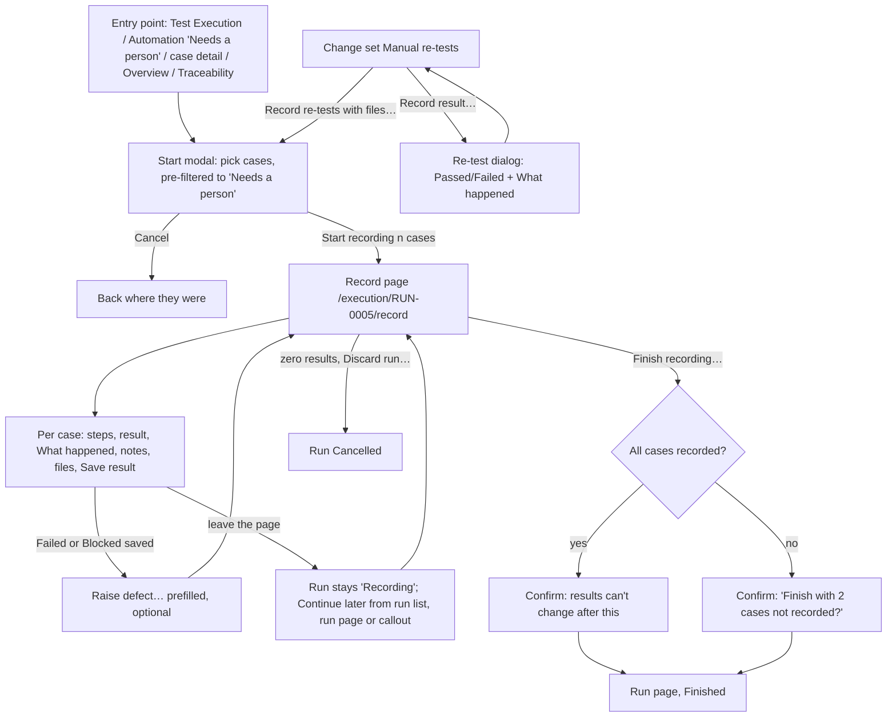

# P4-14b — Record manual results (web)

Single build spec for **P4-14b** (roadmap "P4-14 → Revised 2026-11-19"). It replaces design P4 §10 and the change set Manual re-tests dialog (P6 §7.4 / `ManualRetests.tsx`) for this story. Decisions applied: **D38 (a)** any case approved at the latest G5 can be recorded by hand; the latest result wins and is always labelled "By hand · Recorded by {name}". **D39 (a)** a D37 re-test is a manual result; `/change-sets/{id}/manual-retests` keeps its contract. **D40 (a)** manual passed/failed count for release readiness like automated results. Backend: P4-14a.

## 1. Goal and user

A tester (member or gate approver) who tested cases by hand, with a screen reader, by inspecting HTTPS or because a script is broken, records what happened. The result then counts as execution evidence everywhere, and everyone can see it was done by a person and by whom. Viewers can read manual results but can't record them.

## 2. Flow



Rules that shape the flow:
- A manual run has status `recording` until finished. Results count **as soon as each one is saved**, not at finish.
- The cases in a run are fixed when it starts (backend: `case_keys` at creation). To record another case, start another run.
- Any member can record an unrecorded case in any `recording` run. **Only the person who recorded a result can change it**, and only until the run is finished. After finish nothing can change; record again in a new run.
- Any member can finish a `recording` run (backend rule). If you didn't start it, the confirm dialog says who did (§4.4).
- A `recording` run with zero results can be discarded (backend `cancel`).

## 3. Entry points (member+ only; viewers see none of them)

All entry points open the **Start modal** (§4.1) on Test Execution via `/projects/{id}/execution?record=1`, with the existing `cases=` prefill pattern (`?record=1&cases=TC-0027`) and `&change=CHG-0001` when starting from a change set.

| Where | Control | Prefill | File |
|---|---|---|---|
| Test Execution header | Secondary [Record manual results] to the left of [Run tests…]. Shown when G5 has an approved version, **regardless of G6** (manual runs don't need scripts). | Filter "Needs a person" | `app/(app)/projects/[id]/execution/page.tsx` |
| Test Execution, empty state (no runs) | Add [Record manual results] as a secondary action next to [Run tests…]. In the "Tests can run once scripts pass their checks (Gate 6)." state, add the line "You can still record results for cases you test by hand." + [Record manual results]. | as above | same |
| Test Execution, your open runs | Info `Callout`: "You're recording RUN-0005 by hand: 2 of 4 recorded." [Continue recording RUN-0005]. One callout per run of yours in `recording`, max 3, then "and {n} more" (filter link). | – | same |
| Automation › Overview, "Needs a person (n)" group | [Record manual results] link-button on the group header row (same place as "Add test credentials" for the partial group). | Filter "Needs a person", those cases selected | `components/automation/Overview.tsx` `SuitabilityGroup` |
| Automation › "Not automated" card | Replace "Recording manual results in the app isn't available yet." with "These approved cases are tested by a person. Record what happened in Test Execution." + [Record manual results]. | Those cases selected | `Overview.tsx` `NotAutomatedCard` |
| Case detail, "Last result" row | Link "Record a manual result…" under the result, beside "Run this test…". Shown for any **approved** case on the current version (D38), not only `manual_only`. | That one case selected; filter "All approved cases" if it isn't manual-only | `components/testcases/TestCaseDetail.tsx` |
| Overview "Needs your attention" | Row "{n} approved cases need a person and have no recorded result." [Record manual results] (only when n > 0). | Filter "Needs a person" | `lib/attention.ts` |
| Traceability, "Manual only, no recorded result (n)" | [Record manual results] under the sub-list heading (heading text unchanged). | Filter "Needs a person" | `components/traceability/Traceability.tsx` |
| Change set › Regression run › Manual re-tests | Per case [Record result…] (re-test dialog, §4.6) and section-level [Record re-tests with files…]. | Section's cases + `change=CHG-0001` | `components/changes/ManualRetests.tsx` |

## 4. Screens and components

### 4.1 Start modal (`ManualStartDialog`, new, `components/execution/ManualRecord.tsx`; `Modal` lg, full-screen sheet below `md`)

```
Record manual results                                                          [x]
You test the site yourself and record what happened. Nothing runs on the platform,
so this doesn't need Gate 7.

[i You're already recording RUN-0005 (2 of 4 recorded).        [Continue RUN-0005]]   (only if you have one)

Show  [ Needs a person (4) | All approved cases (24) ]      Find a case [__________]
[x] Select all shown (4)
[x] TC-0027  Check the sign-in form's action address
             Needs a person · Last result: Not run yet
[x] TC-0033  Keyboard-only navigation
             Needs a person · Last result: Passed · By hand, J. Tester · 12 Nov
[ ] TC-0019  Send the form with an empty Message                  (only under "All")
             Can be automated · Last result: Failed · RUN-0003 · 13 Nov
             Has a script. A result you record replaces its latest automated result.   (shown when checked)

3 selected (up to 100)
                                                  [Cancel]  [Start recording 3 cases]
```
- Data: the approved test cases list (reuse the Test Cases list hook with `status=approved`; it already carries `automation_suitability` and `last_result`). Rows reuse `LastResult` text (§5) and the suitability words from P4 §3.
- Default selection: the cases passed in `cases=`; otherwise every "Needs a person" case **without** a passed/failed result. Selection survives switching the filter and searching.
- `Segmented` for the filter, `TextField` search (matches key and title), native checkboxes (`Checkbox`). "Select all shown" is a real tri-state checkbox.
- 100-case limit: at 100 the unchecked boxes are `aria-disabled` and the counter reads "100 selected. That's the most one run can hold."
- A case already in an open `recording` run shows "Also in RUN-0005 (recording)" under it (still selectable; open question 3).
- From a change set: a line under the description "Recording re-tests after CHG-0001. They count for its impact and release readiness." The request includes `change_set_key`.
- Primary button: `POST /projects/{id}/execution-runs {mode: "manual", case_keys, change_set_key?}` → navigate to `/execution/RUN-0005/record`, focus its `h1`. No toast (the page change is the confirmation).

### 4.2 Record page (`/projects/[id]/execution/[runKey]/record`, new route; `ManualRecordPage` + `ManualResultCard`)

```
← RUN-0005
Record manual results · RUN-0005                                      (h1)
By hand · started by J. Tester, 19 Nov 15:20 · 4 cases · Results count as soon as you save them.
2 of 4 recorded · 1 passed · 1 failed                       [Finish recording…]  [⋯]
                                                               ⋯ = Open RUN-0005 · Discard RUN-0005… (0 results only)
Cases
  1. TC-0027 Check the sign-in form's action address — Passed
  2. TC-0033 Keyboard-only navigation — Not recorded yet
  ...                                                         (links; move focus to the card h2)

+-- TC-0027 Check the sign-in form's action address (h2) ------------- [Saved · Passed] --+
| ▸ Steps and expected result (open by default while not recorded)                         |
|   Preconditions: Signed out. Test data: the saved test account (value never shown)       |
|   1. Open /sign-in              → The sign-in form is shown                             |
|   2. Inspect the form's action address → It starts with https://                        |
|   Expected result (TC-0027 v3): The form posts to an https:// address                   |
|                                                                                          |
| Result for TC-0027 *                                                                     |
|   ( ) Passed    ( ) Failed    ( ) Blocked                                                |
|   Blocked means you couldn't test it. It doesn't count as execution evidence.            |
| What happened *                                                                          |
|   [                                                                     ] 0 of 2,000     |
|   What you did and what you saw.                                                         |
| Notes                                                                                    |
|   [                                                                     ] 0 of 2,000     |
|   Optional. For example, the browser and device you used.                                |
| Files                                                                                    |
|   [Add files…]  PNG, JPEG or PDF · up to 10 MB each · up to 5 files.                     |
|   Files can't be removed once uploaded; they're kept as evidence.                        |
|   sign-in-form.png · 412 KB · Uploaded            [Open sign-in-form.png]                |
|   network.pdf · 1.2 MB · Will upload when you save          [Remove network.pdf]         |
|                                                                                          |
| [Save result]   Saved · Passed · Recorded by J. Tester, 19 Nov 15:40                     |
+------------------------------------------------------------------------------------------+
(after a Failed or Blocked save, inside the card)
| [i No defect is drafted automatically for manual results.          [Raise defect…]]     |
| (once one exists)  DEF-0004 · Draft · waiting for review          [Open DEF-0004]       |

[Finish recording…]                                                   (repeated at the end)
```
- **Not sticky.** The summary row and Finish are not fixed to the viewport (so nothing hides the focused field, WCAG 2.4.11); Finish appears at the top and at the end.
- **Card header chip** (text + icon, never colour alone): "Not recorded yet" (grey) · "Saved · Passed/Failed/Blocked" (`ResultStatus` tones) · "Unsaved changes" (amber, `PencilLine`) · "Recorded by M. Member" (grey `UserPen`, read-only card).
- **Steps** come from the case version in the run plan; they reuse the case-detail steps rendering (`components/testcases/TestCaseDetail.tsx` steps list) read-only, in a `Disclosure` "Steps and expected result" that is open while the case is unrecorded and closed after a save.
- **Fields** reuse `TextArea` (`components/ui/Field.tsx`) with `maxLength={2000}` and a visible counter (`aria-live` off; the hint names the limit). Radios are a native `fieldset`/`legend`, same markup as the current `ManualRetests` `RecordDialog`.
- **Save:** `PUT /execution-runs/{id}/results/{case_key} {status, actual_result, notes}`. Then any queued files upload one by one with `POST /execution-results/{id}/evidence` (progress per file, reuse `uploadWithProgress` from `components/requirements/Documents.tsx`). The button shows its loading state; the form stays editable values-wise but Save is disabled while saving.
- After the first save the button reads **[Save changes]** and is enabled only when something changed. Focus stays on the button.
- **Files:** `<input type="file" multiple accept=".png,.jpg,.jpeg,.pdf,image/png,image/jpeg,application/pdf">` behind a real `Button`. Client checks before queuing (extension, ≤ 10 MB, ≤ 5 including uploaded); the server re-checks by magic bytes. Files can be picked before the first save; they're queued ("Will upload when you save") and can be removed while queued. Uploaded files show "Uploaded" and a link that opens the signed URL (images in the existing `EvidenceDrawer` image view, PDF in a new tab with "(opens in a new tab)" in its name). Failed upload: the file stays listed with the error and [Try again]; the result itself is saved.
- **Raise defect…** (member+, after a saved Failed or Blocked, when no defect is linked to the result): link to `/defects/new?from=RUN-0005-02` (existing prefill route). If the page has unsaved changes, the leave guard (§4.5) runs first.
- **Read-only card** (result recorded by someone else, or any card when the run is finished): shows status, What happened, notes and files as text, plus "Recorded by M. Member, 19 Nov 15:40. Only they can change it until RUN-0005 is finished."
- **`⋯` menu** (reuse the `RunMenu` pattern, `components/execution/RunMenu.tsx`): Open RUN-0005 · Discard RUN-0005… (only with zero saved results; `ConfirmDialog`, §6).

### 4.3 Run page and result detail for a manual run (`[runKey]/page.tsx`, `results/[resultKey]`)

Run page:
```
← Test Execution
RUN-0005 · Manual                                   [UserPen Recording · 2 of 4 recorded]   [Continue recording] [⋯]
By hand · started by J. Tester, 19 Nov 15:20 · 4 cases · No Gate 7: nothing ran on the platform.
Results (4)
| Test                                        | Status                 | Recorded by · When            |
| TC-0027 Check the sign-in form's action ... | ✓ Passed               | J. Tester · 19 Nov 15:40      |
| TC-0033 Keyboard-only navigation            | ✗ Failed               | J. Tester · 19 Nov 15:52      |
| TC-0040 Screen reader reads the form errors | Not recorded yet       | —                             |
```
- No "Authorisation & scope" tab, no live view, no "What failed and why" card, no [Re-run…] buttons. In their place, when there are failures: a line "Failed by hand (1): TC-0033. Not analysed: recorded by a person." with [Open RUN-0005-02 result].
- Status column uses `ResultStatus`; rows without a result read "Not recorded yet" while recording and "Not run" once finished.
- [Continue recording] for members+ while `recording` (it opens the record page); [Finish recording…] lives on the record page only. Finished: header pill per `runStatusText` (e.g. "Finished · 1 failed"); `⋯` gains Open Test Execution Report.

Result detail for a manual result:
- Meta line: "By hand · Recorded by J. Tester, 19 Nov 15:52 · RUN-0005 · TC-0033 v2" (replaces browser · size · attempts · script).
- "Expected and actual": Expected unchanged; **Actual** heading becomes "What happened" with the `ManualResultLabel` chip (§5) instead of "Observed on the page". Then "Notes" (or "No notes.").
- Steps: the case's steps without per-step ticks, headed "Steps (TC-0033 v2; recorded as one result, not step by step)".
- Analysis panel replaced by one line: "Not analysed: recorded by a person." No classification, Hypothesis, confidence, fix suggestion or [Change the cause…].
- Evidence: a simple list of uploaded files (no Screenshot/Video/Trace/Console/Network tabs); none: "No files were added."
- Buttons: [Raise defect…] (Failed or Blocked, no linked defect) or [View DEF-0004 · Draft]; [Ask the analyst]. While `recording` and you are the recorder: [Edit in RUN-0005] → record page, focus that card's h2.

### 4.4 Finish recording (`ConfirmDialog`)

| Situation | Dialog / behaviour |
|---|---|
| All cases recorded | "Finish RUN-0005?" · "Results can't be changed after this. To record again, start a new manual run." [Keep recording] [Finish recording] |
| Some not recorded | "Finish with 2 cases not recorded? They'll show 'Not run'." · body lists the keys ("Not recorded: TC-0040, TC-0041.") + "Results can't be changed after this." [Keep recording] [Finish recording] |
| You didn't start the run | Adds first line: "J. Tester started RUN-0005. Finishing it ends recording for everyone." |
| Any card has unsaved changes | No finish. Dialog "Save or discard your changes first." · "TC-0033 has unsaved changes." [Go to TC-0033] (focuses that card's h2) |
| Files still uploading | Finish button `aria-disabled` with reason under it: "Wait for 1 file to finish uploading." |
| Zero saved results | Finish `aria-disabled` with reason: "Record at least one case to finish, or discard the run." |

On success: navigate to the run page, focus its `h1`, toast "RUN-0005 finished: 1 passed, 1 failed, 2 not run."

### 4.5 Leave guard

If any card has unsaved changes and the person navigates away (in-app link, Raise defect…, back), show `ConfirmDialog` "Leave without saving?" · "Your changes to TC-0033 aren't saved." [Stay] [Leave without saving]; plus the browser `beforeunload` prompt for reload/close. Saved results are never at risk.

### 4.6 Change set "Manual re-tests" (revises `components/changes/ManualRetests.tsx`)

Contract unchanged (`GET/POST /change-sets/{id}/manual-retests`, body `{case_key, status, note}`), so the dialog keeps **Passed/Failed only** (no Blocked, no files) but uses the same field labels and vocabulary as the record card:
- Section text: "These must-run tests are run by a person, not by the regression run. Record what happened after CHG-0001. Each result counts as a manual result on the test case and for release readiness."
- Section action (member+): [Record re-tests with files…] → Start modal with the section's cases and `change=CHG-0001` (for evidence or Blocked).
- Dialog title "Record re-test: TC-0005"; description "What happened when you tested TC-0005 by hand after CHG-0001." Fields: "Result for TC-0005" (Passed · Failed) and **"What happened"** (was "Note"; same `note` field, required, ≤ 2,000, hint "What you did and what you saw."). Buttons [Cancel] [Save result].
- Line per item: "Latest: Passed · By hand · Recorded by M. Member · 15 Nov 16:00: '{what happened}'" (update `retestLine` in `lib/release.ts`); "Not recorded yet." when none. Legacy rows render the same way. Results recorded on the record page for a run tied to this change set appear here too (the backend builds the list from both).
- If the GET items carry `run_key`/`result_key` (see open question 2), the latest line ends with a link "Open RUN-0007-01 result".
- After a failed save: toast as today, plus in the item "No defect is drafted automatically for manual results." [Raise defect…] when `result_key` is available.

## 5. How manual results display everywhere

New `ManualResultLabel` in `components/domain/ExecutionLabels.tsx`: `UserPen` icon + "By hand · Recorded by {name}", grey text chip (`TONE_CLASSES.grey`), always next to `ResultStatus`, never instead of it. Names always (no "you"), so screenshots and reports read the same for everyone. Classifications never appear for manual results.

| Place | Display |
|---|---|
| Run list row (`execution/page.tsx`) | What ran: "Manual · 4 cases". Status: `recording` → pill "Recording · 2 of 4 recorded" (blue, `UserPen`); finished → existing `runStatusText`. Results: "1 passed · 1 failed · 2 not run (by hand)". Who: "J. Tester · not needed (manual)" (existing `whoText`). Status filter gains "Recording by hand" (`recording`). |
| Run page / result detail | §4.3 |
| Case list "Last result" (`Bits.tsx LastResult`) | `ResultStatus` then second line "RUN-0005 · 19 Nov · By hand, J. Tester" (link to the result). sr text: "Passed by hand, recorded by J. Tester, RUN-0005, 19 November". |
| Case detail "Last result" row | `ResultStatus` + `ManualResultLabel` + "RUN-0005 · 19 Nov 15:40" + [Open result]. Execution status row unchanged. |
| Traceability cells, chain and "Failed tests" gap list | Result chip + "By hand · Recorded by J. Tester"; in the classification slot: "Not analysed: recorded by a person". Gap heading stays "Manual only, no recorded result ({n})". |
| Release readiness criterion evidence | "TC-0027 · Passed · By hand · Recorded by J. Tester (RUN-0005)". Stale reason shown verbatim from the API ("TC-0027 recorded by hand (passed)"). |
| Reports, assistant | Server-rendered text (P4-14a); no web change beyond showing it. |
| Defect form prefilled from a manual result | Environment arrives as "By hand, recorded by J. Tester · RUN-0005 · RUN-0005-02" (server); no extra UI. |

## 6. States

| State | What the user sees | Copy |
|---|---|---|
| Start modal: loading cases | Skeleton rows | – |
| Start modal: no approved cases | `EmptyState`, primary disabled | "No approved test cases yet. Approve test cases at Gate 5 to record results for them." [Open Test Cases] |
| Start modal: "Needs a person" empty | Empty line under the filter | "No approved case needs a person. Show all approved cases to record one by hand." [Show all approved cases] |
| Start modal: search no match | Line | "No approved case matches '{q}'." |
| Start modal: nothing selected | Primary `aria-disabled`, reason under it | "Choose at least one case." |
| Start modal: create fails | Danger `Callout` (role alert) above footer, focus moves to it | Server message verbatim; network: "You're offline. Reconnect to start recording." |
| Record page: loading | `Skeleton` cards, `aria-busy` | – |
| Record page: load error | `ErrorState` | "Couldn't load RUN-0005. Try again." |
| Record page: unknown key | App 404 | "We couldn't find RUN-0099 in this project." |
| Record page: not a manual run | Redirect to run page | – |
| Record page: viewer | Redirect (replace) to run page; manual results read-only there | – |
| Record page: run already finished | Info `Callout`, all cards read-only, no Finish | "RUN-0005 was finished by J. Tester on 19 Nov 16:10. Start a new manual run to record again." [Record manual results] |
| Record page: run cancelled | Grey `Callout`, no cards editable | "RUN-0005 was discarded. Nothing was recorded." |
| Card: not recorded | Header chip, steps open | "Not recorded yet" |
| Card: validation | Inline errors, focus to first invalid control, `aria-invalid` | "Choose Passed, Failed or Blocked." · "Describe what happened." |
| Card: saving | Button loading, label "Saving…" | – |
| Card: saved | Chip + line next to button; polite announcement | "Saved · Passed · Recorded by J. Tester, 19 Nov 15:40" · announced "TC-0027 saved as Passed. 2 of 4 recorded." |
| Card: unsaved edits after a save | Amber chip, [Save changes] enabled | "Unsaved changes" |
| Card: recorded by someone else | Read-only | "Recorded by M. Member, 19 Nov 15:40. Only they can change it until RUN-0005 is finished." |
| Card: 403 on save | Danger `Callout` in card (role alert); card turns read-only after reload | "Only M. Member can change TC-0027 until RUN-0005 is finished." |
| Card: 409 finished | Page switches to the finished state; your unsaved values stay visible in that card with a note | "RUN-0005 is finished. Start a new manual run to record again." |
| Card: 422 | Server message next to its field | e.g. "Describe what happened." |
| Card: offline / network | Danger `Callout` in card; values kept | "You're offline. Your answers are still here; save again when you reconnect." |
| Card: other save error | Danger `Callout` in card | "Couldn't save TC-0027. {server message}" [Try again] |
| File: wrong type (client or server) | Error line under Files, file listed in red text with icon | "{file}: This file type isn't supported. Use PNG, JPEG or PDF." |
| File: too big | same | "{file}: This file is larger than 10 MB." |
| File: 6th file | same; not queued | "You can add up to 5 files to a result." |
| File: uploading | Per-file progress text | "Uploading {file}… 40%" |
| File: upload failed (other) | Error + [Try again] | "{file} didn't upload. The result is saved. Try again." |
| File: rate limited | Error | Server message verbatim (P2-08 rate limit) |
| Failed/Blocked saved | Info `Callout` in card | "No defect is drafted automatically for manual results." [Raise defect…] |
| Defect raised | Line in card | "DEF-0004 · Draft · waiting for review" [Open DEF-0004] |
| Finish | §4.4 | §4.4 |
| Discard (0 results) | `ConfirmDialog` → run page | "Discard RUN-0005?" · "Nothing has been recorded in it. It will show as Cancelled." [Keep it] [Discard RUN-0005]; toast "RUN-0005 discarded." |
| Re-test dialog errors | as today, with new copy | "Choose Passed or Failed." · "Describe what happened." |

## 7. Copy (new or changed strings)

**Buttons/links:** Record manual results · Record a manual result… · Start recording {n} cases / Start recording 1 case · Continue RUN-{n} · Continue recording · Continue recording RUN-{n} · Save result · Save changes · Saving… · Add files… · Remove {file} · Try again · Open {file} · Raise defect… · Open DEF-{n} · Finish recording… · Finish recording · Keep recording · Go to TC-{n} · Discard RUN-{n}… · Discard RUN-{n} · Keep it · Edit in RUN-{n} · Record re-tests with files… · Record result… · Stay · Leave without saving · Show all approved cases · Select all shown ({n})

**Labels:** Needs a person ({n}) · All approved cases ({n}) · Find a case · Result for TC-{n} · Passed · Failed · Blocked · What happened · Notes · Files · Steps and expected result · Cases · Recording by hand (filter) · Not recorded yet · Not run · Unsaved changes · By hand · Recorded by {name} · Not analysed: recorded by a person

**Hints and notes:** "You test the site yourself and record what happened. Nothing runs on the platform, so this doesn't need Gate 7." · "Has a script. A result you record replaces its latest automated result." · "{n} selected (up to 100)" · "100 selected. That's the most one run can hold." · "Recording re-tests after CHG-{n}. They count for its impact and release readiness." · "By hand · started by {name}, {time} · {n} cases · Results count as soon as you save them." · "{r} of {n} recorded · {p} passed · {f} failed · {b} blocked" (zero parts omitted) · "Blocked means you couldn't test it. It doesn't count as execution evidence." · "What you did and what you saw." · "Optional. For example, the browser and device you used." · "PNG, JPEG or PDF · up to 10 MB each · up to 5 files." · "Files can't be removed once uploaded; they're kept as evidence." · "Will upload when you save" · "Uploaded" · "{n} of 2,000" · "No Gate 7: nothing ran on the platform." · "Steps (TC-{n} v{v}; recorded as one result, not step by step)" · "No files were added." · "No notes." · "Failed by hand ({n}): {keys}. Not analysed: recorded by a person." · "These approved cases are tested by a person. Record what happened in Test Execution." · "You can still record results for cases you test by hand." · "You're recording RUN-{n} by hand: {r} of {t} recorded." · "{n} approved cases need a person and have no recorded result."

**Announcements (polite region):** "TC-{n} saved as {Passed|Failed|Blocked}. {r} of {t} recorded." · "{file} uploaded." · "{file}: {error}" · "Showing {n} cases." (start modal filter/search)

**Errors, confirms, toasts:** all in §4.4, §4.5 and §6.

## 8. Accessibility (WCAG 2.2 AA)

- **Structure:** record page `h1`; each case is a `section` labelled by its `h2` ("TC-0027 Check the sign-in form's action address", `tabIndex=-1` for jump targets). "Cases" is a `nav` with an ordered list; each link text includes the status ("TC-0033 Keyboard-only navigation, not recorded yet").
- **Unique names:** "Save result for TC-0027", "Add files to TC-0027", "Raise defect from TC-0027 result", "Remove network.pdf from TC-0027", "Select TC-0027 Check the sign-in form's action address", "Continue recording RUN-0005" (also its visible text on Test Execution's open-run callout). Visible text stays short; extra words via `sr-only` (names start with the visible text, WCAG 2.5.3).
- **Form semantics:** native radios in `fieldset` with `legend` "Result for TC-0027" (arrow keys move within the group); the Blocked explanation is linked with `aria-describedby`. Required fields marked with visible "*" and `aria-required`; errors set `aria-invalid` and are linked via `aria-describedby`; on a failed save, focus moves to the first invalid control. Counters are not live.
- **Announcements:** one visually hidden `role="status"` region per page for save confirmations, upload outcomes and filter counts (§7). Saves are **not** also toasted (no double announcement). Server save errors use `role="alert"` in the card. Finishing moves focus to the run page `h1` and uses the existing polite toast.
- **Focus:** start modal follows the P1 Modal contract (focus to title, trapped, returned to the opener on close; on success to the record page `h1`). After Save, focus stays on the Save button. After a validation error, first invalid field. After the re-test dialog saves, focus returns to the item's `h4` (existing behaviour). "Go to TC-{n}" and jump links focus the card `h2`.
- **Focus order (record page):** back link → h1 → Finish → ⋯ → Cases nav → each card (Steps disclosure → radios → What happened → Notes → Add files → file actions → Save → Raise defect) → bottom Finish.
- **Keyboard:** every action is a button or link; the file picker is opened by a real button (drag and drop is not offered, so nothing is pointer-only). No hover-only content.
- **Targets:** all controls ≥ 24×24 CSS px (2.5.8); radio and checkbox rows use the full label as the target with `min-h-6 pointer-coarse:min-h-11` (existing pattern) so touch gets 44 px.
- **Not obscured:** no sticky headers or footers on the record page (2.4.11).
- **375 px / reflow:** one column; radios wrap; card action rows wrap with buttons full width below `sm`; file names wrap (`break-words`); run results table becomes cards below `md` (existing pattern). No sideways scroll at 320 px or 400% zoom. Start modal becomes a full-screen sheet with the footer at the end of the content (not fixed).
- **Status not by colour:** every chip has text and an icon; upload errors have text plus `CircleX`.
- **Contrast:** only existing token pairs (`ResultStatus` tones, `TONE_CLASSES.grey`, `Callout` tones), already ≥ 4.5:1; no new colours.
- **Text scaling / motion:** layouts use rem and wrap; upload progress is text, spinners stop under `prefers-reduced-motion` (existing `motion-reduce:animate-none`).
- **Redundant entry (3.3.7):** values typed in a card are kept on any save error, offline, 409 or 403.

## 9. Component inventory

Reuse: `Modal`, `ConfirmDialog`, `Callout`, `Button`/`LinkButton`, `Segmented`, `TextField`, `TextArea`, `Checkbox`, `Disclosure`, `Skeleton`, `EmptyState`, `ErrorState`, `Table`, `useToast` (`components/ui/*`); `ResultStatus`, `RunStatusPill`, `HypothesisLabel` icon convention (`components/domain/ExecutionLabels.tsx`); `ProvenanceLabel` for Expected (`components/domain/ObservationLabel.tsx`); `EvidenceDrawer` signed URLs (`components/domain/EvidenceDrawer.tsx`); `RunMenu` (`components/execution/RunMenu.tsx`); `uploadWithProgress` approach (`components/requirements/Documents.tsx`); `LastResult` (`components/testcases/Bits.tsx`); `useOnline` (`lib/useOnline.ts`); `/defects/new?from=` (`app/(app)/projects/[id]/defects/new/page.tsx`).

New (nothing existing fits: no per-case recording form, no evidence upload for results):

| Component | Path | Purpose |
|---|---|---|
| `ManualStartDialog` | `components/execution/ManualRecord.tsx` | §4.1 |
| `ManualRecordPage`, `ManualResultCard`, `ManualResultFields` | `components/execution/ManualRecord.tsx`; route `app/(app)/projects/[id]/execution/[runKey]/record/page.tsx` | §4.2. `ManualResultFields` (status radios with an allowed-status prop, What happened, optional Notes, optional Files) is shared with the re-test dialog. |
| `ResultFiles` | `components/execution/ManualRecord.tsx` | Queue, client checks, upload progress, list |
| `ManualResultLabel` | `components/domain/ExecutionLabels.tsx` | §5 |
| `lib/execution.ts` additions | – | `recording` in `runStatusText` and `STATUS_FILTERS`; `manualErrors(status, whatHappened)`; `MANUAL_MAX_FILES = 5`, `MANUAL_MAX_BYTES = 10 MB`, `MANUAL_ACCEPT`; `checkResultFiles()` |

## 10. Design acceptance criteria (QA verifies each)

1. **Given** a member on Test Execution before G6 is satisfied, **then** [Record manual results] is shown; **given** a viewer, **then** no entry point from §3 renders anywhere.
2. **Given** the Start modal opened from Test Execution, **then** the filter is "Needs a person", the "Needs a person" cases without a passed/failed result are pre-selected, and "All approved cases" lists every case approved at the latest G5.
3. **Given** a case with a script is checked in the Start modal, **then** "Has a script. A result you record replaces its latest automated result." is shown under it.
4. **Given** "Record a manual result…" on TC-0019's case detail, **then** the Start modal opens with only TC-0019 selected.
5. **Given** a member starts recording 4 cases, **then** they land on `/execution/RUN-0005/record` with focus on the h1, no G7 panel or authorisation appears anywhere for the run, and the run list shows "Recording · 0 of 4 recorded".
6. **Given** Save with no status and empty What happened, **then** "Choose Passed, Failed or Blocked." and "Describe what happened." appear, are linked to their fields, and focus is on the first radio.
7. **Given** TC-0027 saved as Passed, **then** the polite region announces "TC-0027 saved as Passed. 2 of 4 recorded.", the header count updates, focus stays on the Save button, and no toast appears.
8. **Given** a 12 MB PNG, or a 6th file, **then** the matching §6 message appears under Files and is announced; **given** a `.png` that is really HTML, **then** the server message "This file type isn't supported. Use PNG, JPEG or PDF." appears next to the file and the result stays saved.
9. **Given** Failed saved, **then** "No defect is drafted automatically for manual results." and [Raise defect…] appear, no defect exists, and [Raise defect…] opens the defect form with Actual equal to What happened.
10. **Given** a result recorded by M. Member, **when** J. Tester opens the record page, **then** that card is read-only with "Only they can change it until RUN-0005 is finished."
11. **Given** 2 of 4 recorded, **when** Finish recording…, **then** the dialog title is "Finish with 2 cases not recorded? They'll show 'Not run'." and lists both keys; after confirming, the run page shows two "By hand" results and two "Not run" rows, and focus is on the h1.
12. **Given** unsaved changes in TC-0033, **when** Finish recording… or Raise defect… is used, **then** the §4.4 / §4.5 dialog appears and nothing is lost unless "Leave without saving" is chosen.
13. **Given** a finished manual run, **then** the record page is read-only with the finished callout, and no [Continue recording] or [Re-run…] appears on the run page.
14. **Given** a manual Passed result, **then** case list, case detail, run page, result detail, traceability and release readiness evidence show "Passed" with "By hand · Recorded by J. Tester", and no classification, Hypothesis or confidence appears for it anywhere; failed manual results show "Not analysed: recorded by a person".
15. **Given** the change set Manual re-tests section, **when** a member records Passed with What happened, **then** the dialog offers only Passed and Failed, the item reads "Latest: Passed · By hand · Recorded by {name} · …", and the case detail and release readiness show it as a manual result.
16. **Given** keyboard only at 375 px, **then** every control on the Start modal and record page is reachable in the §8 order, nothing scrolls sideways, every target is ≥ 24×24 px, and no sticky element covers the focused control.
17. **Given** offline, **when** Save, **then** "You're offline. Your answers are still here; save again when you reconnect." and the typed values remain.
18. **Given** a recording run with zero results, **then** Finish is unavailable with "Record at least one case to finish, or discard the run." and Discard RUN-0005… cancels it.

## 11. Open questions (behaviour; recommendation applied unless the user says otherwise)

1. **Who can finish someone else's recording run.** Backend P4-14a lets any member finish. **Recommend: keep it** (abandoned runs need closing), with the confirm naming the starter (§4.4). Alternative needs a backend check: only the starter or a gate approver.
2. **Linking re-tests to their result.** The D37 GET must keep its shape; without a `run_key`/`result_key` on `latest`, the Manual re-tests section can't link to the result or offer [Raise defect…]. **Recommend: P4-14a adds those two fields additively (optional, non-breaking).** Until then the section renders without the link (§4.6).
3. **A case in two open runs.** The backend doesn't forbid it. **Recommend: allow it**, and show "Also in RUN-0005 (recording)" under the case in the Start modal; the latest saved result wins (D38).
