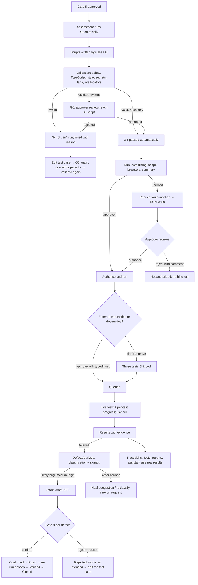

# P4 — AI QA Analyst Platform: Phase 4 UX (Automation, Gate 6, Run authorisation (Gate 7), Execution, Defect analysis, Defects (Gate 8))

## 1. Goal and user
Source: roadmap Phase 4 (stories P4-00…P4-15), spec §8 (automation, failure categories), §11 (defect fields), §12 (traceability), §16 (assistant), §17 (reports), §18 gates G6–G8, §19 (approvals for risky actions). User decisions D7–D15 (§2).

There are two users:
1. **A QA lead.** They want the approved cases running as readable automation, and failures triaged honestly instead of "everything red is a bug".
2. **A developer or PM with no QA background.** They need to know what ran, what broke, whether it is a real bug, and what to look at, without reading code.

The job: "Run the approved tests against my site safely, tell me honestly what failed and why, and give me defect reports I can confirm."

The Phase 1–3 rules still apply:
- Earn trust with evidence and honest states, not volume.
- Nothing the AI or the rules produce replaces human work without a visible diff and a decision.
- Values are computed, never guessed.

Phase 4 adds four more:
- **Nothing touches the site without a person's say-so.** Every run shows what it may do on the site *before* anyone authorises it, in plain words.
- **Results come from the test runner, never from a model or a person.** No screen offers a way to set a result. People change the *classification* (why it failed), never the *status* (whether it failed).
- **A cause is a hypothesis until a person confirms it.** Every classification carries the label "Hypothesis", its confidence and the signals behind it.
- **Expected results are never changed to make a test pass.** Heal suggestions change how a test finds an element, never what it checks. The UI says so wherever a fix is offered.

This spec **extends** `docs/design/P3-qa-analyst-phase3.md` (which extends P2 and P1). Tokens, shell, focus, motion, gate, diff, revision, provenance, report and assistant patterns from P1–P3 apply unless restated here. "P3 §13" points to that spec.

---

## 2. Decisions applied (final; they override older roadmap text)

| # | Decision | What it means in the UI |
|---|---|---|
| D7 | Chromium desktop 1440×900 by default; mobile 390×844, Firefox and WebKit opt-in per run | Run dialog pre-selects Chromium + Desktop. Mobile is one checkbox. Firefox/WebKit are offered only when installed on the server; otherwise disabled with "Not installed on this server". |
| D8 | Every run is authorised separately (G7) | No standing authorisation, no "remember this". A person with gate-approval permission sees **[Authorise and run]** and authorises in the same click. Everyone else sees **[Request authorisation]**. Every re-run (including from the assistant or "Re-run failed") is a new request. |
| D9 | One retry; pass on retry = flaky, no defect; no retries for external-transaction/destructive tests | Results show "Attempt 2 of 2". A pass on retry is **Flaky (passed on retry)**, never a defect draft. The G7 summary says "A failing test runs once more, so it may submit a form twice." Tests with a payment or delete step are labelled "Not retried". |
| D10 | G6 hybrid: rule-written scripts need no sign-off; AI-written scripts need a reviewer; static validation always blocks running | G6 completes by itself when every runnable script was written by rules and passed checks ("Passed automatically"). Each AI-written script shows "Written by AI · needs review" and must be approved or rejected by someone who can approve gates. Invalid scripts can never be selected for a run. |
| D11 | G8 per defect by `can_approve`, bulk allowed | Each draft is confirmed or rejected on its own, or many at once from the list. Rejecting needs a reason and comment. Members edit drafts but can't decide. |
| D12 | Separate approval only for external transactions and destructive actions | Form submission, sign-in and data creation are **listed** in the G7 summary and covered by G7. Payment/checkout and delete-type actions get an approval card (APR-) inside the same dialog, with typed confirmation. |
| D13 | Scripts are read-only in the app | Script viewer has Copy but no Edit. The page says how to change a test: edit the test case (reopens G5) or edit the downloaded project. |
| D14 | API testing deferred | No API test UI. Nothing says "API tests" except the assistant's Later phases list ("Phase 5"). |
| D15 | Manual result recording included | Test Execution gets **[Record manual results]** (§10). Manual results count as execution evidence; no automatic defect drafts. |

**Who can do what** (same `can_approve` check as G3–G5; P3 §4.3 wording rules apply: never "owner or admin" for gate actions):

| Action | Viewer | Member | Gate approver (`can_approve`, any role) |
|---|---|---|---|
| Read scripts, runs, results, evidence, defects, reports | ✓ | ✓ | ✓ |
| Assess automation, regenerate scripts, validate, accept a heal suggestion | – | ✓ | ✓ |
| Download the Playwright project | – | ✓ | ✓ |
| Review AI-written scripts (G6) | – | – | ✓ |
| Request a run | – | ✓ | ✓ (as "Authorise and run") |
| Authorise or reject a run (G7), decide risky-action approvals | – | – | ✓ |
| Cancel a run | – | own runs | ✓ |
| Reclassify a result (with reason), raise a defect, edit drafts, mark fixed, close | – | ✓ | ✓ |
| Confirm or reject a defect draft (G8), mark verified | – | – | ✓ |
| Record manual results | – | ✓ | ✓ |

Controls a person can't use are **not rendered** for viewers (no dead buttons). For members, gate controls render disabled (`aria-disabled`) with the visible reason, and no dialog opens (R2-04 / P3 §13.1 pattern).

---

## 3. Token and status additions (`globals.css`, `ui/StatusPill.tsx`)

No new colours. Everything maps to existing semantic tokens. Every status is **text plus icon**, never colour alone.

**Result status** (`ResultStatus`, new wrapper over `StatusPill`):

| API | Label | Tone | Icon | Note |
|---|---|---|---|---|
| `passed` | Passed | green | `CircleCheck` | |
| `failed` | Failed | red | `CircleX` | an assertion or timeout failed |
| `error` | Error | red | `CircleAlert` | the test couldn't finish (script, setup, cancel, time limit); reason always shown |
| `flaky` | Flaky (passed on retry) | amber | `Shuffle` | never a defect |
| `skipped` | Skipped | grey | `CircleSlash` | reason always shown, e.g. "Not approved: external transaction" |
| `blocked` | Blocked | amber | `Lock` | reason always shown, e.g. "Needs saved test credentials" (amber, not red: nothing failed) |
| (live) running | Running | blue | `Loader2` (static under reduced motion) | |
| (live) waiting | Waiting to start | grey | `CircleDashed` | |

**Run status** (`RUN_STATUS`):

| API | Label |
|---|---|
| `awaiting_authorisation` | Waiting for authorisation (amber, `UserRoundCheck`) |
| `rejected` | Not authorised (grey) |
| `queued` | Waiting to start (blue) |
| `running` | Running (blue) |
| `passed` | Finished · all passed (green) |
| `failed` | Finished · {n} failed (red) |
| `error` | Didn't complete (red) + reason |
| `cancelled` | Cancelled (grey) |

**Failure classification** (`ClassificationLabel`, new). Always followed by the `HypothesisLabel` and confidence (`ConfidenceValue`, existing). The plain-language name leads; the technical name is in the tooltip and reports.

| API | Label | One-line meaning (tooltip, legend, reports) | Tone |
|---|---|---|---|
| `application_defect` | Likely bug in the application | The test did every step, and the site didn't do what the test case expects. | red |
| `selector_failure` | Element not found | The test couldn't find a field or button. The page may have changed since discovery. | amber |
| `script_defect` | Problem in the test script | The script itself broke, so the site wasn't really tested. | amber |
| `test_data_issue` | Test data problem | The site rejected a value the test treats as valid. | amber |
| `environment_failure` | Environment problem | Something around the test stopped it: sign-in refused, a safety block, or a time limit. | amber |
| `network_failure` | Site unreachable | The site couldn't be reached, or the connection dropped. | amber |
| `flaky` | Flaky | It failed, then passed on retry. Not treated as a bug. | amber |
| `unknown` | Cause unclear | The evidence doesn't point to one cause. A person needs to look. | grey |

**`HypothesisLabel`** (new; same pill shape as `ProvenanceLabel`, uses the existing **inferred** tokens, icon `Lightbulb`): text "Hypothesis". Tooltip: "Worked out from the evidence. A person confirms or rejects it." After a person reclassifies: "Set by {name}" (`UserPen`) replaces it. Signals that read evidence (page text, network log, error) are labelled **Observed**; the classification is never labelled Observed.

**Defect severity** (`SeverityValue`): Critical (`ChevronsUp`, `danger-solid`/white) · Major (`ChevronUp`, `danger-bg`/`danger-fg`) · Minor (`Equal`, `warning-bg`/`warning-fg`) · Trivial (`ChevronDown`, neutral). Priority keeps `PriorityValue` (P3 §3).

**Defect status:** Draft (amber, "waiting for review") · Confirmed (red, `Bug`) · Rejected (grey) · Fixed (blue, "needs verifying") · Verified (green) · Closed (grey).

**Script status:** Valid (green) · Invalid (red) · Not checked yet (grey) · Outdated (amber, `RefreshCw`) · Needs review (amber, `UserRoundCheck`, AI scripts only) · Rejected in review (grey).

**Locator status:** Found once (green `CircleCheck`) · Found {n} times (red `CircleX`, "a test would fail: it must match exactly one") · Not found (red `CircleX`) · Not checked (grey `CircleDashed`, "needs sign-in and no test credentials are saved"; a warning, not a blocker).

**Approval status:** Waiting for decision (amber) · Approved (green) · Not approved (grey) · Expired (grey) · Used (grey).

**Suitability** (the P3 labels, now assessed): Can be automated · Needs test credentials · Needs a person. (API `suitable | partial | manual_only`. The old "Suitable / Partly automatable / Manual only" labels and "Preliminary: assessed in Phase 4." disappear once assessed.)

---

## 4. Information architecture

### 4.1 Routes
| Route | Screen |
|---|---|
| `/projects/[id]/automation` | Automation. Tabs `?view=overview\|scripts\|review` (default `overview`). Scripts: `&file=tests/contact/TC-0019.spec.ts&v=<n>`. Bundle: `&bundle=<n>` (older bundles read-only). |
| `/projects/[id]/execution` | Runs list. `?new=1` opens the Run tests dialog; `&cases=TC-0019,TC-0020` prefills "Choose test cases". |
| `/projects/[id]/execution/[runKey]` | Run detail: authorisation (when waiting), live view (when running), results. `?filter=failed\|flaky\|blocked`. |
| `/projects/[id]/execution/[runKey]/results/[resultKey]` | Result detail (`RUN-0003-07`). |
| `/projects/[id]/execution/[runKey]/record` | Manual result recording (§10). |
| `/projects/[id]/defects` | Defects. `?view=list\|review` (default `list`) + filters. |
| `/projects/[id]/defects/[key]` | Defect detail (`DEF-0001`). `?edit=1`. |
| `/projects/[id]/defects/new` | Raise a defect; `?from=RUN-0003-07` prefills from a result. |
| `/projects/[id]/reports/execution`, `/reports/defect` (`?version=`, `?run=`) | The two new reports. |

### 4.2 Sidebar (`lib/sections.ts`)
- `CURRENT_PHASE = 4`. Automation, Test Execution and Defects lose the phase badge and the `ComingInPhase` page. Performance keeps "Coming in Phase 5".
- **Attention badges** (one per section, first match wins):

| Section | Badge | When | Accessible name |
|---|---|---|---|
| Automation | "Review" | G6 waiting (AI scripts unreviewed) | "Automation, Gate 6 waiting for approval" |
| Automation | "Out of date" | `automation` stale | "Automation, out of date" |
| Automation | "{n} invalid" | invalid scripts exist | "Automation, {n} scripts can't run" |
| Test Execution | "Authorise" | ≥1 run waiting for authorisation | "Test Execution, {n} runs waiting for authorisation" |
| Test Execution | "Running" (text, no animation) | a run is running | "Test Execution, a run is in progress" |
| Defects | "{n} to review" | G8 drafts | "Defects, {n} drafts waiting for review" |

### 4.3 Lifecycle, header and Overview
**Lifecycle (`lib/lifecycle.ts`).** The three Phase 4 stages are built. Update agent names to match the roadmap:

| Step | Name | Agent text |
|---|---|---|
| 15 | Automation suitability | Test Automation Engineer Agent |
| 16 | Generate scripts | Test Automation Engineer Agent |
| 17 | Validate scripts | Checks run by code (no AI) |
| G6 | Script validation | "Passed automatically" when no AI scripts; otherwise "Waiting for review" (role-aware) |
| G7 (before 18) | Execution authorisation | **Per run.** Diamond text: "Every run needs authorisation". Status: waiting if any run awaits authorisation; done if the latest run was authorised; not started otherwise. Link "Review RUN-0003" when waiting. |
| 18 | Execute approved tests | Playwright test runner. Mirrors the latest run (Running / Done / Didn't complete / Cancelled). Never "Running" without a run. |
| 19 | Analyse results & investigate failures | Defect Analysis Agent |
| 20 | Defect reports & QA summary | Defect Analysis Agent drafts; you confirm at Gate 8 |
| G8 | Defect review | **Per defect.** "Waiting: 2 defect drafts" / "Done: no drafts waiting" / "Not started" before any analysis. |

- **Execution is never auto-started.** After G6 the step 18 row says "Ready. Runs start only when someone authorises them." [Run tests…].
- **Auto-advance notices:** step 15 row and feed: "Started automatically after Gate 5 approval." Step 19: "Started automatically: RUN-0003 had 4 failures."
- **"Show all 21 steps" actions:** 15–17 → "Assess automation again", "Regenerate scripts…", "Review Gate 6"; 18 → "Run tests…", "Open runs"; 19–20 → "Review Gate 8", "Open defects".
- Waiting copy is role-aware (P3 §4.3): "Waiting for your approval" / "Waiting for approval by someone who can approve gates". For G7 the run key replaces "approval": "RUN-0003 is waiting for your authorisation" / "RUN-0003 is waiting for authorisation by someone who can approve gates".

**Header (`ProjectHeader`).** Status pill gains: "Test run RUN-0003 running" (blue), "RUN-0003 waiting for authorisation" (amber, role-aware), "{n} defect drafts to review" (amber). The ⋯ menu gains "Run tests…" (members and approvers) and "Download Playwright project" (members and approvers, once a bundle exists).

**Overview, "Needs your attention"** (after gate rows, max 5, `lib/attention.ts`):
- "RUN-0003 is waiting for your authorisation: 24 tests, may submit the Contact us form." [Review RUN-0003] (approvers) · Members/viewers: "RUN-0003 is waiting for authorisation by someone who can approve gates." (no button for viewers)
- "1 script written by AI needs review before it can run." [Review Gate 6]
- "{n} defect drafts from RUN-0003 need confirming or rejecting." [Review Gate 8]
- "{n} scripts can't run: {i} invalid, {o} outdated." [Open Automation]
- "RUN-0003 finished: 3 failed, 1 flaky." [Open RUN-0003] (shown for 7 days or until opened)
- "{n} approved cases need a person to test them." [Record manual results] (only when manual-only cases have no result)

**Overview, "At a glance"** adds three cards (before G5: "Starts after Gate 5."):
- **Automation:** "21 of 24 approved cases automated · 21 valid · 1 needs review". G6 line.
- **Last run:** "RUN-0003 · 13 Nov 14:20 · 20 passed · 3 failed · 1 flaky" (text; the bar is secondary). Before any run: "No tests have run yet." [Run tests…]
- **Defects:** "1 draft to review · 0 confirmed open". Before analysis: "Defects appear after a test run finds failures."

**Dashboard.** "Awaiting approval" tile counts G6, G7 run requests and G8 drafts. Add a "Last run" column: "20 of 24 passed · 13 Nov" or "Not run yet". Never a coloured pass rate without text.

**New agents in the feed:** "Test Automation Engineer Agent" (short "Automation Agent"), "Playwright test runner" (short "Test runner"), "Defect Analysis Agent" (short "Analysis Agent"). Example messages:
- "Assessed 24 approved cases: 18 can be automated, 2 need test credentials, 4 need a person"
- "Wrote 20 scripts, 6 page objects and 1 data file (rules)"
- "Validation: 21 valid · 1 invalid ('Message' not found on /contact) · 2 not checked"
- "RUN-0003 requested by M. Member: 24 tests · waiting for authorisation"
- "RUN-0003 authorised by A. Approver"
- "RUN-0003 finished: 20 passed · 3 failed · 1 flaky (4 min 12 s)"
- "Analysed 4 results: 1 likely bug in the application, 1 element not found, 1 flaky, 1 site unreachable"
- "Drafted DEF-0001: Contact form accepts an empty Message"
Events never contain values, page text or error text (P4-06).

---

## 5. Flow



Exits: cancel the dialog (nothing created) · withdraw a request · reject a run · cancel a running run · reject an approval (tests skipped, run continues) · reject a draft.

---

## 6. Automation workspace (P4-02, P4-04, P4-10)

### 6.1 Layout
```
[Project header + compact lifecycle]
Automation                       Scripts [v2 · 13 Nov 12:10 ▾]  [Validate again]  [Regenerate scripts…]  [Download Playwright project]
Written from the test cases approved at Gate 5 on 13 Nov (design run 2) · Generated by rules
[Out-of-date callout]  [Gate 6 banner when waiting]  [Validation running callout]
Tabs:  Overview | Scripts (21) | Review · Gate 6
```
- **Scripts [v2 ▾]** uses `VersionSelect` (bundle versions). Older bundles are read-only with the P2 older-version banner; Validate and Download act on the shown version.
- **[Regenerate scripts…]** is a `ConfirmDialog`: "Write the scripts again from the approved test cases? Scripts whose test case hasn't changed keep their version and checks. Changed ones get a new version and must pass checks again." [Regenerate scripts].
- Viewers see none of the three buttons. Members see all three.

### 6.2 Overview tab
```
+-- Can these test cases be automated? ------------------------------------------------------------+
| 18 of 24 approved test cases can be automated · 2 need test credentials · 4 need a person         |
|                                                                                                  |
| ✓ Can be automated (18)                                       [Show 18 cases that can be automated]
| [Lock] Needs test credentials (2)  Their scripts are written but are blocked in runs until test        |
|    credentials are saved.                         [Add test credentials]  [Show 2 cases needing credentials]
| [User] Needs a person (4)                                         [Record manual results]             |
|    TC-0027 Check the sign-in form's action address · "Step 2 'Inspect the form's action address'  |
|            needs human judgement"                                                                  |
|    TC-0033 Keyboard-only navigation · "Step 3 'Check the focus order feels logical' needs human     |
|            judgement"                                                                              |
|    … [Show 4 cases that need a person]                                                            |
+--------------------------------------------------------------------------------------------------+
+-- Can the scripts run? -------------------------------------------------------------------------+
| 21 valid · 1 can't run · 2 not checked on the live page                     Checked 13 Nov 12:14  |
| ✗ TC-0040 Send the newsletter form · Locator 'Email' was found 2 times on /    [Open TC-0040 script]
| ⚠ TC-0031, TC-0032: not checked on /account (needs sign-in; no test credentials saved)            |
| Checks every script passes: Safety check · TypeScript · Code style · No secrets · Test case tag ·  |
| Finds its fields and buttons on the live page                              What do these mean? ⓘ  |
+--------------------------------------------------------------------------------------------------+
+-- Use the scripts outside this app -------------------------------------------------------------+
| Download a standalone Playwright project with the 21 valid scripts, plus CI templates for GitHub   |
| Actions and GitLab CI.   [Download Playwright project (v2, zip)]                                  |
| 1 script is left out because it can't run: TC-0040. The project's README lists it.               |
+--------------------------------------------------------------------------------------------------+
```
- Counts come from `GET /automation/assessment` and the bundle; each group link has a unique name.
- **"What do these mean?"** popover (`ValidationLegend`):
  - Safety check: "The script only uses allowed testing commands. It can't read files, start programs or reach other sites."
  - TypeScript: "The code compiles."
  - Code style: "No fixed waits, no 'run only this test', no fragile locators."
  - No secrets: "No password, token or saved login appears in the code."
  - Test case tag: "The script is linked to an approved test case."
  - Live page: "Each field and button the script uses is found exactly once on the live page. We only open pages and look; we don't click, type or submit (apart from signing in with the saved test account)."
- **Download** is a link to the zip (`aria-describedby` → the "left out" line). The CI templates are inside the zip; the card says so instead of offering separate downloads (fewer choices for non-QA users).

### 6.3 Scripts tab
```
+-- Files ---------------------------+-- tests/contact/TC-0019.spec.ts -------------------------------------------+
| Tests                              | ✓ Valid · Generated by rules · Version 1 [▾]          [Copy code]          |
|  ▾ contact (6)                     | Test case: TC-0019 Send the form with an empty Message (v3) · REQ-0006      |
|     ✓ TC-0019.spec.ts              | Read-only. To change what this test does, edit TC-0019 and approve Gate 5   |
|     ✓ TC-0020.spec.ts              | again; the script is rewritten. Engineers can edit the downloaded project.  |
|     ✗ TC-0040.spec.ts  Can't run   |                                                                             |
|  ▸ sign-in (4)                     | Checks  ✓ Safety  ✓ TypeScript  ✓ Code style  ✓ No secrets  ✓ Tag           |
|  ▸ navigation (5)                  |         ✓ Live page: 4 of 4 found once                                     |
| Page objects                       | +-------------------------------------------------------------------------+ |
|     ✓ ContactPage.ts               | |  1 // TC-0019 v3 · REQ-0006 · Generated by rules (AI not configured)     | |
|     ✓ SignInPage.ts                | |  2 import { test } from "../../fixtures";                               | |
| Test data                          | |  …                                                                      | |
|     factories.ts                   | | 14   await test.step("Press Send message", async () => {                 | |
| Platform files                     | | 15     await contact.sendMessage.click();                                 | |
|     fixtures.ts  Platform file     | | 16     await qa.expectSubmissionBlocked(contact.form);                    | |
|     qa.ts        Platform file     | | 17     await qa.expectFieldFlagged("Message");                            | |
|     playwright.config.ts           | +-------------------------------------------------------------------------+ |
| Not automated (4)                  | What this script checks (from the test case)                                |
|     TC-0027 · Needs a person       |  Step 5 Press Send message → Submission is blocked · Message is flagged      |
+------------------------------------+ Versions (1) · Last results: ✗ Failed in RUN-0003 [Open result]             |
```
- **File list:** nested `ul` lists with a `Disclosure` button per folder and one link per file (not an ARIA `tree`: simpler, works with Tab and screen readers, satisfies "keyboard-operable"). Each file link's name includes its status: "TC-0040.spec.ts, can't run". Folders show counts. "Platform file" files are trusted platform code; their viewer says "Platform file: part of the testing toolkit, the same in every project. Not generated."
- **Viewer:** monospace, line numbers (`aria-hidden`, so screen readers read code only), syntax colours at AA on `elevated`. The code block is a focusable `role="region"` named "Code of TC-0019.spec.ts" that scrolls inside itself. [Wrap lines] toggle (default on below `md`). [Copy code] announces "Code copied".
- **Checks row:** each check is text + icon. A failed check expands to its messages; each message links to its line ("Line 22: Locator 'Message' was not found on /contact"), which scrolls the code region and outlines the line (`danger-line` left border plus a "Problem on this line" sr text). Secret-scan messages name the line, never the value.
- **"What this script checks"** lists the assertion map in words, linked to the case's steps. It makes the "expected results never change" rule visible.
- **Page objects** show the **locator table** instead of "What this script checks":

  | Element | How it's found | On the live page | Used by |
  |---|---|---|---|
  | Name | `getByLabel("Name")` | ✓ Found once | 6 scripts |
  | Message | `getByLabel("Message")` | ✓ Found once | 6 scripts |
  | Send message | `getByRole("button", { name: "Send message" })` | ✓ Found once | 6 scripts |
  | Email (newsletter) | `getByLabel("Email")` | ✗ Found 2 times | TC-0040 |

  CSS fallbacks show "Fallback: {reason}" in the second line.
- **AI-written scripts** show "Written by AI · needs review" (`GeneratedByLabel ai` + `UserRoundCheck`) and, for approvers, the review controls inline (§6.4). A side-by-side "Compared with the rules version" `DiffView` appears when a rule baseline exists.
- **Heal versions** (`generated_by="heal"`): "Changed by an accepted fix suggestion from RUN-0004-03 · checks must pass before it can run."
- **Versions:** `RevisionHistory` with version, date, cause ("Test case TC-0019 changed", "Fix suggestion accepted by {name}") and a diff to the previous version.

### 6.4 Review · Gate 6 tab (reuse `GateReviewPanel` grouped checks from P3)
```
+-- Gate 6 · Script validation ------------------------------ [⚠ Waiting for your approval | … by someone who can approve gates] --+
| Scripts v2 · written from the Gate 5 approval on 13 Nov                                                                    |
| MUST FIX BEFORE TESTS CAN RUN (1)                                                                                          |
| ✗ 1 script written by AI needs review: TC-0044.                         [Review TC-0044 script]                            |
| ADVICE (3)                                                                                                                 |
| ⚠ 1 script can't run and is left out of runs: TC-0040 (locator found 2 times).   [Open TC-0040 script]                     |
| ⚠ 2 scripts weren't checked on the live page (needs sign-in, no test credentials). [Add test credentials]                  |
| ⚠ 1 script is outdated: its test case changed after it was written.               [Regenerate scripts…]                    |
| PASSED (Disclosure)                                                                                                        |
| ✓ 21 scripts passed every check · ✓ No secrets in any script · ✓ Every script is linked to an approved test case           |
|                                                                                                                            |
| SCRIPTS WRITTEN BY AI (1)                                                                                                  |
| TC-0044 Pay with a test card · checks passed · assertions match the test case          [Open script]                       |
|   Comment [                          ]   [Approve script]  [Reject script…]                                               |
+----------------------------------------------------------------------------------------------------------------------------+
```
- **There is no "Approve Gate 6" button.** Per D10 the gate completes when blockers clear: every AI script is reviewed. The panel says: "Gate 6 completes by itself when every script written by AI has been reviewed. Scripts written by rules need no sign-off."
- **Passed automatically** (rule scripts only, no blockers): approved line reads "Passed automatically · {date} · every script was written by rules and passed its checks. No sign-off needed." No buttons.
- **Reject script…** needs a comment ("Say what's wrong with this script."). The case then uses its rules script if one exists ("TC-0044 will use its rules script."), otherwise it is listed under Not automated: "Script rejected in review".
- **Members/viewers:** review buttons disabled with the P3 permission Callout ("You can review these scripts, but approving needs gate-approval permission…"). Viewers: no comment field.
- **Reopened** (new bundle after approval): "New scripts since the last review: {n}." Only new AI scripts need review again.

### 6.5 Automation states
| State | What the user sees | Copy |
|---|---|---|
| G5 not approved | `EmptyState` + link | "Scripts are written from the test cases approved at Gate 5. Approve Gate 5 first." [Review Gate 5] |
| G5 approved, assessment not run (Phase 3 projects) | `EmptyState` | "Test cases are approved. Check which ones can be automated." [Assess automation]. Viewers: text only, "A member, owner or admin can start this." |
| Assessing / writing scripts | Card with steps 15–17 + feed filtered to the Automation Agent | "Checking which of the 24 approved test cases can be automated…" then "Writing scripts for 20 test cases…" |
| Validating | Info Callout, tabs stay usable | "Checking 21 scripts. The live-page check opens each page and looks for fields and buttons; it doesn't click, type or submit." |
| Validation partly done | Rows show "Not checked yet" | — |
| No case can be automated | `EmptyState` + reasons list | "None of the 24 approved test cases can be automated yet." then the grouped reasons and [Record manual results] |
| Toolkit not installed on the server | Danger Callout, no Validate/Run | "Scripts can't be checked or run on this server: the testing toolkit isn't installed. Ask whoever runs this server to follow the setup in automation/README." |
| Chromium missing | Same pattern | "The Chromium browser isn't installed on this server, so scripts can't be checked on live pages or run." |
| AI off | `GeneratedByLabel rules` + dismissible info Callout | "Scripts written by rules (AI not configured). Rules cover forms, sign-in, navigation and page checks. Steps needing judgement are left for a person." |
| AI on, mixed | `GeneratedByLabel mixed` + Disclosure "Checks on AI scripts ({n})" | Lines such as "Dropped an AI script for TC-0019: it changed what the test checks. The rules script is used." · "AI script for TC-0050 failed checks 3 times; the rules script is used." |
| Out of date | `OutOfDateCallout` | "Some scripts are out of date: the approved test cases changed on {date}. Outdated scripts can't run. Regenerate to update them; unchanged scripts stay valid." [Regenerate scripts…] |
| Failed | ErrorState | "Writing scripts failed: {reason}. Your test cases are unaffected." [Try again] |
| Loading / load error / offline | Skeleton / "Couldn't load automation. Try again." / P1 offline banner | — |
| Viewer | No action buttons, no review controls | — |

### 6.6 Test Cases changes (P4-02, P4-07, P4-12)
- **List:** "Last result" becomes real: `ResultStatus` + "RUN-0003 · 13 Nov" (second line), linking to the result. More than one browser/size → worst status plus "+1 more" with sr "Chromium desktop failed, mobile passed". No result: "Not run yet" (no Phase tooltip). Manual results add "Recorded by {name}".
- **More filters** add: Automation (Can be automated · Needs test credentials · Needs a person · Script can't run · Outdated script) and Last result (Passed · Failed · Error · Flaky · Blocked · Not run yet).
- **Detail side panel:**
  - Automation: "Can be automated · Script valid · TC-0019.spec.ts v1" [Open script]; or "Needs a person: Step 2 'Inspect …' needs human judgement" [Record a manual result].
  - Last result: per browser/size row with status, run, date, [Open result]; Execution status is now the computed value (read-only). Linked defects: "DEF-0001 Draft".
  - [Run this test…] (members/approvers; opens the Run dialog with this case) for cases with a valid script.
- "Preliminary: assessed in Phase 4." is removed everywhere once assessed. Phase 3 projects not yet assessed keep it.

---

## 7. Run tests dialog and Gate 7 (P4-05, P4-06, P4-07)

Opened from Test Execution [Run tests…], the header ⋯ menu, a case's [Run this test…], a result's [Re-run this test…], a run's [Re-run failed tests…] (prefilled), and assistant proposals. `Modal` size lg, two steps; full-screen below `md`.

### 7.1 Step 1 of 2: What to run
```
Run tests                                                                  Step 1 of 2 · What to run
Test cases   (•) Smoke (6)   ( ) Regression (21)   ( ) All automated (21)   ( ) Choose test cases…
Browsers     [x] Chromium (desktop browser engine)
             [ ] Firefox      Not installed on this server
             [ ] WebKit (Safari's engine)      Not installed on this server
Screen sizes [x] Desktop 1440 × 900 (the size discovery used)   [ ] Mobile 390 × 844
Note (optional) [                                                              ]

21 tests will run: 21 test cases × 1 browser × 1 screen size.
Left out (3)   TC-0040 · script can't run · TC-0044 · script needs review (Gate 6) · TC-0031 · blocked: needs test credentials  [Why?]
                                                                     [Cancel]  [Next: check what this run will do]
```
- Defaults per D7. Counts per option come from the server. "Choose test cases…" opens an inline searchable checklist of cases with valid scripts (key, title, suites); others are shown disabled with their reason.
- **Left out** explains exclusions before the user commits. Blocked partial cases are still listed in the run (they appear as Blocked, not executed); invalid, outdated and unreviewed AI scripts can't be selected.
- **Limit:** above 300 tests: "A run can include up to 300 tests. This selection makes 360 (180 cases × 2 screen sizes). Choose fewer cases or one screen size." Next disabled with that reason.
- [Next] validates on the server (`POST` creates nothing yet; the scope preview is a dry-run read). If a script became invalid meanwhile: inline error "TC-0019's script can't run any more (checked again at 14:01). It was removed from this selection." 

### 7.2 Step 2 of 2: Check what this run will do (the G7 authorisation summary)
```
Check what this run will do                                                  Step 2 of 2 · Authorise
Site            http://localhost:4100 (approved at Gate 1). Tests can't reach any other site.
Tests           21 tests · Chromium · Desktop 1440 × 900 · about 4 minutes
What it may do on the site
  • May submit the Contact us form (if the application does not block it): 4 tests   [Show 4 tests]
  • Submits the Contact us form: 2 tests
  • Signs in with the saved test account: 4 tests. The password is never shown, recorded or traced.
  • Creates data on the site: none
  • Pays, buys or deletes anything: no
Retries         A failing test runs once more to tell real failures from flaky ones, so it may submit a form twice.
Evidence        A screenshot of every test (password fields hidden); video and trace for failures; console and network logs.
Not covered     This authorisation is for this run only. It doesn't cover re-runs, other sites or scripts changed later.

[Back]                                                      [Authorise and run 21 tests]  |  [Request authorisation]
Your authorisation is recorded with your name, the time and this exact list.   |   Nothing runs until someone who can approve gates authorises it.
```
- **Side-effect lines** are computed by the server (P4-05) and grouped by form, with counts. Wording rules:
  - Negative cases that press a submit control: "May submit the {form} form (if the application does not block it)". This is the demo line and must appear verbatim.
  - Positive submissions: "Submits the {form} form".
  - Sign-in: "Signs in with the saved test account".
  - Registration: "Creates data on the site: {form} form ({n} tests)".
  - Each line with tests has [Show {n} tests], expanding a list of keys and titles (unique names: "Show 4 tests that may submit the Contact us form").
- **No risky actions:** the line "Pays, buys or deletes anything: no" is shown, so the absence is explicit.
- **Approver, no approvals needed:** [Authorise and run 21 tests] (primary). One click creates the run with `authorise: true` and goes to the run page. No extra checkbox (D8: same click; the summary is the confirmation).
- **Member (no `can_approve`):** [Request authorisation] (primary) with the note under it. After sending: the run page in "waiting" state (§8.3) and toast "RUN-0004 requested. Someone who can approve gates must authorise it."
- **Viewer:** the dialog never opens; no Run controls render.

### 7.3 Risky-action approvals inside step 2 (D12)
Shown only when the scope contains `external_transaction` or `destructive`, between "What it may do" and "Retries":
```
Needs a separate approval (1)
+-- APR-0001 · External transaction (payment or purchase) ------------------------------------------+
| TC-0044 Pay with a test card on /checkout · Not retried                                          |
| ( ) Approve: this test may make a payment or purchase on shop.example.com                        |
|     Type shop.example.com to confirm [_______________________]                                   |
| ( ) Don't approve: skip TC-0044 in this run (the other tests still run)                          |
+--------------------------------------------------------------------------------------------------+
```
- `destructive` cards read "Destructive action (delete, cancel or close something)" with the matched step quoted: "Step 4 'Press Delete account'".
- **Approver:** each card needs a choice. [Authorise and run] stays `aria-disabled` with the reason "Decide 1 separate approval above to continue." Typing the wrong host: field error "Type shop.example.com exactly to confirm." (case-insensitive, trimmed). Approval and run authorisation are recorded together in one click.
- **Member:** cards are read-only: "Needs approval by someone who can approve gates. They'll see this when they review the request." Approvals are created `pending` with the request.
- **Expiry:** approvals expire after 24 hours (P4-05). An expired request shows "This request expired after 24 hours because it includes a separate approval. Request it again." [Request again] (prefills the same selection).
- Tests marked "Not retried" are listed in the Retries line: "TC-0044 isn't retried because it may make a payment."

### 7.4 Dialog states
| State | Copy |
|---|---|
| No valid scripts | Dialog doesn't open; button `aria-disabled` with "No script can run yet. Open Automation to see why." |
| Another run in progress (project limit 1) | Info in step 2: "RUN-0003 is running. This run starts when it finishes." Authorise stays enabled. |
| Organisation limit (2) | "Two runs are already in progress in your workspace. This run starts when one finishes." |
| Toolkit or browser missing | Danger Callout, buttons disabled: "Tests can't run on this server: {reason}." |
| Site unreachable at last check | Warning: "The site didn't respond at the last check (13 Nov 13:58). The run may fail with 'Site unreachable'." Doesn't block. |
| Scope changed between steps | InlineError: "The scripts changed while you were choosing. Check the summary again." Step 2 refreshes. |
| Server error | InlineError in the footer: "Couldn't create the run: {reason}. Nothing was started." |
| Offline | Buttons disabled: "You're offline. Reconnect to run tests." |

---

## 8. Test Execution workspace (P4-06, P4-07)

### 8.1 Runs list (`/execution`)
```
Test Execution                                        [Record manual results]  [Run tests…]
Runs are started by a person and authorised for each run (Gate 7). Tests run only on http://localhost:4100.
[Waiting for authorisation callout, when any]

Run        What ran                     Status                       Results                         Started by · Authorised by        When · Duration
RUN-0004   Regression · Chromium ·      ⚠ Waiting for authorisation  21 tests                        M. Member · —                     13 Nov 15:02
           Desktop                                                                                     [Review RUN-0004] (approvers)
RUN-0003   Regression · Chromium ·      ✗ Finished · 3 failed         20 passed · 3 failed · 1 flaky  M. Member · A. Approver            13 Nov 14:16 · 4 min 12 s
           Desktop                                                    ███████████▒▒░ (bar, aria-hidden)
RUN-0002   Manual · 4 cases             ✓ Finished · all passed       4 passed (recorded)             J. Tester · not needed (manual)    13 Nov 11:40
```
- Results column is text first; the bar is decorative. Each run key links to the run page ("Open RUN-0003").
- Filters: Status, Started by, Mode (Automated · Manual). Sort: newest first.
- **Empty (G6 not satisfied):** "Tests can run once scripts pass their checks (Gate 6)." [Open Automation]. **Empty (ready):** "No tests have run yet. Choose which tests to run; you'll see exactly what they'll do on the site before anything starts." [Run tests…]. Viewers: text only.
- At 375 px rows become cards (key + status first line; what ran; results text; who/when).

### 8.2 Run page: layout by status
```
← Test Execution
RUN-0003 · Regression                                            ✗ Finished · 3 failed          [Re-run failed tests…] [⋯]
Chromium · Desktop 1440 × 900 · 24 tests · requested by M. Member · authorised by A. Approver, 13 Nov 14:15 · 4 min 12 s
Note: "Before the release meeting"
Tabs:  Results (24) | Authorisation & scope
```
`⋯` holds: Open Test Execution Report · Ask the analyst about this run · Copy link.
- **Authorisation & scope** tab: the exact §7.2 summary as authorised (frozen), the G7 decision ("Authorised by {name} · {time} · '{comment}'"), each approval with its decision and who typed the confirmation, configuration (workers, retries, timeouts). This is also what the report prints.

### 8.3 Waiting for authorisation (G7 review of a request)
```
+-- Gate 7 · Authorise RUN-0004 ---------------------- [⚠ Waiting for your authorisation | … by someone who can approve gates] -+
| Requested by M. Member · 13 Nov 15:02 · "Before the release meeting"                                              |
| [§7.2 summary, identical wording, including risky-action cards]                                                   |
| Comment (needed to reject) [                                                          ]                           |
| [Authorise and run 21 tests]   [Reject request…]                                                                 |
+-------------------------------------------------------------------------------------------------------------------+
```
- New `RunAuthorisationPanel`, styled like `GateReviewPanel` (same header, pill and approved line) but bound to a run, not a stage.
- **Approver:** risky-action cards are interactive here (§7.3). Reject needs a comment ("Say why this run shouldn't go ahead."). Rejected runs show "Not authorised by {name}: '{comment}'. Nothing ran." and the requester can [Request again].
- **Requester (member):** sees the panel read-only plus [Withdraw request] (→ Cancelled, "Request withdrawn. Nothing ran.").
- **Other members:** read-only with the permission note "Authorising runs needs gate-approval permission."
- **Scope no longer valid** (a script in it became invalid/outdated after the request): Authorise is disabled with "TC-0019's script changed after this request, so this run can't be authorised as requested. Request it again." [Request again].

### 8.4 Running: live view
```
RUN-0003 · Regression                                         ● Running                                  [Cancel run…]
Progress  9 of 24 finished · 7 passed · 1 failed · 1 flaky · 15 to go           ██████▒░░░░░░ 9 of 24
+-- Live view of the test browser ----------------------------------------------------- [Pause live view] -+
| [Worker 1 frame]                                    | [Worker 2 frame]                                    |
| TC-0019 Send the form with an empty Message         | TC-0021 Send the form with a 1-character Name       |
| Step 5 of 5 · Press Send message · Attempt 2 of 2   | Step 2 of 5 · Enter "A" in Name                     |
+----------------------------------------------------------------------------------------------------------+
Frames aren't saved. Failed tests keep a video recording.
Tests  [All 24 | Running 2 | Failed 1 | Flaky 1 | Waiting 15]
| Test                                         | Browser · size     | Status              | Attempt | Time  |
| TC-0019 Send the form with an empty Message  | Chromium · Desktop | ● Running           | 2 of 2  | 6.1 s |
| TC-0005 Send the form with an empty Name     | Chromium · Desktop | ✓ Passed            | 1       | 3.2 s |
| TC-0031 Sign in with the saved test account  | Chromium · Desktop | [Lock] Blocked: needs test credentials | – | – |
```
- **Live tiles** (new `LiveRunView`, based on the old `LiveView`/`LiveFrame` from `main` and the polling approach of `discovery/LiveDiscovery.tsx`): one tile per worker, polling signed frame URLs about 5 times a second; polling stops when the tab is hidden, when paused, and when the run ends (`GET /live` 404). Each tile is a `figure` with a caption naming the test, step and attempt. `img alt`: "Live view of the test browser, worker 1: TC-0019 Send the form with an empty Message".
- **[Pause live view]** (required: moving content over 5 s needs a pause control, WCAG 2.2.2) freezes the last frame; label toggles to [Resume live view]. **Reduced motion:** the live view starts paused, showing the latest frame refreshed every 5 s, with [Play live view].
- **Not Chromium / no frames yet:** "Waiting for the browser…" (never an error). Firefox/WebKit-only runs: "Live view is available for Chromium only. Results appear below as each test finishes."
- **Rows** update from SSE within ~2 s; reconnect replays without duplicates (existing `LiveConnectionIndicator`). Rows are not a live region.
- **Polite status region** announces only: run start, each failure ("TC-0019 failed"), every 25% of progress, and the end ("RUN-0003 finished: 20 passed, 3 failed, 1 flaky, 0 errors"). Never per frame or per pass.
- **[Cancel run…]** (requester or approver): `ConfirmDialog` "Cancel RUN-0003? Tests that have finished keep their results. The {n} unfinished tests are marked 'Error: run cancelled'. A cancelled run can't be resumed." [Keep running] [Cancel run]. Then "Cancelling…" until the server confirms (≤ 6 s).
- **When the run ends** the live card is removed (no stale "live" dot), focus is not moved, and the "What failed and why" card (§9.1) appears at the top of Results.

### 8.5 Run states
| State | What the user sees | Copy |
|---|---|---|
| Waiting for authorisation | §8.3 | — |
| Not authorised | Grey Callout | "Not authorised by {name}: '{comment}'. Nothing ran." [Request again] |
| Waiting to start | Info Callout + scope | "Authorised. Waiting for a free test runner; RUN-0002 is still running." |
| Running | §8.4 | — |
| Finished | Results + §9.1 | "Finished: 20 passed · 3 failed · 1 flaky · 0 errors." |
| Analysing failures | Info line in §9.1 | "Working out why 4 tests failed…" |
| Didn't complete (worker stopped) | Danger Callout; stored results kept | "The run didn't complete: the test runner stopped. Results that finished are kept; the other {n} tests show 'Error'." [Re-run all…] |
| Time limit | Danger Callout | "The run stopped at its 30-minute limit. Unfinished tests show 'Error: run time limit reached'." |
| Cancelled | Grey Callout | "Cancelled by {name} at 14:18. {n} tests finished; the rest show 'Error: run cancelled'." |
| Approval expired | Grey Callout | "This request expired after 24 hours because it includes a separate approval. Nothing ran." [Request again] |
| Live view can't connect | Tile placeholder | "Waiting for the browser…" |
| SSE lost | Existing indicator | "Reconnecting… results still update every 10 seconds." |
| Load error / offline | ErrorState / banner | "Couldn't load RUN-0003. Try again." |
| Unknown key | App 404 | "We couldn't find RUN-0099 in this project." |

### 8.6 Result detail (`/execution/RUN-0003/results/RUN-0003-07`)
```
← RUN-0003
RUN-0003-07 · TC-0019 Send the form with an empty Message                                        ✗ Failed
Chromium 131 · Desktop 1440 × 900 · failed on both attempts (2 of 2) · 8.4 s · script TC-0019.spec.ts v1
[Ask the analyst]  [View DEF-0001 · Draft] | [Raise defect…]   [Re-run this test…]
+-- Expected and actual ---------------------------------------------------------------------------------+
| Expected (TC-0019 v3)  [Assumed · Written by a person]                                                 |
|   Submission is blocked and Message is identified as required                                          |
| Actual  [Observed on the page]                                                                         |
|   Step 'Press Send message' failed: Expected the Contact us form to still be shown, but the page shows |
|   'Thank you' (Message sent) at /contact.                                                              |
+--------------------------------------------------------------------------------------------------------+
Steps                                         Attempt [1 | 2]
  1 ✓ Open /contact                                        0.8 s
  2 ✓ Enter "Ada Test" in Name                             0.2 s
  3 ✓ Enter "ada@example.com" in Email                     0.2 s
  4 ✓ Leave Message empty                                  0.0 s
  5 ✗ Press Send message                                   5.1 s
      Expected: the submission is blocked; Message is flagged as required
+-- Why it failed (analysis) ----------------------------- [Hypothesis] ---------------------------------+  (§9.2)
Evidence   Screenshot | Video | Trace | Console (0 errors) | Network (12 requests, 0 blocked)                    (§8.7)
```
- **Expected** shows the case's expected result with its provenance label (reuse `ProvenanceLabel`); **Actual** is labelled "Observed on the page". This keeps the Observed/Inferred vocabulary: what the page showed is Observed, the cause is a Hypothesis.
- **Steps** come from `test.step` titles with per-step status and time. Synthetic values are written in; sign-in steps read "Sign in with the saved test account". Attempt toggle (`Segmented`) when attempts > 1; attempts summary line: "Attempt 1: failed at step 5 · Attempt 2: failed at step 5".
- **Status-specific headers:** Flaky: "Failed on attempt 1, passed on attempt 2. Treated as flaky, not as a bug." · Blocked: "Not run: needs saved test credentials." [Add test credentials] · Skipped: "Not run: the separate approval APR-0001 wasn't given." · Error: "The test couldn't finish: {reason in plain words}."
- **Passed results** show steps and screenshot only, no analysis panel.
- **Buttons:** [Raise defect…] (members+, shown when no linked defect; opens `/defects/new?from=…`), [View DEF-0001 · Draft] when one exists, [Re-run this test…] (opens the dialog with this case). Viewers: [Ask the analyst] only.

### 8.7 Evidence viewer (`EvidenceViewer`, new; reuses `EvidenceDrawer` signed-URL handling)
`Tabs` with counts in the names:
- **Screenshot:** final screenshot, `alt` "Final screen of TC-0019 on Chromium desktop, attempt 2". Note under it: "Password fields are hidden in every screenshot." [Open full size].
- **Video** (failures only): native `<video controls>`; no autoplay; captions not applicable, so a text alternative sits under it: "Recording of TC-0019 on Chromium. The steps above describe the same actions in text." [Download video].
- **Trace** (failures only): [Download trace (zip)] + help "Open it in Playwright Trace Viewer (trace.playwright.dev) to step through the test." For sign-in tests: "No trace: traces are switched off for tests that sign in, so the password is never recorded."
- **Console:** text log in a focusable scroll region, filter [All | Errors only], each line with level as text. Header note: "Messages from the tested site. Shown as text; never run."
- **Network:** table (Method · Address · Status · Time), filter [All | Failed | Blocked]. Blocked rows: "Blocked by safety policy: {host} isn't an approved site." (text + `ShieldX` icon).
- Missing evidence: "No video: videos are kept for failed tests only." · "Evidence couldn't be loaded. Try again." · Expired signed URL → silent refetch, then the error.

---

## 9. Defect Analysis output (P4-08)

### 9.1 "What failed and why" (run page, top of Results, once analysis finishes)
```
+-- What failed and why ------------------------------------------------- Generated by rules · Hypotheses --+
| 4 tests need attention                                                                                     |
| ✗ Likely bug in the application (1)   TC-0019 · DEF-0001 drafted              [Review Gate 8]              |
| ⚠ Element not found (1)               TC-0040 · a fix suggestion is ready      [Open TC-0040 result]       |
| ⚠ Flaky (1)                           TC-0022 · passed on retry; no defect      [Open TC-0022 result]       |
| ⚠ Site unreachable (1)                TC-0008 · connection refused at 14:19     [Open TC-0008 result]       |
| Only likely application bugs become defect drafts. Script, page and environment problems don't.            |
+------------------------------------------------------------------------------------------------------------+
```
- Groups ordered: application bug, cause unclear, then the rest. Each item links (unique names).
- While analysing: "Working out why 4 tests failed…". Analysis failed: "Couldn't analyse the failures: {reason}. Results are unaffected." [Analyse again] (members+).
- All passed: "All 24 tests passed. Nothing to analyse." (no card when nothing failed besides that line).

### 9.2 Analysis panel (result detail)
```
+-- Why it failed ----------------------------------------- [Hypothesis] [Generated by rules] ----------+
| Most likely cause: Likely bug in the application · Confidence: High                                 |
| Why we think so                                                                                    |
|  ✓ Every action step passed, then the check failed           [Observed] (steps 1–5)                 |
|  ✓ The page showed "Thank you" instead of blocking the form  [Observed] [Screenshot] [Video]        |
|  ✓ It failed on both attempts                                 [Observed]                             |
|  ✓ No network errors, safety blocks or server errors          [Observed] [Network log]              |
| Possible causes                                                                                    |
|  • The Message field isn't marked as required in the form.                                         |
|  • The server accepts the form without checking Message.                                           |
| What to do next                                                                                    |
|  • Confirm or reject DEF-0001 (Gate 8).  • After a fix, re-run TC-0019 to verify.                  |
| Defect: DEF-0001 Contact form accepts an empty Message · Draft          [Open DEF-0001]            |
| [Change the cause…]                                                                                |
+----------------------------------------------------------------------------------------------------+
```
- **No defect drafted** lines: "No defect drafted: flaky results aren't treated as bugs." · "No defect drafted: the likely cause is the test, not the application." · "No defect drafted: confidence is low. Look at the evidence, then raise a defect if it's a real bug." [Raise defect…] (the roadmap's low-confidence "Raise defect").
- **Duplicate:** "Added as occurrence 2 of DEF-0001 (same test, same failed step)." [Open DEF-0001].
- **AI on:** wording may be AI-refined (`GeneratedByLabel mixed`). If code kept the rule result: "The AI suggested 'Likely bug in the application'; it was overruled because the network log shows the site was unreachable."
- **Change the cause…** (members+, `Modal`): radio list of the 8 causes with their one-line meaning, required reason ("Say why you think the cause is different."), and consequence lines: to application bug → "A defect draft will be created for review at Gate 8."; away from it with a draft → "DEF-0001 stays as a draft. Reject it at Gate 8 if it isn't a bug." Result: the panel shows "Cause set by {name}: '{reason}'" with the original hypothesis struck through in a "Previously" line (text "was: Element not found, medium").
- **The status never changes.** Helper text in the dialog: "This changes the likely cause only. The test result stays Failed."

### 9.3 Fix suggestion (selector failures only)
```
+-- Fix suggestion ----------------------------------------------------------------------------------+
| The Message field's label changed. These locators find it on /contact today:                        |
|  (•) getByLabel("Your message")       Found once ✓   (recommended)                                 |
|  ( ) getByRole("textbox", { name: "Your message" })   Found once ✓                                 |
| Change to ContactPage.ts   [DiffView: - getByLabel("Message")  + getByLabel("Your message")]       |
| Changes how the test finds the field, not what it checks. Expected results stay the same.           |
| [Accept fix suggestion]   Creates ContactPage.ts version 2. Scripts must pass checks before they run. |
+----------------------------------------------------------------------------------------------------+
```
- Members+. After accept: toast "ContactPage.ts version 2 created. Validate it before the next run." [Validate now]. Nothing is applied automatically, and no suggestion is ever shown that changes an assertion.

---

## 10. Manual test results (P4-14, D15)

**Entry:** [Record manual results] on Test Execution, the Automation "Needs a person" group, a case's [Record a manual result], and the Overview attention row.

**Step 1 (Modal):** "Record manual results" · checklist of approved cases, pre-filtered to "Needs a person" (others available under "Show all approved cases"). Note: "Manual results don't need Gate 7: nothing runs on the platform. You test the site yourself and record what happened." [Start recording {n} cases] → creates `RUN-0005` (Manual) → `/execution/RUN-0005/record`.

**Step 2 (record page):**
```
RUN-0005 · Manual · 2 of 4 recorded                                               [Finish recording]
TC-0027 Check the sign-in form's action address                                       (h2)
  Preconditions · Steps (with expected results) · Test data ("Uses the saved test account (value never shown)")
  Result *     ( ) Passed   ( ) Failed   ( ) Blocked
  What happened *  [                                                        ]  (required for Failed and Blocked)
  Notes            [                                                        ]
  Evidence         [Add file]  PNG, JPEG or PDF, up to 10 MB
  [Save result]   Saved · Recorded by J. Tester, 13 Nov 15:40
```
- One card per case, saved independently; the header count updates in the polite status region ("TC-0027 saved as Passed").
- **Failed:** after saving: "No defect is drafted automatically for manual results." [Raise defect…] (prefills).
- **Finish recording** with unrecorded cases: `ConfirmDialog` "Finish with 2 cases not recorded? They'll show 'Not run'." Later the run can be reopened by its creator via [Continue recording] until finished.
- Results show everywhere as "Passed · Recorded by J. Tester" with `UserPen`, never with a classification ("Not analysed: recorded by a person").
- Upload errors (P2-08 copy): "This file type isn't supported. Use PNG, JPEG or PDF." · "This file is larger than 10 MB."
- Viewers: no entry points.

---

## 11. Defects workspace (P4-09, D11)

### 11.1 Layout
```
Defects                                                                 [Raise defect…]  [Open Defect Report]
Drafted from likely application bugs found in test runs, or raised by people. Each draft is confirmed or rejected at Gate 8.
[Gate 8 banner: "2 defect drafts are waiting for your review." [Review Gate 8]]
Tabs:  Defects (5) | Review · Gate 8 (2)
```

### 11.2 Defects tab (list)
```
Search [DEF id, summary]  Status [Open ▾] Severity [Any ▾] Priority [Any ▾] [More filters ▾]   (Source, Requirement, Test case, Run)
+----------------------------------------------------------------------------------------------------------------------------+
|[ ]| Defect                                   | Severity  | Priority | Status        | Reproducibility | Test case · Req.  | Last seen      |
|[ ]| DEF-0001 Contact form accepts an empty   | ⌃ Major   | = Medium | ○ Draft       | 2 of 2 attempts | TC-0019 · REQ-0006| RUN-0003 13 Nov|
|   | Message · from analysis                  |           |          |   waiting for |   (always)      |                   |                |
|   |                                          |           |          |   review      |                 |                   |                |
+----------------------------------------------------------------------------------------------------------------------------+
```
- Default status filter "Open" = Draft, Confirmed, Fixed. Closed and rejected via the filter ("{n} closed and {m} rejected defects are hidden. Show them").
- **Bulk bar** (`BulkActionBar`):
  - Approvers: [Confirm {n}] [Reject {n}…] (drafts only) · [Mark fixed] · [Close].
  - Members: [Mark fixed] [Close]. No checkbox appears on rows whose only possible actions are G8.
  - Non-applicable items are skipped with reasons (P3 §6.3 pattern): "Confirm 5 defects? 2 can't be confirmed: they aren't drafts." [Confirm 3]. Toast: "3 defects confirmed. 2 skipped." [Show skipped]. API limit 100: "Confirm first 100".
- 375 px: cards (key + severity + status first line, summary, reproducibility, links).

### 11.3 Review · Gate 8 tab
```
+-- Gate 8 · Defect review --------------------------------- [⚠ 2 drafts waiting for your review | … for review by someone who can approve gates] --+
| Confirm a draft when it's a real bug in the application. Reject it when it isn't, and say why.                                 |
| [ ] DEF-0001 Contact form accepts an empty Message · Major · 2 of 2 attempts · Likely bug (High)        [Open DEF-0001]        |
|     Why: every action step passed; page showed "Thank you"; failed on both attempts; no network errors                          |
|     [Confirm DEF-0001]  [Reject DEF-0001…]                                                                                     |
| [ ] DEF-0002 Session isn't kept after reload · Major · 2 of 2 attempts · Likely bug (Medium)           [Open DEF-0002]          |
|     …                                                                                                                         |
| Selected 0 · [Confirm selected] [Reject selected…]                                                                            |
| Decided (3): DEF-0003 confirmed by A. Approver · …  (Disclosure)                                                              |
+-------------------------------------------------------------------------------------------------------------------------------+
```
- Uses `GateReviewPanel` header/pill/approved-line styles, but decisions are per row. "Done: no drafts waiting" when empty: "No defect drafts are waiting. Gate 8 opens again when an analysis drafts a new defect."
- **Confirm** is immediate (no dialog), toast "DEF-0001 confirmed." [Undo] is **not** offered (it's a gate decision with audit); the row moves to "Decided".
- **Reject…** (`RejectDialog`, parameterised): Reason (required radio): Not a defect · Duplicate (then "Duplicate of" DEF picker) · Works as intended · Can't reproduce · Problem with the test. Comment (required). For **Works as intended**: "If the application is right, the test case's expected result is wrong. [Edit TC-0019] Editing it moves the case back to draft and Gate 5 needs approval again. Nothing changes automatically."
- **Members:** permission Callout shown **before** anything else, buttons disabled: "You can read and edit these drafts, but confirming or rejecting needs gate-approval permission. Ask someone who can approve gates." No dialog opens (R2-04).

### 11.4 Defect detail (`/defects/DEF-0001`, report layout, `ReportDocument` styles)
```
← Defects
DEF-0001 · Contact form accepts an empty Message                          ○ Draft · waiting for review
[Confirm] [Reject…] (approvers) · [Edit] · [⋯ Mark fixed / Close / Ask the analyst / Copy link]
Main column                                                     | Side column
Description                                                     | Severity   ⌃ Major
  The Contact us form sends the message when Message is empty.  |   from REQ-0006 risk High (RISK-005) and "a blocked
Environment                                                     |   submission failed". [Change…]
  http://localhost:4100 · Chromium 131 · Desktop 1440 × 900 ·   | Priority   = Medium · from TC-0019 [Change…]
  RUN-0003 · 13 Nov 2026 14:18                                  | Reproducibility  2 of 2 attempts (always)
Preconditions                                                   | Status flow  Draft → Confirmed → Fixed → Verified → Closed
  The Contact us page is reachable.                             | Links  REQ-0006 · TC-0019 (v3) · RUN-0003-07 · script v1
Steps to reproduce                                              | Occurrences (1)  RUN-0003 13 Nov
  1 Open /contact  2 Enter "Ada Test" in Name                   | Source  Drafted by the Defect Analysis Agent (rules)
  3 Enter "ada@example.com" in Email  4 Leave Message empty     | Revisions (1)
  5 Press Send message                                          |
Expected result  [Assumed · Written by a person]                |
  Submission is blocked and Message is identified as required   |
Actual result  [Observed on the page]                           |
  The page shows "Thank you" (Message sent) at /contact.        |
Root cause  [Hypothesis]                                        |
  Likely bug in the application (High). The Message field isn't |
  validated as required…                                        |
Evidence  [screenshot thumb] [video] [console] [network]        |
G8 record (after decision)                                      |
```
- Every §11 field has a label; empty ones read "None". Credentials only ever as "the saved test account".
- **Status actions** (one primary per state):

| Status | Primary | Others | Disabled reason |
|---|---|---|---|
| Draft | [Confirm] (approver) | [Reject…], [Edit] (members+) | members: permission note |
| Confirmed | [Mark fixed] (members+) | [Re-run TC-0019…] | — |
| Fixed | [Mark verified] (approver) | [Re-run TC-0019…] | "No passing re-run yet. Re-run TC-0019 after the fix to verify it." (`aria-disabled` until a later passing result of the same or newer script exists; then "Passed in RUN-0006 on 14 Nov") |
| Verified | [Close] (members+) | — | — |
| Rejected | — | [Close] | Line: "Rejected by {name}: Works as intended · '{comment}'" |
| Closed | — | — | — |

- **Edit** (members+, drafts and confirmed): summary, description, preconditions, steps, expected, actual, severity/priority (override requires a reason: "Explain why you changed the severity."). Read-only with help text: classification ("Change the cause on the result"), occurrences, links, G8 record. Version conflict → P3 conflict Callout with Compare.
- **Reopen** (from Closed/Rejected): not a button on the defect. A new failure creates a new draft; [Raise defect…] links back ("Related to DEF-0001").
- **No delete** anywhere. If asked: "Defects can't be deleted. Reject or close it instead; the history stays."

### 11.5 Raise a defect (`/defects/new`)
Form with every §11 field. From a result it prefills all fields and links the result ("Prefilled from RUN-0003-07. Check the wording before saving."). Blank: requirement and case pickers optional. Saves as Draft, source "Raised by {name}", and goes to G8 like any draft. Errors: "Add a summary." · "Describe the actual result."

### 11.6 Defects states
| State | Copy |
|---|---|
| Before any run | "Defects appear here when a test run finds a likely bug in the application, or when someone raises one." [Open Test Execution] |
| Runs, no defects | "No defects. {n} runs finished; no failure was classified as a likely application bug." |
| Analysis running | Info: "Working out why RUN-0003's tests failed. Drafts appear here when it finishes." |
| Filters match nothing | "No defects match these filters." [Clear filters] |
| Loading / error / offline | Skeleton / "Couldn't load defects. Try again." / banner |
| Viewer | Read-only, no checkboxes, no Raise defect |
| Unknown key | App 404 "We couldn't find DEF-0099 in this project." |

---

## 12. Traceability and readiness (P4-12)
- **Coverage tiles** become real: Execution coverage "17 of 22" ("approved requirements with a passed or failed result"); Pass rate "20 of 24 (83%)" ("latest result per test; flaky and errors shown separately"); Automation coverage "21 of 24" ("approved cases with a valid script"). Numbers are text; no bars that could read as quality scores.
- **Gap lists:** the four "Needs test execution (Phase 4)" cards become computed and move into the main list: Requirements without execution evidence (sub-lists "Automated but not run" and "Manual only, no recorded result" with [Record manual results]); Failed tests (key, classification + Hypothesis, run) ; Outdated automation scripts ([Regenerate scripts…]); Defects without regression coverage ([Open TC-…] to add it to Regression). Empty lists state meaning: "None. Every approved requirement has a passed or failed result."
- **Matrix:** the "Later phases" column group is replaced by Scripts · Results · Defects. Cells: "TC-0019.spec.ts ✓ Valid" · "✗ Failed RUN-0003" · "DEF-0001 Draft". Gaps read "No script", "Not run", text not colour. sr names: "Result for TC-0019: failed in RUN-0003".
- **Chain view** extends: Test case → Script (version, status) → Result (per browser/size) → Defect, and starting from `DEF-0001` walks back up. "← you are here" stays.
- **375 px cards** end with "Script ✓ Valid · Last result ✗ Failed (RUN-0003) · DEF-0001 Draft" instead of the Phase 4 line.
- **Readiness tab (Requirements):** DoD "Tests executed with evidence" and "No open critical/high defects" show Met / Not met with keys ("Not met: DEF-0001 (Major) is open"), replacing "unknown … Phase 4".
- Phase 5 items (performance, accessibility scanning, security) still read "Phase 5".

## 13. Reports (P4-11)
- Reports list adds **Test Execution Report** (per run; "Latest result per test case" option) and **Defect Report**. [Download ▾] offers PDF, HTML, CSV (JSON stays API-only, as P3 OQ3). Before any run: "Not available yet · Needs a test run" (Generate hidden). The "later reports" note lists Phase 5 reports only.
- A frozen Test Execution Report is created when a run finishes; the run page `⋯` links it.
- **Bands:** Defect Report "DRAFT: {n} defects not yet reviewed at Gate 8" while drafts exist. Execution Report shows "Causes are hypotheses unless a person confirmed them."
- RTM gains script, last result and defect columns; its disclaimer is removed. Test Case Specification "Execution status" shows the latest result.
- File names: `{host}-test-execution-RUN-0003-{yyyy-mm-dd}.{pdf|html|csv}`, `{host}-defects-v{n}-….`

## 14. AI QA Analyst v3 (P4-13)
- **Works without AI** gains: "Did the tests pass?" · "Explain a failed test" (picker of failed results) · "Analyse a defect" (DEF picker) · "Automation status" · "Re-run failed tests" (proposal) · "Add defect cases to Regression" (proposal).
- **Needs AI:** "Improve existing test scripts".
- **Later phases:** only Phase 5+ items (e.g. "Performance and load tests · Phase 5", "API tests · Phase 5"). The three Phase 4 fallbacks are removed from `LATER_TASKS_FALLBACK`.
- **Answers** cite `RUN-`, `DEF-`, `APR-` and result keys as links; classifications carry the Hypothesis label. With no runs: "No tests have been run in this project yet." [Run tests…].
- **Rerun proposal card** (`ProposalCard`): "Re-run the 3 failed tests from RUN-0003 · Chromium · Desktop". Footer: "Creates a run request. It still needs authorisation (Gate 7) by someone who can approve gates; the assistant can't authorise runs." [Create run request] → toast "RUN-0006 requested." [Open RUN-0006]. Viewers: "Only members, owners and admins can apply proposals."
- **Entry points:** [Ask the analyst] on result detail, run page `⋯` and defect detail opens `AssistantDrawer` with the item as context and the matching chip pre-run.

## 15. The demo thread: what the user sees (acceptance walk-through, AI off, http://localhost:4100)
1. **Test Cases:** TC-0019 expected result written as "Submission is blocked and Message is identified as required"; G5 approved. (Key is illustrative; e2e uses the computed key.)
2. **Automation › Overview:** TC-0019 under "Can be automated". Sign-in cases under "Needs test credentials" if none saved.
3. **Automation › Scripts:** `tests/contact/TC-0019.spec.ts` · Valid · Generated by rules; "What this script checks: Step 5 Press Send message → Submission is blocked · Message is flagged". `ContactPage.ts` locator table: Name, Email, Message, Send message all "Found once".
4. **G6:** "Passed automatically · every script was written by rules and passed its checks."
5. **Run tests (member):** Regression · Chromium · Desktop → summary shows "May submit the Contact us form (if the application does not block it)" → [Request authorisation]. The approver sees the attention row, opens RUN-000n, sees the same summary, [Authorise and run].
6. **Live view:** TC-0019 tile shows step 5, then attempt 2 of 2; row turns "✗ Failed"; status region announces "TC-0019 failed".
7. **Result:** Expected vs Actual naming "Thank you"; screenshot and video; analysis "Likely bug in the application · High · Hypothesis" with the four signals; "Defect: DEF-0001 … Draft".
8. **Defects › Review · Gate 8:** a member sees the permission note and disabled buttons; the approver presses [Confirm DEF-0001].
9. **Traceability › Chain DEF-0001:** REQ-0006 → TC-0019 → TC-0019.spec.ts v1 → RUN-000n-07 Failed → DEF-0001 Confirmed.
10. Session-persistence cases also fail (demo's `POST /login` sets no cookie). They show as their own classified results; the UI never collapses failures into "1 failure".

---

## 16. Component inventory

**Reuse (extend where noted)**

| Component | Path | Phase 4 use |
|---|---|---|
| GateReviewPanel, GateBanner | `components/domain/GateReviewPanel.tsx` | G6 tab (grouped checks; add `noApproveButton` / auto-complete line); G8 header styles; banners for G6–G8 (`GATE_NAMES` already has G6–G8) |
| LifecycleProgress, `lib/lifecycle.ts`, `lib/sections.ts`, `lib/attention.ts` | `components/domain/`, `lib/` | §4.2–4.3 (agent names, per-run G7, per-defect G8, `CURRENT_PHASE = 4`) |
| ProjectHeader (`MoreMenu`, status) | `components/workspace/ProjectHeader.tsx` | Run/defect status pills; Run tests…, Download project |
| StatusPill, Tabs/Segmented, Table, FilterBar, BulkActionBar, Modal, ConfirmDialog, Callout, Disclosure, StatTile, Tooltip, Toast, States, Field | `components/ui/*` | Throughout; new tones §3 |
| ProvenanceLabel, GeneratedByLabel | `components/domain/ObservationLabel.tsx` | Expected (case provenance), Actual ("Observed on the page"), rules/AI/mixed |
| ConfidenceValue | `components/domain/ConfidenceValue.tsx` | Classification confidence |
| EvidenceDrawer | `components/domain/EvidenceDrawer.tsx` | Signed-URL loading for `EvidenceViewer` |
| DiffView, RevisionHistory, VersionSelect, OutOfDateCallout | `components/domain/*` | AI vs rules script diff, heal diffs, script/defect revisions, bundle versions, stale |
| LiveConnectionIndicator, polling approach | `components/domain/AgentActivityFeed.tsx`, `components/discovery/LiveDiscovery.tsx` | Live run status |
| Old `LiveView`/`LiveFrame` | `main:web/src/components/run/LiveView.tsx` (deleted here) | Basis for `LiveRunView` tiles; switch to signed `frame_url` polling and add pause |
| RejectDialog | `components/requirements/RejectDialog.tsx` | G8 reject reasons; AI script reject |
| TestCasesTable, TestCaseDetail, Bits (`LastResult`) | `components/testcases/*` | Real last result, automation row, filters |
| Traceability | `components/traceability/Traceability.tsx` | Real columns, gap lists, chain levels |
| ReportDocument, reports list | `components/report/*`, `reports/page.tsx` | Two reports |
| Assistant, AnswerCard, ProposalCard, AssistantDrawer | `components/assistant/*` | v3 chips, rerun proposal, context entry |
| Readiness | `components/requirements/Readiness.tsx` | DoD met/not met |
| Credentials | `components/domain/Credentials.tsx` | Target of "Add test credentials" links |

**New**

| Component | Suggested path | Why nothing existing fits |
|---|---|---|
| SuitabilitySummary, ValidationSummary, ExportCard, ValidationLegend | `automation/Overview.tsx` | Grouped reasons and check counts |
| FileList, ScriptViewer, CheckResults, LocatorTable | `automation/Scripts.tsx` | Read-only code with line-linked messages |
| Gate6Review, AiScriptReview | `automation/Gate6Review.tsx` | Per-script review, auto-complete gate |
| RunDialog, AuthorisationSummary, RiskyActionCard | `execution/RunDialog.tsx` | Scope + side effects + typed confirmation; shared by dialog, run page, report |
| RunAuthorisationPanel | `execution/RunAuthorisation.tsx` | G7 is per run, not per stage |
| RunsTable, RunHeader, RunResultsTable, LiveRunView | `execution/*` | Live rows, worker tiles with pause |
| ResultDetail, ExpectedActual, StepResults, EvidenceViewer | `execution/Result.tsx` | Attempts, evidence tabs |
| WhatFailedCard, AnalysisPanel, ReclassifyDialog, FixSuggestion | `execution/Analysis.tsx` | Hypothesis with signals; heal diff |
| ManualRecord | `execution/ManualRecord.tsx` | Per-case recording with upload |
| ResultStatus, ClassificationLabel, HypothesisLabel, SeverityValue | `domain/ExecutionLabels.tsx` | §3 vocab, shared everywhere |
| DefectsTable, DefectDetail, DefectForm, Gate8Review | `defects/*` | §11 layout, per-row gate decisions |

---

## 17. Accessibility (WCAG 2.2 AA; additions to P1 §11, P2 §14, P3 §19)
- **Names:** unique link names: "Review Gate 6", "Review RUN-0004", "Review Gate 8", "Open TC-0040 script", "Open RUN-0003-07 result", "Confirm DEF-0001", "Show 4 tests that may submit the Contact us form". File links include status ("TC-0040.spec.ts, can't run"). Bulk checkboxes "Select DEF-0001 Contact form accepts an empty Message".
- **Status in text everywhere:** result, run, script, locator, approval, defect status, severity, classification, confidence. The run progress bar is `aria-hidden` next to its text. Hypothesis is text ("Hypothesis"), not only purple.
- **Live content:** live tiles have a pause control and start paused under `prefers-reduced-motion`; frame polling stops when hidden. One polite region announces milestones only (§8.4). The results table is not live. No flashing (frames are screenshots; no element flashes >3/s).
- **Code:** code region is focusable, named, scrolls in itself; line numbers `aria-hidden`; issue lines carry sr text; wrap toggle avoids sideways scroll at 320 px and 400% zoom.
- **Media:** `<video controls>`, no autoplay, text alternative and step list as the equivalent; screenshots have descriptive `alt`; logs are real text, never images.
- **Dialogs:** P1 Modal focus contract. Run dialog: step heading receives focus on step change; the step indicator is text ("Step 2 of 2"). Typed-confirmation field labelled "Type shop.example.com to confirm", errors linked by `aria-describedby`. Disabled Authorise/Confirm/Verify use `aria-disabled` with the visible reason (P3 §19).
- **Focus order:** run page: h1 → header actions → (waiting: G7 panel) → live view pause → tests filter → table. Result detail: h1 → actions → expected/actual → steps → analysis → evidence tabs. After Confirm in G8, focus moves to the next undecided row's Confirm button, or to the "Decided" heading when none remain. After a run ends, focus stays where it was.
- **Targets:** all controls ≥ 24×24 CSS px, 44×44 on coarse pointers (radio rows, bulk checkboxes, tile pause).
- **Contrast:** no new colour pairs; code syntax colours must meet 4.5:1 on `elevated` (check in the axe run). Live frames sit on a dark surround with captions on `surface`.
- **Secrets:** saved logins only as "the saved test account (value never shown)"; no masked asterisks in the DOM.
- **Zoom:** layouts hold at 320 px, 200% and 400%; keys never truncate; tables become cards below `md`.

## 18. Responsive summary
| Width | Automation | Run dialog | Run page / live | Result | Defects |
|---|---|---|---|---|---|
| ≥ 1024 | File list + viewer side by side | Modal lg | Tiles 2 columns, table | Two blocks + evidence tabs | Table; detail 2/3 + 1/3 |
| 768–1023 | File list above viewer | Modal | Tiles 1 column; table in scroll region | Single column | Table in scroll region; detail single column |
| < 768 | File list as its own view; viewer full width with [Back to files]; wrap on | Full-screen sheet, sticky footer buttons | One tile (worker select), test cards | Evidence tabs become a select | Cards; bulk primary + `⋯` |

No page scrolls sideways at 375 px or 320 px; code, logs and network tables scroll inside their own named regions.

---

## 19. Copy (new strings)
Inline strings above are authoritative; this collects reusable ones.

**Buttons:** Assess automation · Assess automation again · Regenerate scripts… · Regenerate scripts · Validate again · Validate now · Download Playwright project · Copy code · Wrap lines · Approve script · Reject script… · Review Gate 6 · Run tests… · Run this test… · Re-run this test… · Re-run failed tests… · Re-run all… · Next: check what this run will do · Back · Authorise and run {n} tests · Request authorisation · Reject request… · Withdraw request · Request again · Review RUN-{n} · Cancel run… · Cancel run · Keep running · Pause live view · Resume live view · Play live view · Open result · Open RUN-{n} · Ask the analyst · Raise defect… · View DEF-{n} · Change the cause… · Accept fix suggestion · Analyse again · Record manual results · Start recording {n} cases · Save result · Finish recording · Continue recording · Add file · Confirm · Confirm DEF-{n} · Confirm {n} · Confirm selected · Reject… · Reject DEF-{n}… · Reject selected… · Mark fixed · Mark verified · Close · Edit · Review Gate 8 · Open Defect Report · Open Test Execution Report · Create run request · Add test credentials · Download video · Download trace (zip)

**Labels:**
- Suitability: Can be automated · Needs test credentials · Needs a person
- Script: Valid · Invalid / Can't run · Not checked yet · Outdated · Needs review · Rejected in review · Generated by rules · Written by AI · needs review · Platform file
- Checks: Safety check · TypeScript · Code style · No secrets · Test case tag · Live page · Found once · Found {n} times · Not found · Not checked
- Run: Waiting for authorisation · Not authorised · Waiting to start · Running · Finished · all passed · Finished · {n} failed · Didn't complete · Cancelled · Manual
- Result: Passed · Failed · Error · Flaky (passed on retry) · Skipped · Blocked · Not run yet · Attempt {n} of {m} · Recorded by {name} · Not retried
- Causes: §3 table · Hypothesis · Confidence: High / Medium / Low · Set by {name}
- Defect: Draft · Confirmed · Rejected · Fixed · Verified · Closed · Critical · Major · Minor · Trivial · "{n} of {m} attempts (always | intermittent)"
- Reject reasons: Not a defect · Duplicate · Works as intended · Can't reproduce · Problem with the test
- Side effects: May submit the {form} form (if the application does not block it) · Submits the {form} form · Signs in with the saved test account · Creates data on the site · External transaction (payment or purchase) · Destructive action (delete, cancel or close something) · Pays, buys or deletes anything: no
- Live: Live view of the test browser · Waiting for the browser… · Frames aren't saved. Failed tests keep a video recording.

**Toasts:** "RUN-{n} requested. Someone who can approve gates must authorise it." · "RUN-{n} authorised and starting." · "RUN-{n} not authorised." · "Request withdrawn. Nothing ran." · "RUN-{n} cancelled." · "Code copied" · "Script approved." · "Script rejected. TC-{n} will use its rules script." · "{file} version {v} created. Validate it before the next run." · "Cause changed to {label}." · "DEF-{n} confirmed." · "DEF-{n} rejected." · "{n} defects confirmed. {m} skipped." · "DEF-{n} marked fixed. Re-run TC-{m} to verify." · "DEF-{n} verified." · "DEF-{n} created as a draft." · "TC-{n} saved as {status}." · "Validation started."

**Errors:** "Type {host} exactly to confirm." · "Say why this run shouldn't go ahead." · "Say why you think the cause is different." · "Say what's wrong with this script." · "Choose a reason and add a comment to reject." · "Explain why you changed the severity." · "Describe what happened." · "No passing re-run yet. Re-run TC-{n} after the fix to verify it." · "Couldn't create the run: {reason}. Nothing was started." · "A run can include up to 300 tests…" · "Defects can't be deleted. Reject or close it instead; the history stays."

---

## 20. Design checks (Given / When / Then; QA verifies each)

**Navigation and lifecycle**
1. Given Phase 4 is deployed, then Automation, Test Execution and Defects have no phase badge and no "Coming in Phase 4" page; Performance still shows "Coming in Phase 5".
2. Given G5 approved, then lifecycle step 15 and the feed say "Started automatically after Gate 5 approval." and step 18 never reads "Running" without a run.
3. Given rule-only valid scripts, then the G6 diamond and tab read "Passed automatically" with no approve button.
4. Given RUN-0004 waits, then an approver's header, sidebar ("Authorise") and Overview read "RUN-0004 is waiting for your authorisation"; a member reads "…by someone who can approve gates"; a viewer sees no button.
5. Given G6, G7 and G8 links on one page, then each has a unique accessible name.

**Automation**
6. Given the demo assessment with AI off, then Overview shows counts equal to the API, TC-0019 under "Can be automated", and each "Needs a person" case quotes the step in its reason. "Preliminary: assessed in Phase 4." no longer appears for assessed cases.
7. Given TC-0019's script, then the viewer shows "Valid · Generated by rules", line numbers, [Copy code], no Edit control, the read-only note, and "What this script checks" lists the blocked-submission and Message-flagged checks.
8. Given a renamed label fixture, then the script reads "Can't run", the check message "Line n: Locator 'Message' was not found on /contact" links to the line, and the script can't be chosen in the Run dialog (listed under "Left out").
9. Given a secret-scan failure, then the message names the line and no part of the value is in the DOM.
10. Given an AI-written script, then it shows "Written by AI · needs review", G6 lists it under "Must fix before tests can run", a member's review buttons are disabled with the permission Callout and no dialog opens, and an approver's approve completes G6.
11. Given the file list, when only the keyboard is used, then every folder opens and closes and every file opens; the code region is focusable and scrolls without page scroll at 375 px.
12. Given a viewer, then no Validate, Regenerate, Download or review controls render.

**Run dialog and G7**
13. Given the dialog opens, then Chromium and Desktop 1440 × 900 are pre-selected, Mobile is unchecked, and uninstalled Firefox/WebKit are disabled with "Not installed on this server".
14. Given a run including TC-0019, then step 2 lists exactly "May submit the Contact us form (if the application does not block it)" with a [Show n tests] list containing TC-0019, and the Retries line mentions running twice.
15. Given an approver with no risky actions, when they press [Authorise and run 21 tests], then one request creates an authorised run and the run page opens; no extra confirmation appears.
16. Given a member, then the primary button is [Request authorisation]; after pressing, the run shows "Waiting for authorisation" and the target's access log is empty.
17. Given a checkout fixture case, then an APR card appears; [Authorise and run] is `aria-disabled` with "Decide 1 separate approval above to continue."; a wrong host shows "Type {host} exactly to confirm."; choosing "Don't approve" lets the run start and the case shows "Skipped: not approved".
18. Given an approver rejects a request without a comment, then "Say why this run shouldn't go ahead." appears; with a comment the run shows "Not authorised … Nothing ran."
19. Given a selection over 300 tests, then Next is disabled with the limit message.

**Live view and results**
20. Given a running run, then rows change within ~2 s of SSE events, tiles show frames, [Pause live view] freezes them, and with reduced motion the view starts paused.
21. Given the run ends, then the live card disappears, no "live"/"Running" indicator remains, and the polite region announced the final totals once.
22. Given RUN-0003-07 (TC-0019), then the page shows the failed step 5, Expected "Submission is blocked and Message is identified as required" with its provenance label, Actual naming "Thank you" labelled "Observed on the page", attempts "2 of 2", screenshot with the password note, and the video with controls and "Recording of TC-0019 on Chromium."
23. Given a sign-in test's result, then the Trace tab says traces are off for sign-in tests, and no username or password appears in the DOM.
24. Given a flaky result, then it reads "Flaky (passed on retry)", the header explains it isn't treated as a bug, and no defect link exists.
25. Given a cancelled run, then finished results remain and the rest read "Error: run cancelled".

**Analysis**
26. Given the demo failure with AI off, then the panel reads "Likely bug in the application · Confidence: High (or Medium) · Hypothesis · Generated by rules", lists the signals with Observed labels and evidence links, and links DEF-0001.
27. Given "What failed and why", then groups and counts equal the API, and the footnote says only likely application bugs become drafts.
28. Given a member changes the cause without a reason, then the reason error shows; with a reason the panel shows "Cause set by {name}" and the previous hypothesis, and the result status still reads Failed.
29. Given a selector failure, then a fix suggestion shows a POM diff, states expected results stay the same, and accepting creates a new version that must be validated before running.

**Defects and G8**
30. Given DEF-0001, then every §11 field is labelled and filled per P4-09, root cause carries "Hypothesis", reproducibility reads "2 of 2 attempts (always)", and severity/priority show their derivation.
31. Given a member, then the G8 tab shows the permission Callout before any controls, Confirm/Reject are disabled, and no dialog opens.
32. Given an approver selects 5 rows with 2 non-drafts and presses Confirm, then the dialog offers "Confirm 3" with the skipped listed; the toast reads "3 defects confirmed. 2 skipped."
33. Given Reject as "Works as intended", then a comment is required and the dialog offers [Edit TC-0019] with the Gate 5 note; no case changes automatically.
34. Given a Fixed defect with no later passing run, then [Mark verified] is focusable, disabled, with "No passing re-run yet…"; after a passing re-run it enables and names the run.
35. Given the defects UI, then no Delete control exists.

**Manual results, traceability, reports, assistant**
36. Given a member records TC-0027 as Passed, then it shows "Recorded by {name}", no classification, and the requirement leaves "Requirements without execution evidence".
37. Given a manual Failed result, then no draft exists and [Raise defect…] prefills from it.
38. Given the demo after G8, then the chain view for DEF-0001 shows REQ → TC → script → result → DEF-0001, matrix cells use text statuses, and no "Not available until Phase 4" text remains anywhere.
39. Given a confirmed Major defect, then DoD "No open critical/high defects" reads "Not met: DEF-0001 (Major) is open".
40. Given drafts exist, then the Defect Report has the DRAFT band; downloads offer PDF, HTML, CSV only.
41. Given AI off, then "Did the tests pass?", "Explain a failed test", "Analyse a defect" are under Works without AI, "Improve existing test scripts" under Needs AI, and Later phases lists no Phase 4 task.
42. Given "Re-run the failed tests", then the proposal says it needs Gate 7, and accepting creates a run "Waiting for authorisation", never a running run.

**Accessibility and responsive**
43. Given axe-core on every Phase 4 screen and state above, then zero serious or critical violations.
44. Given keyboard only, then every action is reachable, focus is always visible, and after confirming a defect focus moves to the next undecided row.
45. Given 375 px, 320 px, 200% and 400% zoom, then `document.scrollingElement.scrollWidth` equals the viewport width on every Phase 4 page.

---

## 21. Open questions (only those that change behaviour)
1. **Can a run be authorised while its risky-action approvals are still undecided?** The roadmap lets G7 and approvals be decided separately (run queues once all are decided). **Recommend: no.** Decide them together in one panel (§7.3, §8.3): Authorise is disabled until each approval is decided. This removes an "authorised but still waiting" state nobody understands. Backend: reject `authorise` with 409 while approvals are pending, or accept approval decisions in the same request.
2. **Typed confirmation for destructive actions too?** P4-05 requires typing the host only for external transactions. **Recommend: yes, same typed host for destructive.** Deleting data is at least as irreversible as a test payment.
3. **Do run requests without risky actions expire?** Only approvals expire (24 h). A request can sit for days while scripts and the site change. **Recommend: requests expire after 7 days** ("This request expired after 7 days. Request it again."), and any script change invalidates the request immediately (§8.3).
4. **Manual failures and analysis.** P4-14 sends manual failures to analysis as `unknown`. Showing "Cause unclear (Low)" on a person's own observation reads as noise. **Recommend: no classification for manual results** ("Not analysed: recorded by a person"), and keep them out of the "unknown" share metric.
5. **Does a flaky result count as execution evidence and as "passed"?** **Recommend:** it counts as evidence (the test ran), is counted separately in the pass rate ("20 passed · 1 flaky"), and is listed in a "Flaky tests" sub-list under Failed tests rather than hidden. This affects DoD and coverage numbers.
6. **Rejecting an AI-written script at G6.** **Recommend:** fall back to the rules script when one exists; otherwise the case is "Not automated: script rejected in review". Needs backend to keep the rule baseline runnable.
7. **Should members be able to authorise their own requests if granted `can_approve`?** By design anyone with `can_approve` authorises in the same click, including their own run. **Recommend: allow it (D8)**, and record it as "Requested and authorised by {name}". If a four-eyes rule is wanted, that's a later workspace setting.
