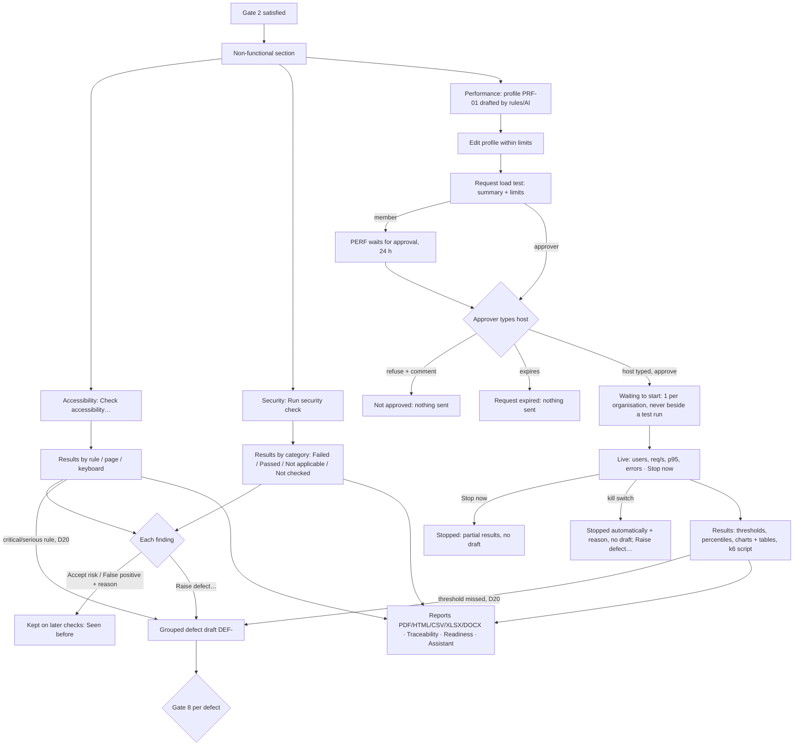

# P5 — AI QA Analyst Platform: Phase 5 UX (Non-functional: Performance, Accessibility, Security; reports and formats; audit, retention, purge; API testing)

## 1. Goal and user
Source: roadmap Phase 5 (P5-00…P5-08), spec §9 (performance), §10 (accessibility), security (passive), §12 (traceability), §16 (assistant), §17 (reports), §19 (approvals). Decisions D17–D24 (§2).

Two users, as before:
1. **A QA lead** who wants accessibility, security hygiene and speed evidence next to the functional results, without three more tools.
2. **A developer or PM with no QA background** who needs to know, in plain words: can people use my site with a keyboard and a screen reader, am I missing basic protections, does it slow down when ten people use it at once, and what do I fix first.

Job: "Check my site for the problems users and attackers notice first, safely, and tell me honestly what was and wasn't checked."

The P1–P4 rules still apply (evidence over volume; visible diff and a decision before anything replaces human work; values computed, never guessed; nothing touches the site without a person's say-so; Observed vs Hypothesis). Phase 5 adds:
- **Load is a risk to someone's site, so it is approved per run, with the host typed and the caps on screen.** Nobody can start load from a single click without typing the host.
- **Say what was and wasn't checked.** Every check shows Passed, Failed, Not applicable or Not checked with the reason. "No findings" never means "safe" or "accessible".
- **Fixed honesty text, never paraphrased** (§3.6).
- **A finding is a fact; whether it matters is a person's call.** Accept risk and False positive need a reason; nothing is confirmed without G8.

This spec **extends** `docs/design/P4-qa-analyst-phase4.md` (which extends P3, P2, P1). Tokens (light navy theme, P1 §2), shell, focus, motion, gate, approval, report and assistant patterns apply unless restated. "P4 §7.3" points to that spec.

---

## 2. Decisions applied (final; override older roadmap text)

| # | Decision | What it means in the UI |
|---|---|---|
| D17 | Built-in Node load generator; k6 script downloadable, not run | Engine line everywhere: "Built-in load generator {version}". Results and profiles offer **[Download k6 script]** with "Not run by the platform. Run it yourself with k6 if you use it." No "Run with k6" control anywhere. |
| D18 | Every load test needs its own `load_test` approval by `can_approve`, host typed. Org ceiling 20 users / 20 req/s / 5 min (owner/admin can raise); platform hard cap 50 / 50 / 10 min | No standing approval, no "remember", no re-run without a new approval. Approve stays disabled until the host is typed exactly. The three limits (this test · your organisation · this server) are shown side by side in the editor, the request and the approval. |
| D19 | Security is passive only, no approval | [Run security check] starts immediately for members. The fixed "This is not a security audit" statement is on every security screen, report and assistant answer. No probing, payload or "deep scan" control exists. |
| D20 | Automatic grouped drafts for critical/serious accessibility rules and failed performance thresholds; security only on request | One draft per rule per scan ("Product images have no text alternative (2 pages)"), one per missed threshold. Kill-switch stops create none (offer [Raise defect…]). Keyboard heuristics never draft. Security findings show [Raise defect…] only. All drafts go to Gate 8 unchanged. |
| D21 | XLSX for table reports; DOCX for every report through one generic renderer | Download menu gains "XLSX (Excel workbook)" on table reports and "DOCX (Word document)" on all reports. XLSX is not offered on document reports (no 422 reachable from the UI). |
| D22 | Test Completion Report is Phase 6 | Not in the Reports list. The "later reports" note says "Test Completion and Release Readiness reports arrive in Phase 6." The Reporting lifecycle stage (step 21, G9) moves to Phase 6. |
| D23 | Hardening limited to egress proxy, audit log, retention/purge, CI audit | User-visible: proxy status in Settings, Audit log, Retention, project archive and permanent deletion. CI has no UI. No Postgres/Redis/S3/Docker settings. |
| D24 | API testing in Phase 5, last, cut first | §15 is self-contained. If cut, nothing in §4–§14 references API testing except the Defects source filter value "API" (hidden when no API defect exists) and the assistant's Later phases line. |

**Who can do what** (P3 §4.3 wording: gate/approval actions say "someone who can approve", never "owner or admin"):

| Action | Viewer | Member | Approver (`can_approve`) | Owner/Admin | Owner only |
|---|---|---|---|---|---|
| Read scans, findings, profiles, runs, metrics, reports | ✓ | ✓ | ✓ | ✓ | |
| Start/cancel accessibility and security checks | – | ✓ | ✓ | | |
| Triage findings (Accept risk, False positive, Reopen; reason), Raise defect | – | ✓ | ✓ | | |
| Create/edit/ready/retire load profiles; download k6 script | – | ✓ | ✓ | | |
| Request a load test | – | ✓ | ✓ (as "Approve and start") | | |
| Approve or refuse a load test (typed host) | – | – | ✓ | | |
| Stop a load test | – | own requests | ✓ any | | |
| G8 for non-functional drafts | – | – | ✓ | | |
| Organisation load limits, retention, audit log and export | – | – | – | ✓ | |
| Archive / unarchive a project | – | – | – | ✓ | |
| Delete an archived project permanently | – | – | – | – | ✓ |

Viewers: controls they can't use are **not rendered**. Members: approval controls render `aria-disabled` with the visible reason, no dialog opens (P3 §13.1). Owner/admin-only settings pages are not linked for others; direct URLs show "Only owners and admins can see this page." Other organisations get the app 404 everywhere.

---

## 3. Vocabulary, statuses and fixed text (`domain/NonFunctionalLabels.tsx`, new; no new colours)

Every status is text + icon, never colour alone. Tones map to the P1 §2.1 semantic tokens.

### 3.1 Severity
| Kind | API | Label | Tone / icon |
|---|---|---|---|
| Accessibility | `critical` | Critical | `danger-solid`/white, `ChevronsUp` |
| | `serious` | Serious | `danger-bg`/`danger-fg`, `ChevronUp` |
| | `moderate` | Moderate | `warning-bg`/`warning-fg`, `Equal` |
| | `minor` | Minor | neutral, `ChevronDown` |
| Security | `high` | High | `danger-bg`/`danger-fg`, `ChevronUp` |
| | `medium` | Medium | `warning-bg`/`warning-fg`, `Equal` |
| | `low` | Low | neutral, `ChevronDown` |
| | `info` | For information | info tone, `Info` |

Sub-labels (second line, `fg-muted`): "Best practice (not a WCAG failure)" for best-practice rules; "Needs review: the automated check couldn't decide" for axe `incomplete` items (grey `CircleHelp`, never counted as problems, never drafted).

### 3.2 Check result (security rules, per-page accessibility coverage)
Failed (red `CircleX`) · Passed (green `CircleCheck`) · Not applicable (grey `CircleSlash`, reason always shown) · Not checked (grey `CircleDashed`, reason always shown).

### 3.3 Finding status (`quality_findings.status`)
| API | Label | Note |
|---|---|---|
| `open` | Open | amber `CircleDot` |
| `accepted_risk` | Accepted risk | grey `ShieldCheck`; line "Accepted by {name}: '{reason}'" |
| `false_positive` | False positive | grey `CircleSlash`; line "Marked by {name}: '{reason}'" |
| `fixed` | Not found again | green `CircleCheck`; "Not found in A11Y-0002." Set only by a later check, never by a person or the AI |

Badge **"Seen before (A11Y-0001-03)"** (neutral, `History`) when the fingerprint appeared in an earlier check. Reappearing after "Not found again" shows "Seen before · reopened".

### 3.4 Check and run status
**Accessibility / security check** (`quality_scans.status`): Waiting to start (blue) · Checking {n} of {m} pages (blue) · Finished (green) · Partial: {n} pages not checked (amber) · Didn't complete (red, reason) · Cancelled (grey).

**Load test** (`performance_runs.status`):
| API | Label |
|---|---|
| `awaiting_approval` | Waiting for approval (amber, `UserRoundCheck`) |
| `rejected` | Not approved (grey) |
| `expired` | Request expired (grey) |
| `queued` | Waiting to start (blue) |
| `running` | Running (blue) |
| `passed` | Finished · all thresholds met (green) |
| `failed` | Finished · {n} of {m} thresholds missed (red) |
| `stopped` | Stopped by {name} (grey) |
| `aborted` | Stopped automatically (amber, `OctagonAlert`) + reason |
| `error` | Didn't complete (red) + reason |

**Threshold result:** Met (green `CircleCheck`) · Missed (red `CircleX`) · Not measured (grey; "The load test stopped early, so this wasn't judged").

### 3.5 Evidence labels
- Rule output (axe result, header value, cookie flags, latency, error rate) is **Observed** (`ObservedLabel`, existing): "Observed on the page", "Observed in the response headers", "Measured during PERF-0001".
- Keyboard pass results carry a new **"Heuristic"** pill (same shape as `HypothesisLabel`, inferred tokens, `Lightbulb` icon). Tooltip: "Worked out by a rule of thumb. A person should check it." Heading: "Keyboard checks (heuristic)".
- Kill-switch possible causes use `HypothesisLabel`: "The site or the network may be overloaded, or the site is down."
- Threshold source: "From REQ-0012" (link) or "Default threshold (no requirement states one)".
- AI text (when on) keeps `GeneratedByLabel ai|mixed`; numbers never come from the AI.

### 3.6 Fixed statements (`lib/nonfunctional.ts` constants; never edited per screen)
- `SECURITY_STATEMENT`: "This is a passive check of what a normal visitor's browser receives. It is not a security audit or a penetration test, and no findings does not mean the site is secure."
- `A11Y_STATEMENT`: "Automated checks find only part of WCAG 2.2 AA issues. Screen reader, zoom and cognitive checks need a person."
- `PERF_STATEMENT(engine, version)`: "Measured with the built-in load generator {version}. Load is generated from the platform host, not from your users' locations." plus, when relevant, the cap or stop line ("Capped at 20 requests a second." · "Stopped automatically: …").

`HonestyNote` (new, wraps `Callout` info, not dismissible, `role` none, first content after the heading) renders them.

### 3.7 Numbers
- Times: under 1 s "640 ms"; from 1 s "1.4 s" (one decimal). Rates "18.2 requests/s". Errors "0.4 %" (one decimal; "0 %" only when the count is 0). Counts with thousands separators.
- Percentiles in plain words first, term second: "95 % of requests were faster than 1.4 s (p95)". Glossary popover `PercentileHelp` ("What do p50, p95 and p99 mean?"): "p50: half the requests were faster than this. p95: 95 out of 100 were faster. p99: 99 out of 100 were faster. The slowest few requests are what busy visitors notice."
- "Virtual user" tooltip: "A simulated visitor that opens pages one after another, pausing 0.5–1.5 s between them."

### 3.8 Tool availability (from `GET /health.tools`)
Never faked, never silently swapped. Missing tool → danger `Callout`, start controls `aria-disabled` with the reason:
- `axe` null: "Accessibility checks can't run on this server: the accessibility checker (axe-core) isn't installed. Ask whoever runs this server to run `npm install` in automation/."
- browser unavailable: "Accessibility and security checks can't run on this server: the Chromium browser isn't installed."
- `loadgen` null: "Load tests can't run on this server: the built-in load generator isn't installed. Ask whoever runs this server to follow automation/README." (k6 download hidden too; it is produced by the generator.)
- `k6` null is **not** an error: Settings shows "k6: not installed · Not needed: the platform exports k6 scripts but doesn't run them."

---

## 4. Information architecture

### 4.1 Routes
| Route | Screen |
|---|---|
| `/projects/[id]/non-functional` | Non-functional. `?tab=performance\|accessibility\|security` (default: the tab with something waiting or running, else the most recently run, else `performance`). |
| `/projects/[id]/performance` | Redirects to `/non-functional?tab=performance` (old links, `ComingInPhase` bookmarks). |
| `/projects/[id]/non-functional/profiles/[profileKey]` | Load profile editor (`PRF-01`). `?v=` older versions read-only. |
| `/projects/[id]/non-functional/load-tests/[runKey]` | Load test page (`PERF-0001`): approval, live, results. |
| `/projects/[id]/non-functional/checks/[scanKey]` | Accessibility (`A11Y-0001`) or security (`SEC-0001`) check results. `?view=rules\|pages\|keyboard` (a11y), `&finding=A11Y-0001-03` opens the finding drawer. |
| `/projects/[id]/reports/performance?run=`, `/reports/accessibility?scan=`, `/reports/security?scan=` | The three new reports. |
| `/projects/[id]/settings?view=archive` | Project settings › Archive and delete. |
| `/settings/load-limits`, `/settings/retention`, `/settings/audit-log` | Organisation settings (owner/admin). |

### 4.2 Sidebar (`lib/sections.ts`)
- `CURRENT_PHASE = 5`. The `performance` entry becomes `{ slug: "non-functional", label: "Non-functional", icon: Gauge, phase: 5 }`; position unchanged (after Test Execution). Still 12 sections. Tooltip/description: "Speed under load, accessibility and basic security."
- **Badges** (first match wins):

| Badge | When | Accessible name |
|---|---|---|
| "Approve" | a load test is waiting and the viewer can approve | "Non-functional, {n} load tests waiting for your approval" |
| "Waiting" | a load test is waiting, viewer can't approve | "Non-functional, a load test is waiting for approval" |
| "Running" (text, no animation) | a check or load test is running | "Non-functional, a check is in progress" |
| "Out of date" | `accessibility` or `security_assessment` stale | "Non-functional, checks are out of date" |

### 4.3 Lifecycle (`lib/lifecycle.ts`, `LifecycleProgress`)
- Non-functional checks are **optional branches**, not numbered steps, and have no gate diamond (approvals are not gates). Full variant: after the Defects stage, a separate group **"Optional checks · any time after Gate 2"** with three rows:

| Row | Agent text | Status text |
|---|---|---|
| Accessibility | Accessibility checks (axe-core + keyboard pass, no AI) | Not run yet · Checking… · Done: {n} open findings · Partial · Out of date: pages changed after this check · Didn't complete |
| Security (passive) | Security rule table (no AI) | same pattern |
| Performance | Performance Testing Agent; built-in load generator | Not run yet · PERF-0002 waiting for your approval / for approval by someone who can approve · Running · Done: all thresholds met · Done: 1 threshold missed · Stopped |

  Each row links to its tab. Before G2: rows read "Available after Gate 2" (grey), no action. The line under the group: "Every load test needs its own approval. Accessibility and security checks only read pages."
- Compact/mini variants: no change except a single chip "Non-functional: {state}" in compact when something is running or waiting (keeps the rail short).
- **Reporting stage (step 21, G9):** `phase: 6`, `phaseLabel: "Phase 6"` (D22).
- Never "Running" without a scan or run. Never auto-started: the rows say "Starts only when someone runs it."

### 4.4 Header (`ProjectHeader`)
- Status pill gains (after G7 run states, before defect drafts): "Load test PERF-0002 running" (blue) · "PERF-0002 waiting for your approval" / "…for approval by someone who can approve" (amber) · "Accessibility check running" / "Security check running" (blue).
- ⋯ menu adds (members+): "Check accessibility…", "Check security", "Plan a load test" (opens the Performance tab). Viewers: none.
- Archived project with scheduled deletion: a page-wide danger Callout under the header (§13.5).

### 4.5 Overview
**Needs your attention** (`lib/attention.ts`, after G7 rows; max 5):
- Approver: "PERF-0002 is waiting for your approval: up to 10 virtual users for 2 min 10 s against localhost:4100." [Review PERF-0002]. Member: "PERF-0002 is waiting for approval by someone who can approve." [Open PERF-0002]. Viewer: text only.
- "PERF-0001 missed 1 threshold: the Desk lamp page (/products/2) was slow under load." [Open PERF-0001] (7 days or until opened).
- "PERF-0003 was stopped automatically: 100 % errors over 10 s." [Open PERF-0003].
- "A11Y-0001 found 2 critical or serious accessibility problems." [Open A11Y-0001].
- "Accessibility and security checks are out of date: pages changed after them." [Open Non-functional].
- Non-functional drafts are counted in the existing "{n} defect drafts need confirming or rejecting" row.

**At a glance** adds one card **Non-functional** (before G2: "Available after Gate 2."):
```
Non-functional                                                    [Open Non-functional]
Accessibility  A11Y-0001 · 13 Nov · 2 rules on 2 of 6 pages (1 critical, 1 serious)
Security       SEC-0001 · 13 Nov · 7 findings · passive check, not a security audit
Performance    PERF-0001 · 13 Nov · 1 of 7 thresholds missed
```
Never-run lines: "Not checked yet." Never a score, grade or percentage.

**Dashboard:** "Awaiting approval" tile also counts load tests waiting for approval.

**Feed agents** (new): "Accessibility checker" · "Security checker" · "Performance Testing Agent" (short "Performance Agent") · "Load generator". Examples: "A11Y-0001 started by M. Member: 6 pages, desktop" · "A11Y-0001 finished: 2 rules failed on 2 of 6 pages; 0 pages not checked" · "Drafted DEF-0004: Product images have no text alternative (2 pages)" · "PRF-01 drafted (rules): 7 pages, up to 10 virtual users" · "PERF-0001 requested by M. Member · waiting for approval" · "PERF-0001 approved by A. Approver (host typed)" · "PERF-0001 finished: 6 of 7 thresholds met (2 min 10 s)" · "PERF-0003 stopped automatically: 100 % errors over 10 s". Events never contain page text, header values or response bodies.

### 4.6 Removing "Phase 5" placeholders
- Test Cases "Not designed in Phase 3 … designed in Phase 5" → "Not designed as test cases: {types}. They're checked in Non-functional." [Open Non-functional].
- Reports note → "Test Completion and Release Readiness reports arrive in Phase 6."
- `LATER_TASKS_FALLBACK` → Phase 6 items only (§12.3). Readiness "Phase 5" items become evaluable (§12.2).
- `ComingInPhase` for Performance is deleted.

---

## 5. Flow


Exits: close a dialog (nothing created) · cancel a check (finished pages kept) · withdraw a request · refuse or let it expire · Stop now · triage instead of raising a defect · reject the draft at G8.

---

## 6. Non-functional section

### 6.1 Layout
```
[Project header + compact lifecycle]
Non-functional                                                                           [Ask the analyst]
Speed under load, accessibility and basic security, checked on the pages discovery found on http://localhost:4100.
+-- Accessibility ---------------+-- Security (passive) ----------+-- Performance -------------------+
| A11Y-0001 · 13 Nov             | SEC-0001 · 13 Nov              | PERF-0001 · 13 Nov               |
| 2 rules failed on 2 of 6 pages | 7 findings · 6 rules passed ·  | ✗ 1 of 7 thresholds missed       |
| ✓ No keyboard trap found       | 4 not applicable               |                                  |
+--------------------------------+--------------------------------+----------------------------------+
Tabs:  Performance | Accessibility (2 open) | Security (7 open)
```
- The three summary cards are links to their tab (unique names "Open accessibility results", …); at 375 px they stack. Never-run card: "Not checked yet" + the tab's start button (members+).
- Tab counts are open findings / waiting state ("Performance · 1 waiting"). Tabs use `Tabs` (ARIA tabs, `?tab=`).
- Before G2: `EmptyState` "Non-functional checks use the pages discovery found. Approve Gate 2 first." [Review Gate 2]. No tabs.

### 6.2 Shared states (all three tabs)
| State | What the user sees | Copy |
|---|---|---|
| Before G2 | EmptyState | above |
| Never run | EmptyState with what it does, the honesty line, start button (members+) | per tab (§7.1, §8.1, §9.1) |
| Running | Progress card; results of finished pages appear as they come | per tab |
| Out of date | `OutOfDateCallout` | "Pages changed after this check (discovery ran again on {date}). The results still show what was found then. Run the check again to update them." [Check again] |
| Tool unavailable | Danger Callout, start `aria-disabled` | §3.8 |
| No permission (viewer) | No start, triage, request, approve or stop controls | — |
| Member on approve controls | Disabled + reason | "Approving load tests needs approval permission. Someone who can approve will see this request." |
| AI off | `GeneratedByLabel rules`; dismissible info Callout once per project | "Checks and load profiles are made by rules (AI not configured). Explanations use the rule text." |
| AI on | AI may rewrite "Why it matters" text and profile rationale, labelled | — |
| Loading / error / offline | Skeleton / "Couldn't load non-functional results. Try again." / P1 offline banner; start buttons disabled "You're offline. Reconnect to start a check." | — |

---

## 7. Accessibility tab (P5-02)

### 7.1 Never run
```
Accessibility
Checks every discovered page for barriers that affect people using screen readers, keyboards or low vision.
[HonestyNote: A11Y_STATEMENT]
What the check does: opens each page, runs the axe-core rules for WCAG 2.2 A and AA, and presses only Tab and
Shift+Tab to follow keyboard focus. It never clicks, types or submits.          [Check accessibility…]
```

### 7.2 Start dialog (`Modal` md; full-screen below `md`)
```
Check accessibility
Pages        (•) All discovered pages (6)   ( ) Choose pages…
Screen sizes [x] Desktop 1440 × 900   [ ] Phone 390 × 844
Keyboard     [x] Follow keyboard focus with Tab and Shift+Tab (up to 60 presses per page)
Signed-in    [ ] Include pages behind sign-in (2), using the saved test account
                 Disabled when no credentials: "Save test credentials to include these pages." [Add test credentials]
About 1 minute · 6 pages × 1 screen size. Nothing on the site is clicked, typed or submitted.
                                                                    [Cancel]  [Start check]
```
- Defaults: all pages, desktop only (mobile opt-in, as D7), keyboard on, signed-in off. Phone doubles the page visits; the estimate updates.
- Start → toast "A11Y-0002 started." and the check page. Errors: "Couldn't start the check: {reason}. Nothing was started." · "An accessibility check is already running (A11Y-0002)." [Open A11Y-0002].

### 7.3 Running
```
A11Y-0002 · Checking 3 of 6 pages                                                         [Cancel check…]
| Page              | Desktop                     |
| /                 | ✓ Done · no problems        |
| /products/1       | ✓ Done · 2 rules failed     |
| /products/2       | ● Checking                  |
| /about            | ○ Waiting                   |
```
- Rows update from `quality.page_done`; table is not a live region. Polite region announces start, every 25 %, and the end ("A11Y-0002 finished: 2 rules failed on 2 of 6 pages, 0 pages not checked").
- [Cancel check…] `ConfirmDialog`: "Cancel A11Y-0002? Pages already checked keep their results; the rest show 'Not checked: check cancelled'." [Keep checking] [Cancel check].

### 7.4 Results (`/checks/A11Y-0001`)
```
← Non-functional
A11Y-0001 · Accessibility check                          ✓ Finished        [Open Accessibility Report] [⋯]
13 Nov 14:02 · 6 pages · Desktop 1440 × 900 · keyboard pass on · axe-core 4.14.x · started by M. Member
[HonestyNote: A11Y_STATEMENT]
2 rules failed on 2 of 6 pages · 1 critical · 1 serious · 0 moderate · 0 minor · 3 need review
Defects drafted: DEF-0004 (Product images have no text alternative), DEF-0005 (Text has too little contrast) · Gate 8
View:  [By rule | By page | Keyboard]          Severity [Any ▾] Status [Open ▾] Page [Any ▾]
```
**By rule** (default):
```
| Rule                                            | Severity      | Where              | WCAG          | Status  |
| Images must have a text alternative (image-alt) | ⌃⌃ Critical   | 2 pages · 2 elements | 1.1.1 (A)   | Open    |
|   Product images have no text alternative       |               | /products/1, /products/2 |       | DEF-0004 Draft |
| Text must have enough contrast (color-contrast) | ⌃ Serious     | 2 pages · 2 elements | 1.4.3 (AA)  | Open    |
| Needs review (3)  [Disclosure]                                                                  |
```
- Each rule row opens the finding drawer for its first page; the "Where" cell lists pages as links (unique names "Open image-alt on /products/2").
- **By page:** one row per page and screen size: "/products/2 · Desktop · 2 rules failed · 2 elements" or "✓ No problems found by the automated rules" or "Not checked: page timed out after 20 s". Pages with no problems never read "Accessible" or "0 issues".
- **Not checked** pages are listed in their own block above the table: "1 page wasn't checked, so it isn't counted as clean: /account (needs sign-in; not included)."

### 7.5 Finding drawer (`Drawer`, `?finding=`)
```
A11Y-0001-01 · Images must have a text alternative                 ⌃⌃ Critical · Open · Seen before (—)
/products/2 · Desktop · WCAG 1.1.1 Non-text content (Level A)
What's wrong  [Observed on the page]
  The product image has no alt attribute, so screen readers announce nothing or the file name.
Elements (1)
  ① img.product-image                     
[Screenshot of /products/2 with element ① outlined]
How to fix
  Add an alt attribute that says what the image shows, e.g. alt="Desk lamp". Decorative images use alt="".
  Learn more about image-alt (opens Deque University in a new tab)
Linked to   Feature: Product details · REQ-0009 Product page shows product information · TC-0031 (accessibility)
            or "No requirement covers this page."
Defect      DEF-0004 · Draft · grouped with 1 other page                                     [Open DEF-0004]
[Accept risk or mark false positive…]  [Raise defect…] (only when no defect is linked)  [Ask the analyst]
```
- Element HTML sits in a focusable named code region ("HTML of element 1"), monospace, wraps below `md`. Password `value` attributes are already removed server-side; the UI adds nothing.
- **Screenshot:** outlines are numbered badges (① ②) that match the element list, plus a 3 px `danger-solid` outline with a white inner ring (visible on any background). `alt`: "Screenshot of /products/2 at desktop size with 1 element outlined: element 1, the product image." [Open full size]. Password fields are masked; the note says so.
- "How to fix" uses axe's help text verbatim (labelled "From axe-core") unless AI is on and a plain-words version exists (`GeneratedByLabel ai`, the axe text under a "Original rule text" Disclosure).

### 7.6 Keyboard view
```
Keyboard checks (heuristic)  [Heuristic]
Pressed Tab up to 60 times and Shift+Tab back on each page. Nothing was clicked or typed.
| Page        | Focus moves through        | Trap   | Focus visible        | Not reachable |
| /           | 9 links and buttons        | ✓ None | ✓ On all 9           | ✓ None        |
| /contact    | 7 controls                 | ✓ None | ✗ 1 without outline  | ✓ None        |
[Show focus order for /contact]  →  ol: 1 Link "Home" · 2 Link "Products" · … 5 Text box "Message" · 6 Button "Send message"
```
- Findings here (Keyboard trap, Focus not visible, Not reachable by keyboard) open the same drawer with the Heuristic pill; they never draft defects (the drawer says "Keyboard checks don't create defect drafts automatically. Raise one if a person confirms it.").

### 7.7 Triage dialog (`TriageDialog`, new; shared with security)
```
Accept risk or mark false positive · A11Y-0001-02
( ) Accept the risk: it's a real problem, and we've decided not to fix it now
( ) False positive: the check is wrong here
( ) Reopen (shown when not Open)
Reason *  [                                                        ]
This stays on later checks of the same element (shown as "Seen before"). It doesn't change the defect, if there is one.
                                                            [Cancel]  [Save]
```
- Errors: "Choose an option." · "Say why. The reason is shown in reports."
- If a linked defect is still a draft: extra line "DEF-0004 is still a draft. Reject it at Gate 8 if it isn't a bug." [Open DEF-0004].
- Toast: "A11Y-0001-02 marked as accepted risk." Focus returns to the row's triage button.

### 7.8 Accessibility states (tab-specific)
| State | Copy |
|---|---|
| Finished, nothing found | "The automated rules found no problems on the 6 pages checked." + `A11Y_STATEMENT` (never "accessible", never "0 issues") |
| Partial | Amber Callout: "Partial: 1 page wasn't checked (timed out after 20 s). It isn't counted as clean." [Check again] |
| Didn't complete | "The check didn't complete: {reason}. Pages already checked keep their results." [Check again] |
| Cancelled | "Cancelled by {name}. {n} pages were checked; the rest show 'Not checked: check cancelled'." |
| Second check, same problems | Finding rows show "Seen before"; drafted defects line: "No new drafts: the problems were added to DEF-0004 and DEF-0005 as new occurrences." |

---

## 8. Security tab (P5-03, D19)

### 8.1 Never run
```
Security (passive)
[HonestyNote: SECURITY_STATEMENT]                         ← always first, in every state of this tab
Checks what a normal visitor's browser receives on each discovered page: HTTPS, security headers, cookies, mixed
content and error messages. It opens each page once, plus one plain-http request to the start page and one
encryption (TLS) handshake. No attacks, no guessing of hidden pages, no form submission. No approval needed.
                                                                                      [Run security check]
```
- [Run security check] starts immediately (no dialog; the paragraph is the explanation). Signed-in pages: a checkbox above the button "Include pages behind sign-in (2), using the saved test account" (unchecked; disabled without credentials). Toast "SEC-0002 started."

### 8.2 Results (`/checks/SEC-0001`)
```
SEC-0001 · Security check (passive)                                  ✓ Finished   [Open Security Report] [⋯]
13 Nov 14:10 · 6 pages · started by M. Member
[HonestyNote: SECURITY_STATEMENT]
7 failed · 6 passed · 4 not applicable · 0 not checked
Defects are created only when you raise one.
Status [Failed ▾ | All]   Severity [Any ▾]
TRANSPORT
  ⊘ Not applicable  Pages served over HTTPS        The target is plain http on this computer (loopback).
  ⊘ Not applicable  HTTP redirects to HTTPS        same reason
  ⊘ Not applicable  HSTS · TLS version · Password field over HTTP   same reason
HEADERS
  ✗ Failed  Medium  Content-Security-Policy missing         6 of 6 pages     [Details]
  ✗ Failed  Medium  No clickjacking protection              6 of 6 pages     [Details]
  ✗ Failed  Low     X-Content-Type-Options: nosniff missing 6 of 6 pages     [Details]
  ✗ Failed  Low     Referrer-Policy missing                 6 of 6 pages     [Details]
  ✗ Failed  Low     Server version disclosed (X-Powered-By) 6 of 6 pages     [Details]
  ✗ Failed  For information  Permissions-Policy missing     6 of 6 pages     [Details]
  ✓ Passed  CORS doesn't allow any site with credentials
COOKIES
  ✗ Failed  Low     Cookie without SameSite: recently_viewed   2 pages      [Details]
  ✓ Passed  Session cookies are HttpOnly  ("No session-like cookie was set" as the reason line)
CONTENT
  ✓ Passed  No mixed content · ✓ No forms posting elsewhere · ✓ No error details shown · ⓘ Third-party scripts: none
```
- Grouped by category; **one row per rule** with page count (not one row per page), so 6 missing headers don't become 36 rows. "Not applicable" and "Not checked" rows are always shown, with the reason, so the reader sees what wasn't checked.
- Filter defaults to Failed + Not checked when anything failed; "Show all 17 checks" switches to All.

### 8.3 Finding drawer (security)
```
SEC-0001-02 · Content-Security-Policy missing                         Medium · Open
Pages (6): / · /products · /products/1 · /products/2 · /about · /contact   [Show all]
Observed in the response headers  [Observed]
  Content-Security-Policy: (not sent)            ← observed header block, monospace, values shown as received
Why it matters   Without a policy, a script injected into a page can run and steal what visitors type.
How to fix       Send a Content-Security-Policy header. Start with: default-src 'self'; and add the
                 sources your pages need.
Reference        OWASP Secure Headers Project: Content-Security-Policy (opens in a new tab)
[Accept risk or mark false positive…]  [Raise defect…]  [Ask the analyst]
[SECURITY_STATEMENT as a short footer line]
```
- Cookie findings show name and flags only: "recently_viewed · Path=/ · no HttpOnly · no SameSite". Cookie values are never stored or shown (note: "Cookie values are never stored.").
- **Raise defect…** on a rule creates **one grouped draft** across its pages (§10). Before saving, the defect form is prefilled: summary "Pages don't send a Content-Security-Policy (6 pages)", source Security, severity from the rule (Medium → Minor, High → Major; overridable with a reason).

### 8.4 Security states
| State | Copy |
|---|---|
| Finished, nothing failed | "No passive check failed on the 6 pages checked." + `SECURITY_STATEMENT` directly under it (never "secure", never a green tick headline) |
| All transport rules N/A | Reason row text as §8.2; never counted as passed |
| Partial | "Partial: 1 page wasn't checked (no response). Its headers and cookies weren't checked." |
| TLS handshake failed | Transport row "Not checked: the encrypted connection couldn't be opened ({reason})." |

---

## 9. Performance tab (P5-01b, P5-01c)

### 9.1 Tab layout
```
Performance
How fast pages respond when several people use the site at once. Every load test needs its own approval.
[Waiting-for-approval callout when any]
LOAD PROFILES                                                                        [New profile ▾]
| PRF-01 Load test of public pages · v2 · Ready · Generated by rules · 7 pages · up to 10 users ·  |
|   2 min 10 s · at most 20 requests/s · default thresholds          [Edit] [Request load test…]  |
LOAD TESTS
| Test      | Profile     | Status                          | Result                    | Requested · Approved by   | When          |
| PERF-0002 | PRF-01 v2   | ⚠ Waiting for approval          | —                         | M. Member · —             | 13 Nov 15:02  |
| PERF-0001 | PRF-01 v1   | ✗ Finished · 1 of 7 missed      | p95 worst: 1.4 s (/products/2) | M. Member · A. Approver | 13 Nov 14:20 · 2 min 10 s |
Limits: this organisation allows up to 20 virtual users, 20 requests a second and 5 minutes per load test.
```
- **Never run, G4 not approved:** "Load profiles use the approved Test Strategy. Approve Gate 4 first." **G4 approved, no profile:** "No load profile yet. The Performance Agent can draft one from the public pages discovery found." [Draft a load profile] (members). Drafting shows "Drafting a load profile from 7 public pages…".
- **New profile ▾:** "Load (steady traffic)" · "Stress (step up to your limit)" · "Spike (sudden jump for 30 s)" · "Short soak (longer, half the users)". Each template opens the editor prefilled; the soak item has "Short: limited to {5 min} by your organisation".
- Stale profile (G4 re-approved): amber pill "Strategy changed" + "This profile still works. Draft it again to pick up changes." [Draft again].

### 9.2 Profile editor (`/profiles/PRF-01`)
```
PRF-01 · Load test of public pages        Version 2 [▾] · Ready · Generated by rules         [Save] [⋯ Retire]
Type   Load (steady traffic)
PAGES TO LOAD (7 of at most 10)                                                    [Add pages…]
| Page          | Weight | Why                         |              |
| /             | 3      | Start page                  | [Remove /]   |
| /products     | 2      | Listing page                | [Remove …]   |
| /products/2   | 1      |                             |              |
Only public pages discovery visited, opened with GET, never signed in. Forms are never submitted.
TRAFFIC
| Stage | Duration | Users at end of stage |
| 1 Ramp up   | [30] s  | [10]    "Your organisation allows up to 20 virtual users."
| 2 Hold      | [90] s  | [10]
| 3 Ramp down | [10] s  | [0]
[Add stage]   Chart: users over time (aria-hidden; the table above is the data)
Total 2 min 10 s · your organisation allows up to 5 min.
Pause between pages  [0.5] to [1.5] s
Max requests a second [20]   "Your organisation allows up to 20."
THRESHOLDS
| Measure                 | Applies to   | Must be       | Source                                       |
| 95 % of requests faster | each page    | under 800 ms  | Default threshold (no requirement states one) |
| Errors                  | all requests | under 1 %     | Default threshold (no requirement states one) |
| 95 % of requests faster | /products/*  | under 2 s     | From REQ-0012 (locked: comes from a requirement) |
[Download k6 script]  Not run by the platform. Run it yourself with k6 if you use it.
```
- **Add pages…** is a checklist of eligible discovered pages only (no free-text URL): visited, HTTP 200, same host, public, not logout/delete/download. Ineligible pages are shown disabled with the reason ("needs sign-in", "looks like a logout link"). At 10: "A profile can load at most 10 pages."
- **Inline limits:** each number field has `aria-describedby` to its limit line. Over the limit: field error "Your organisation allows up to 20 virtual users." and Save stays enabled; the server's 422 message is shown verbatim if it differs. Owner/admin see a link "Change organisation limits".
- Requirement thresholds can be tightened, not removed or loosened ("This threshold comes from REQ-0012. Change the requirement to change it.").
- Save creates a new version (`VersionSelect`, older read-only); toast "PRF-01 version 3 saved." A pending request for an older version is invalidated (§9.4).
- AI on: weights may be reordered with a rationale, labelled `GeneratedByLabel ai`; the "Why" column shows it.
- Viewers: read-only fields (no inputs), no Save/Request.

### 9.3 Request dialog (`LoadTestRequestDialog`, new; `Modal` lg; full-screen below `md`)
```
Request a load test · PRF-01 v2
Summary   Up to 10 virtual users, at most 20 requests a second, for 2 minutes 10 seconds, against localhost:4100;
          GET only; not signed in.
          About 2,100 requests.
LIMITS                    This test   Your organisation   This server (hard limit)
  Virtual users           10          20                  50
  Requests a second       20          20                  50
  Duration                2 min 10 s  5 min               10 min
WHAT IT DOES
  • Opens 7 pages with GET requests only: no forms, no sign-in, no data changes.
  • Load comes from this platform's computer, not from your users' locations.
  • Stops by itself if the site looks overwhelmed: over 20 % errors, responses slower than 10 s, or no
    successful response for 5 s.
  • Real visitors may notice the site is slower while it runs. Use a test or staging copy if you can.
Thresholds 7 (6 default, 1 from REQ-0012)                                   [Show thresholds]
Note (optional) [                                       ]

Member:   [Cancel]  [Request approval]
          Nothing is sent to the site until someone who can approve types the host and approves.
Approver: Type localhost to approve and start  [______________]
          [Cancel]  [Request approval instead]  [Approve and start load test]
          Your approval is recorded with your name, the time and that you typed the host.
```
- The summary sentence is server-computed and must appear verbatim (demo thread).
- **Approver path** (same request, `approve: true, confirm_text`): [Approve and start load test] is `aria-disabled` until the typed text matches the host (case-insensitive, trimmed; reuse `hostMatches`), with the reason "Type localhost to approve." Wrong text on submit: "Type localhost exactly to approve." [Request approval instead] lets an approver hand it to a colleague.
- **Member path:** after sending, the load test page in its waiting state and toast "PERF-0002 requested. Someone who can approve must approve it."
- **Blocked:** profile over a limit: dialog doesn't open; [Request load test…] `aria-disabled` "PRF-01 is over your organisation's limits. Edit it first." Profile not Ready: "Mark PRF-01 ready first." Tool missing: §3.8.
- **Queued notes** (shown, not blocking): "Another load test is running in your workspace (PERF-0007). This one starts when it finishes." · "RUN-0005 is running on this project. Load tests never run at the same time as test runs here, so this one waits."

### 9.4 Approval on the load test page (`LoadApprovalPanel`, new; styled like `RunAuthorisationPanel`)
```
+-- Approve load test PERF-0002 · APR-0004 ------------ [⚠ Waiting for your approval | … for approval by someone who can approve] --+
| Requested by M. Member · 13 Nov 15:02 · expires 14 Nov 15:02 (in 23 h) · "Before the release meeting"                      |
| [§9.3 Summary, LIMITS table and WHAT IT DOES, identical wording]                                                           |
| Profile PRF-01 v2: 7 pages, 3 stages, 7 thresholds                                     [Show the profile]                   |
| Type localhost to approve  [______________]                                                                                |
| Comment (needed to refuse) [                                                 ]                                             |
| [Approve and start load test]  [Don't approve…]                                                                            |
+----------------------------------------------------------------------------------------------------------------------------+
```
- Approver: Approve disabled until the host matches (above). Refuse needs a comment ("Say why this load test shouldn't run."). Result: "Not approved by {name}: '{comment}'. Nothing was sent to the site." Requester sees [Request again] (prefilled).
- Requester (member): read-only + [Withdraw request] ("Request withdrawn. Nothing was sent to the site.").
- Other members: read-only + permission note. Viewers: read-only, no buttons.
- **No longer valid** (profile edited, ceiling lowered, hard cap changed): Approve disabled, warning "This request can't be approved as it was made: {PRF-01 changed to version 3 | your organisation's limit is now 10 users}. Request it again." [Request again].
- **Expired:** "This request expired after 24 hours. Nothing was sent to the site." [Request again].
- The record after approval (frozen; also printed in the report): "Approved by A. Approver · 13 Nov 15:10 · host typed: yes".

### 9.5 Live view (`LiveLoadView`, new; pattern of `LiveRunView`)
```
PERF-0002 · PRF-01 v2                                      ● Running                         [Stop now]
1 min 05 s of 2 min 10 s  ███████▒▒▒▒▒▒  (text first; bar aria-hidden)
+------------------+------------------------+----------------------------------+------------------+
| Virtual users    | Requests a second      | 95 % faster than (p95, last 10 s)| Errors (last 10 s)|
| 10 of 10         | 18.4 · limit 20        | 420 ms                           | 0 %              |
+------------------+------------------------+----------------------------------+------------------+
Response time over time (p95)  [Chart | Table]                                     [Pause updates]
Updated every second · numbers from the load generator · load from the platform's computer
```
- `StatTile` ×4, values update at least every 2 s from `performance.progress`. **[Pause updates]** freezes tiles and chart (WCAG 2.2.2); under reduced motion the view starts paused and refreshes every 5 s, button "Resume updates". Pausing never pauses the load (the button tooltip says so: "Pauses the screen, not the load test.").
- **[Stop now]** (requester or any approver; danger secondary, always visible, top right, also in a sticky footer below `md`). `ConfirmDialog`: "Stop PERF-0002 now? Load stops within 2 seconds. Results so far are kept and marked Stopped. A stopped load test can't be resumed." [Keep running] [Stop now]. **Initial focus on [Stop now]** (stopping is the safe direction; Enter confirms). After confirm: "Stopping…" then the Stopped state (≤ 2 s; if not confirmed by the server in 5 s: "Still stopping… the load generator is being shut down." and the run shows Error if the worker died).
- Polite region: start, 25/50/75 %, any kill-switch stop, end ("PERF-0002 finished: 6 of 7 thresholds met"). Never per tick.
- **Kill switch** (assertive once, then a persistent amber banner):
  "Stopped automatically: 100 % errors over 10 s." / "Stopped automatically: responses were slower than 10 s for 10 s (p95 12.4 s)." / "Stopped automatically: no successful response for 5 s. The site may be down."
  Second line: "The kill switch stops load by itself when the site looks overwhelmed, to protect it." Then "Possible causes [Hypothesis]: the site or the network is overloaded, or the site is down." No defect is drafted: "No defect drafted: a load test stopped this way may be caused by the environment. Raise one if the site itself is at fault." [Raise defect…].
- When the run ends the live tiles are replaced by results; no live dot remains; focus stays where it was.

### 9.6 Results
```
PERF-0001 · PRF-01 v1 · Load              ✗ Finished · 1 of 7 thresholds missed     [Open Performance Report] [⋯]
13 Nov 14:20 · 2 min 10 s · 2,086 requests · requested by M. Member · approved by A. Approver (host typed)
[HonestyNote: PERF_STATEMENT]
With up to 10 virtual users, 6 of 7 pages stayed within their thresholds. The Desk lamp page (/products/2) was
slow: 95 % of its requests were faster than 1.4 s, and the threshold is 800 ms.        [What do p50, p95 mean?]
Defect drafted: DEF-0006 Desk lamp page slows down under load (p95 1.4 s with 10 users; threshold 800 ms) · Gate 8
THRESHOLDS
| Page / scope   | Measure               | Threshold           | Measured   | Result   | vs PERF-0000 |
| /products/2    | 95 % faster than (p95)| under 800 ms (Default) | 1.4 s   | ✗ Missed | first run    |
| /products/1    | p95                   | under 800 ms (Default) | 62 ms   | ✓ Met    |              |
| All requests   | Errors                | under 1 % (Default)    | 0 %     | ✓ Met    |              |
PER PAGE
| Page        | Requests | Req/s | p50   | p90   | p95   | p99   | Slowest | Errors | Status codes |
| /products/2 | 298      | 2.3   | 610 ms| 1.2 s | 1.4 s | 1.6 s | 1.7 s   | 0 %    | 200: 298     |
OVER TIME   Response time (p95) · Requests a second · Errors     each [Chart | Table]
RUN DETAILS  Engine: built-in load generator {v} · Load from the platform's computer · Limits: this test 10/20/2 min 10 s,
             organisation 20/20/5 min, server 50/50/10 min · Approval APR-0003 · Not signed in · GET only
[Download k6 script]  Not run by the platform.     [Request again…] (opens §9.3 with the same profile)
```
- The plain-language paragraph leads; tables carry the numbers; charts are secondary. Missed thresholds are identified by text ("✗ Missed"), and missed rows sort first.
- **Charts** (`MetricChart`, new, `recharts` already in `web/package.json`): lines with direct labels, threshold drawn as a dashed line labelled "Threshold 800 ms", no colour-only series (each page line also has a distinct dash pattern and an end label). Each chart is a `figure` with a caption and a `Segmented` [Chart | Table]; the Table view is the full time series (per 1 s; collapsed to 5 s buckets above 300 rows with a note). The chart SVG is `aria-hidden`; the caption summarises it ("p95 for /products/2 rose from 200 ms to 1.4 s after 30 s, when 10 users were active").
- **Comparison:** "vs previous run" column shows "+120 ms" / "−40 ms" with words in sr ("120 milliseconds slower than PERF-0000"). First run: "first run".
- **Stopped / stopped automatically:** grey (or amber) Callout "Stopped by {name} at 1 min 05 s. Measurements cover the first 1 min 05 s and aren't judged against thresholds." Every threshold reads "Not measured" with the measured value still shown (OQ7). No draft.
- **Didn't complete:** "The load test didn't complete: the worker stopped. Results up to 1 min 12 s are kept. No load is being sent." [Request again…].

### 9.7 Organisation load limits (`/settings/load-limits`, owner/admin)
```
Load limits
Every load test in this organisation must stay within these limits. Each test still needs its own approval.
Virtual users        [20]   This server allows up to 50.
Requests a second    [20]   This server allows up to 50.
Duration             [5] min  This server allows up to 10 min.
The server limits are set by whoever runs this server and can't be changed here.
[Save limits]
```
- Raising: `ConfirmDialog` "Raise the limits to 40 users, 40 requests a second and 8 min? Larger tests put more load on the sites you test." Lowering: "Lower the limits? Pending load test requests above the new limits can no longer be approved." Over hard cap: field error "This server allows up to 50." Toast "Load limits saved." Audited (shown in the audit log).
- Others: page not linked; direct URL shows the read-only values with "Only owners and admins can change load limits."

---

## 10. Findings → defects → Gate 8 (D20; `defects/*`, `Gate8Review`)

- **Drafted automatically:** one per critical/serious axe rule per check (grouped across pages; a later check adds occurrences to the open draft or defect), and one per missed threshold. **On request:** security rules ([Raise defect…] per rule group), heuristic keyboard findings, minor/moderate accessibility rules, kill-switch stops.
- **Source** (`defects.source`): new values shown as text chips: Functional · Accessibility · Security · Performance · API. The Defects list gains **Source** in [More filters] and a column chip after the summary ("DEF-0004 Product images have no text alternative (2 pages) · Accessibility").
- **Gate8Review row additions** (same per-row Confirm/Reject):
  - Accessibility: "Why: axe rule image-alt (Critical) on 2 pages, 2 elements · WCAG 1.1.1 · from A11Y-0001 [Observed]". [Open DEF-0004]
  - Performance: "Why: measured p95 1.4 s on /products/2 with 10 users; threshold 800 ms (Default) · PERF-0001 [Observed]".
  - Security: "Why: Content-Security-Policy not sent on 6 pages · SEC-0001 [Observed] · raised by {name}".
  No Hypothesis label on these rows: the measurement is observed; "is it a bug for this product" is the G8 decision. The tab intro adds: "Non-functional drafts state what was observed. Confirm when it's a problem you'll fix; reject with 'Works as intended' or 'Accepted risk' when it isn't."
- **Reject reasons** gain **"Accepted risk"** (non-functional drafts only). Choosing it shows a checkbox "Also mark the {n} findings as Accepted risk with this comment" (unchecked by default; see OQ2).
- **Defect detail** for non-functional drafts:
  - Environment: "http://localhost:4100 · Chromium 131 · Desktop 1440 × 900 · A11Y-0001" or "Built-in load generator {v} · PRF-01 v1 · PERF-0001 · 10 virtual users".
  - Steps to reproduce: a11y "Open /products/2. Inspect the product image (img.product-image)."; perf "Run PRF-01 v1 (up to 10 virtual users, 2 min 10 s), or the attached k6 script. Watch /products/2."
  - Expected `[Assumed · from WCAG 1.1.1]` / `[Default threshold]` or `[From REQ-0012]`; Actual `[Observed]` / `[Measured during PERF-0001]`.
  - Root cause: "Not analysed. Automated checks measure what happens, not why." (No Hypothesis is invented.)
  - Evidence: outlined screenshot and node list; or the time-series chart + table and the k6 script link.
  - Occurrences: "A11Y-0001 · 2 pages", "A11Y-0002 · 2 pages (added)".
  - Mark verified (Fixed → Verified): enabled when a later check no longer finds the rule on those pages, or a later approved load test meets the threshold ("Not found in A11Y-0003" / "Met in PERF-0004"); otherwise "No later check yet. Check accessibility again after the fix." / "Run a new load test after the fix to verify it."

---

## 11. Reports (P5-04a/b/c)

### 11.1 Reports list
Adds three rows (one per finished run/check, latest first, older under "Earlier"):

| Report | Source | Before any data |
|---|---|---|
| Performance Report | Load test (`PERF-0001`) | "Not available yet · Run a load test first" (Generate hidden) |
| Accessibility Report | Accessibility check (`A11Y-0001`) | "Not available yet · Check accessibility first" |
| Security Report | Security check (`SEC-0001`) | "Not available yet · Run a security check first" |

Reports freeze when their run or check finishes; the run/check page ⋯ links them. Footer note: "Test Completion and Release Readiness reports arrive in Phase 6."

### 11.2 Report content (in-app `ReportDocument` + `Phase5Report` body, new)
- **Performance:** the plain-language paragraph; profile and approval ("Requested by M. Member · approved by A. Approver, 13 Nov 14:18 · host typed: yes"); engine, generator location, the three limits; thresholds with sources and results; percentiles p50/p90/p95/p99, throughput, error rates, status codes, per-page tables; charts with data tables; stop or kill-switch reason; defects raised; limitations ("No container sandbox: memory limits aren't enforced on macOS." and "Browser rendering time (Core Web Vitals) isn't measured.").
- **Accessibility:** `A11Y_STATEMENT` first; scope (pages, sizes, signed-in, keyboard); summary by severity and WCAG criterion; findings by rule then page with elements; triage status and reason; mapping to requirements and test cases; Not checked pages; keyboard results under "Keyboard checks (heuristic)".
- **Security:** `SECURITY_STATEMENT` as the first paragraph; every rule with Failed / Passed / Not applicable / Not checked and reason; findings with observed values, why it matters, how to fix, references, triage.
- **Defect Report** (carry-over): "Decided by" column and "Decided by {name}, {date}" in the approval line (name only); counts split by source.
- AI sections (when on) keep their label. Numbers equal the API.

### 11.3 Download menu (`[Download ▾]`, `lib/reports.ts` `downloadFormats`)
| Format | Label in menu | Hint (second line) | Offered on |
|---|---|---|---|
| PDF | PDF | For reading and sharing | all |
| HTML | HTML (single file) | Opens in any browser | all |
| CSV | CSV (spreadsheet) | Opens in Excel, Numbers or Google Sheets | table reports (TC spec, RTM, Execution, Defect, Performance, Accessibility, Security) |
| CSV time series | CSV: time series | One row per second | Performance only |
| XLSX | XLSX (Excel workbook) | One sheet per table, with filters. No formulas. | the same table reports |
| DOCX | DOCX (Word document) | Plain layout to paste into your own template | all (hidden if P5-04c is cut) |

- Document reports (Requirements Spec, Strategy, Plan, Discovery) never list XLSX. JSON stays API-only (P3 OQ3; see OQ6).
- Preparing/failed copy extends the P2 pattern: "Preparing XLSX…" · "Couldn't create the Excel file. Try again." · "Preparing DOCX…" · "Couldn't create the Word file. Try again."
- File names: `{host}-performance-PERF-0001-{yyyy-mm-dd}.{ext}`, `{host}-accessibility-A11Y-0001-…`, `{host}-security-SEC-0001-…`, `{host}-performance-PERF-0001-timeseries-….csv`.
- Draft band: XLSX Summary sheet line 1 and DOCX first paragraph carry the same band text as HTML (e.g. "DRAFT: 2 defects not yet reviewed at Gate 8").

---

## 12. Traceability, readiness, assistant v4 (P5-07)

### 12.1 Traceability
- **Matrix:** new column group "Non-functional" (Accessibility · Security · Performance). Cells as text: "2 open (1 critical)" · "Open: 1" · "✗ Missed in PERF-0001" / "✓ Met" / "Not checked". sr: "Accessibility for REQ-0009: 2 open findings, 1 critical".
- **Gap lists** (with counts equal to the coverage tiles): "Requirements with open accessibility findings" · "Pages not checked for accessibility" ([Check accessibility…]) · "Non-functional requirements without evidence" (requirements classified performance, accessibility or security with no check, run or finding; [Open Non-functional]). Empty: "None. Every page was checked for accessibility."
- **Chain view** accepts `A11Y-…`, `SEC-…`, `PERF-…`: Requirement → Page/feature → Finding → Defect, or Requirement (threshold source) → Profile → Load test → Threshold result → Defect.
- 375 px card last line adds "Accessibility 2 open · Performance ✗ Missed".

### 12.2 Readiness (DoD)
Items mentioning accessibility, security or performance become evaluable: "Not met: A11Y-0001-01 (Critical) is open" · "Met: all thresholds met in PERF-0004 (approved 14 Nov)" · "Not evaluable: no check has run" (grey, never "Met"). Accepted risk counts as resolved only with its reason shown: "Met: A11Y-0001-02 accepted as a risk by A. Approver ('…')".

### 12.3 AI QA Analyst v4 (`Assistant.tsx` chips, `ProposalCard`, `AnswerCard`)
- **Works without AI:** "Is the site fast enough?" · "Can everyone use the site?" (accessibility summary) · "Is the site missing basic protections?" (security summary) · "Explain a finding" (picker of A11Y/SEC findings) · "Check accessibility" (proposal) · "Run a security check" (proposal) · "Plan a load test" (proposal).
- **Later phases:** "Release readiness and Test Completion Report · Phase 6" · "What changed since the last scan · Phase 6".
- **Answers:** cite `PERF-`, `A11Y-`, `SEC-`, `PRF-`, `APR-` keys as links; numbers quoted from the stored run ("PERF-0001: /products/2 p95 1.4 s, threshold 800 ms"). Security answers always end with `SECURITY_STATEMENT`; accessibility summaries end with `A11Y_STATEMENT`. No finished run: "No load test has run in this project yet." [Plan a load test].
- **Load test proposal card:** "Run a load test with PRF-01: up to 10 virtual users, at most 20 requests a second, 2 min 10 s, against localhost:4100." Footer: "Creates a load test request. Someone who can approve must still type the host and approve it; the assistant can't approve load tests or start load." [Create load test request] → toast "PERF-0003 requested." [Open PERF-0003].
- **Scan proposals:** "Check accessibility on 6 pages (desktop)." [Start check]. Viewers: "Only members, owners and admins can apply proposals."
- **Entry points:** [Ask the analyst] in the finding drawer, load test page ⋯ and check page ⋯ (context = that key; matching chip pre-run).

---

## 13. Organisation and project settings (P5-05a/b/c)

### 13.1 Settings navigation (`SettingsTabs`)
Links (with `aria-current`): Profile & organisation · Members · **Load limits** · **Retention** · **Audit log**. The last three render only for owner/admin.

### 13.2 Server status (existing Organisation card on `/settings`, all roles)
Rows added under "Discovery browser":
- "Network safety proxy: On · every connection the platform's browsers make is checked against your approved sites" · Off (non-production only, amber): "Off (development only): DNS tricks could reach internal services."
- "Accessibility checker: axe-core 4.14.x" or "Not installed"
- "Load generator: built-in {version}" or "Not installed"
- "k6: Not installed · Not needed: the platform exports k6 scripts but doesn't run them"
- "Docker: Not installed · Not used in this version"
Needs `/health` to expose the proxy state (OQ5).

### 13.3 Audit log (`/settings/audit-log`, owner/admin)
```
Audit log                                                                  [Export ▾  CSV | JSON]
Who did what in this organisation. Entries can't be edited or deleted.
Who [Anyone ▾]  What [Any action ▾]  Project [Any ▾]  From [date] To [date]   [Clear filters]
1,284 entries match · newest first
| When            | Who                              | What                                     | Project    | Details                                   |
| 13 Nov 15:10    | A. Approver · a@example.com      | Approved a load test                     | Demo Shop  | APR-0004 for PERF-0002 · host typed: yes  |
| 13 Nov 14:55    | O. Owner · o@example.com         | Changed load limits                      | —          | users 20 → 30                              |
| 13 Nov 14:40    | A. Approver                      | Approved Gate 8 for DEF-0004             | Demo Shop  |                                           |
| 13 Nov 14:30    | M. Member                        | Downloaded a report                      | Demo Shop  | Performance Report PERF-0001 · XLSX       |
[Show 50 more]
```
- **What** filter is grouped: Gates · Approvals and load tests · Checks · Defects · Reports · Settings and members · Projects. Each action has a plain label; the code (`load_test.approved`) is in a tooltip and the export.
- Typed host shows as "host typed: yes", never the text. No secrets, tokens or passwords appear (server-redacted; the UI adds nothing).
- Paging: cursor; [Show 50 more] appends and moves focus to the first new row. 375 px: rows become cards.
- **Export:** downloads the filtered set; toast "Export ready: 1,284 entries. The export itself is recorded in the audit log." Over 100,000: Export `aria-disabled` "Exports are limited to 100,000 entries. Narrow the dates." Empty filter result: "No entries match these filters." [Clear filters].
- Member/viewer: page not linked; direct URL: "Only owners and admins can see the audit log."

### 13.4 Retention (`/settings/retention`, owner/admin)
```
Retention
How long heavy or sensitive evidence is kept. Reports and the audit log are never removed by retention.
Videos and traces        [30] days
Screenshots              [90] days
Load test time series    [90] days
0 keeps them forever. A daily clean-up removes files older than this. The record stays: what it was, when,
and its checksum.                                                                       [Save retention]
```
- Shortening: `ConfirmDialog` "Keep screenshots for 30 days instead of 90? Screenshots older than 30 days are removed at the next daily clean-up. This can't be undone." [Keep 90 days] [Shorten to 30 days]. Errors: "Enter a whole number of days (0 or more)."
- **Removed evidence** everywhere (`EvidenceViewer`, finding drawer, reports): grey placeholder "Removed by the retention policy on 14 Dec 2026." (the 410 text), never a broken image.

### 13.5 Archive and delete (`/projects/[id]/settings?view=archive`)
```
Archive and delete
ARCHIVE                      Active project: [Archive project…]   |   Archived: [Unarchive]
                             Archiving hides the project from the list and stops new checks and runs. Everything is kept.
DELETE PERMANENTLY (owner)   [Delete project permanently…]
                             Only archived projects can be deleted. Everything except the audit log is removed.
```
- Archive (owner/admin, OQ4) `ConfirmDialog`: "Archive Demo Shop? It leaves the projects list and can't start checks or runs. Nothing is deleted; you can unarchive it."
- **Delete permanently** (owner, archived only). Active: `aria-disabled` "Archive the project first." Admin: `aria-disabled` "Only the organisation owner can delete a project permanently."
  ```
  Delete Demo Shop permanently?
  This removes every requirement, test case, script, run, finding, defect, report and file of this project.
  Only the audit log keeps a record. Deletion runs in 24 hours; you can cancel until then.
  Type Demo Shop to confirm  [______________]
  [Cancel]  [Schedule deletion]   ← danger, aria-disabled until the name matches exactly
  ```
  Error: "Type the project name exactly to confirm." Toast: "Demo Shop will be deleted on 14 Nov at 16:02."
- **Scheduled:** danger Callout on every page of the project, under the header: "This project will be deleted permanently on 14 Nov at 16:02. Only the audit log will keep a record." [Cancel deletion] (owner). Cancel → toast "Deletion cancelled. Nothing was removed." The projects list (Archived filter) shows "Deletion scheduled · 14 Nov 16:02".
- After deletion: the project's URLs show the app 404 "We couldn't find this project."

---

## 14. States (cross-section summary)
| State | Where | What the user sees / copy |
|---|---|---|
| Empty (before G2) | Non-functional | "Non-functional checks use the pages discovery found. Approve Gate 2 first." |
| Empty (never run) | Each tab | §7.1, §8.1, §9.1 |
| Loading | All | Skeletons matching the layout; live tiles show "—" with "Waiting for the first numbers…" |
| Running | Checks / load test | §7.3 / §9.5; header pill and sidebar "Running" |
| Waiting for approval | Load test | §9.4; role-aware everywhere |
| Stopped (person) | Load test | "Stopped by {name} at 1 min 05 s." partial results |
| Stopped automatically | Load test | §9.5 kill-switch copy; no draft |
| Cancelled | Checks | §7.8 |
| Partial | Checks | "Partial: {n} pages weren't checked. They aren't counted as clean." |
| Failed / didn't complete | All | "{Check/load test} didn't complete: {reason}. {What's kept}." [Check again] / [Request again…] |
| Expired / not approved | Load test | §9.4 |
| Tool unavailable | Tabs, dialogs | §3.8 |
| No permission | All | Viewer: no controls. Member: approve disabled + reason. Settings: "Only owners and admins can …" |
| AI off | All | Rules labels; full functionality; assistant chips under Works without AI |
| Offline | All | P1 banner; start/request/approve/stop disabled "You're offline. Reconnect to {action}." Live view: "Connection lost. Reconnecting… the load test keeps running on the server." [Stop now] stays enabled and retries the request |
| Out of date | Checks, profiles | §6.2, §9.1 |
| Retention removed | Evidence | "Removed by the retention policy on {date}." |
| Unknown key | All | App 404 "We couldn't find PERF-0099 in this project." |

---

## 15. API testing (P5-06a/b, D24) — **cut first**; build only if the phase has room

Nothing in §4–§14 depends on this section. If cut, the assistant keeps "API tests · later" under Later phases.

- **Entry:** Test Cases gains [Import API description…] (members) and a **Type** filter (UI · API). Cases with `kind=api` show an "API" chip after the key.
- **Import dialog:** `( ) From the site [http://localhost:4100/openapi.json]` (must be on the Gate 1 sites) · `( ) Upload a file` (JSON or YAML, up to 2 MB, OpenAPI 3.0 or 3.1). Success: "Imported 'Demo Shop API' 1.0: 3 operations. Test cases are being designed." Errors: "api.other.com isn't an approved site for this project (Gate 1). Use a document from localhost:4100 or upload the file." · "This isn't an OpenAPI 3.0 or 3.1 document." · "1 operation refers to another file, which isn't fetched: POST /api/orders. It has no test cases." · "This file is larger than 2 MB."
- **Operations view** (Test Cases `?type=api&group=operation`): "GET /api/products/{id} · 3 cases · REQ-0021 (Observed in the API document)". Requirements from operations carry `ProvenanceLabel observed` with "from the API document".
- **API token:** Project settings › Test credentials gains "API token (sent as Authorization: Bearer)", write-only: "Saved · never shown again" [Replace] [Remove]. Cases needing it show "Needs the API token" (same as "Needs test credentials").
- **G5, G6, G7 unchanged.** Run dialog summary adds lines: "Sends API requests to localhost:4100: 9 tests" · "Creates data through the API (POST /api/products): 4 tests" · DELETE operations → the existing Destructive action card with typed host (P4 §7.3).
- **Result detail (API):** Expected `[From the API document]` "price is a number" / Actual `[Observed in the response]` "price is a string ("19.99")"; assertion line "price: expected number, got string". Evidence tab **Request and response** replaces Screenshot/Video/Trace: method, URL, status, headers (Authorization shown as "hidden"), body (≤ 64 KB, monospace region, "Shown as text; never run").
- **Defect:** "GET /api/products/{id} returns price as a string", source API, Likely bug in the application (Hypothesis), G8 as Phase 4.

---

## 16. Demo thread (AI off, http://localhost:4100, project past G4)
1. **Accessibility:** [Check accessibility…] → defaults (6 pages, desktop) → A11Y-0001 finishes: "2 rules failed on 2 of 6 pages · 1 critical · 1 serious". By rule: image-alt (Critical, /products/1 and /products/2, WCAG 1.1.1), color-contrast (Serious, same pages, 1.4.3). Keyboard: no trap. Drafts DEF-0004 "Product images have no text alternative (2 pages)" and DEF-0005. Member marks color-contrast on /products/1 as Accepted risk with a reason.
2. **Security:** [Run security check] → SEC-0001: 7 failed (CSP, nosniff, clickjacking, Referrer-Policy, Permissions-Policy (For information), X-Powered-By, recently_viewed without SameSite); HTTPS/HSTS/TLS/password-over-HTTP "Not applicable: the target is plain http on this computer (loopback)"; no HttpOnly finding for recently_viewed; the statement first.
3. **Performance:** [Draft a load profile] → PRF-01 with 7 pages, default thresholds labelled. Member [Request load test…] → summary reads exactly "Up to 10 virtual users, at most 20 requests a second, for 2 minutes 10 seconds, against localhost:4100; GET only; not signed in." → [Request approval]. Approver opens PERF-000n from Overview, types `localhost`, [Approve and start load test]. Live tiles update. Result: /products/2 "✗ Missed" p95 vs 800 ms; others Met; DEF draft "Desk lamp page slows down under load (p95 … with 10 users; threshold 800 ms)". Second run: [Stop now] → Stopped.
4. **Reports:** Performance, Accessibility, Security downloadable as PDF, HTML, CSV, XLSX (DOCX if built), statements included.
5. **Traceability** gap list names the product-page requirements; assistant "Is the site fast enough?" cites PERF-000n. **Audit log** shows the approval with "host typed: yes"; export downloads.

---

## 17. Component inventory

**Reuse**
| Component | Path | Phase 5 use |
|---|---|---|
| Tabs, Segmented, Table, FilterBar, Modal, ConfirmDialog, Callout, Disclosure, Drawer, StatTile, StatusPill, Toast, States, Field, BulkActionBar | `components/ui/*` | Throughout |
| `AuthorisationSummary` `Row`, `RiskyActionCard` typed-host pattern, `hostMatches` | `components/execution/RunDialog.tsx`, `lib/execution.ts` | Request dialog rows and typed host in §9.3–9.4; API run lines §15 |
| `RunAuthorisationPanel` | `components/execution/RunAuthorisation.tsx` | Base styling for `LoadApprovalPanel` |
| `LiveRunView` (reduced-motion, visibility, pause) | `components/execution/LiveRunView.tsx` | Hooks and pause pattern for `LiveLoadView` (extract `useReducedMotion`/`useVisible` to `lib/`) |
| `Gate8Review`, `RejectDefectDialog`, `DefectForm` | `components/defects/*` | Source chip, "Why" lines, Accepted risk reason, prefilled non-functional drafts |
| `ObservedLabel`, `HypothesisLabel`, `SeverityValue` | `components/domain/ExecutionLabels.tsx` | §3.5; "Heuristic" pill built the same way |
| `ProvenanceLabel`, `GeneratedByLabel` | `components/domain/ObservationLabel.tsx` | Threshold sources, rules/AI labels |
| `OutOfDateCallout`, `VersionSelect`, `RevisionHistory` | `components/domain/*` | Stale checks/profiles, profile versions |
| `EvidenceDrawer` signed-URL handling | `components/domain/EvidenceDrawer.tsx` | Outlined screenshots, time series, removed evidence |
| `LifecycleProgress`, `lib/lifecycle.ts`, `lib/sections.ts`, `lib/attention.ts`, `lib/projectStatus.ts` | | §4.2–4.5 |
| `ProjectHeader` (`MoreMenu`) | `components/workspace/ProjectHeader.tsx` | Pills, menu items, deletion Callout |
| `automation/Overview.tsx` card structure | `components/automation/Overview.tsx` | Pattern for the three summary cards and grouped result cards |
| `Phase4Report`, `ReportDocument`, reports page, `lib/reports.ts` | `components/report/*`, `app/(app)/projects/[id]/reports/page.tsx` | New types, formats, file names |
| `Traceability`, `Readiness` | `components/traceability/Traceability.tsx`, `components/requirements/Readiness.tsx` | §12.1–12.2 |
| `Assistant`, `ProposalCard`, `AnswerCard`, `AssistantDrawer` | `components/assistant/*` | §12.3 |
| `SettingsTabs`, settings page | `components/settings/SettingsTabs.tsx`, `app/(app)/settings/page.tsx` | §13 |
| `Credentials` | `components/domain/Credentials.tsx` | API token field (§15) |

**New**
| Component | Suggested path | Why nothing existing fits |
|---|---|---|
| `NonFunctionalPage`, `SummaryCards` | `components/nonfunctional/NonFunctional.tsx` | New section with three tabs |
| `SeverityA11y`, `SeveritySec`, `CheckResult`, `FindingStatus`, `SeenBefore`, `HeuristicLabel`, `HonestyNote`, `PerfRunStatus`, `ThresholdResult` | `components/domain/NonFunctionalLabels.tsx` | §3 vocabulary, shared with reports, defects, traceability |
| `CheckDialog`, `CheckProgress`, `A11yResults`, `KeyboardResults` | `components/nonfunctional/Accessibility.tsx` | Per-page progress, rule/page/keyboard views |
| `SecurityResults` | `components/nonfunctional/Security.tsx` | Category rule table with four results |
| `FindingDrawer`, `TriageDialog`, `OutlinedScreenshot` | `components/nonfunctional/Finding.tsx` | Element outlines numbered to a list; triage with reason |
| `ProfileList`, `ProfileEditor`, `StagesTable`, `ThresholdsTable`, `LimitHint` | `components/nonfunctional/Profiles.tsx` | Caps inline, requirement-locked thresholds |
| `LoadTestRequestDialog`, `LimitsTable`, `LoadApprovalPanel` | `components/nonfunctional/LoadApproval.tsx` | Typed-host approval bound to a load test, three limits |
| `LiveLoadView`, `StopNowButton`, `KillSwitchBanner` | `components/nonfunctional/LiveLoad.tsx` | Numeric live view, no frames |
| `LoadResults`, `MetricChart` (recharts + table toggle) | `components/nonfunctional/LoadResults.tsx` | Charts with equivalent tables |
| `Phase5ReportBody` | `components/report/Phase5Report.tsx` | Three report bodies |
| `LoadLimitsPage`, `RetentionPage`, `AuditLogPage` | `components/settings/*` | Organisation settings |
| `ArchiveAndDelete`, `DeletionScheduledCallout` | `components/workspace/ArchiveAndDelete.tsx` | Typed-name, scheduled, cancellable deletion |
| `ImportApiDialog`, `OperationsView`, `RequestResponseEvidence` | `components/testcases/ApiImport.tsx`, `components/execution/Result.tsx` | §15 only |

---

## 18. Accessibility (WCAG 2.2 AA; additions to P1 §11 … P4 §17)
- **Names:** unique and specific: "Review PERF-0002", "Approve and start load test", "Stop now" (one per page), "Open image-alt on /products/2", "Accept risk or mark false positive for A11Y-0001-02", "Raise defect for Content-Security-Policy missing", "Show focus order for /contact", "Download k6 script for PRF-01", "Remove /products/2 from PRF-01".
- **Status in text everywhere:** severity, check result, finding status, threshold Met/Missed, run status; progress bars and chart SVGs are `aria-hidden` next to their text.
- **Charts:** every chart has an equivalent table one control away ([Chart | Table], `Segmented` with `aria-pressed`), a caption summarising the trend, threshold labelled in text, series distinguishable without colour (dash pattern + end labels). Contrast of lines ≥ 3:1 against `surface` (WCAG 1.4.11).
- **Live updates:** [Pause updates] on the live load view (2.2.2); starts paused under `prefers-reduced-motion`; one polite region with milestones only; kill-switch announced once assertively. Tiles are not live regions. Updates stop when the tab is hidden.
- **Stop now:** reachable by Tab from the page start within the header actions (after h1); `ConfirmDialog` with focus on [Stop now]; Escape = Keep running. Below `md` the sticky footer button is the same element (no duplicate in the tab order).
- **Typed confirmation fields:** labelled "Type localhost to approve" / "Type Demo Shop to confirm"; errors via `aria-describedby`; disabled buttons use `aria-disabled` with the visible reason (P3 §19); no paste blocking.
- **Screenshots:** `alt` names the page, size and outlined elements; numbered badges ≥ 24 px; outline 3 px with white inner ring (visible on any page colour).
- **Code/HTML/headers:** focusable named regions that scroll inside themselves; wrap below `md`.
- **Focus order:** Non-functional: h1 → summary cards → tabs → tab content. Check page: h1 → actions → statement → summary → view switch → filters → table. Load test page: h1 → [Stop now]/actions → approval panel (when waiting: typed field → Approve → comment → Don't approve) → tiles → chart/table → details. After triage, focus returns to the row's triage button; after Approve, focus moves to the page h1 ("PERF-0002 · Running").
- **Targets:** ≥ 24×24 CSS px, 44×44 on coarse pointers (tabs, segmented, Remove buttons, stage inputs).
- **Contrast:** no new colour pairs; the danger-solid Critical chip and charts are checked in the axe run.
- **Zoom/reflow:** 320 px, 200 %, 400 %; tables become cards below `md` (findings, load tests, audit log); limits table becomes a definition list ("Virtual users: this test 10 · organisation 20 · server 50").
- **The product's own a11y check** (the axe run in e2e) covers every Phase 5 screen and state.

## 19. Responsive summary
| Width | Non-functional | Check results | Profile editor | Load test page | Settings |
|---|---|---|---|---|---|
| ≥ 1024 | 3 summary cards in a row | Table + drawer (480 px) | Tables inline | 4 tiles in a row; chart full width | Tables |
| 768–1023 | Cards 2 + 1 | Table in scroll region; drawer full height | Tables in scroll regions | 2 × 2 tiles | Tables in scroll regions |
| < 768 | Cards stacked | Cards per rule/page; drawer full screen | Stages and thresholds as stacked cards | Tiles stacked; [Stop now] sticky footer; dialogs full screen | Cards |

No page scrolls sideways at 375 px or 320 px.

---

## 20. Copy (new strings; inline copy above is authoritative)

**Buttons:** Check accessibility… · Start check · Cancel check… · Cancel check · Keep checking · Check again · Run security check · Draft a load profile · Draft again · New profile · Add pages… · Add stage · Save · Mark ready · Retire · Edit · Request load test… · Request approval · Request approval instead · Approve and start load test · Don't approve… · Withdraw request · Request again… · Review PERF-{n} · Open PERF-{n} · Stop now · Keep running · Pause updates · Resume updates · Download k6 script · Accept risk or mark false positive… · Raise defect… · Open accessibility results · Open security results · Open Non-functional · Open Accessibility Report · Open Security Report · Open Performance Report · Show focus order for {page} · Show all {n} checks · Save limits · Save retention · Export · Show 50 more · Clear filters · Archive project… · Unarchive · Delete project permanently… · Schedule deletion · Cancel deletion · Import API description… · Create load test request · Plan a load test

**Labels:** Non-functional · Accessibility · Security (passive) · Performance · Critical · Serious · Moderate · Minor · High · Medium · Low · For information · Best practice (not a WCAG failure) · Needs review · Failed · Passed · Not applicable · Not checked · Open · Accepted risk · False positive · Not found again · Seen before · Heuristic · Keyboard checks (heuristic) · Met · Missed · Not measured · Waiting for approval · Not approved · Request expired · Stopped automatically · Stopped by {name} · Default threshold (no requirement states one) · From {REQ} · Virtual users · Requests a second · 95 % faster than (p95) · Errors · This test · Your organisation · This server (hard limit) · host typed: yes · Not run by the platform · Removed by the retention policy on {date} · Deletion scheduled

**Fixed statements:** §3.6 (exact text).

**Toasts:** "A11Y-{n} started." · "SEC-{n} started." · "PRF-{n} version {v} saved." · "PERF-{n} requested. Someone who can approve must approve it." · "PERF-{n} approved and starting." · "PERF-{n} not approved." · "Request withdrawn. Nothing was sent to the site." · "PERF-{n} stopped." · "{key} marked as accepted risk." · "{key} marked as false positive." · "{key} reopened." · "DEF-{n} created as a draft." · "Load limits saved." · "Retention saved." · "Export ready: {n} entries. The export itself is recorded in the audit log." · "{project} archived." · "{project} will be deleted on {date time}." · "Deletion cancelled. Nothing was removed." · "Imported '{title}' {version}: {n} operations."

**Errors:** "Type {host} exactly to approve." · "Say why this load test shouldn't run." · "Your organisation allows up to {n} virtual users." · "Your organisation allows up to {n} requests a second." · "Your organisation allows up to {n} min." · "This server allows up to {n}." · "A profile can load at most 10 pages." · "Choose an option." · "Say why. The reason is shown in reports." · "Couldn't start the check: {reason}. Nothing was started." · "Couldn't request the load test: {reason}. Nothing was sent to the site." · "Enter a whole number of days (0 or more)." · "Type the project name exactly to confirm." · "Archive the project first." · "Only the organisation owner can delete a project permanently." · "Exports are limited to 100,000 entries. Narrow the dates." · "Only owners and admins can see the audit log." · "Couldn't create the Excel file. Try again." · "Couldn't create the Word file. Try again."

---

## 21. Design checks (Given / When / Then; QA verifies each)

**Navigation, lifecycle, header, Overview**
1. Given Phase 5, then the sidebar shows "Non-functional" (no phase badge, 12 sections), `/performance` redirects to `?tab=performance`, and no "Coming in Phase 5" text remains anywhere.
2. Given a project before G2, then Non-functional shows "Approve Gate 2 first" with no tabs, and the lifecycle's optional rows read "Available after Gate 2".
3. Given G2 approved, then no check or load test starts by itself; lifecycle rows read "Not run yet" and the Reporting stage is labelled Phase 6.
4. Given PERF-0002 waiting, then an approver sees sidebar "Approve", header "PERF-0002 waiting for your approval" and an Overview row with [Review PERF-0002]; a member sees "…by someone who can approve" and "Waiting"; a viewer sees no button.
5. Given finished checks, then the Overview Non-functional card shows the three lines as text, with no score or percentage.

**Accessibility**
6. Given the start dialog, then all pages, Desktop and the keyboard pass are pre-selected, Phone is unchecked, and the signed-in option is disabled without saved credentials.
7. Given the demo check, then By rule lists image-alt (Critical, 2 pages, WCAG 1.1.1) and color-contrast (Serious, 2 pages, 1.4.3), the A11Y statement is visible, and DEF drafts for both rules are linked.
8. Given the finding drawer for /products/2 image-alt, then the element is numbered ① in the list and on the screenshot, the screenshot `alt` names the outlined element, and "How to fix" is shown with its source.
9. Given triage without a reason, then "Say why. The reason is shown in reports." appears; with a reason the status reads "Accepted risk" with the reason; a second check shows "Seen before" and keeps the status.
10. Given a page that timed out, then the check reads Partial, the page is listed as Not checked with the reason, and it is not counted in "pages with no problems".
11. Given keyboard results, then they carry the Heuristic label and no keyboard finding has a defect draft.

**Security**
12. Given the Security tab in any state (empty, running, results, nothing failed), then `SECURITY_STATEMENT` is the first content after the heading, verbatim.
13. Given the demo check, then exactly the 7 failed rules show (one row per rule with page counts), HTTPS/HSTS/TLS/password-over-HTTP read "Not applicable" with the loopback reason, and no HttpOnly finding exists for recently_viewed.
14. Given a member, then [Run security check] starts without any approval dialog; no defect is drafted until [Raise defect…] is used, which creates one draft for the rule across its pages.
15. Given a cookie finding, then only the name and flags are shown; no cookie value appears in the DOM.

**Performance**
16. Given the profile editor with users set to 30 and a ceiling of 20, then the field shows "Your organisation allows up to 20 virtual users." and [Request load test…] is disabled with the reason.
17. Given a requirement threshold, then it shows "From REQ-…" and can't be removed or loosened; defaults show "Default threshold (no requirement states one)".
18. Given a member's request, then the dialog shows the exact summary sentence and the three-column limits table; after [Request approval] the page reads "Waiting for approval" and the target's access log is empty.
19. Given an approver on the approval panel, then [Approve and start load test] is `aria-disabled` with "Type localhost to approve." until `localhost` is typed; a wrong value shows "Type localhost exactly to approve."; refusing without a comment shows the comment error.
20. Given a member viewing another person's request, then no Approve control is enabled and the permission note is shown; a viewer sees no buttons.
21. Given a profile edited after a request, then the pending request shows "can't be approved as it was made" with [Request again].
22. Given a running test, then tiles update at least every 2 s, [Pause updates] freezes them (load continues), reduced motion starts paused, and the polite region announces only milestones.
23. Given [Stop now] via keyboard only, then a confirmation opens with focus on [Stop now]; confirming ends with "Stopped by {name}" within about 2 s and no live indicator remains.
24. Given the 500s fixture, then the banner reads "Stopped automatically: 100 % errors over 10 s.", causes carry the Hypothesis label, no draft exists and [Raise defect…] is offered.
25. Given the demo result, then /products/2 reads "✗ Missed" in text with the measured p95 and 800 ms, other pages "✓ Met", the plain-language paragraph names the page, every chart has a Table view with the same numbers, and the PERF statement and engine version are shown.
26. Given [Download k6 script], then the file downloads and the label says "Not run by the platform".

**Defects, reports, traceability, assistant**
27. Given Gate 8 with non-functional drafts, then each row shows a source chip and an Observed "Why" line, no Hypothesis label, and "Accepted risk" is a reject reason.
28. Given the Defects list, then the Source filter offers Functional, Accessibility, Security, Performance (API only when API defects exist).
29. Given the Reports list, then Performance, Accessibility and Security reports appear (or "Not available yet · …"), the menu offers XLSX only on table reports and DOCX on all (if built), and the note mentions Phase 6.
30. Given the Security report in any format, then it starts with `SECURITY_STATEMENT`; the Performance report shows approver name and "host typed: yes".
31. Given the traceability gap lists, then counts equal the tiles and cells use text ("2 open (1 critical)", "✗ Missed in PERF-0001").
32. Given AI off, then the four summary/explain chips are under Works without AI, Later phases lists only Phase 6 items, and accepting "Plan a load test" creates a request "Waiting for approval", never a running test.
33. Given a security question to the assistant, then the answer ends with `SECURITY_STATEMENT`.

**Settings**
34. Given a member, then Load limits, Retention and Audit log are not in the settings links and their URLs show the owner/admin message.
35. Given an owner raising users above the hard cap, then "This server allows up to 50." and Save is refused.
36. Given the audit log, then load test approvals show "host typed: yes" (never the text), filters change the count, [Show 50 more] moves focus to the first new row, and an export toast mentions it is audited.
37. Given evidence removed by retention, then its place shows "Removed by the retention policy on {date}." and no broken image.
38. Given an active project, then Delete is disabled with "Archive the project first."; given an admin on an archived project, "Only the organisation owner…"; given the owner with the wrong name typed, Schedule deletion stays disabled; after scheduling, every project page shows the deletion Callout with [Cancel deletion].
39. Given Settings › Organisation, then the network safety proxy state and tool availability (axe, load generator, k6 "Not needed…") are shown as text.

**API testing (only if built)**
40. Given the demo's /openapi.json, then 3 operations import; an off-host URL shows the Gate 1 error; the token field never shows a saved value.
41. Given the failing API result, then Expected/Actual read "price is a number" / "price is a string" with labels, the Request and response tab hides Authorization, and the defect title matches.

**Accessibility and responsive**
42. Given axe-core on every Phase 5 screen and state above, then zero serious or critical violations.
43. Given keyboard only, then every action above is reachable with visible focus, including chart/table toggles, the finding drawer and the typed-host fields.
44. Given 375 px, 320 px, 200 % and 400 % zoom, then `document.scrollingElement.scrollWidth` equals the viewport width on every Phase 5 page.

---

## 22. Open questions (only those that change behaviour)
1. **Can an approver approve their own load test request?** D18 requires `can_approve` and a typed host but no second person. **Recommend: yes** (as D8 / P4 OQ7), recorded "Requested and approved by {name} · host typed: yes". A four-eyes rule would be a later organisation setting.
2. **Rejecting a non-functional draft at G8 as "Accepted risk": also triage its findings?** Otherwise the next check re-opens the same problem as an occurrence. **Recommend:** offer a checkbox "Also mark the {n} findings as Accepted risk with this comment", unchecked by default; the backend applies `accepted_risk` with the G8 comment as the reason.
3. **Security "Raise defect" granularity.** Findings are stored per page, but six pages missing the same header is one fix. **Recommend: one grouped draft per rule across pages** (§8.3), matching the D20 accessibility grouping; needs `raise-defect` to accept a rule group, not only one finding.
4. **Who can archive a project?** The archive endpoint exists, but there is no UI, and purge requires archiving first. **Recommend: owner and admin archive/unarchive; owner only deletes permanently.** If members can archive, an owner could find projects disappearing.
5. **Egress proxy status in the UI.** `/health` doesn't report it. **Recommend:** add `egress_proxy: "on" | "off"` to `/health` (read-only, no secrets) so Settings can show it; otherwise drop the row.
6. **JSON in the download menu.** The roadmap lists JSON among Phase 5 report downloads; P3 OQ3 kept JSON API-only. **Recommend: keep JSON API-only** (fewer choices for non-QA users; e2e downloads JSON via the API). If e2e must click it in the UI, add it last as "JSON (for tools)".
7. **Thresholds on stopped or automatically stopped runs.** A partial run can't fairly pass or fail a threshold. **Recommend:** every threshold reads "Not measured" on `stopped`/`aborted` runs (measured values still shown, never Met or Missed), and readiness ignores them ("Not evaluable" until a complete approved run exists). If the backend judges partial data instead, §9.6 and §12.2 change.
