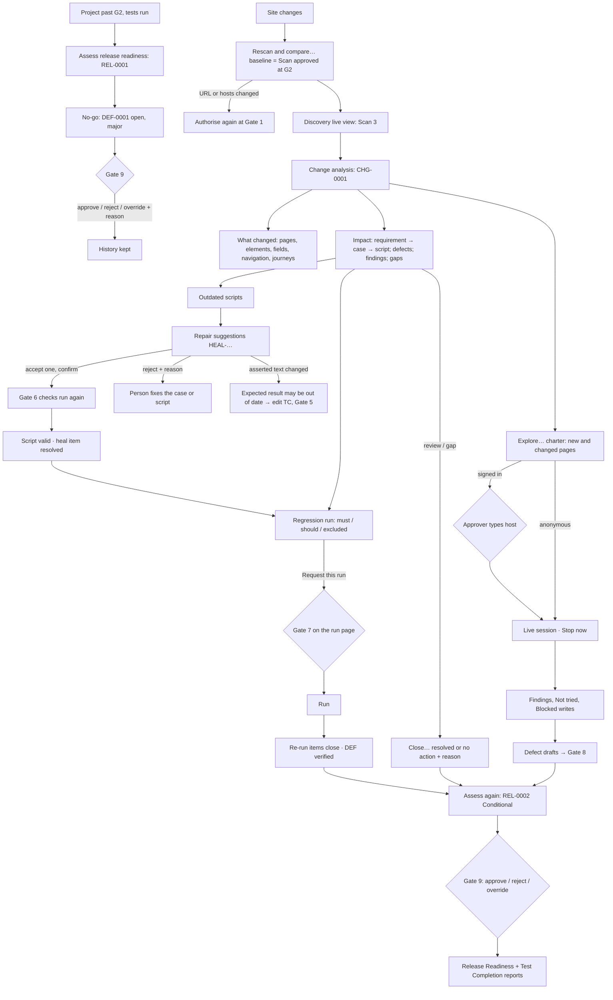

# P6 — AI QA Analyst Platform: Phase 6 UX (Change intelligence and release readiness: rescan and changes, impact and regression, repairs, exploratory testing, release readiness and Gate 9, completion reports)

## 1. Goal and user
Source: roadmap Phase 6 (P6-00…P6-08), spec §8 (self-healing), §12 (traceability), §13 (change impact), §16 (assistant), §17 (reports), §18 (G9). Decisions D25–D35 (§2).

Two users, as before:
1. **A QA lead** who has to answer "what do we retest after this change, and can we ship?" with evidence.
2. **A developer or PM with no QA background** who changed the site and needs to know, in plain words, what broke, what needs a person, and whether it's safe to release.

Job: "When my site changes, tell me what changed, what that breaks in my tests, fix what can be fixed safely, find what my scripted tests didn't look for, and give me an honest release recommendation."

The P1–P5 rules still apply (evidence over volume; values computed, never guessed; nothing touches the site without a person's say-so; Observed vs Hypothesis; fixed honesty text; status as text, never colour alone). Phase 6 adds:
- **Nothing old is lost.** Every screen that shows a change can open both scans. No control deletes or replaces an earlier scan, run, finding or assessment.
- **Approved work stays approved after a rescan (D27).** The UI says which items are affected; it never shows a whole section "Out of date" because of a rescan (accessibility and security checks excepted, as in P5).
- **A person accepts every repair, one at a time (D31).** No "accept all", no auto-apply, and the screen always says "Only this locator changes; the test's checks stay the same."
- **The release verdict is the platform's recommendation until a person decides Gate 9 (D32, D33).** "Recommended" and "Final" are always written next to the verdict.

This spec **extends** `docs/design/P5-qa-analyst-phase5.md` (which extends P4…P1). Tokens (light navy theme, P1 §2), shell, focus, motion, gate, approval, report and assistant patterns apply unless restated. "P5 §9.4" points to that spec. Section numbers here are stable: web PRs cite "design P6 §n".

---

## 2. Decisions applied (final; override older roadmap text)

| # | Decision | What it means in the UI |
|---|---|---|
| D25 | Rescans start by a person; baseline = last G2-approved scan; any two completed scans can be compared | [Rescan and compare…] in the header ⋯ menu and the Changes tab. No schedule control anywhere. Compare picker accepts any two completed scans. |
| D26 | Structural element matching | Renames and moves are shown as such; a field that was both renamed and moved shows as removed + added. The legend says so (§6.6). |
| D27 | Targeted impact, no whole-chain staleness | After a rescan, Requirements, Strategy, Test Cases and Automation keep their status and badges. Affected items are listed in Impact (§7). More than half the pages changed → a re-baseline **warning** only (§6.4). |
| D28 | Risk-based regression: must / should / excluded | Regression tab with three groups, each row with its reason (§7.4). Must-run rows say "Always included". |
| D29 | Rule explorer with AI off; AI picks from the same list when on | Exploratory works with AI off. Each step shows "Chosen by rules" or "Chosen by AI". AI notes are labelled and never shown as findings (§9.6). |
| D30 | Safe clicks only, writes blocked at the network layer; signed-in sessions need an `exploratory_session` approval with the host typed | Start dialog lists what exploration never does. Signed-in toggle explains the approval. Approval panel uses the P5 typed-host pattern. "Blocked write attempts" and "Not tried: may change data" are always shown, even when empty ("None"). |
| D31 | Proactive and reactive heal suggestions, ranked, verified live, accepted one at a time | Repair card (§8) with up to 3 candidates, signals in words, an outlined screenshot, one Accept per card behind a confirmation. No bulk selection on repair lists. |
| D32 | Tiered go / conditional / no-go | Verdict card with a one-sentence reason; criteria table with "Blocking" as text; conditions list (§10). |
| D33 | G9 approve, reject or override with a ≥ 20-character reason | G9 panel with three options; Override requires a different verdict and a reason (live counter); shown as "Overridden by {name}: {reason}" next to every rendering of the verdict (page, Overview, report, assistant, audit log). |
| D34 | Reports in HTML/PDF/JSON + CSV/XLSX; no DOCX | Download menu for the two new reports: PDF, HTML, CSV, XLSX. DOCX is never offered (P5-04c was cut, so it is hidden everywhere). JSON stays API-only (OQ6). |
| D35 | Egress proxy is P6-07, not blocking exploration | No UI change beyond P5 §13.2 (the proxy row). Exploration never waits for it. |

**Who can do what** (P3 §4.3 wording: "someone who can approve", never "owner or admin"):

| Action | Viewer | Member | Approver (`can_approve`) | Owner/Admin |
|---|---|---|---|---|
| Read scans, change sets, impact, repairs, sessions, assessments, reports | ✓ | ✓ | ✓ | |
| Rescan; compare two scans (creates a change set) | – | ✓ | ✓ | |
| Close review / gap / regenerate impact items (reason for "No action needed") | – | ✓ | ✓ | |
| Request the regression run (waits for G7) | – | ✓ | ✓ | |
| Accept or reject a repair suggestion | – | ✓ | ✓ | |
| Start an anonymous exploratory session; stop own session | – | ✓ | ✓ | |
| Request a signed-in session | – | ✓ | ✓ (or "Approve and start") | |
| Approve a signed-in session (typed host); stop any session | – | – | ✓ | |
| Triage exploratory findings, Raise defect | – | ✓ | ✓ | |
| Assess release readiness; confirm a criterion the platform can't check | – | ✓ | ✓ | |
| Decide Gate 9 (approve, reject, override) | – | – | ✓ | |
| Organisation exploration limits | – | – | – | ✓ |

Viewers: controls they can't use are **not rendered**. Members: approval and G9 controls render as a read-only panel with the visible reason (P3 §13.1); no dialog opens. Other organisations get the app 404 everywhere, including diffs, steps, evidence and reports.

---

## 3. Vocabulary, statuses and fixed text (`components/domain/ChangeLabels.tsx`, `components/domain/ReleaseLabels.tsx`, new; no new colours)

Every status is text + icon. Tones map to the P1 §2.1 semantic tokens.

### 3.1 Change kind (`change_items.kind`, grouped for display)
| Display | API kinds | Icon |
|---|---|---|
| Added | `page_added`, `element_added`, `form_added`, `field_added`, `journey_added` | `Plus` |
| Removed | `*_removed` | `Minus` |
| Renamed | `element_renamed` | `ArrowRight` |
| Moved | `element_moved` | `Move` |
| Changed | `page_changed`, `form_changed`, `field_changed`, `navigation_changed`, `journey_changed` | `PenLine` |
| Requirement changed | `requirement_changed` | `ClipboardList` |
| Content values changed | noise-filter group (digits/currency only) | `Hash` |

Subject is always written out: "Page added: /offers", "Field changed: Message → Your message (now required)", "Button renamed: Send message → Send".

### 3.2 Significance
| API | Label | Tone / icon | Tooltip (`Tooltip`, also the legend text) |
|---|---|---|---|
| `structural` | Structural | `warning-bg`/`warning-fg`, `Blocks` | "Something was added, removed or now behaves differently: pages, forms, fields, required or allowed values, status codes." |
| `behavioural` | Behavioural | info tone, `MousePointerClick` | "Something people click or read to act was renamed, or navigation or a journey changed." |
| `cosmetic` | Cosmetic | neutral, `Paintbrush` | "Headings, moves that don't affect a test, and changed numbers or prices." |

### 3.3 Impact level, action and status
| Level (`level`) | Label | Meaning line (shown in the legend and the row's sr text) |
|---|---|---|
| `direct` | Direct | "A test step or script uses the changed element." |
| `indirect` | Indirect | "On a changed page or feature, but no step uses the changed element." |
| `gap` | Not covered | "Nothing tests this yet." |

| Action (`action`) | Label | Row button |
|---|---|---|
| `rerun` | Re-run | — (closes itself, §7.3) |
| `review` | Review | [Close…] |
| `heal` | Repair the script | [Review HEAL-n] (closes itself) |
| `regenerate` | Regenerate | [Regenerate requirements…] · [Close…] |
| `write_requirement` | Write a requirement | [Write a requirement] · [Close…] |

Status: Open (amber `CircleDot`) · Resolved (green `CircleCheck`, line "Resolved by RUN-0005" or "Resolved by {name}") · No action needed (grey `CircleSlash`, line "{name}: '{reason}'").

### 3.4 Script status addition
`outdated`: "Outdated" (amber `Unlink`) + `outdated_reason` verbatim ("getByLabel('Message') not found after CHG-0001"). Already exists in P4 as a status; Phase 6 always shows the reason and links the repair.

### 3.5 Repair suggestion
| Field | Label |
|---|---|
| level `high` / `medium` / `low` | "High match" (green `CircleCheck`) · "Medium match" (amber `CircleDot`) · "Low match" (grey, only under "Other possibilities") |
| source `change` / `failure` | "From CHG-0001 (before any test failed)" · "From a failed test (RUN-0003-07)" |
| status | Open · Accepted (green) · Rejected (grey, reason) · Replaced (grey: "Another suggestion for this locator was accepted") |
| kind `expected_result_review` | "Expected result may be out of date" (amber `FileWarning`), status "Needs a person" |

### 3.6 Exploratory session status (`quality_scans` of kind `exploratory`)
Waiting for approval (amber `UserRoundCheck`) · Not approved (grey) · Request expired (grey) · Waiting to start (blue) · Exploring (blue) · Finished · budget used (green) · Finished · every allowed action tried (green) · Stopped by {name} (grey) · Didn't complete (red + reason) · Withdrawn (grey).

Step outcome (`exploratory_steps.outcome`): OK · No visible effect · Opened another page · Problem found (`error`) · Blocked: tried to send data (`blocked`).

Finding severity reuses P5 §3.1 security wording: High · Medium · Low. Finding status, triage and "Seen before" reuse P5 §3.3.

### 3.7 Verdict and criteria (`components/domain/ReleaseLabels.tsx`)
| Verdict | Label | Tone / icon |
|---|---|---|
| `go` | Go | `success-bg`/`success-fg`, `CircleCheck` |
| `conditional` | Conditional | `warning-bg`/`warning-fg`, `TriangleAlert` |
| `no_go` | No-go | `danger-bg`/`danger-fg`, `OctagonX` |

Always followed by its state word: **"Recommended"** (awaiting G9), **"Final"** (decided), **"Not decided"** (rejected, superseded, stale). Never the verdict alone.

Criterion status: Met (green `CircleCheck`) · Not met (red `CircleX`) · Not evaluable (grey `CircleHelp`, reason always shown). Blocking column: "Blocking" (text, `Lock` icon) or "Not blocking". Source: "Exit criterion (Test Strategy v2)" · "Definition of Done" · "Platform check". Manual: "Confirmed by {name}: '{reason}'".

Assessment status: Waiting for Gate 9 (amber) · Final (green) · Rejected (grey) · Replaced by REL-n (grey, `superseded`) · Out of date (amber, `stale`).

Residual level: reuse risk levels (Very high · High · Medium · Low) with the existing risk chips. Lines: "Mitigated by testing" · "Reduced: some tests passed, none failed" · "Not reduced: {n} tests failed / not tested" · "Accepted by {name}: '{reason}'".

### 3.8 Fixed statements (`lib/change.ts`, `lib/exploratory.ts`, `lib/release.ts` constants; rendered by the existing `HonestyNote`)
- `CHANGE_STATEMENT`: "Changes are detected by comparing what discovery saw in two scans. Content that discovery can't see (behind sign-in without credentials, inside canvases or iframes, or only after form submission) is not compared."
- `EXPLORE_STATEMENT(n, m)`: "This session tried {n} actions on {m} pages within its budget. Exploration is a sample, not a complete test, and it never submits forms or sends data."
- `RELEASE_STATEMENT(time)`: "This recommendation is based on the tests the platform ran and the evidence recorded up to {time}. It is advisory, it does not cover what wasn't tested, and the release decision belongs to the people who approve it."
- `REPAIR_LINE`: "Only this locator changes; the test's checks stay the same."
- `EXPECTED_LINE`: "Expected results are never changed automatically."

`{time}` is `fmtDateTime` of the assessment snapshot ("15 Nov 2026, 16:00"). Statements are never edited per screen and never paraphrased by the AI.

### 3.9 Generated-by
Change sets, impact, regression lists, repair scores, exploration steps and assessments carry `GeneratedByLabel rules` with AI off. With AI on, only these may show `GeneratedByLabel ai`: the change summary paragraph, "should run" order with its explanation, repair-candidate order with its explanation, AI step choice ("Chosen by AI"), AI notes, and the assessment narrative ("What this means"). Numbers, statuses and verdicts are never labelled AI.

---

## 4. Information architecture

### 4.1 Routes
| Route | Screen |
|---|---|
| `/projects/[id]/discovery?view=changes` | **Changes** tab of Application Discovery (§6.1): latest change set, compare picker, scan history, change sets. |
| `/projects/[id]/discovery/changes/[chgKey]` | Change set (`CHG-0001`). `?tab=changes\|impact\|regression\|repairs` (default `changes`), `&page=/contact` opens the before/after drawer. |
| `/projects/[id]/automation?view=repairs` | **Repairs** tab of Automation (§8.1): every repair suggestion, all sources. `&heal=HEAL-0001` scrolls to and focuses that card. |
| `/projects/[id]/execution?tab=runs\|exploratory` | Test Execution gains tabs: **Runs** (today's list) and **Exploratory** (§9.1). `?tab=exploratory&new=1` opens the start dialog. |
| `/projects/[id]/execution/exploratory/[expKey]` | Exploratory session (`EXP-0001`): approval, live, results. `?view=findings\|not-tried\|steps\|coverage`, `&finding=EXP-0001-01` opens the drawer. |
| `/projects/[id]/release-readiness` | Release readiness: the latest assessment (§10). |
| `/projects/[id]/release-readiness/[relKey]` | A specific assessment (`REL-0001`); older ones read-only. |
| `/projects/[id]/reports/completion?assessment=`, `/reports/release-readiness?assessment=` | The two new reports (§11). |
| `/settings/load-limits` | Organisation limits page gains an "Exploratory sessions" section (§9.9). |

Next.js note: `execution/exploratory/[expKey]` is a static segment, so it wins over `execution/[runKey]`. `release-readiness` is not one of the 12 sections; `projectRoute()` maps it to the **Reports** section for sidebar highlighting (`SECTION_ALIASES = { "release-readiness": "reports" }`), because the lifecycle's Reporting stage (step 21, G9) already links to Reports.

### 4.2 Sidebar (`lib/sections.ts`)
- `CURRENT_PHASE = 6`. Still 12 sections, same order, no phase badges left.
- **Badges** (first match wins within a section; existing badges keep priority unless stated):

| Section | Badge | When | Accessible name |
|---|---|---|---|
| Application Discovery | "Changed" | the latest change set has open impact items | "Application Discovery, the application changed: {n} impact items open" |
| Application Discovery | "Comparing" (text, no animation) | `change_analysis` running | "Application Discovery, comparing scans" |
| Automation | "{n} to repair" | open locator repair suggestions (after "Review", before "Out of date") | "Automation, {n} repair suggestions waiting" |
| Test Execution | "Approve" | a signed-in session waits and the viewer can approve (after "Authorise") | "Test Execution, {n} exploratory sessions waiting for your approval" |
| Test Execution | "Running" (existing) | a run **or** a session is running | "Test Execution, a run or exploratory session is in progress" |
| Reports | "Decide" | an assessment waits for G9 and the viewer can approve | "Reports, release readiness waiting for your decision" |
| Reports | "Waiting" | an assessment waits for G9, viewer can't approve | "Reports, release readiness waiting for a decision" |
| Reports | "Out of date" | the latest assessment is `stale` | "Reports, release readiness is out of date" |

Discovery never shows "Out of date" because of a rescan.

### 4.3 Lifecycle (`lib/lifecycle.ts`, `LifecycleProgress`)
- **Reporting stage becomes live** (`phase: 6` is now ≤ `CURRENT_PHASE`):

| Row | Agent text | Status text |
|---|---|---|
| 21 Release readiness assessment | "Lead QA Orchestrator (rules)" | Not started: "Starts when someone assesses release readiness (after a test run)." · Assessing… · Done: "REL-0002: Conditional (recommended)" |
| G9 Release readiness | — | Not started · "REL-0002 waiting for your decision" / "…for a decision by someone who can approve" · "Final: Conditional · A. Approver" · "Final: Go · overridden by A. Approver" · "Rejected: assess again" · "Out of date: assess again" |

  Row 21 and the G9 diamond link to `/release-readiness`. Before any finished run: "Available after the first test run" (grey), no action. "Show all 21 steps" actions: 21 → "Assess release readiness", G9 → "Decide Gate 9" (approver) / "Open release readiness".
- **Optional group** (P5 §4.3, "Optional checks · any time after Gate 2") gains two rows:

| Row | Agent text | Status text |
|---|---|---|
| Change analysis | "Compares scans (rules)" | "Starts after a rescan" · "Comparing Scan 3 with Scan 2…" · "CHG-0001: 9 changes, 15 open impact items" · "CHG-0001: all impact items closed" · "Didn't complete" |
| Exploratory testing | "Safe explorer (rules{, AI-guided when on})" | "Not run yet" · "EXP-0002 waiting for your approval" / "…for approval by someone who can approve" · "Exploring" · "EXP-0001: 2 findings" · "Stopped" |

  The group's line becomes: "Every load test and signed-in exploration needs its own approval. Accessibility and security checks, rescans and anonymous exploration only read pages."
- Compact variant adds a chip "Gate 9: {state}" once an assessment exists.

### 4.4 Header (`ProjectHeader`)
- **Status pill** gains (after load-test states): "Rescan running: will compare with Scan 2" (blue) · "Comparing Scan 3 with Scan 2" (blue) · "Exploring: EXP-0001" (blue) · "EXP-0002 waiting for your approval" / "…for approval by someone who can approve" (amber) · "REL-0002 waiting for your decision (Gate 9)" / "REL-0002 waiting for a Gate 9 decision" (amber).
- **⋯ menu** (members+):
  - "Re-scan site" becomes **"Rescan and compare…"** once a G2-approved scan exists (before that it stays "Re-scan site", unchanged; see OQ1).
  - Adds "Explore pages…" (→ `/execution?tab=exploratory&new=1`; after G2) and "Assess release readiness" (→ `/release-readiness`, after a finished run).

### 4.5 Overview
**"Application changed" banner** (P6-06): an info `Callout` directly under the header, above "Needs your attention", shown while the latest change set has open impact items:
```
ⓘ The application changed. CHG-0001 found 9 changes between Scan 2 (13 Nov) and Scan 3 (15 Nov):
  4 structural, 4 behavioural, 1 cosmetic. 15 impact items are open.            [Open CHG-0001]
```
Re-baseline variant (adds a second line): "More than half the pages changed. Consider regenerating requirements from Scan 3." Not dismissible; it disappears when the open count reaches 0. Viewers see it without changes (the button is a link).

**Needs your attention** (`lib/attention.ts`, max 5; Phase 6 rows go after G7 rows):
- Approver: "REL-0002 is waiting for your decision (Gate 9): recommended Conditional." [Decide REL-0002]. Member: "REL-0002 is waiting for a Gate 9 decision by someone who can approve." [Open REL-0002]. Viewer: text only.
- "REL-0002 is out of date: evidence changed after it was assessed." [Assess again] (members) / text (viewers).
- "2 scripts are outdated after CHG-0001. Review their repair suggestions before the regression run." [Review repairs].
- "CHG-0001 recommends re-running 3 tests (and 4 more if you include should-run tests)." [Open regression run] (until a run from it exists).
- Approver: "EXP-0002 is waiting for your approval: signed-in exploration of 3 pages on localhost:4100." [Review EXP-0002]. Member: "…for approval by someone who can approve."
- "EXP-0001 found 2 problems on /offers." [Open EXP-0001] (7 days or until opened).

**At a glance** adds two cards:
```
Release readiness                                                    [Open release readiness]
⚠ Conditional · Recommended · REL-0002 · 15 Nov 16:00
4 conditions · overall residual risk: Medium · Gate 9: waiting for approval
```
Variants: "Final: Go · overridden by A. Approver" (override line always shown when overridden) · "Out of date: evidence changed after REL-0002." · none yet with a finished run: "Not assessed yet." [Assess release readiness] (members) · no finished run: "Available after the first test run."
```
Changes                                                              [Open Changes]
CHG-0001 · Scan 2 → Scan 3 · 15 Nov · 9 changes · 15 of 18 impact items open
Exploratory  EXP-0001 · 15 Nov · 2 findings (2 medium) · 1 blocked write attempt
```
Never-run lines: "No rescan yet." · "No exploratory session yet."

**Feed agents** (new): "Change analysis" · "Repair suggestions" · "Safe explorer" · "Release readiness (rules)". Examples: "Rescan started by M. Member: Scan 3, compared with Scan 2" · "CHG-0001: 9 changes (4 structural, 4 behavioural, 1 cosmetic)" · "Impact: 4 requirements, 6 test cases, 2 scripts outdated" · "HEAL-0001 accepted by M. Member: ContactPage.ts version 3" · "EXP-0001 finished: 60 actions on 3 pages, 2 findings, 1 blocked write attempt" · "REL-0002 recommended Conditional (4 conditions)" · "REL-0002 decided by A. Approver: Conditional (final)" · "REL-0003 overridden by A. Approver: Go". Events never contain page text, locator values beyond what the UI shows, or reasons (reasons are on the item).

### 4.6 Removing "Phase 6" placeholders
- Reports note "Test Completion and Release Readiness reports arrive in Phase 6." is removed.
- `LATER_TASKS_FALLBACK` → "Hosted deployment (Postgres, Redis, file storage, container sandbox)" · "API testing" · "Word (DOCX) reports" (§12.3).
- Lifecycle "Phase 6" labels on step 21 / G9 are removed.

---

## 5. Flow


Exits: close any dialog (nothing created) · cancel a rescan (finished pages kept; no change set) · reject a repair · close an impact item as "No action needed" with a reason · withdraw or don't approve a session · Stop now · reject at G7 or G8 · reject at G9 (assess again later) · any older assessment stays readable.

---

## 6. Changes (P6-01): Application Discovery › Changes

### 6.1 Changes tab (`/discovery?view=changes`)
The Discovery view tabs (`Tabs`, "Discovery views") gain **Changes** after "Access gaps": `{ id: "changes", label: "Changes", count: openImpact }`. The tab is project-wide: it ignores the `?scan=` selector (the "You're viewing Scan n" note is not shown on it).
```
Changes                                                                       [Rescan and compare…]
Compare what discovery saw in two scans. Nothing from earlier scans is changed or deleted.
+-- Latest change -------------------------------------------------------------------------------+
| CHG-0001 · Scan 2 → Scan 3 (rescan) · 15 Nov 10:12 · compared by rules                         |
| 9 changes: 4 structural · 4 behavioural · 1 cosmetic                                            |
| 15 of 18 impact items open · 2 scripts outdated · regression run: not requested yet            |
|                                                                               [Open CHG-0001] |
+-------------------------------------------------------------------------------------------------+
COMPARE TWO SCANS
From [Scan 2 · 13 Nov · approved at Gate 2 ▾]   To [Scan 3 · 15 Nov · rescan ▾]   [Compare]
SCANS
| Scan   | Started      | Kind                      | Pages | Gate 2           | Compared in          |
| Scan 3 | 15 Nov 10:02 | Rescan, compared with 2   | 13    | Not reviewed     | CHG-0001             |
| Scan 2 | 13 Nov 09:40 | Re-scan                   | 12    | Approved (baseline) | CHG-0001          |
| Scan 1 | 12 Nov 17:05 | First scan                | 11    | —                | —                    |
CHANGE SETS
| Change set | Compared            | Changes                         | Impact     | Created            |
| CHG-0001   | Scan 2 → Scan 3     | 9 (4 structural, 4 behavioural) | 15 open    | 15 Nov 10:12       |
```
- **Compare** (members+): both selects list completed scans only (`completed`, `partial` with a "(partial)" suffix); "To" must be later than "From" (else inline error "Choose a later scan in To."); the same pair already compared → [Compare] becomes [Open CHG-000n] (no duplicate). New pair → "Comparing Scan 1 with Scan 3…" inline status with `Spinner`, then navigates to the new change set; toast "CHG-0002 ready: {n} changes." Viewers: the Compare block is not rendered; existing change sets are listed.
- Scan rows link to that scan's Summary (`?view=summary&scan=n`). "Approved (baseline)" marks the scan used by rescans (D25).
- Tables become cards below `md` (§17).

### 6.2 Changes tab states
| State | What the user sees | Copy |
|---|---|---|
| Before G2 | `EmptyState`, no Compare | "Changes are compared with the scan approved at Gate 2. Approve Gate 2 first." [Review Gate 2] (members+) |
| One scan only | `EmptyState` | "Nothing to compare yet. When your site changes, rescan it to see exactly what changed and what that affects." [Rescan and compare…] (members+) |
| Rescan running | Callout info with link to Live | "Scan 3 is running. When it finishes, it's compared with Scan 2." [Watch live] |
| Comparing | Progress card (§6.3 step list) | "Comparing Scan 3 with Scan 2…" |
| Comparison failed | Danger Callout | "Couldn't compare Scan 2 with Scan 3: {reason}. Both scans are unchanged." [Try again] (members+) |
| Loading / error / offline | Skeleton / "Couldn't load changes. Try again." / P1 offline banner; [Rescan and compare…] and [Compare] `aria-disabled` "You're offline. Reconnect to {rescan \| compare scans}." | |
| AI off | `GeneratedByLabel rules`; no summary paragraph | — |

### 6.3 Rescan dialog (`RescanDialog` extended; `Modal` lg, full screen below `md`)
After G2 (a G2-approved scan exists):
```
Rescan localhost:4100 and compare?
Starts Scan 4 with the settings below and compares it with the scan you choose. Approved requirements, test
cases and scripts stay as they are: the comparison lists exactly what the change affects.
Compare with  [Scan 2 · 13 Nov · approved at Gate 2 (recommended) ▾]
[ScanSettingsFields, prefilled with Scan 2's limits]
[x] Sign in with the saved test account          (as today)
Accessibility and security results will be marked out of date, because pages may have changed.
                                                                  [Cancel]  [Start rescan]
```
- "Compare with" lists completed scans, baseline first and preselected. Choosing another adds the hint "Scan 3 wasn't approved at Gate 2. Changes are still listed, but approved work is linked to Scan 2."
- Start → toast "Scan 4 started. It will be compared with Scan 2." and the Discovery Live view (existing `LiveDiscovery`), whose header line gains "Rescan · will be compared with Scan 2".
- **Errors:** 409 G1 → danger Callout inside the dialog, focus moved to it: "The site's URL or allowed hosts changed since they were authorised. Authorise them again (Gate 1) before rescanning." [Open Project settings]. Limits over the org cap → field errors (existing). Another scan running → "A scan is already running (Scan 4)." [Watch live]. Generic → "Couldn't start the rescan: {reason}. Nothing was started."
- After discovery finishes, the Changes tab and the Live view's end card show the **comparison progress** (ordered list, polite region announces each completed step and the end):
  ```
  Comparing Scan 4 with Scan 2
  ✓ 1 Compared pages, elements, forms and navigation
  ● 2 Working out what the change affects
  ○ 3 Re-checking script locators on 2 changed pages (reads pages only)
  ```
  End: "CHG-0002 ready: 9 changes, 15 impact items." [Open CHG-0002]. The `change.ready` event moves no focus.

### 6.4 Change set page (`/discovery/changes/CHG-0001`)
```
← Changes
CHG-0001 · Scan 2 → Scan 3                                   ✓ Compared            [Explore these pages…] [⋯]
Scan 2 (13 Nov 09:40, approved at Gate 2) → Scan 3 (15 Nov 10:02, rescan) · compared by rules · started by M. Member
[HonestyNote: CHANGE_STATEMENT]
[Re-baseline warning, when rebaseline_suggested]
[AI summary paragraph, GeneratedByLabel ai, when AI on]
+-- Changes ------------+-- Affected ------------------+-- Next steps ------------------------------------+
| 9 changes             | 4 requirements · 6 test cases | 1 Review 2 repair suggestions      [Review repairs]|
| 4 structural          | 2 scripts outdated            | 2 Request the regression run (Gate 7) [Open]      |
| 4 behavioural         | 1 defect to re-test           | 3 Close 5 review items              [Open impact] |
| 1 cosmetic            | 3 to review · 2 not covered   | 4 Assess release readiness          [Assess]      |
+-----------------------+-------------------------------+--------------------------------------------------+
Tabs:  What changed (9) | Impact (15 open) | Regression run | Repairs (2)
```
- Three `StatTile`-style cards; "Next steps" is an ordered list whose items show ✓ when done ("✓ 1 Repairs reviewed"), written for the non-QA user. Steps link to the tabs or pages; viewers see the list without buttons.
- **Re-baseline warning** (warning `Callout`, not dismissible): "More than half the pages changed (8 of 12). Approved requirements may no longer describe the site. Consider regenerating requirements from Scan 3; you review the result before anything is replaced." [Regenerate requirements…] (members+; opens the existing `RegenerateDialog` with Scan 3).
- [Explore these pages…] opens the exploratory start dialog with this change set's charter preselected (§9.2); hidden for viewers.
- ⋯: "Open Scan 2" · "Open Scan 3" · "Ask the analyst about CHG-0001" · "Copy link".
- Statuses: "Comparing…" (blue) · "Compared" (green) · "Didn't complete" (red + reason, [Try again]).

### 6.5 What changed tab
```
Show  [x] Hide cosmetic changes (1 hidden)    Kind [Any ▾]   Significance [Any ▾]   Page [Any ▾]
Legend: Structural · Behavioural · Cosmetic  [What do these mean?]
PAGES (2 added or removed · 3 changed)
| Page              | Change                       | Significance   |                                   |
| /offers           | + Page added                 | Structural     | [Compare /offers]                 |
| /products/1       | − Page removed (now 404)     | Structural     | [Compare /products/1]             |
| /contact          | Changed: 3 changes           | Structural     | [Compare /contact]                |
ELEMENTS AND FORM FIELDS
| Page      | What                          | Before                 | After                          | Significance |
| /contact  | Field changed: Message        | Label "Message" · optional | Label "Your message" · required | Structural |
| /contact  | + Field added: Order number   | —                      | Text · optional · up to 20 characters | Structural |
| /contact  | Button renamed                | "Send message"         | "Send"                         | Behavioural  |
| /offers   | + Form added: Promo code      | —                      | 1 field · submit "Apply code"  | Structural   |
| /products | − Link removed                | "Travel mug"           | —                              | Structural   |
NAVIGATION
  + Link added: "Offers" → /offers     (Behavioural)
JOURNEYS
  Changed: "Contact us" — step 3 "Enter Message" → "Enter Your message"; step 4 "Press Send message" → "Press Send"
REQUIREMENTS (appear after requirements are regenerated from Scan 3 and applied)
  None yet.  [Regenerate requirements…]
```
- Groups are `h3` sections with counts; empty groups read "No navigation changes." (never hidden, so the reader knows it was compared).
- **Noise filter:** "Hide cosmetic changes" is **on** by default; its label carries the hidden count. "Content values changed" is one collapsed row per page: "Content values changed on /products (3): prices or counts" (`Disclosure` lists "£12.50 → £13.00"). Filters update the table count line ("Showing 8 of 9 changes"), announced politely.
- **Before/After cells** are text: `WordDiff` for names with visually hidden "Before:" / "After:" prefixes; removed text is struck through and added text underlined (not colour alone). Constraint changes are spelled out: "optional → required", "up to 20 characters".
- Element rows link "Used by TC-0019, TC-0020" when a step or script uses it (from impact), so the user sees why it matters.
- Partial scans: when either scan is partial, a warning Callout above Pages: "Scan 3 stopped early after 9 pages. Pages it didn't reach are listed as 'Not compared', not as removed." (see OQ2), and those rows read "Not compared: Scan 3 didn't reach this page".

### 6.6 Before/after drawer (`PageChangeDrawer`, new; `Drawer` 640 px, full screen below `md`; `?page=`)
```
/contact · Changed (3 changes)                                       Structural
View  ( Side by side | Before | After )                    [Open Scan 2 page] [Open Scan 3 page]
+-- Before · Scan 2 · 13 Nov -------------+-- After · Scan 3 · 15 Nov --------------+
| [screenshot]                            | [screenshot]                            |
+-----------------------------------------+-----------------------------------------+
CHANGES ON THIS PAGE
| What                     | Before                  | After                       | Used by           |
| Field changed: Message   | "Message" · optional    | "Your message" · required   | TC-0019, TC-0020  |
| Field added: Order number| —                       | optional · up to 20 chars   | —                 |
| Button renamed           | "Send message"          | "Send"                      | TC-0019…TC-0021   |
How elements are matched: same page, then same element fingerprint, then same role and selector (a rename),
then same role and name (a move). An element that was both renamed and moved shows as removed and added.
```
- **View switch:** `Segmented` "Side by side | Before | After". Default Side by side from `md`; below `md` the option is not offered and the default is "Before" (one image at full width; switching keeps scroll position).
- **Screenshot alt:** "Before: /contact in Scan 2, 13 Nov, desktop 1440 × 900." / "After: /contact in Scan 3, 15 Nov, desktop 1440 × 900." Page added: Before panel is a placeholder text "Not in Scan 2: this page is new." Page removed: After panel "Scan 3 got 404 Not Found for this page." Missing or retention-removed evidence: `RemovedEvidence` text, never a broken image. [Open full size] per image (existing `EvidenceDrawer` handling).
- Changes are text in the table; screenshots are illustrative (no pixel diff, no overlays).
- Drawer title is the page path; Escape closes; focus returns to the row's [Compare …] button (Drawer's `focusOrigin()`; §16.2).

---

## 7. Impact and regression (P6-02)

### 7.1 Impact tab
```
Impact · 15 open of 18                Level [Any ▾]  Status [Open ▾]  Type [Any ▾]   [How impact works]
REQUIREMENTS AND TESTS
▾ REQ-0007 Contact form requires name, email and message                Direct · 2 changes on /contact
    Why: field "Message" changed (label, now required); button "Send message" renamed
    ▾ TC-0019 Send the form with an empty Message          Direct · Re-run · Open
        Closes by itself when TC-0019 has a result from a run after CHG-0001.
        Script tests/contact/TC-0019.spec.ts                 ✗ Outdated · Repair the script · Open
          getByLabel('Message') not found after CHG-0001                         [Review HEAL-0001]
    ▸ TC-0020 Send the form with a 1-character Name        Direct · Re-run · Open
▸ REQ-0002 Visitors can move between pages from the menu                Indirect · navigation changed
DEFECTS TO RE-TEST
  DEF-0001 Contact form accepts an empty Message · Major · Confirmed     Direct · Re-run · Open
    May be fixed or changed by CHG-0001: re-test. Re-tested by TC-0019.
PAGE REMOVED: REVIEW
  /products/1 (Travel mug)
    TC-0012 View the Travel mug page                                    Review · Open   [Close…]
    A11Y-0001-01 Images must have a text alternative                     Review · Open   [Close…]
    PRF-01 target /products/1 (profile marked out of date)               Review · Open   [Close…]
NOT COVERED BY ANY REQUIREMENT
  /offers · page added                       Not covered · Write a requirement · Open   [Write a requirement] [Close…]
  Promo code form on /offers · form added    Not covered · Write a requirement · Open   [Write a requirement] [Close…]
```
- Structure is nested lists (`ul` > `li`), each group an `h3`, each requirement row a `Disclosure` button (`aria-expanded`, name "REQ-0007 Contact form requires name, email and message, direct, 2 changes"). Not an ARIA tree. Requirements with direct impact are expanded by default; indirect collapsed.
- Every row shows level, action and status as text chips (§3.3), and its `reason` verbatim. Keys link to their item.
- **[How impact works]** (`Disclosure`): the three level lines from §3.3, plus "Approved versions stay current after a rescan. Work through these items to bring them up to date."
- **[Write a requirement]** → `/requirements/new?from=CHG-0001&page=/offers` (prefilled feature/page; the requirement closes the item when approved: "Resolved by REQ-0021"). **[Regenerate requirements…]** on `regenerate` items opens the existing `RegenerateDialog`.
- Filters: Level (Direct, Indirect, Not covered) · Status (Open default, Resolved, No action needed, All) · Type (Requirement, Test case, Script, Defect, Finding, Performance target). Filtered empty: "No impact items match these filters." [Clear filters].
- All closed: success Callout "Every impact item from CHG-0001 is closed." (filter switches to All).

### 7.2 Close dialog (`CloseImpactDialog`, new; `Modal` sm)
```
Close impact item · TC-0012 View the Travel mug page
( ) Resolved: I've dealt with it (for example, retired or updated the test case)
( ) No action needed
Reason (needed for "No action needed") [                                        ]
Shown on the item and in the Test Completion Report.
                                                                     [Cancel]  [Close item]
```
- Errors (on submit): "Choose an option." · "Say why no action is needed."
- Only `review`, `regenerate` and `write_requirement` items have [Close…]. `rerun` and `heal` items close themselves (OQ4); their row says how.
- Toast "TC-0012 impact item closed." Focus moves to the next open item's [Close…] in the same group, else to the group heading (`tabIndex -1`) (§16.2).

### 7.3 Automatic closing (text only, no controls)
- Re-run: "Resolved by RUN-0005 (15 Nov 15:40)" on the row; the row moves to Resolved.
- Repair: "Resolved: HEAL-0001 accepted and TC-0019's script is valid again."
- Viewers see the same lines.

### 7.4 Regression run tab
```
Regression run · recommended by rules                                              about 3 min (from RUN-0003)
[Request this run]   It still needs Gate 7: someone who can approve authorises it before anything runs.
[x] Include the 4 "should run" tests  (7 tests, about 3 min · without them: 3 tests, about 1 min)
MUST RUN (3) — always included
| Test                                           | Why                                                        | Script              |
| TC-0019 Send the form with an empty Message    | Directly affected: field "Message" changed · Re-tests DEF-0001 | ✗ Outdated · [Review HEAL-0001] |
| TC-0020 Send the form with a 1-character Name  | Directly affected: button "Send message" renamed            | ✗ Outdated · [Review HEAL-0002] |
| TC-0021 Send the form with valid details       | Directly affected: button "Send message" renamed            | ✗ Outdated · [Review HEAL-0002] |
SHOULD RUN (4)
| TC-0002 Move to Products from the menu         | Indirectly affected: navigation changed                     | ✓ Valid |
| TC-0030 Product list shows prices              | Linked to high risk RISK-03 (pricing)                       | ✓ Valid |
| TC-0001 Home page loads                        | Smoke test                                                  | ✓ Valid |
NOT INCLUDED (2)
| TC-0012 View the Travel mug page               | Page removed: review or retire the case                     | — |
| TC-0031 Sign in with the saved test account    | Manual test: a person runs it                               | — |
```
- Groups are `h3` + `Table` with captions; at 375 px cards (§17).
- **Request this run** (members+):
  - `aria-disabled` while any must-run script is outdated, with the reason under the button: "3 must-run tests have outdated scripts. Accept or reject their repair suggestions first." [Review repairs] (OQ3). Should-run tests with outdated scripts move to Not included with "Script outdated: accept or reject HEAL-0003 first".
  - Otherwise creates the run waiting for G7 and navigates to `/execution/RUN-0005` (the `RunAuthorisationPanel`). Toast: member "RUN-0005 requested. Someone who can approve must authorise it (Gate 7)."; approver "RUN-0005 created. Review and authorise it to start." Approvers authorise on the run page, where the G7 summary and risky-action cards are (P4 §8.3); there is no one-click "request and authorise" here.
  - 422 from the server is shown verbatim in a danger Callout above the button, with focus moved to it.
- **Already requested:** info Callout "RUN-0005 was requested from this recommendation · Waiting for authorisation." [Open RUN-0005]; the button reads [Request another run].
- **Estimate:** "about 3 min (from RUN-0003)"; when no timing exists, "No estimate: these tests haven't run before."
- **AI on:** should-run order may differ, with `GeneratedByLabel ai` and a one-line explanation; must-run and Not included are always rule-ordered and labelled "Rules".
- Viewer: the list without the button and checkbox.
- Empty (no impacted cases): "No approved test case is affected by CHG-0001. A smoke run is still a good idea." with should-run smoke tests if any.

#### Manual re-tests (D37; revised 2026-11-19, P4-14b)

The section below the must-run list (`components/changes/ManualRetests.tsx`) is now specified in `docs/design/P4-14-manual-results.md` §4.6 (D39 (a): a re-test is a manual result). Summary: same endpoint and body; the dialog keeps Passed/Failed only, and its "Note" field becomes the required "What happened"; lines read "Latest: Passed · By hand · Recorded by {name} · {time}: '{what happened}'"; a section action [Record re-tests with files…] opens the manual run Start modal with those cases and the change set; re-tests recorded either way count for the case, impact and release readiness.

### 7.5 Outdated scripts in Automation
- Automation › Scripts: outdated rows show "✗ Outdated: getByLabel('Message') not found after CHG-0001" and [Review HEAL-0001]. The tab label count keeps excluding outdated scripts (existing) and the Overview card adds "2 outdated after CHG-0001".
- Test Execution run dialog (P4 §7.1): outdated scripts are already excluded; the reason line becomes "Outdated after CHG-0001: review HEAL-0001".

---

## 8. Repairs (P6-04)

### 8.1 Where repairs appear
- **Automation › Repairs** (`?view=repairs`, new tab after "Review · Gate 6", label "Repairs (2)"): all suggestions, filter Status [Open ▾ | Accepted | Rejected | Replaced | All] and Source [Any | From a change | From a failed test]. Grouped by page object file.
- **Change set › Repairs** tab: the same cards filtered to that change set.
- **Result detail** (P4 §9.3): a failure-sourced suggestion renders the same `RepairCard` in place of `FixSuggestion`. Phase 4 results with JSON suggestions (no `HEAL-` key) keep the old `FixSuggestion` unchanged.
- No list has checkboxes or a bulk bar.

### 8.2 Repair card (`RepairCard`, new; extends `FixSuggestion` structure)
```
+-- HEAL-0001 · ContactPage.ts · the Message field ------------------------- Open · From CHG-0001 (before any test failed) -+
| Used by 3 scripts: TC-0019, TC-0020, TC-0021                                                                            |
| Current locator   getByLabel('Message')      ✗ Not found on /contact after CHG-0001                                    |
| CHOOSE A REPLACEMENT                                                                                                     |
| (•) getByLabel('Your message')                                                    High match (0.93)                      |
|      Why: Same field, renamed (CHG-0001) · Same role (text box) · Name 62 % similar · In the same form ·                 |
|           Uses a label (the most robust kind of locator)                                                                 |
|      ✓ Found exactly 1 visible element on /contact (checked 15 Nov 10:20)          [screenshot thumbnail] [Open full size] |
| ( ) getByRole('textbox', { name: 'Your message' })                                High match (0.88)                      |
|      Why: …   ✓ Found exactly 1 …                                                                                       |
| ▸ Other possibilities (1, low match)                                                                                     |
| CHANGE TO ContactPage.ts                                                                                                |
|   [DiffView]  − getByLabel('Message')   + getByLabel('Your message')                                                     |
| Only this locator changes; the test's checks stay the same.                                                              |
| [Accept this replacement…]   [Reject…]                                                                                   |
+-------------------------------------------------------------------------------------------------------------------------+
```
- Candidates are a radio `fieldset` (legend "Choose a replacement for getByLabel('Message')"); the first is preselected. Low candidates sit under "Other possibilities" (`Disclosure`) and are selectable there.
- **Signals in words** (code → copy): diff match "Same field, renamed (CHG-0001)" / "Same element, moved (CHG-0001)" · role "Same role ({role})" · name "Name {n} % similar ('Message' → 'Your message')" · landmark "In the same form" / "In the same section" · strategy "Uses a label" / "Uses a role and name" "(the most robust kind of locator)". Score shown to two decimals after the level.
- **Verified line:** "✓ Found exactly 1 visible element on /contact (checked {time})". Thumbnail 160 px wide; [Open full size] opens `EvidenceDrawer`. Outline reuses P5 `OutlinedScreenshot` (3 px `danger-solid` + white inner ring). Alt: "Screenshot of /contact on 15 Nov with the matched element outlined: text box 'Your message'."
- **DiffView** (`allowSideBySide={false}`): "−"/"+" prefixes and visually hidden "Before:"/"After:" so the difference is text, not colour.
- **AI on:** candidate order may follow the AI, with `GeneratedByLabel ai` and its one-line reason; the rule order is under "Rule order" (`Disclosure`). Only verified candidates are ever shown.

### 8.3 Accept and reject
- **[Accept this replacement…]** (members+) → `ConfirmDialog`:
  "Use getByLabel('Your message') in ContactPage.ts? Only this locator changes; the test's checks stay the same. ContactPage.ts version 3 is created, and the 3 scripts that use it are checked again (Gate 6) before they can run." [Cancel] [Accept replacement].
- After accept, the card becomes:
  ```
  HEAL-0001 · Accepted by M. Member · 15 Nov 10:31 · ContactPage.ts version 3
  getByLabel('Message') → getByLabel('Your message')
  ● Checking 3 scripts… → ✓ 3 scripts valid again. The impact item is closed.
                       → ✗ TC-0020 still fails its checks: {first error}. [Open Automation]
  ```
  Other open suggestions for the same locator show "Replaced: another suggestion for this locator was accepted (HEAL-0001)". Toast "HEAL-0001 accepted. ContactPage.ts version 3 is being checked." Polite region announces the check result. Focus moves to the card heading (`tabIndex -1`) (§16.2).
- **[Reject…]** → `Modal` sm: "Reject HEAL-0001? It won't be offered again for this locator on this page." Reason * ("Say why. The reason is kept with the suggestion."). [Cancel] [Reject suggestion]. Card: "Rejected by {name}: '{reason}'. Fix the test case or regenerate the scripts." [Open TC-0019].
- **Viewer:** card read-only, no radios (candidates listed as text), no buttons. **Offline:** buttons `aria-disabled` "You're offline. Reconnect to accept or reject."
- **Accept error:** danger Callout in the card: "Couldn't accept HEAL-0001: {reason}. Nothing was changed." (409 when already accepted elsewhere → "This suggestion was already decided by {name}." and the card refreshes).

### 8.4 Card variants
| Variant | What the user sees |
|---|---|
| No candidate | "No safe replacement found: nothing on /contact matches exactly once with the same role. Update the test case or regenerate the scripts." [Open TC-0019] · no Accept |
| Ambiguous | Candidate rows read "More than one element matches; not offered" with the count ("2 matches"), no radio · if no other candidate, no Accept |
| Expected result may be out of date | Amber card, no radios, no Accept: "The confirmation text changed from 'Thank you' to 'Thanks!' on /contact (CHG-0002). TC-0021 checks this text. Expected results are never changed automatically. Review TC-0021." [Review TC-0021] (edits go through Gate 5, line under the button) · [Close…] is not offered: it closes when TC-0021 is edited and approved |
| From a failed test | Source line "From a failed test (RUN-0003-07)"; otherwise identical |
| Empty list | "No repair suggestions. When a rescan or a failed test breaks a locator, suggestions appear here." |

---

## 9. Exploratory testing (P6-03c): Test Execution › Exploratory

### 9.1 Exploratory tab (`/execution?tab=exploratory`)
Test Execution gains `Tabs` "Test Execution views": **Runs** (today's page body) · **Exploratory** (count of open findings). The page h1 stays "Test Execution"; the intro line changes per tab.
```
Exploratory testing                                                                         [Explore…]
Clicks around pages to find problems nobody wrote a test for: script errors, broken links, pages that fall
over. It only clicks things that can't change data, never types or submits, and blocks anything the page
tries to send.
[Waiting-for-approval Callout when any]
| Session  | What was explored                       | Status                       | Findings      | Budget used          | Started · approved by   | When         |
| EXP-0001 | New and changed pages from CHG-0001 (3) | ✓ Finished · budget used     | 2 (2 medium)  | 60 of 60 actions     | M. Member · —           | 15 Nov 11:02 |
Limits: up to 60 actions and 10 minutes per session in this organisation.
```
| State | Copy |
|---|---|
| Before G2 | `EmptyState` "Exploration uses the pages discovery found. Approve Gate 2 first." [Review Gate 2] |
| Never run | `EmptyState` with the intro text, `EXPLORE_STATEMENT` short form "Exploration is a sample, not a complete test." and [Explore…] (members+) |
| Session running | Row status "Exploring · 23 of 60 actions"; [Explore…] `aria-disabled` "EXP-0002 is running. One session at a time per project." |
| Viewer | Table only |
| Offline | [Explore…] `aria-disabled` "You're offline. Reconnect to start exploring." |
| Browser unavailable | Danger Callout (P5 §3.8 wording): "Exploration can't run on this server: the Chromium browser isn't installed." |

### 9.2 Start dialog (`ExploreDialog`, new; `Modal` lg, full screen below `md`)
```
Explore pages
WHAT TO EXPLORE
 (•) New and changed pages from CHG-0001 (3 pages)        ← default when a change set exists
 ( ) Pages with open defects (1 page)
 ( ) All discovered pages (12 pages)
 ( ) Chosen pages…  → checklist of discovered pages
BUDGET
 Actions  [60]   Your organisation allows up to 60. This server allows up to 200.
 Minutes  [10]   Your organisation allows up to 10. This server allows up to 20.
SIGNED-IN PAGES
 [ ] Explore signed in, with the saved test account
     Signed-in sessions need approval: someone who can approve types the host first.
     The sign-out link and button are never clicked.
WHAT IT DOES
 • Clicks buttons that can't submit, tabs, menus and links to pages on localhost:4100, and presses
   Escape to check that a dialog closes.
 • Never types, selects, uploads, submits forms or downloads files.
 • Never clicks anything named like delete, remove, buy, pay, order, checkout, subscribe, send, submit,
   confirm, save or sign out, and never opens sign-out addresses, even through a redirect. Those are
   listed as "Not tried".
 • Blocks every request the page tries to send other than reading. Blocked attempts are listed.
 • Desktop 1440 × 900 only.
```
Footer by role and choice:
- Member, anonymous: [Cancel] [Start exploring] → toast "EXP-0002 started." and the session page.
- Member, signed in: [Cancel] [Request approval] + line "Nothing happens on the site until someone who can approve types the host and approves." → toast "EXP-0002 requested. Someone who can approve must approve it." No Approve control is ever shown to members.
- Approver, signed in: "Type localhost to approve and start" field, [Cancel] [Request approval instead] [Approve and start exploring] (`aria-disabled` "Type localhost to approve." until `hostMatches`; on submit with wrong text "Type localhost exactly to approve.").

Rules:
- Charter counts come from the API; a charter with 0 pages is disabled with the reason ("No page has an open defect."). Without a change set, the first option is not shown and "All discovered pages" is the default.
- **Chosen pages** checklist: discovered pages only (no free-text URL); ineligible pages disabled with the reason ("needs sign-in: turn on Explore signed in", "looks like a sign-out link"). At least one page: "Choose at least one page."
- **Budget fields** `aria-describedby` their limit line. Over the organisation limit: field error "Your organisation allows up to 60 actions." / "…up to 10 minutes." (the 422 text verbatim if different). Whole numbers ≥ 1: "Enter a whole number of actions (1 or more)." Owner/admin see "Change organisation limits" link (§9.9).
- Signed-in checkbox disabled without saved credentials: "Save test credentials to explore signed in." [Add test credentials].
- **Queued notes** (shown, not blocking): "PERF-0004 is running on this project. Exploration waits until it finishes." · "2 browser checks are already running in your workspace. This session starts when one finishes."
- Errors: "EXP-0002 is already running on this project. One session at a time." [Open EXP-0002] · "Couldn't start exploring: {reason}. Nothing was started." · 409 before G2: "Approve Gate 2 first."

### 9.3 Session page layout (`/execution/exploratory/EXP-0001`)
```
← Exploratory
EXP-0001 · Exploratory session                          [status pill]                         [Stop now] [⋯]
New and changed pages from CHG-0001 · 3 pages · budget 60 actions, 10 min · not signed in · rules (AI off)
Started by M. Member · 15 Nov 11:02
```
⋯: "Open in Test Completion Report" (once an assessment includes it) · "Ask the analyst about EXP-0001" · "Copy link". The body depends on status: approval panel (§9.4), live (§9.5), results (§9.6).

### 9.4 Approval panel (`ExploreApprovalPanel`, new; reuses `LoadApprovalPanel` layout and `useTypedHost`)
```
+-- Approve exploratory session EXP-0002 · APR-0006 ------- [⚠ Waiting for your approval | … by someone who can approve] -+
| Requested by M. Member · 15 Nov 11:30 · expires 16 Nov 11:30 (in 23 h)                                             |
| Explore 3 pages on localhost:4100 signed in with the saved test account, for up to 60 actions and 10 minutes.     |
| [WHAT IT DOES list from §9.2, identical wording]                                                                   |
| Pages: /account, /account/orders, /offers                                                       [Show pages]       |
| Type localhost to approve  [______________]                                                                        |
| Comment (needed to refuse) [                                              ]                                       |
| [Approve and start exploring]  [Don't approve…]                                                                    |
+--------------------------------------------------------------------------------------------------------------------+
```
- The summary sentence is server-computed and shown verbatim.
- Approver: as P5 §9.4 (typed host, refuse needs "Say why this session shouldn't run."). Result lines: "Approved by A. Approver · 15 Nov 11:40 · host typed: yes" · "Not approved by {name}: '{comment}'. Nothing was sent to the site." [Request again] · "This request expired after 24 hours. Nothing was sent to the site." [Request again].
- Requester (member): read-only + [Withdraw request] → "Request withdrawn. Nothing was sent to the site."
- Other members: read-only + "Approving signed-in exploration needs approval permission. Someone who can approve will see this request." Viewers: read-only, no buttons.
- After Approve, focus moves to the page h1 ("EXP-0002 · Exploring").

### 9.5 Live session (`LiveExploreView`, new; pattern of `LiveLoadView`)
```
EXP-0001                                                 ● Exploring                                   [Stop now]
23 of 60 actions · 3 min 40 s of 10 min · page 2 of 3    ███████▒▒▒▒▒▒▒ (aria-hidden; text first)
+-------------------------+-------------------------+-------------------------+-------------------------+
| Now on                  | Findings so far         | Blocked write attempts  | Not tried               |
| /offers                 | 2 (2 medium)            | 1                       | 1                       |
+-------------------------+-------------------------+-------------------------+-------------------------+
Last step  23 · Clicked button "Add to basket" on /offers
           Blocked: the page tried to send POST /basket. Exploration never sends data.
STEP LOG (newest at the bottom)                                                      [Pause updates]
| #  | Page     | Action                          | Outcome                         | Chosen by |
| 22 | /offers  | Clicked button "Show details"   | Problem found: uncaught error   | Rules     |
| 23 | /offers  | Clicked button "Add to basket"  | Blocked: tried to send data     | Rules     |
```
- `StatTile` ×4 and the step log update at least every 2 s (`exploration.step` over SSE, polling fallback every 2 s). Rows append; the table is not a live region; it doesn't auto-scroll when the user has scrolled up ("[Jump to latest step]" appears).
- **[Pause updates]** freezes tiles and log (WCAG 2.2.2); tooltip "Pauses the screen, not the session." Reduced motion: starts paused, refreshes every 5 s, button "Resume updates".
- **Polite region** announces only: start, each new finding ("Finding on /offers: uncaught error, medium"), 25/50/75 % of the action budget, and the end ("EXP-0001 finished: 60 actions on 3 pages, 2 findings, 1 blocked write attempt"). Never per step.
- **[Stop now]** (requester or any approver; viewers and other members: not rendered): `ConfirmDialog` "Stop EXP-0001 now? It stops within 2 seconds. Steps and findings so far are kept. A stopped session can't be resumed." [Keep exploring] [Stop now], initial focus on [Stop now] (`data-autofocus`). Then "Stopping…" → "Stopped by {name} after 23 actions." If the server hasn't confirmed in 5 s: "Still stopping… the browser is being shut down." Below `md` the button is a sticky footer (same element, one tab stop).
- No live browser picture this phase (the step log and evidence are the record).
- **Offline:** "Connection lost. Reconnecting… the session keeps running on the server." [Stop now] stays enabled and retries.
- When the session ends, the live block is replaced by results; no live dot remains; focus moves to the results heading only if it was inside the removed live block (§16.2).

### 9.6 Results
```
EXP-0001 · Exploratory session                                  ✓ Finished · budget used          [⋯]
[HonestyNote: EXPLORE_STATEMENT(60, 3)]
Budget used: 60 of 60 actions · 6 min 12 s · 3 pages · 41 elements tried · 4 never reached
2 findings (2 medium) · 1 blocked write attempt · 1 not tried
Defect drafted: DEF-0007 "Offers page: 'Show details' throws an error and shows £NaN" · Gate 8
View:  [Findings (2) | Not tried and blocked (2) | Step log (60) | Coverage]
```
- **Findings** (`Table`, cards below `md`): Severity · What · Page · Step · Status · Defect. Example: "Medium · Uncaught error after clicking 'Show details' · /offers · step 22 · Open · DEF-0007 Draft"; "Medium · 'NaN' appeared on the page · /offers · step 22 · Open · DEF-0007 Draft". Row opens the finding drawer.
- **Not tried and blocked:**
  ```
  BLOCKED WRITE ATTEMPTS (1)
  | Request          | After                                       | Step |
  | POST /basket     | Clicking button "Add to basket" on /offers  | 23   |
  The request was stopped before it left the browser. Nothing was sent.
  NOT TRIED: MAY CHANGE DATA (1)
  | Element                      | Page    | Why not tried         |
  | Button "Apply code"          | /offers | Submits a form        |
  NEVER REACHED (4)  (Disclosure)  "The budget ran out before these were tried: …"
  ```
  Empty lists read "None." (never hidden).
- **Step log:** the full table as in §9.5, filter Outcome [Any ▾]; each "Problem found" row links its finding.
- **Coverage:** per page "/offers · 14 actions · 2 findings · 1 not tried"; pages in the charter not visited: "Not explored: the budget ran out."
- **AI notes** (P6-03b, when on): a section "Notes from the AI (not findings)" with `GeneratedByLabel ai`, each note with its step number. Never in the Findings view, never counted.
- **End states:** "Finished · every allowed action was tried (41 of 60 actions used)." · "Stopped by {name} after 23 actions. Steps and findings so far are kept." · "Didn't complete: the worker stopped. Steps up to 23 are kept." [Explore again…].
- **No findings:** "No problems found by the automated checks in 60 actions on 3 pages." + `EXPLORE_STATEMENT` (never "no bugs").

### 9.7 Finding drawer (reuses the P5 `FindingDrawer` structure)
```
EXP-0001-01 · Uncaught error after clicking "Show details"               Medium · Open · Seen before (—)
/offers · desktop 1440 × 900 · step 22
What happened  [Observed]
  TypeError: Cannot read properties of undefined (reading 'price')
STEPS TO REPRODUCE
  1. Open http://localhost:4100/offers
  2. Click the button "Show details"
BEFORE AND AFTER   ( Side by side | Before | After )
  [Before step 22]                      [After step 22]
CONSOLE (redacted)    focusable code region "Console output for EXP-0001-01"
NETWORK (redacted)    GET /offers 200 · …
Defect   DEF-0007 · Draft · grouped with EXP-0001-02                                   [Open DEF-0007]
[Accept risk or mark false positive…]  [Raise defect…] (when no defect)  [Ask the analyst]
```
- Steps are an `ol`. Screenshot alts: "Before step 22: /offers before clicking 'Show details'." / "After step 22: /offers after clicking 'Show details', showing 'Bundle price: £NaN'."
- Triage reuses `TriageDialog` (P5 §7.7). Low findings show [Raise defect…] only; high findings and uncaught errors are drafted automatically (copy: "Drafted automatically: uncaught errors and high findings always get a draft for Gate 8.").
- Injection finding body adds: "This page contains text that tries to instruct automated tools. The explorer ignored it. [Observed]"

### 9.8 Defects
- Source chip "Exploratory" in Defects list, filter and `Gate8Review` "Why" line: "Why: uncaught TypeError after clicking 'Show details' on /offers · EXP-0001 step 22 [Observed]". Steps to reproduce are copied from the finding.

### 9.9 Organisation limits (`/settings/load-limits`, owner/admin)
The settings tab label becomes **"Limits"** (route unchanged). A second section:
```
Exploratory sessions
Every session in this organisation must stay within these limits. Signed-in sessions also need approval.
Actions per session   [60]    This server allows up to 200.
Minutes per session   [10]    This server allows up to 20.
[Save exploration limits]
```
Same validation, confirmation and audit pattern as P5 §9.7 ("Raise the limits to 120 actions and 15 minutes? Longer sessions click more on the sites you test."). Others: read-only values with "Only owners and admins can change these limits."

---

## 10. Release readiness and Gate 9 (P6-05b)

### 10.1 Page layout (`/release-readiness`, `ReleaseReadinessPage`, new)
```
← Reports
Release readiness                                                                [Assess release readiness]
REL-0002 · assessed 15 Nov 16:00 by M. Member · rules            [Assessment ▾ REL-0002 (latest)]
[HonestyNote: RELEASE_STATEMENT("15 Nov 2026, 16:00")]
[Stale / superseded / rejected banner when applicable]
+-- Recommendation -------------------------------------------------------------------------------+
| ⚠ Conditional · Recommended                                                                     |
| Every blocking criterion is met, but 4 conditions remain.                                       |
| Overall residual risk: Medium · Gate 9: waiting for your decision         [Go to the decision] |
+-------------------------------------------------------------------------------------------------+
CONDITIONS (4)
  1. Fix or accept DEF-0007 (minor): Offers page 'Show details' throws an error.
  2. Review TC-0012 after CHG-0001: page /products/1 was removed.
  3. Review A11Y-0001-01 after CHG-0001: page /products/1 was removed.
  4. Fix or accept A11Y-0001-02 (serious).
CRITERIA (11)                                      Status [Any ▾]  [x] Blocking first
| Criterion                                         | Blocking     | Status            | Source                        | Evidence           |
| No open critical or high defects                  | [Lock] Blocking | ✓ Met             | Exit criterion (Strategy v2)  | DEF-0001 Verified  |
|   "Critical or high" means the critical and major severities.                                                                   |
| Impacted tests re-run since the change            | [Lock] Blocking | ✓ Met             | Platform check                | RUN-0005           |
| Every high risk tested and passing                | [Lock] Blocking | ✓ Met             | Platform check                | RISK-01, RISK-03   |
| Nothing waiting at Gate 8                         | [Lock] Blocking | ✓ Met             | Platform check                | —                  |
| 95 % of executed tests pass                       | Not blocking | ✓ Met (97 %)      | Exit criterion (Strategy v2)  | RUN-0005           |
| No open review or gap items from changes          | Not blocking | ✗ Not met         | Platform check                | 2 items in CHG-0001|
| No open high or medium exploratory findings       | Not blocking | ✓ Met             | Platform check                | EXP-0001           |
| Stakeholders signed off                           | Not blocking | ? Not evaluable   | Exit criterion (Strategy v2)  | [Confirm result…]  |
|   The platform can't check this: confirm it.                                                                                   |
RESIDUAL RISK (highest first)                                       Overall: Medium
| Risk                                 | Before testing | Now     | Why                                              |
| RISK-04 Removed product page links   | Medium         | Medium  | Not reduced: TC-0012 not tested after CHG-0001  |
| RISK-01 Contact form validation      | High           | Low     | Mitigated by testing: all 3 linked tests passed  |
WHAT CHANGED SINCE REL-0001 (14 Nov)
  Recommendation No-go → Conditional · CHG-0001 (9 changes) · RUN-0005 (7 passed) · DEF-0001 Verified ·
  DEF-0007 confirmed (minor) · EXP-0001 (2 findings) · 3 criteria changed: [Show]
[What this means — GeneratedByLabel ai, only when AI on]
GATE 9 · RELEASE DECISION   (§10.3)
HISTORY
| Assessment | Assessed     | Recommended  | Final                                 | Status      |
| REL-0002   | 15 Nov 16:00 | Conditional  | —                                     | Waiting for Gate 9 |
| REL-0001   | 14 Nov 09:10 | No-go        | No-go · A. Approver                   | Final       |
REPORTS   [Open Release Readiness Report]  [Open Test Completion Report]
```
- **One-sentence reason** (code templates): No-go "1 blocking criterion isn't met: there is an open major defect (DEF-0001)." / "{n} blocking criteria aren't met: {first} and {n-1} more." · Conditional "Every blocking criterion is met, but {n} conditions remain." · Go "Every criterion is met by recorded evidence."
- Verdict card is a `section` with `h2` "Recommendation" (or "Final verdict"). The verdict chip is text + icon (§3.7). Override: the card reads "Go · Final" then "Overridden by A. Approver: '{reason}' (recommended: Conditional)".
- [Go to the decision] is an in-page link to `#gate-9` (approvers and members; focus moves to the G9 heading).
- **Criteria table:** status and blocking are text; detail line under each row; evidence keys link to their items (unique names "Open DEF-0001 for criterion No open critical or high defects"). "Blocking first" sort is on by default. Manual results show "Confirmed by {name}: '{reason}'" under the status.
- **Residual risk:** "Before testing" = initial level; rows sorted failed/untested high first; "Accepted by {name}: '{reason}'" for accepted risks.
- **What changed since:** text list; [Show] reveals criterion status changes ("Impacted tests re-run: Not met → Met"). First assessment: "This is the first assessment."
- **Assessment ▾** (`VersionSelect` pattern) opens older assessments read-only, with a neutral banner "You're viewing REL-0001 (Final: No-go). The latest is REL-0002." [Open latest].

### 10.2 Assess release readiness
- [Assess release readiness] (members+) starts immediately (no dialog) unless an assessment is waiting for G9 and not stale: then `ConfirmDialog` "Assess again? REL-0002 is waiting for a Gate 9 decision. A new assessment replaces it; REL-0002 stays in history." [Cancel] [Assess again].
- While assessing: the page body shows `Spinner` "Assessing: reading results, defects, risks, changes and exploration…" (`aria-busy`), then the new assessment; toast "REL-0003: Conditional (recommended)." Polite region announces the same.
- Disabled (`aria-disabled` + visible reason) before any finished run: "Run the tests first: release readiness needs execution results." Offline: "You're offline. Reconnect to assess."
- Errors: "Couldn't assess release readiness: {reason}. Nothing was changed." [Try again].

### 10.3 Gate 9 panel (`ReleaseDecisionPanel`, new; styled like `GateReviewPanel`, `id="gate-9"`)
**Approver, assessment waiting and current:**
```
+-- Gate 9 · Release decision for REL-0002 --------------------------------- [⚠ Waiting for your decision] -+
| The platform recommends Conditional. You decide; your decision is recorded with your name and the time.     |
| ( ) Approve: Conditional becomes the final verdict                                                           |
|       The 4 conditions are listed in the report as what must still happen.                                  |
| ( ) Override: choose a different final verdict                                                               |
|       Final verdict  ( ) Go   ( ) No-go          ← only verdicts different from the recommendation           |
|       Reason (at least 20 characters) [                                              ]  0 of 20 characters   |
|       Shown as "Overridden by A. Approver: {reason}" next to the verdict, in the reports and the audit log.  |
| ( ) Reject this assessment                                                                                   |
|       Nothing is decided. Gate 9 goes back to "changes requested"; assess again after dealing with the reason.|
|       Reason [                                              ]                                                |
| [Record decision…]                                                                                           |
+--------------------------------------------------------------------------------------------------------------+
```
- Radio `fieldset` (legend "Your decision on REL-0002"). Sub-fields render only under the chosen option and are required for it.
- Validation on [Record decision…] (submit, not blur): "Choose a decision." · Override: "Choose a final verdict." · "Write at least 20 characters. The reason is shown next to the verdict." · Reject: "Say why. The reason is shown on the assessment." Errors via `aria-describedby`; focus moves to the first invalid field. The character counter is `aria-live="off"`; its value is in the field's description ("12 of 20 characters") and read on focus.
- **Confirmation** (`ConfirmDialog`), text by decision:
  - Approve: "Make Conditional the final verdict for REL-0002? The Release Readiness Report loses its DRAFT band and names you as the decider." [Cancel] [Approve: Conditional]
  - Approve a No-go: "Make No-go the final verdict for REL-0002? The report will say the release should not go ahead." [Approve: No-go]
  - Override: "Override the recommendation? Final verdict: Go (recommended: Conditional). Your reason is shown as 'Overridden by A. Approver: {reason}' next to the verdict, in the Release Readiness Report and in the audit log." [Override to Go]
  - Override to Go while a blocking criterion is not met adds a danger line: "Blocking criteria not met: No open critical or high defects (DEF-0001, major)."
  - Reject: "Reject REL-0002? Nothing is decided and Gate 9 goes back to 'changes requested'." [Reject assessment]
- After deciding: toast "REL-0002: Conditional is final." / "REL-0002 overridden: Go is final." / "REL-0002 rejected." The panel becomes the decision record (below); focus moves to the verdict card heading (§16.2).

**Decision record (all roles):** "Final verdict: Conditional · approved by A. Approver · 15 Nov 16:30" · "Final verdict: Go · Overridden by A. Approver: '{reason}' · recommended: Conditional · 15 Nov 16:30" · "Rejected by A. Approver: '{reason}' · 15 Nov 16:30. Assess again when ready." [Assess release readiness] (members+).

**Member:** read-only panel: pill "Waiting for a decision by someone who can approve", text "Deciding Gate 9 needs approval permission. Someone who can approve will see this assessment. You can still confirm criteria the platform can't check." No radios.
**Viewer:** pill and the recommendation sentence only.
**Stale:** radios `disabled`, warning Callout first in the panel: "Evidence changed after this assessment ({reason}). It can't be decided. Assess again to include the new evidence." e.g. "RUN-0006 finished at 16:20". [Assess again] (members+). Page-level banner repeats it under the statement. Stale assessments keep showing their verdict with "Not decided".
**Superseded:** "Replaced by REL-0003 (15 Nov 17:02). This assessment can't be decided." [Open REL-0003].
**409 on submit** (became stale meanwhile): danger Callout in the panel with the server message, the page refreshes the assessment, focus to the Callout.

### 10.4 Confirm a criterion (`ConfirmCriterionDialog`, new; `Modal` sm)
Offered as [Confirm result…] on `not_evaluable` criteria from the strategy or DoD (never on platform checks), members+, only while the assessment waits for G9 and is current.
```
Confirm: Stakeholders signed off
The platform can't check this. Record what a person confirmed.
( ) Met    ( ) Not met
Reason * [                                                      ]
Shown as "Confirmed by {your name}" on the assessment and in the report. The recommendation is worked out again.
                                                                   [Cancel]  [Save]
```
- Errors: "Choose Met or Not met." · "Say how it was confirmed."
- After save: toast "Criterion confirmed. The recommendation is now {verdict}." If the verdict changed, the polite region announces it. Focus returns to the row's status cell heading (`tabIndex -1`).

### 10.5 Release readiness states
| State | What the user sees | Copy |
|---|---|---|
| No finished run | `EmptyState` | "Release readiness needs test results. Run the tests first." [Open Test Execution] |
| No assessment yet | `EmptyState` + statement | "Not assessed yet. The platform checks the exit criteria and recommends Go, Conditional or No-go. A person decides at Gate 9." [Assess release readiness] (members+) |
| Assessing | Spinner | §10.2 |
| Waiting for G9 | §10.1 + §10.3 by role | — |
| Stale | Banner + disabled panel | §10.3 |
| Final / rejected / superseded | Decision record / banners | §10.3 |
| AI off | `GeneratedByLabel rules`; no "What this means" | — |
| AI on | "What this means" paragraph labelled AI; figures from the record | — |
| Loading / error / offline | Skeleton / "Couldn't load release readiness. Try again." / P1 banner; decision and assess `aria-disabled` "You're offline. Reconnect to {decide \| assess}." | — |

---

## 11. Reports (P6-05c)

### 11.1 Reports list
Two rows join the list (the "arrive in Phase 6" note is removed):

| Report | Source | Before any data |
|---|---|---|
| Release Readiness Report | Release assessment (`REL-0002`) | "Not available yet · Assess release readiness first" |
| Test Completion Report | Release assessment, or current data | "Not available yet · Assess release readiness first" |

- A **"Release readiness"** card sits at the top of the Reports page: the verdict line (§4.5 card text) + [Open release readiness]. It is how the sidebar's Reports entry leads to the workspace.
- Release Readiness Report: one per assessment, latest first, older under "Earlier".
- **Generate Test Completion Report** (`Modal` md, members+):
  ```
  Generate Test Completion Report
  Based on  (•) REL-0002 · 15 Nov 16:00 (recommended: matches the release decision)
            ( ) Current data, not tied to an assessment
  Lessons learned (optional) [                                                   ]
  Shown in the report as written by {your name}. The report is frozen when it's generated.
                                                                   [Cancel]  [Generate]
  ```
  Toast "Test Completion Report generated." Errors: "Couldn't generate the report: {reason}." With AI on, a [Suggest lessons learned] button fills the field with labelled AI text the user can edit; the label stays if unedited.
- Release readiness page links both reports (§10.1).

### 11.2 Report content (in-app `ReportDocument` + `Phase6Report` body, new)
- **Release Readiness Report:** `RELEASE_STATEMENT` first; verdict with its reason and "Recommended"/"Final"; G9 decision line ("Decided by A. Approver, 15 Nov 16:30" · override line "Overridden by A. Approver: '{reason}' (recommended: Conditional)"); conditions; criteria with evidence keys and manual confirmations; residual risk; what changed since the last assessment.
- **Test Completion Report:** summary; scope and not tested (with reasons); deviations ("Approved but never executed: TC-0012, TC-0031 (manual)"); measures (executed/passed/failed/blocked by type and level, AC and requirement coverage, defects by severity, status, source); change sets and regression runs; exploratory sessions (actions, findings, `EXPLORE_STATEMENT`); non-functional summary; exit criteria; residual risk; reusable assets; limitations (includes "No Word (DOCX) export."); lessons learned (author or AI label).
- Names only, never emails. Numbers equal the API.
- **DRAFT band** (Release Readiness, while not final): "DRAFT: Gate 9 not decided for REL-0002." Stale: "DRAFT: REL-0002 is out of date and can't be decided." XLSX: same text on the Summary sheet's first line.

### 11.3 Download menu
PDF · HTML (single file) · CSV (spreadsheet: criteria, conditions, residual risk, results) · XLSX (Excel workbook). No DOCX. JSON stays API-only (OQ6). File names: `{host}-release-readiness-REL-0002-{yyyy-mm-dd}.{ext}`, `{host}-test-completion-REL-0002-{yyyy-mm-dd}.{ext}` (`…-current-…` for current data). Preparing/failed copy as P5 §11.3. 409 "Not available yet: assess release readiness first" is shown verbatim if reached by URL.

---

## 12. Traceability, readiness, assistant v5 (P6-06)

### 12.1 Traceability
- **Matrix:** new column "Change" after Script: "Direct · CHG-0001 · open" / "Indirect · resolved" / "—". Script cell adds "✗ Outdated". sr: "Change for TC-0019: directly affected by CHG-0001, open. Script outdated."
- **Tiles + gap lists** (counts equal the lists; empty lists say so):
  - "Scripts that are outdated" (spec §12): "tests/contact/TC-0019.spec.ts · getByLabel('Message') not found after CHG-0001" [Review HEAL-0001]. Empty: "None. Every script's locators were found."
  - "Impacted tests not re-run": "TC-0019 · direct · CHG-0001" [Open regression run]. Empty: "None. Every impacted test has a result after its change."
  - "New pages without requirements": "/offers (added in CHG-0001)" [Write a requirement]. Empty: "None."
- **Chain view** accepts `CHG-`, `EXP-`, `HEAL-`, `REL-`: CHG → change → impact item → requirement → case → script → latest result; HEAL → page object → scripts → cases → requirement; EXP → finding → defect → G8; REL → criteria → evidence keys. Unknown or other-organisation keys: "We couldn't find {key} in this project."
- 375 px card last line adds "Change: Direct · CHG-0001 · open · Script outdated".

### 12.2 Readiness (DoD)
Items mentioning regression, retest or "after changes" become evaluable: "Met: every must-run test from CHG-0001 has a result (RUN-0005)" · "Not met: 2 impacted tests not re-run since CHG-0001" · "Not evaluable: no change set yet" (grey, never "Met").

### 12.3 AI QA Analyst v5 (`Assistant.tsx` chips, `ProposalCard`, `AnswerCard`)
- **Works without AI** (new chips): "What changed?" (hint "The latest change set") · "What does the change affect?" · "Propose a regression run" (hint "Creates a run request; Gate 7 still decides") · "Explain a repair suggestion" (picker of HEAL keys) · "Explore new and changed pages" (hint "Safe clicks only; signed-in needs approval") · "Can we release?" (hint "The latest assessment, with its evidence").
- **Later phases:** "Hosted deployment (Postgres, Redis, file storage, container sandbox)" · "API testing" · "Word (DOCX) reports".
- **"Can we release?"** answer: verdict with "Recommended"/"Final", cites REL-000n and its blocking criteria, override line when overridden, and always ends with `RELEASE_STATEMENT`. Stale: starts "REL-0002 is out of date: evidence changed after it." No assessment: "No release assessment exists yet." + proposal card "Assess release readiness now." [Assess] (members+). Never says "ready to release" unless the final verdict is Go.
- **Regression proposal card:** "Re-run 7 tests recommended after CHG-0001 (3 must run, 4 should run), about 3 min." Footer "Creates a run request. Someone who can approve must still authorise it at Gate 7; the assistant can't start runs." [Create run request] → toast "RUN-0005 requested." [Open RUN-0005]. Outdated must-run scripts: the card shows the §7.4 disabled reason instead of the button.
- **Exploration proposal card:** "Explore 3 new and changed pages from CHG-0001: up to 60 actions and 10 minutes, not signed in." Footer "Only clicks things that can't change data and blocks anything the page tries to send." [Start exploring]. Signed in: footer adds "Needs approval by someone who can approve." and the button is [Request approval].
- **"What changed?"** cites CHG-000n counts and ends with `CHANGE_STATEMENT`. **"Explain a repair suggestion"** gives the signals in words and `REPAIR_LINE`; it has no Accept action (accept happens on the card).
- Viewers: "Only members, owners and admins can apply proposals."

---

## 13. States (cross-section summary)
| State | Where | What the user sees / copy |
|---|---|---|
| Before G2 | Changes, Exploratory | §6.2, §9.1 |
| No run yet | Release readiness | §10.5 |
| Empty | Changes (one scan), Repairs, Exploratory, Impact filters | §6.2, §8.4, §9.1, §7.1 |
| Loading | All | Skeletons matching the layout; live tiles "—" with "Waiting for the first step…" |
| Running | Rescan, comparison, session, assessment | §6.3, §9.5, §10.2; header pill and sidebar badge |
| Waiting for approval | Signed-in session | §9.4 role-aware |
| Waiting for G7 | Regression run | Run page (P4 §8.3); Changes "regression run: waiting for authorisation" |
| Waiting for G9 | Release readiness | §10.3 role-aware |
| Stale / out of date | Assessment | §10.3; never shown on Requirements/Strategy/Test Cases/Automation after a rescan (D27) |
| Partial scan in a comparison | Change set | §6.5 "Not compared" |
| Failed / didn't complete | Comparison, session, assessment, repair check | "{Thing} didn't complete: {reason}. {What's kept}." + retry where one exists |
| Stopped | Session | "Stopped by {name} after {n} actions. Steps and findings so far are kept." |
| Not approved / expired / withdrawn | Session | §9.4 "Nothing was sent to the site." |
| No permission | All | Viewer: no controls. Member: approval and G9 panels read-only with reason |
| AI off | All | Rules labels; full functionality; assistant chips under Works without AI |
| Offline | All | P1 banner; actions `aria-disabled` "You're offline. Reconnect to {action}."; Stop now stays enabled and retries |
| Retention removed | Screenshots | `RemovedEvidence` "Removed by the retention policy on {date}." |
| Unknown key | All | App 404 "We couldn't find {key} in this project." |

---

## 14. Demo thread (AI off, http://localhost:4100; what the user sees)
1. **REL-0001** on v1: [Assess release readiness] → "No-go · Recommended · 1 blocking criterion isn't met: there is an open major defect (DEF-0001)." Approver approves → "Final verdict: No-go · approved by A. Approver".
2. **Rescan** (shop on v2): ⋯ › Rescan and compare… → Scan 3 live → "Comparing Scan 3 with Scan 2" → CHG-0001. What changed lists exactly: page added /offers, page removed /products/1, link added "Offers", field changed Message (label, now required), field added Order number (up to 20), button renamed Send message → Send, form added Promo code, journey changed Contact us, link removed Travel mug. Overview banner appears.
3. **Impact:** REQ-0007 direct with TC-0019…21; scripts "✗ Outdated: getByLabel('Message') not found after CHG-0001"; /products/1 items under "Page removed: review"; /offers and Promo code under "Not covered". Regression tab: must run TC-0019…21 (with "Re-tests DEF-0001"); [Request this run] disabled with the outdated reason.
4. **Repairs:** HEAL-0001 `getByLabel('Your message')` and HEAL-0002 `getByRole('button', { name: 'Send' })`, both "High match", "Same field, renamed (CHG-0001)", one verified match with outlined screenshot. Member accepts each through the confirmation → "✓ scripts valid again".
5. **Regression run:** [Request this run] → RUN-0005 waiting → approver authorises (G7) → passes → DEF-0001 Fixed → Verified; must-run items "Resolved by RUN-0005".
6. **EXP-0001:** [Explore these pages…] → charter "New and changed pages from CHG-0001" → live session → findings: uncaught error and "NaN" on /offers (medium), DEF-0007 drafted; Blocked "POST /basket"; Not tried "Button 'Apply code' · Submits a form". G8 confirms DEF-0007 as minor.
7. **REL-0002:** Conditional, conditions name DEF-0007, the two removed-page review items (and the Phase 5 items if present). Approver approves (or overrides with a ≥ 20-character reason, shown as "Overridden by …").
8. **Reports:** Release Readiness and Test Completion download as PDF, HTML, CSV, XLSX; the verdict and counts equal the page. Changes tab: compare Scan 2 with Scan 3 again opens CHG-0001; DEF-0001's v1 screenshot still opens.

---

## 15. Component inventory

**Reuse**
| Component | Path | Phase 6 use |
|---|---|---|
| Tabs, TabPanel, Segmented, Table, FilterChips, Modal, ConfirmDialog, Callout, Disclosure, Drawer, StatTile, StatusPill, Badge, Toast, States, Field, Tooltip | `web/src/components/ui/*` | Throughout |
| `AppShell` route focus, `claimRouteFocus` | `web/src/components/layout/AppShell.tsx`, `web/src/lib/focusReturn.ts` | h1 focus on new routes; list pages restoring focus to the opened row |
| `focusOrigin`, `tabbables`, `trapTab` | `web/src/lib/pointerFocus.ts` | Every new dialog/drawer goes through `Modal`/`Drawer`, which already use them (§16.2) |
| `RescanDialog`, `ScanSettingsFields` | `web/src/components/workspace/ProjectDialogs.tsx`, `web/src/components/domain/ScanSettingsFields.tsx` | Rescan and compare (§6.3) |
| `LiveDiscovery` | `web/src/components/discovery/LiveDiscovery.tsx` | Rescan live view + comparison progress |
| `DiffView`, `WordDiff` | `web/src/components/domain/DiffView.tsx` | Before/after names, locator diffs |
| `FixSuggestion` | `web/src/components/execution/FixSuggestion.tsx` | Base of `RepairCard`; kept for Phase 4 JSON suggestions |
| `OutlinedScreenshot`, `FindingDrawer`, `TriageDialog` | `web/src/components/nonfunctional/CheckResults.tsx` | Repair screenshots; exploratory finding drawer and triage (extract `OutlinedScreenshot` + drawer body to `components/domain/`) |
| `HonestyNote`, `Severity`, `FindingStatusLabel`, `SeenBefore` | `web/src/components/domain/NonFunctionalLabels.tsx` | Statements; exploratory findings |
| `LoadApprovalPanel`, `useTypedHost`, `WhatItDoes`, `LimitsTable` | `web/src/components/nonfunctional/LoadApproval.tsx` | `ExploreApprovalPanel`, start dialog limits |
| `LiveLoadView` pause/reduced-motion pattern, `useReducedMotion`, `useVisible` | `web/src/components/nonfunctional/LoadTest.tsx`, `web/src/components/execution/LiveRunView.tsx` | `LiveExploreView` (move both hooks to `web/src/lib/`) |
| `RunAuthorisationPanel`, `hostMatches` | `web/src/components/execution/RunAuthorisation.tsx`, `web/src/lib/execution.ts` | Regression run lands here; typed host |
| `GateReviewPanel` header/pill styling, `gateName` | `web/src/components/domain/GateReviewPanel.tsx` | `ReleaseDecisionPanel` |
| `RegenerateDialog` | `web/src/components/requirements/RegenerateDialog.tsx` | Re-baseline and `regenerate` items |
| `GeneratedByLabel`, `ObservedLabel`, `ProvenanceLabel` | `web/src/components/domain/ObservationLabel.tsx`, `ExecutionLabels.tsx` | Rules/AI labels, Observed evidence |
| `EvidenceDrawer`, `RemovedEvidence` | `web/src/components/domain/*` | Screenshots, removed evidence |
| `VersionSelect`, `OutOfDateCallout` | `web/src/components/domain/*` | Assessment history select; stale banner |
| `LifecycleProgress`, `lib/lifecycle.ts`, `lib/sections.ts`, `lib/attention.ts`, `ProjectHeader` | | §4.2–4.5 |
| `Gate8Review`, `DefectForm` | `web/src/components/defects/*` | Exploratory source chip and "Why" line |
| `ReportDocument`, reports page, `lib/reports.ts` | `web/src/components/report/*`, `web/src/app/(app)/projects/[id]/reports/page.tsx` | Two new types, formats, Release readiness card |
| `Traceability`, `Readiness` | `web/src/components/traceability/Traceability.tsx`, `web/src/components/requirements/Readiness.tsx` | §12.1–12.2 |
| `Assistant`, `ProposalCard`, `AnswerCard` | `web/src/components/assistant/*` | §12.3 |
| `LoadLimits` | `web/src/components/settings/LoadLimits.tsx` | Exploration limits section |

**New**
| Component | Suggested path | Why nothing existing fits |
|---|---|---|
| `ChangeKind`, `Significance`, `ImpactLevel`, `ImpactStatus`, `RepairLevel` | `components/domain/ChangeLabels.tsx` | §3.1–3.5 vocabulary shared by changes, impact, traceability, reports |
| `VerdictChip`, `CriterionStatus`, `BlockingLabel`, `AssessmentStatus` | `components/domain/ReleaseLabels.tsx` | §3.7, shared by page, Overview, reports, assistant |
| `ChangesTab`, `ComparePicker`, `ComparisonProgress` | `components/changes/Changes.tsx` | Scan history and compare |
| `ChangeSetPage`, `WhatChanged`, `PageChangeDrawer` | `components/changes/ChangeSet.tsx` | Grouped diff tables and before/after |
| `ImpactView`, `CloseImpactDialog`, `RegressionView` | `components/changes/Impact.tsx` | Nested impact and must/should/excluded |
| `RepairCard`, `RepairList` | `components/automation/Repairs.tsx` | Ranked, verified, one-at-a-time candidates |
| `ExploratoryTab`, `ExploreDialog`, `ExploreApprovalPanel`, `LiveExploreView`, `SessionResults` | `components/exploratory/*` | Charter/budget, approval, live step log, Not tried / Blocked |
| `ReleaseReadinessPage`, `CriteriaTable`, `ResidualRiskTable`, `ReleaseDecisionPanel`, `ConfirmCriterionDialog` | `components/release/*` | Verdict workspace and G9 with override |
| `ChangedBanner`, `ReleaseGlance`, `ChangesGlance` | `components/workspace/Overview*.tsx` | Overview additions |
| `Phase6ReportBody`, `CompletionReportDialog` | `components/report/Phase6Report.tsx` | Two report bodies, lessons learned |

---

## 16. Accessibility (WCAG 2.2 AA; additions to P1 §11 … P5 §18)

### 16.1 Names, semantics, text alternatives
- **Unique names:** "Compare /contact before and after", "Review HEAL-0001", "Accept this replacement for getByLabel('Message')", "Reject HEAL-0001", "Close impact item for TC-0012", "Write a requirement for /offers", "Request this run", "Start exploring", "Approve and start exploring", "Stop now" (one per page), "Confirm result for Stakeholders signed off", "Record decision for REL-0002", "Decide REL-0002", "Open DEF-0001 for criterion No open critical or high defects".
- **Status as text everywhere:** change kind, significance, impact level/action/status, script Outdated, repair level, step outcome, session status, verdict + Recommended/Final, criterion status, Blocking/Not blocking, residual level. Progress bars and chart-like bars are `aria-hidden` beside their text.
- **Before/after:** text tables carry the change; screenshots have alts naming page, scan, date and size (§6.6, §8.2, §9.7); removed/added text uses `del`/`ins` with visually hidden "Before:"/"After:" (`ins`/`del` aren't announced by all screen readers).
- **Impact hierarchy:** nested lists with headings and `Disclosure` buttons; the requirement → case → script nesting is conveyed by list nesting and the row's accessible name, not by indentation alone.
- **Tables:** `Table label=…` captions; row headers on the first cell; cards below `md` keep a heading per card.
- **Live updates:** exploratory session and comparison use one polite region each, milestones only; tiles and logs are not live regions; [Pause updates] on the session (2.2.2), paused by default under reduced motion. Updates stop when the tab is hidden.
- **Forms:** override reason and confirmation reasons are `TextArea` with visible labels, required marked in text, counters in `aria-describedby`; disabled actions use `aria-disabled` with the visible reason (P3 §19); typed-host fields allow paste.

### 16.2 Focus (consistent with `web/src/lib/pointerFocus.ts`)
Safari doesn't focus a button when it's clicked, so after a click `document.activeElement` is `<body>`. Therefore:
- **Every new dialog and drawer uses `Modal`, `ConfirmDialog` or `Drawer`**, which record `focusOrigin()` (the pressed control, else the focused element) on open and return focus there on close. No hand-rolled overlays.
- **Never "focus stays where it was"** after an action that changes the page. Each action names its target, focused programmatically (headings get `tabIndex={-1}`):

| After | Focus moves to |
|---|---|
| Accept or reject a repair | the card heading ("HEAL-0001 · Accepted…") |
| Close an impact item | next open item's [Close…] in the group, else the group heading |
| Record a G9 decision | the verdict card heading ("Final verdict") |
| Confirm a criterion | the criterion's row header cell |
| Approve a session / load test | the page h1 |
| Request this run / start exploring / assess (navigates) | the new page's h1 (AppShell route focus) |
| Compare (same page, inline) | the new change set's h1 after navigation |
| Session ends while focus was inside the live block | the results heading; otherwise unchanged (the live block is the only thing removed) |
| Server error on submit | the danger Callout (`tabIndex -1`, `role="alert"` once) |

- **Validation runs on submit**, not on blur, and never relies on `relatedTarget`; focus moves to the first invalid field.
- **Stop now / Record decision confirmations:** initial focus via `data-autofocus` (Stop now: the [Stop now] button; G9 and accept confirmations: [Cancel], because those are not the safe direction). Escape = cancel.
- **List pages that restore focus** (returning from a change set to the Changes tab, from a session to the Exploratory tab) call `claimRouteFocus` and focus the row link they came from.
- **Focus order:** Change set: h1 → actions → statement → re-baseline warning → summary cards → next steps → tabs → filters → content. Session page: h1 → [Stop now] → approval panel (typed host → Approve → comment → Don't approve) → tiles → last step → [Pause updates] → log. Release readiness: h1 → [Assess] → assessment select → statement → banners → verdict card ([Go to the decision]) → conditions → criteria → residual risk → changes → G9 panel → history → reports.

### 16.3 Targets, contrast, reflow
- Targets ≥ 24×24 CSS px, 44×44 on coarse pointers (radio rows in repair cards and G9 panel, Close buttons, Segmented, tabs).
- No new colour pairs; verdict and significance chips use existing semantic tokens; the screenshot outline is P5's (≥ 3:1 on any background).
- Reflow at 320 px, 200 % and 400 %: tables become cards; code and locator expressions wrap (`break-all` in code regions); no sideways page scroll.
- The product's axe run in e2e covers every Phase 6 screen and state above.

---

## 17. Responsive summary (375 px is the reference phone width)
| Width | Changes tab | Change set | Impact / Regression | Repairs | Exploratory session | Release readiness |
|---|---|---|---|---|---|---|
| ≥ 1024 | Latest card + tables | 3 summary cards in a row; drawer 640 px with side-by-side | Nested lists; tables | Card max 880 px; thumbnail beside candidate | 4 tiles in a row; log table | One column, max 960 px; criteria table |
| 768–1023 | Tables in scroll regions | Cards 2 + 1; drawer full height | Tables in scroll regions | Thumbnail under candidate | 2 × 2 tiles | Criteria table in a scroll region |
| < 768 (375 px) | Compare selects stacked full width; scans and change sets as cards ("Scan 3 · 15 Nov · Rescan · 13 pages · CHG-0001") | Cards stacked; Next steps list full width; Tabs scroll inside their bar; drawer full screen, View = Before/After only, one image at 100 % | Impact rows as stacked cards with ≤ 12 px indent per level; regression rows as cards "TC-0019 · Why: … · Script: Outdated [Review HEAL-0001]"; [Request this run] full width with reason below | Candidates stacked; code wraps; DiffView stacked; buttons full width | Tiles stacked; [Stop now] sticky footer; log as cards "23 · /offers · Clicked 'Add to basket' · Blocked"; drawer full screen with Before/After toggle | Verdict card first; criteria as cards ("Status: Not met · Blocking · Source: Platform check · Evidence: …"); G9 panel full width; dialogs full screen |

No page scrolls sideways at 375 px or 320 px.

---

## 18. Copy (new strings; inline copy above is authoritative)

**Buttons:** Rescan and compare… · Start rescan · Compare · Watch live · Open CHG-{n} · Open Changes · Compare {page} · Open Scan {n} page · Regenerate requirements… · Explore these pages… · Close… · Close item · Write a requirement · Review HEAL-{n} · Review repairs · Open regression run · Request this run · Request another run · Accept this replacement… · Accept replacement · Reject… · Reject suggestion · Review TC-{n} · Explore… · Start exploring · Request approval · Request approval instead · Approve and start exploring · Don't approve… · Withdraw request · Request again · Stop now · Keep exploring · Pause updates · Resume updates · Jump to latest step · Explore again… · Assess release readiness · Assess again · Go to the decision · Record decision… · Approve: {verdict} · Override to {verdict} · Reject assessment · Confirm result… · Save exploration limits · Open release readiness · Decide REL-{n} · Open Release Readiness Report · Open Test Completion Report · Generate · Suggest lessons learned · Create run request · Assess

**Labels:** Changes · Rescan · First scan · Re-scan · Approved (baseline) · Added · Removed · Renamed · Moved · Changed · Requirement changed · Content values changed · Structural · Behavioural · Cosmetic · Hide cosmetic changes ({n} hidden) · Not compared · Direct · Indirect · Not covered · Re-run · Review · Repair the script · Regenerate · Write a requirement · Open · Resolved · No action needed · Outdated · Must run · Should run · Not included · Always included · High match · Medium match · Low match · Other possibilities · Found exactly 1 visible element · Accepted · Rejected · Replaced · Expected result may be out of date · Needs a person · Exploring · Finished · budget used · Finished · every allowed action tried · Blocked write attempts · Not tried: may change data · Never reached · Chosen by rules · Chosen by AI · Notes from the AI (not findings) · Go · Conditional · No-go · Recommended · Final · Not decided · Met · Not met · Not evaluable · Blocking · Not blocking · Platform check · Exit criterion (Test Strategy v{n}) · Definition of Done · Confirmed by {name} · Overridden by {name} · Waiting for Gate 9 · Overall residual risk · Before testing · Now · Mitigated by testing · Limits · Exploratory sessions · Actions per session · Minutes per session

**Fixed statements:** §3.8 (exact text).

**Toasts:** "Scan {n} started. It will be compared with Scan {b}." · "CHG-{n} ready: {n} changes." · "{key} impact item closed." · "RUN-{n} requested. Someone who can approve must authorise it (Gate 7)." · "RUN-{n} created. Review and authorise it to start." · "HEAL-{n} accepted. {file} version {v} is being checked." · "HEAL-{n} rejected." · "EXP-{n} started." · "EXP-{n} requested. Someone who can approve must approve it." · "EXP-{n} approved and starting." · "EXP-{n} not approved." · "Request withdrawn. Nothing was sent to the site." · "EXP-{n} stopped." · "REL-{n}: {verdict} (recommended)." · "REL-{n}: {verdict} is final." · "REL-{n} overridden: {verdict} is final." · "REL-{n} rejected." · "Criterion confirmed. The recommendation is now {verdict}." · "Test Completion Report generated." · "Exploration limits saved."

**Errors:** "The site's URL or allowed hosts changed since they were authorised. Authorise them again (Gate 1) before rescanning." · "Couldn't start the rescan: {reason}. Nothing was started." · "Choose a later scan in To." · "Couldn't compare Scan {a} with Scan {b}: {reason}. Both scans are unchanged." · "Choose an option." · "Say why no action is needed." · "{n} must-run tests have outdated scripts. Accept or reject their repair suggestions first." · "Couldn't accept HEAL-{n}: {reason}. Nothing was changed." · "This suggestion was already decided by {name}." · "Say why. The reason is kept with the suggestion." · "Choose at least one page." · "Your organisation allows up to {n} actions." · "Your organisation allows up to {n} minutes." · "Enter a whole number of actions (1 or more)." · "Type {host} exactly to approve." · "Say why this session shouldn't run." · "EXP-{n} is already running on this project. One session at a time." · "Couldn't start exploring: {reason}. Nothing was started." · "Run the tests first: release readiness needs execution results." · "Couldn't assess release readiness: {reason}. Nothing was changed." · "Choose a decision." · "Choose a final verdict." · "Write at least 20 characters. The reason is shown next to the verdict." · "Say why. The reason is shown on the assessment." · "Evidence changed after this assessment ({reason}). It can't be decided. Assess again to include the new evidence." · "Choose Met or Not met." · "Say how it was confirmed." · "Couldn't generate the report: {reason}." · "Not available yet: assess release readiness first"

---

## 19. Design checks (Given / When / Then; QA verifies each)

**Navigation, lifecycle, header, Overview**
1. Given Phase 6, then the sidebar still has 12 sections, `CURRENT_PHASE = 6`, no "Phase 6" text remains (reports note, lifecycle, assistant Later phases), and `/release-readiness` highlights Reports.
2. Given a rescan finished, then Requirements, Test Strategy, Test Cases and Automation show no "Out of date" badge or callout because of it, and accessibility/security show "Out of date".
3. Given a change set with open impact items, then Overview shows the "The application changed" banner with the counts and [Open CHG-0001], and Discovery's badge reads "Changed".
4. Given an assessment waiting for G9, then an approver sees the Reports badge "Decide", the header pill "…waiting for your decision (Gate 9)" and the Overview row [Decide REL-000n]; a member sees "Waiting" and "…by someone who can approve"; a viewer sees no button.
5. Given the lifecycle, then step 21 and G9 are live and link to release readiness; before any finished run they read "Available after the first test run".

**Changes (P6-01)**
6. Given a project before G2, then the Changes tab says "Approve Gate 2 first" and the ⋯ menu shows "Re-scan site" (unchanged); after G2 it shows "Rescan and compare…".
7. Given the rescan dialog, then "Compare with" preselects the Gate 2 scan and the settings are prefilled with its limits; a 409 for changed hosts shows the Gate 1 message with focus on it.
8. Given the rescan finishes, then the comparison progress list appears and the polite region announces "CHG-000n ready: …" without moving focus.
9. Given CHG-0001 on the demo, then What changed lists exactly the §14 step 2 items, with significance as text, and empty groups say "No … changes."
10. Given "Hide cosmetic changes" on, then the hidden count is in the label and toggling it changes the "Showing n of m" line; price-only differences appear as "Content values changed".
11. Given the before/after drawer, then it opens from the keyboard, both screenshots have alts naming page, scan and date, Escape returns focus to the row's Compare button (also in Safari), and at 375 px only Before/After are offered.
12. Given Compare with the same pair twice, then the second time the button reads "Open CHG-000n" and no new change set is created; comparing Scan 1 with Scan 3 creates a new one and CHG-0001 is unchanged.
13. Given a viewer, then no Rescan or Compare controls render, and existing change sets are readable.

**Impact and regression (P6-02)**
14. Given CHG-0001, then REQ-0007 and its cases are "Direct", the scripts read "Outdated" with the reason naming `getByLabel('Message')`, /products/1 items are under "Page removed: review", and /offers and Promo code are "Not covered".
15. Given Close… with "No action needed" and no reason, then "Say why no action is needed." appears and nothing is saved; re-run and repair items have no Close button.
16. Given must-run scripts outdated, then [Request this run] is `aria-disabled` with the reason and [Review repairs]; after both repairs are accepted and valid, it is enabled and states that Gate 7 is still needed.
17. Given a member requests the run, then the run page shows "Waiting for authorisation" and no browser contacted the target; given the run passes, the re-run items read "Resolved by RUN-000n".
18. Given AI off, then all lists are labelled rules; given AI on (FakeLLM), only the should-run order carries the AI label.

**Repairs (P6-04)**
19. Given HEAL-0001, then the card shows old and new expressions as text with "−"/"+", "High match", the signal "Same field, renamed (CHG-0001)", "Found exactly 1 visible element", and a screenshot with an alt naming the outlined element.
20. Given Accept, then a confirmation with `REPAIR_LINE` appears; after confirming, the card shows "Accepted", then "scripts valid again", focus is on the card heading, and other suggestions for the locator read "Replaced".
21. Given the fixture's ambiguous rename, then the row reads "More than one element matches; not offered" with no radio; given changed asserted text, the card is "Expected result may be out of date" with [Review TC-…] and no Accept.
22. Given Reject without a reason, then the error shows; no list has checkboxes or a bulk accept; a viewer sees no radios or buttons.

**Exploratory (P6-03c)**
23. Given Test Execution, then Runs and Exploratory tabs exist, and before G2 Exploratory says "Approve Gate 2 first".
24. Given the start dialog, then the change-set charter is preselected when one exists, budget limits are shown inline, an over-limit value shows "Your organisation allows up to 60 actions.", and the "What it does" list is shown.
25. Given a member with Explore signed in, then the button is [Request approval] with the approval line and no Approve control; given an approver, [Approve and start exploring] is `aria-disabled` until the host is typed.
26. Given a running session, then tiles and the log update at least every 2 s, [Pause updates] freezes them, reduced motion starts paused, and the polite region announces only milestones and findings.
27. Given [Stop now] by keyboard, then a confirmation opens with focus on [Stop now]; confirming ends with "Stopped by {name} after n actions" within about 2 s, and no live indicator remains.
28. Given EXP-0001 on the demo, then findings list the uncaught error and "NaN" on /offers (medium) with numbered steps and before/after screenshots with alts; Blocked lists "POST /basket"; Not tried lists "Apply code · Submits a form"; `EXPLORE_STATEMENT` shows with the real numbers.
29. Given empty Blocked or Not tried lists, then they read "None."; given AI notes, they appear only under "Notes from the AI (not findings)".
30. Given a viewer, then no Explore, Stop, triage or Raise defect controls render.

**Release readiness (P6-05b)**
31. Given REL-0001 on v1, then the card reads "No-go · Recommended" with the DEF-0001 sentence, and the criterion "No open critical or high defects" reads "Not met" and "Blocking" as text with DEF-0001 linked.
32. Given a member, then the G9 panel is read-only with the permission text and no radios; given a viewer, only the pill and sentence.
33. Given an approver choosing Override, then only verdicts different from the recommendation are offered, [Record decision…] shows errors until a verdict and a ≥ 20-character reason are given, and the confirmation states the override is shown in the report and audit log.
34. Given an override to Go with a blocking criterion not met, then the confirmation lists the unmet blocking criteria.
35. Given a decision recorded, then focus is on the verdict heading, the card reads "Final", and an override shows "Overridden by {name}: '{reason}'" on the page, Overview card, report and assistant answer.
36. Given a new result after the assessment, then the page shows the stale banner, the decision controls are disabled with the reason, and [Assess again] creates a new assessment that supersedes the old one (still in history).
37. Given a not-evaluable strategy criterion, then [Confirm result…] records Met/Not met with a reason, shows "Confirmed by {name}", and the verdict is recomputed; platform checks have no Confirm button.
38. Given no finished run, then the page shows "Run the tests first" and [Assess release readiness] is `aria-disabled` with that reason.

**Reports, traceability, assistant (P6-05c, P6-06)**
39. Given the Reports list, then the Release readiness card and both new report rows appear (or "Not available yet · Assess release readiness first"); the menu offers PDF, HTML, CSV, XLSX and never DOCX.
40. Given an assessment waiting for G9, then the Release Readiness Report shows "DRAFT: Gate 9 not decided for REL-000n" (XLSX: Summary first line); after the decision it shows the decider's name and time.
41. Given the traceability gap lists, then "Scripts that are outdated", "Impacted tests not re-run" and "New pages without requirements" counts equal their tiles; chain view accepts CHG/EXP/HEAL/REL keys.
42. Given "Can we release?" with AI off, then the answer cites REL-000n and blocking criteria and ends with `RELEASE_STATEMENT`; with no assessment it offers [Assess]; accepting the regression proposal creates a run waiting for G7.

**Accessibility and responsive**
43. Given axe-core on every Phase 6 screen and state above, then zero serious or critical violations.
44. Given keyboard only (in Chrome and Safari), then every action above is reachable with visible focus, and each post-action focus target in §16.2 is where focus lands.
45. Given 375 px, 320 px, 200 % and 400 % zoom, then `document.scrollingElement.scrollWidth` equals the viewport width on every Phase 6 page and dialog.

---

## 20. Open questions (only those that change behaviour)
1. **Should a plain discovery re-run (whole-chain stale) still be offered after G2?** The API keeps it, but next to "Rescan and compare" it invites the costly path D27 avoids. **Recommend: no.** After G2 the UI only offers "Rescan and compare…"; a full re-baseline is done by regenerating requirements from the new scan (the re-baseline warning links it). Before G2, "Re-scan site" is unchanged.
2. **Pages a partial or cancelled rescan didn't reach.** The diff would list them as removed, which is false and drives wrong "Page removed: review" items. **Recommend:** the backend marks pages not reached by a partial/cancelled target scan as "Not compared" (no impact items), and the UI shows the §6.5 warning. Alternative: refuse to compare partial scans.
3. **Must-run tests whose scripts are outdated.** The roadmap both lists them as must-run and refuses outdated scripts (422). **Recommend:** keep them in Must run and disable [Request this run] with the reason (§7.4), so a must-run test is never silently dropped. Alternative: allow the run without them, which weakens `rr.impacted_rerun`.
4. **Can a person close a re-run or repair impact item as "No action needed"?** If yes, `rr.impacted_rerun` can be met without a re-run. **Recommend: no**; only review, regenerate and write-requirement items are closable by people. The backend PATCH should return 422 for `rerun`/`heal`.
5. **Can an approver decide Gate 9 on an assessment they created, or approve their own signed-in session request?** **Recommend: yes**, as P5 OQ1 and D8, recorded "Assessed and decided by {name}" / "Requested and approved by {name} · host typed: yes". A four-eyes rule would be a later organisation setting.
6. **JSON in the download menu.** The roadmap's demo step 8 lists JSON; P5 OQ6 kept JSON API-only. **Recommend: keep it API-only** for consistency (e2e fetches JSON via the API). If the e2e must click it, add "JSON (for tools)" last in the menu.
