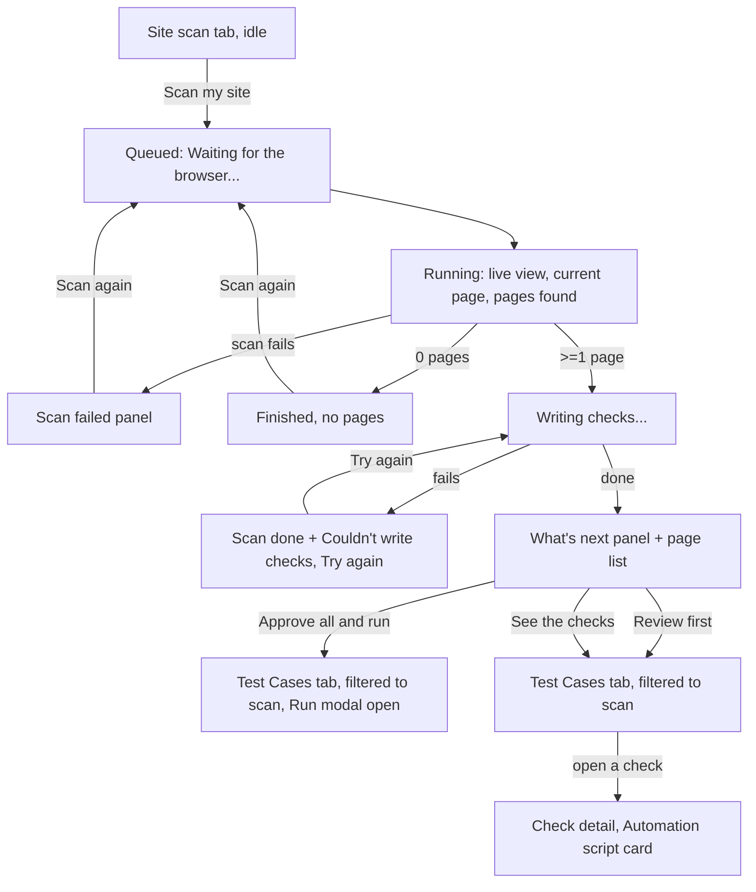

# SCAN-1: Watch the scan live and get checks automatically

## 1. Goal and user
Story: SCAN-1 (`docs/product/backlog.md`). The user is someone with little QA experience. They press "Scan my site", watch the browser work, and finish with checks that are ready to approve and run. They should never have to work out what to do next.

## 2. Flow

Ways out: the user can leave the tab at any point. When they come back, the tab shows whatever state the scan is in now (the latest scan is fetched, see `latest` in DiscoveryTab). Nothing depends on the tab staying open.

## 3. Layout
Everything goes in `web/src/components/project/DiscoveryTab.tsx`. The "Scan your site" form card stays at the top as it is. The status row (StatusPill, started/completed) stays. Below the status row there is one **stage area** that changes by state. Below that is the existing `AppMap` (page list), which still shows once any pages exist.

### 3a. Running: `ScanLiveView` (new, small, built on the LiveView pattern)
Do not copy `LiveView` (`web/src/components/run/LiveView.tsx`). Pull its body out into a shared `LiveFrame` (the frame `<figure>`, the "Waiting for the first frame..." placeholder and the polling of `/test-runs/:id/live`), then use it in both places. The scan already has `testRunId` on `Discovery`, so the frames come from the same endpoint. The scan uses one browser, so there is one frame and no "Worker N" caption.

```
+-- Card ---------------------------------------------------------------+
| (o) Watching your site live                        [StatusPill RUNNING]|
| This is the browser we're using to look around your site.             |
|-----------------------------------------------------------------------|
| +-------------------------------------+  Now visiting                 |
| |                                     |  Pricing                      |
| |        live frame (16:10, black)    |  https://acme.com/pricing     |
| |                                     |                               |
| |                                     |  Pages found                  |
| +-------------------------------------+  7 of up to 15                |
|                                          [=======-------] (progress)  |
|                                          Recently visited             |
|                                          - Home        /              |
|                                          - Sign in     /login         |
|                                          - Pricing     /pricing       |
+-----------------------------------------------------------------------+
```
- Grid `lg:grid-cols-[1fr_280px]`, the same as the PageCard detail. Below `lg` the side panel goes under the frame.
- "Now visiting" is the title (falling back to "(untitled page)") with the URL under it in `font-mono text-xs text-fg-muted`, truncated, with the full URL in `title`.
- Progress bar: `role="progressbar"` with `aria-valuenow={pages}` and `aria-valuemax={maxPages}`. Use the blue tone (it is a status, not a CTA, and orange is reserved for CTAs, see the StatusPill comment).
- "Recently visited" lists the last 5 pages from `d.pages`, newest first.
- While the scan is running, `AppMap` stays hidden. It shows a long list that keeps jumping, and its "Limitations" card makes no sense yet. Only the side panel list is shown.
- The live dot uses `Radio` with `animate-pulse motion-reduce:animate-none text-red-400`.

### 3b. Writing checks: `ScanStagePanel` (new, uses Card + Spinner)
```
+-- Card ---------------------------------------------------------------+
| (spinner) Writing checks for the pages we found...                     |
| We found 12 pages. Now writing step-by-step checks and the automated  |
| tests that go with them. This usually takes under a minute.           |
| [=========---------]  5 of 12 pages done                              |
+-----------------------------------------------------------------------+
```
If the API does not report per-page progress, leave out the bar and the "N of M" line, and keep the spinner and the text.

### 3c. What's next: `WhatsNextPanel` (new, uses Card, Button, LinkButton)
This card is the most prominent element on the page. Use `Card` with `className="border-accent/50"`. It sits directly under the status row and above `AppMap`. When the user lands on this state, focus moves to its heading (see section 6).
```
+-- Card (orange border) -----------------------------------------------+
| (check) Your checks are ready                                          |
| We wrote 8 checks for the 12 pages we found.                          |
|                                                                       |
|  [ 8 ]  step-by-step checks     (a person can follow them)            |
|  [ 6 ]  with an automated test  (we can run these for you)            |
|                                                                       |
|  1. Look them over. They're drafts until you approve them.            |
|  2. Approve them and we'll run the automated ones.                    |
|  3. To see the code of an automated test, open a check and scroll to  |
|     "Automation script".                                              |
|                                                                       |
| [Approve all and run]  [Review first]          See the checks ->      |
+-----------------------------------------------------------------------+
```
- The two numbers use the stat style (`text-2xl font-semibold text-fg-strong`), side by side, stacked on mobile.
- "Approve all and run" is `Button` primary (orange). "Review first" is `LinkButton` secondary. "See the checks ->" is a text `Link`, aligned right, and wraps under the buttons on small screens.
- When this panel shows, remove the old "Suggest checks for these pages ->" link from the status row. Its job is now done by the panel.

**Where the links go**
| Control | Destination / action |
|---|---|
| Approve all and run | Navigates to `/projects/:id?tab=test-cases&scan=<discoveryId>&run=1`. TestCasesTab reads `run=1` and calls the existing `approveAndRun(ids)` with the IDs of this scan's **draft** checks, which opens `NewRunModal` with them preselected. Then it removes `run=1` from the URL with `router.replace` so a refresh doesn't approve again. Approval happens only because the user clicked this button. |
| Review first | `/projects/:id?tab=test-cases&scan=<discoveryId>` |
| See the checks -> | Same as Review first |
| "Automation script" (step 3 text) | Not a link. It names the section on `/test-cases/:id` (`ScriptPanel`, title "Automation script"). |

**Test Cases tab with `?scan=`**: show a filter chip above the table: "From the scan on {date} · {n} checks" with a "Show all" ghost button that removes the param. This is a filter like the existing ones, and `filtersActive` should include it.

## 4. States
| State | Condition | What the user sees | Copy |
|---|---|---|---|
| First run | no scan yet | Form card + EmptyState (`Radar` icon) | Title "No scans yet". Body "Scan your site and we'll write checks for every page we find." |
| Starting | POST in flight | "Scan my site" button `loading` | (button) "Scan my site" |
| Queued | `QUEUED` | ScanLiveView with placeholder frame, side panel shows 0 pages | Frame: "Waiting for the browser..." Side: "Getting ready to open your site." |
| Running, no frame yet | `RUNNING`, no slot or `hasFrame=false`, or `/live` errors | Same placeholder, side panel updates normally. Never an error. | "Waiting for the browser..." |
| Running, live | `RUNNING` + frame | Live frame, now visiting, count, recent list | see 3a |
| Scan failed | `FAILED` | Card with InlineError tone, "Scan again" button that resubmits the form with the same values. Shows `AppMap` if there are partial pages. | Title "The scan stopped early". Body "{summary or: We couldn't finish looking around your site.} Check that the address works in your browser, then try again." Button "Scan again" |
| Cancelled (if supported) | `CANCELLED` | Same card, grey | Title "Scan cancelled". Body "We kept the {n} pages found so far." Button "Scan again" |
| Finished, 0 pages | `COMPLETED`, 0 pages | Card, no generation | Title "We couldn't find any pages". Body "Your site may need a sign-in first, or the address may be wrong. Add a test login in Sites & logins, then scan again." Buttons "Scan again" (primary), LinkButton "Sites & logins" -> `?tab=environments` |
| Writing checks | `COMPLETED` + generation pending/running | ScanStagePanel, AppMap below | see 3b |
| Generation failed | `COMPLETED` + generation failed | StatusPill stays COMPLETED. Amber-bordered card with `role="alert"`. AppMap below. | Title "Your scan worked, but we couldn't write the checks". Body "{reason, plain}. Your pages are saved below." Button "Try again" (primary, `loading` while it runs) |
| Done | generation done, created >= 1 | WhatsNextPanel | see 3c and Copy |
| Done, some without automation | withScript < total | Same panel. The second number is smaller. | Extra line: "{n} checks need a person to follow them. We can't automate them yet." |
| Done, none automated | withScript = 0 | Same panel. Primary button changes to "Approve all" (nothing to run). | "None of these can be automated yet. A person can follow the steps." |
| Done, all duplicates | created 0, skipped >= 1 | Panel without the counts | Title "No new checks needed". Body "You already have checks for all {n} pages we found." Buttons: "See the checks" (secondary, unfiltered) |
| Done, some duplicates | skipped >= 1 | Extra muted line in the panel | "{skipped} pages already had checks, so we skipped them." |
| Already approved | the scan's checks are no longer drafts | "Approve all and run" becomes "Run these checks" (approve step not needed) | "Run these checks" |
| Load error | GET fails | Existing `ErrorState` with retry | (existing) |
| Offline | fetch fails during polling | Keep the last known state, add a muted line under the status row. Polling resumes on its own. | "Lost connection. We'll update this when you're back online." |

The live indicator (red dot, "Watching your site live") must only render while the status is QUEUED or RUNNING. It is removed on the same render that shows any final state.

## 5. Copy (new or changed strings)
- Live card title: "Watching your site live"
- Live card description: "This is the browser we're using to look around your site."
- "Waiting for the browser..." / "Getting ready to open your site."
- "Now visiting" / "Pages found" / "{n} of up to {max}" / "Recently visited"
- Status row while running (replaces "pages so far — refreshing every 2s"): "{n} pages found so far"
- "Writing checks for the pages we found..."
- "We found {pages} pages. Now writing step-by-step checks and the automated tests that go with them. This usually takes under a minute."
- "{done} of {total} pages done"
- "Your scan worked, but we couldn't write the checks" / "Your pages are saved below." / "Try again"
- What's next title: "Your checks are ready"
- "We wrote {n} checks for the {pages} pages we found."
- "step-by-step checks" / "a person can follow them"
- "with an automated test" / "we can run these for you"
- Steps: "Look them over. They're drafts until you approve them." / "Approve them and we'll run the automated ones." / "To see the code of an automated test, open a check and scroll to "Automation script"."
- Buttons: "Approve all and run", "Review first", "See the checks", "Approve all", "Run these checks", "Scan again"
- Toast after Approve all and run: "{n} checks approved" (existing)
- Test Cases chip: "From the scan on {date} · {n} checks" / "Show all"
- Empty state: "No scans yet" / "Scan your site and we'll write checks for every page we find."
- Jargon clean-up in the same file (needed by AC3): the Limitations card description "Discovery is a best-effort crawl..." becomes "The scan follows the links it can reach. It can miss pages behind a sign-in, a search box or a form." "Candidate workflows" becomes "Journeys we spotted". The fallback "Discovery failed." becomes "The scan stopped early."
- Use singular and plural correctly everywhere ("1 check", "1 page").

## 6. Accessibility
- **Live frame**: the `img` has alt "Live view of the browser scanning {site name}". The frame is not interactive and gets no tab stop. The placeholder text is visible, not just an icon.
- **Announcements**: add one visually hidden `aria-live="polite"` region per tab that announces **only changes of state**, not every 2-second poll: "Scan started", "Scan finished. {n} pages found.", "Writing checks", "{n} checks ready", "Couldn't write the checks". The page count in the side panel is not in a live region (it would be noisy). Failures go through `role="alert"` on the card.
- **Focus**: when the state becomes Done, Generation failed or Scan failed, and the user started the scan in this session, move focus to that card's heading (`tabIndex={-1}`, `h2`). Do not steal focus on first page load. Tab order inside What's next: Approve all and run, Review first, See the checks.
- **Buttons/targets**: use the `md` size (h-9 = 36px). Pad the hit area to at least 44px with `min-h-11` on the panel's buttons, because this is the main CTA and also used on touch screens. The text link gets `py-2`.
- **Progress bars**: `role="progressbar"` with `aria-label="Pages found"` / `"Checks written"` and `aria-valuetext="7 of up to 15"`.
- **Contrast**: orange CTA text uses the existing `text-on-accent` pair. The muted text (`text-fg-muted`) on `bg-surface` is already used everywhere. Don't use `text-fg-subtle` for any copy in these panels. Status colour is always paired with text (StatusPill label), never colour alone.
- **Motion**: pulse and spinner get `motion-reduce:animate-none`. The live frame is content and stays on.
- **Text scaling**: the side panel stacks below `lg`, and long URLs truncate with the full value in `title` and in the accessible name.

## 7. Design acceptance criteria
1. Given a scan was just started, when the status is QUEUED, then the Site scan tab shows "Watching your site live" with "Waiting for the browser..." and no error.
2. Given the scan is RUNNING and frames are available, then a live frame updates, "Now visiting" shows the current page title and URL, and "Pages found" goes up with no page reload.
3. Given the live endpoint fails or has no frame, then "Waiting for the browser..." shows and the page count still updates.
4. Given the scan reaches COMPLETED, FAILED or CANCELLED, then the live card and red dot are gone on that same render.
5. Given the scan completes with pages, when generation is running, then "Writing checks for the pages we found..." is shown and the status pill reads Completed.
6. Given generation fails, then the pill still reads Completed, the "Your scan worked, but we couldn't write the checks" card shows, and "Try again" shows a loading state, then reaches "Your checks are ready" on success.
7. Given generation finishes, then "Your checks are ready" shows the correct total and automated count, the 3 numbered steps, and the buttons "Approve all and run", "Review first" and "See the checks".
8. Given the user clicks "Review first" or "See the checks", then the Test Cases tab opens showing only this scan's checks, with the chip "From the scan on ...", and "Show all" removes the filter.
9. Given the user clicks "Approve all and run", then this scan's drafts become approved, the run dialog opens with exactly those checks selected, and refreshing the page does not approve again.
10. Given the user opens one of the automated checks, then its page shows an "Automation script" card containing code.
11. Given the same scan is run again on unchanged pages, then the panel shows "No new checks needed" and the Test Cases count does not change.
12. Given a screen reader, when the state changes, then exactly one polite announcement is made per state change (none for each poll).
13. Given reduced motion is on, then the dot and spinner do not animate.
14. No string on the Site scan tab contains "discovery", "crawl", "heuristic", "spec" or "workflow".

## 8. Open questions (each changes behaviour)
1. **Scripts on drafts.** The detail page only allows scripts for approved or ready cases ("Approve the test case first"). AC2 wants a script for every automatable case, created automatically, while the cases stay drafts. **Recommend:** the system may attach scripts to drafts. Only *running* requires approval. Change the ScriptPanel note for drafts to "Approve this check to run its automated test." and keep "Regenerate" enabled.
2. **Cancel.** AC1 mentions "cancelled", but there is no cancel status or button for scans. **Recommend:** no cancel button in SCAN-1. Handle `CANCELLED` if the API ever returns it.
3. **"Approve all and run" scope.** **Recommend:** only this scan's checks that are still drafts and were created by this scan. Never older checks. The run then covers only the ones with an automated test. The run dialog already explains manual ones, so confirm it does.
4. **API shape the UI needs.** On `GET /discovery/:id`: `generation: { status: "PENDING"|"RUNNING"|"DONE"|"FAILED", total, withScript, skippedDuplicates, done?, error? }`. Also `scanId` filtering on `GET /projects/:id/test-cases`. **Recommend:** the developer adds these. The UI keeps polling every 2 s while generation is PENDING or RUNNING.
